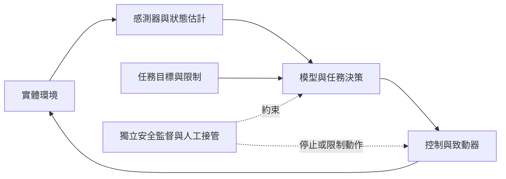
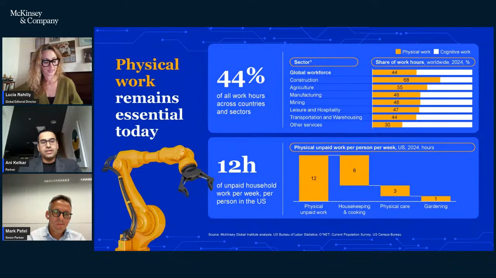
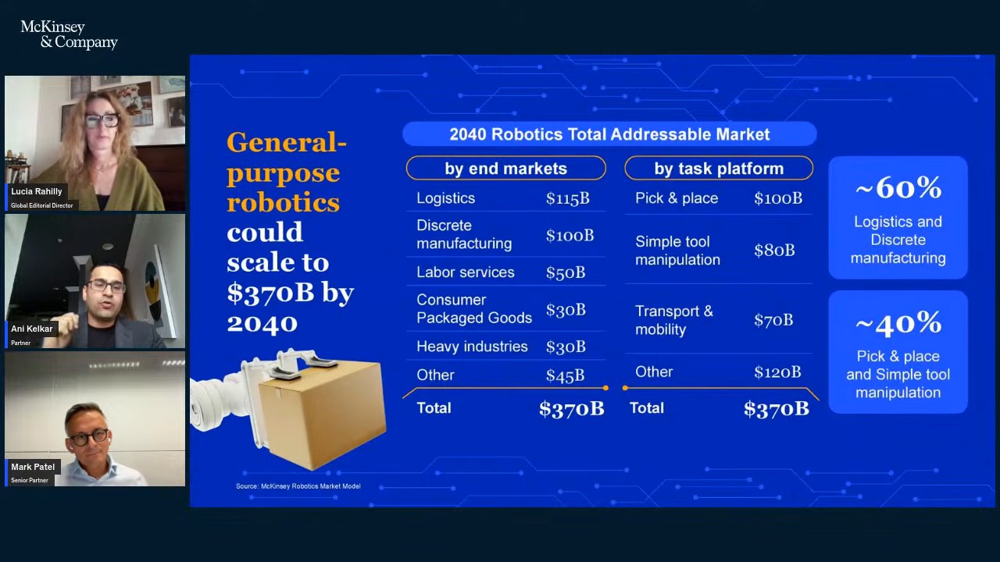
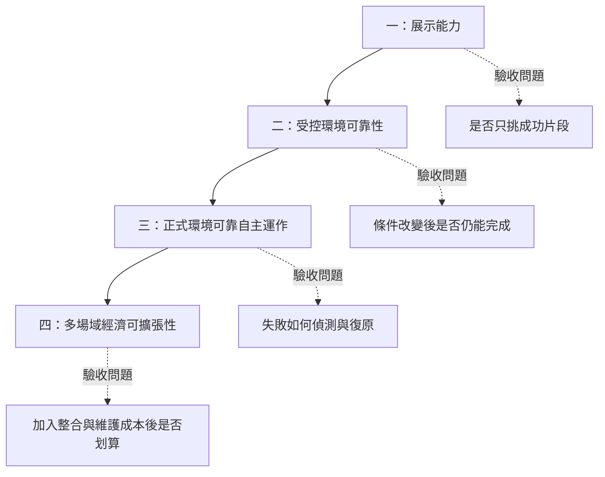
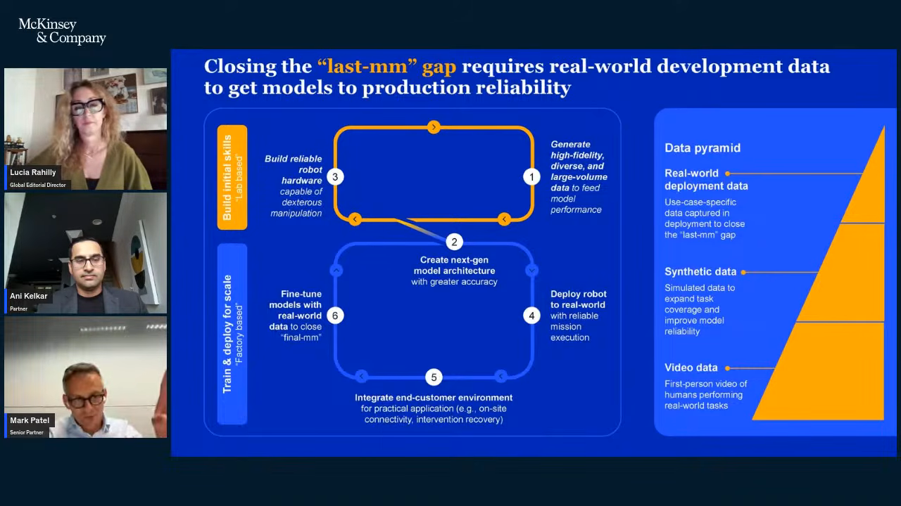
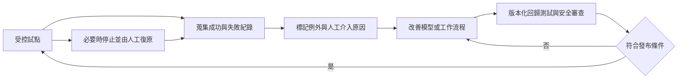
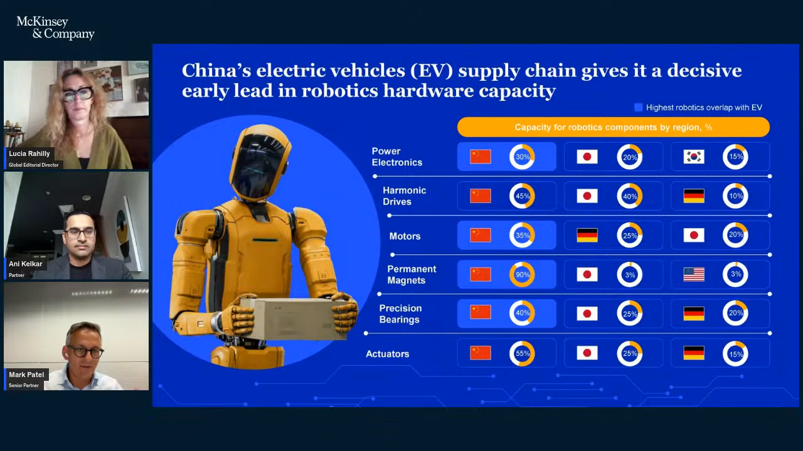
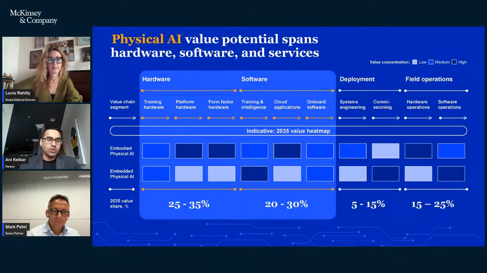

## TL;DR

- Physical AI 讓系統依實際環境感知、決策與行動；人形機器人只是其中一種外形。
- 企業要評估的是任務成果、可靠性與總成本，不是展示影片有多精彩。
- 價值涵蓋硬體、模型、系統整合、機隊調度、部署資料與維護；品質和產出量也要納入。
- 下一步：挑一個具體任務，先量測人工或既有自動化基準，再訂試點的成果與停止條件。
- 影片中的市場數字都是估計；3,300 億美元的預測年份在來源間不一致，不能當成精確承諾。

## 摘要（Summary）

這場 McKinsey Live 對談從企業經營角度討論實體人工智慧（Physical AI）。Mark Patel 與 Ani Kelkar 認為，領導者容易被機器人外形吸引，忽略讓設備長期可靠運作的資料、整合與營運能力。本文依英文自動字幕整理主張與例子，再加入獨立的試點設計、風險分析與圖解；不是逐字翻譯，也不是已驗證的投資報告。

> [!info] 來源與查核範圍
> YouTube 發布日期為 2026-09-10，不等同錄影日期。已取得整條 `en-orig` 自動字幕，共 758 段非空文字，從 00:00 延伸到最後一句約 30:28；片長為 30:57。人名以官方網頁校正，字幕未逐字人工聽打。原始章節標記與字幕內容錯位，甚至包含超過片長的 32:21；下文時間點依字幕重建。

畫面查核採每分鐘抽樣，再擷取五張重要投影片，以 720p 畫面核對圖表文字。這不是全片逐格檢查；圖片均出自原影片，圖表數值是來源主張，未另行重現其研究。抽取片段可能包含前一個關鍵影格，圖片旁時間為擷取定位點，回看時可前後移動數秒。

## 關鍵洞察（Key Insights）

- **能力與外形分開判斷**：相同感知與決策能力，可以出現在移動設備、建築系統或工業設備，不必先選人形。
- **可泛化仍有邊界**：可處理較多變化，不代表什麼任務都能做；每個場域仍需驗收。
- **部署本身也是學習來源**：異常與人工介入紀錄，才會暴露模擬環境遺漏的情境。
- **工作流程決定收益**：設備完成局部動作，未必改善整條流程。可對照 [[2026-05-25-HUMAN-SOP-TO-AGENTIC-WORKFLOW-PROMPT-TOOLKIT|任務拆解與流程責任]]，但軟體代理人的經驗不能直接當成機器人安全證據。

## 詳細內容（Details）

### 一、用感知、決策、行動理解 Physical AI

[02:45–05:38](https://www.youtube.com/watch?v=KnlxZnt6GkM&t=165s) 的定義重點是：系統從執行預設動作，走向根據現場狀態選擇行動。生成式 AI 常產出文字、程式或影像；Physical AI 的結果會改變實體環境，因此設備限制與失敗後果不能留到模型完成後才處理。

下圖為筆記者依講者概念繪製的簡化架構。安全監督是本文補上的設計考量，不是影片提供的實作規格。

### 二、數字的用途與不可混算之處

以下是講者或主持人的估計，不是本文重現的研究結果。美元金額不代表同一年度、同一市場口徑，也不是公司的營收保證。

| 數字 | 出處與含義 | 閱讀限制 |
|---|---|---|
| 2045 年約 2% | [01:00](https://www.youtube.com/watch?v=KnlxZnt6GkM&t=60s)：主持人描述人形機器人在 Physical AI 部門價值中的比重 | 影片未展開分母與估計模型，不能換算成出貨量占比 |
| 全球有薪工時的 44% | [06:12](https://www.youtube.com/watch?v=KnlxZnt6GkM&t=372s)：與實體工作相關 | 不是 44% 工作將消失，也不是立即可自動化比例 |
| 約 2,000 項任務 | [15:22](https://www.youtube.com/watch?v=KnlxZnt6GkM&t=922s)：研究拆解實體工作，再對應感知與動作能力 | 講座未附完整任務資料集 |
| 2040 年 3,700 億美元 | [15:50](https://www.youtube.com/watch?v=KnlxZnt6GkM&t=950s)：通用型機器人的潛在市場 | 同段把小於 10 億美元的基準稱為 2025 年；不能因上傳在 2026 年就改寫基準年 |
| 約十年後 3,300 億美元 | [27:41](https://www.youtube.com/watch?v=KnlxZnt6GkM&t=1661s)：Physical AI 軟體與模型層 | 口述沒有指定西元年份；影片說明寫 2035，官方網頁摘要寫 2036 |

> [!warning] 保留來源差異
> 3,300 億美元的年份差異依[官方回顧](https://www.mckinsey.com/featured-insights/mckinsey-live/webinars/physical-ai-the-hidden-value-pools-leaders-are-missing)與影片說明核對後仍存在，本文不擅自選一個「正確年份」。06:59–07:32 另有約 40%、13%、6,000 萬及 2,000 萬全職工作等值的口述，但地理範圍與分母未完整交代，故不拿它們和全球 44% 相乘或推算就業損失。

#### 投影片補充：產業與市場分布

[約 06:10 的投影片](https://www.youtube.com/watch?v=KnlxZnt6GkM&t=370s) 補上口述沒有交代的 **2024 年**基準。實體工作工時占比分別為：全球 44%、營建 68%、農業 55%、製造 48%、礦業 48%、休閒與餐旅 47%、運輸與倉儲 44%、其他服務 30%。這些是各產業內占比，不可跨列加總。美國每人每週無薪實體工作 12 小時，圖中拆為家務與烹飪 8 小時、照護 3 小時、園藝 1 小時。圖下注明 McKinsey Global Institute、BLS、O*NET 與人口調查等來源，但沒有可直接重算的資料表。

[約 15:30 的投影片](https://www.youtube.com/watch?v=KnlxZnt6GkM&t=930s) 提供兩種切法，**各自**加總為 3,700 億美元，不能把兩欄再加一次。

| 產業分類 | 億美元 | 任務平台分類 | 億美元 |
|---|---:|---|---:|
| 物流 | 1,150 | 抓取與放置 | 1,000 |
| 離散製造 | 1,000 | 簡單工具操作 | 800 |
| 勞務服務 | 500 | 運輸與移動 | 700 |
| 民生消費包裝商品 | 300 | 其他 | 1,200 |
| 重工業 | 300 | — | — |
| 其他 | 450 | — | — |
| 合計 | 3,700 | 合計 | 3,700 |

> [!warning] 圖表內部也有不一致
> 物流與離散製造合計約 58.1%，與圖中「約 60%」相容；但抓取放置加簡單工具操作為 1,800／3,700，約 **48.6%**，圖右卻寫「約 40%」。本文保留原圖並標出計算差異，不把 40% 當成已核實結果。

### 三、影片例子地圖：說明能力，不等於交付證據

以下涵蓋字幕中的主要應用、類比與供應鏈例子；多數是說明性情境，沒有附客戶名稱、測試條件或投資報酬結果。

| 回看時間 | 例子 | 說明什麼 |
|---|---|---|
| [03:58](https://www.youtube.com/watch?v=KnlxZnt6GkM&t=238s) | 生成式 AI 從聊天延伸到程式、影像、工程設計與藥物探索 | 底層能力可以長出多種應用，不能把它等同單一產品 |
| [05:03](https://www.youtube.com/watch?v=KnlxZnt6GkM&t=303s) | 自駕車、工業設備、倉庫、無人機、醫療系統 | Physical AI 的載體不只人形機器人 |
| [06:28](https://www.youtube.com/watch?v=KnlxZnt6GkM&t=388s) | 美國日常清潔與家務；講者提到每週約 12 小時 | 有薪工時不是所有實體活動；數字的原始調查未提供 |
| [08:58](https://www.youtube.com/watch?v=KnlxZnt6GkM&t=538s) | 倉庫移動機器人兼做搬運與安全巡檢 | 同一硬體可以承接多種任務 |
| [09:11](https://www.youtube.com/watch?v=KnlxZnt6GkM&t=551s) | 建築的暖通、照明與影音體驗 | 部分有價值的自動化不會長得像機器人 |
| [09:51](https://www.youtube.com/watch?v=KnlxZnt6GkM&t=591s) | 堆高機、曳引機、工業檢查設備與機械手臂 | 講者看好的近期應用集中在移動與專用設備 |
| [11:12](https://www.youtube.com/watch?v=KnlxZnt6GkM&t=672s) | 人形機器人運動會的精彩表現與失誤 | 可激發想像，但不足以證明長期可靠性 |
| [12:03](https://www.youtube.com/watch?v=KnlxZnt6GkM&t=723s) | 零件位置、方向已知時，機器人反覆走同一軌跡 | 傳統自動化的強項；不代表所有情境都需要新 AI |
| [12:59](https://www.youtube.com/watch?v=KnlxZnt6GkM&t=779s) | 杯子比預期重就改變握法；有人擋路就改方向 | 感測回饋與適應能力的日常類比 |
| [13:19](https://www.youtube.com/watch?v=KnlxZnt6GkM&t=799s) | 不規則物件、人群導航、工地巡檢、玩具與模型的不同處理 | 環境與物件差異會影響動作選擇 |
| [23:44](https://www.youtube.com/watch?v=KnlxZnt6GkM&t=1424s) | 電動車的磁鐵、軸承、馬達、控制器與電力系統 | 既有製造與供應鏈能力可能移轉，但不保證直接相容 |
| [26:42](https://www.youtube.com/watch?v=KnlxZnt6GkM&t=1602s) | 生成式 AI 調查中，投入部署與獲利改善的落差 | 用來提醒「已導入」不等於「有成果」；不是 Physical AI 的實測獲利率 |

### 四、從展示到可擴張營運的四階段

[17:45–21:54](https://www.youtube.com/watch?v=KnlxZnt6GkM&t=1065s) 是本片最有實務價值的一段。可靠自主運作不要求每次動作完全相同，而要求在變動情境下仍能提供可信賴的結果。

圖中的四階段來自講者；下方驗收問題為本文補充，並非 McKinsey 規定的認證流程。

講者把通往生產級可靠性的難處稱為「最後一毫米」（last millimeter）。這裡是部署成熟度的比喻，**不是已測得的定位精度**。模擬與合成資料可以加快開發，但現場例外仍需透過部署辨識。[19:48](https://www.youtube.com/watch?v=KnlxZnt6GkM&t=1188s)

### 五、部署資料如何變成可持續改善

[約 20:10 的投影片](https://www.youtube.com/watch?v=KnlxZnt6GkM&t=1210s) 將開發拆成兩個循環：初始能力的資料、模型、硬體迭代，以及部署、客戶環境整合、真實資料微調。右側金字塔依序列出人類操作影像、合成資料、現場部署資料。圖形沒有數值尺度，不能解讀成訓練資料的固定配比；現場連線、人工介入與復原是下方循環的明確工作，不是附帶事項。

下圖把影片的部署學習循環，延伸成本文建議的工程工作流。加入版本化測試、安全審查及人工復原；**不建議讓現場系統未經驗證就自動改模型、直接上線**。

這與 [[2023-10-15-OBSERVABILITY-DRIVEN-DEVELOPMENT|可觀測性驅動開發]] 的共同點，是把營運證據送回設計；不同之處是實體系統還涉及人員、設備與物理環境，不能只驗證程式輸出。

### 六、價值在哪裡，領導者該選什麼角色

[22:33–28:03](https://www.youtube.com/watch?v=KnlxZnt6GkM&t=1353s) 將視野拉到整個系統：感測、致動、能源、運算與連線會影響模型能做什麼；模擬、機隊調度、系統整合、資料與維護則影響它能否持續產生收益。講者提到中國電動車製造基礎可能帶來優勢，這是供應鏈判斷，不是已確定的市場勝負。

[28:18](https://www.youtube.com/watch?v=KnlxZnt6GkM&t=1698s) 的三項管理建議可整理為：先理解任務，再備妥人才與資料基礎，最後選擇自己是技術提供者、部署服務者，或採用技術改善業務的企業。

[約 24:00 的投影片](https://www.youtube.com/watch?v=KnlxZnt6GkM&t=1440s) 比口述更具體。下表轉錄其「機器人零組件產能地區占比」，只列圖中的三個地區；未列出部分不代表零，圖內也未交代統計年度或完整方法。

| 零組件 | 圖中地區占比 |
|---|---|
| 電力電子 | 中國 30%、日本 20%、南韓 15% |
| 諧波減速器 | 中國 45%、日本 40%、德國 10% |
| 馬達 | 中國 35%、德國 25%、日本 20% |
| 永久磁鐵 | 中國 90%、日本 3%、美國 3% |
| 精密軸承 | 中國 40%、日本 25%、德國 20% |
| 致動器 | 中國 55%、日本 25%、德國 15% |

[約 26:30 的投影片](https://www.youtube.com/watch?v=KnlxZnt6GkM&t=1590s) 標示為「示意性的 2035 年價值熱圖」，列出硬體 25–35%、軟體 20–30%、部署 5–15%、現場營運 15–25%。範圍不是可任選端點拼成 100% 的分配表，也不是毛利率。熱圖還區分具機器人載體（embodied）與嵌入設備／環境（embedded）的兩列，顯示不同型態的價值集中位置可能不同；影片沒有給出足以重算色階的量化方法。

## 我的心得（My Takeaways）

以下為筆記者的延伸分析，未在使用者場域實測。

我會先問「哪個成果最昂貴、最不穩定」，而不是先問要買哪種機器人。若問題其實是動線混亂或零件擺放不一致，改善環境或使用既有自動化，可能比訓練更強模型便宜。這也是本文和 [[2026-04-20-AI-REVOLUTION-STARTS-FROM-BOSS-CHIEN-LI-FENG-MEGA-TALK|從管理者與資料基礎開始的 AI 轉型]] 可以對照之處。

### 自編試點卡：倉庫搬運兼巡檢

這是把影片例子轉成可討論的計畫，**不是講者提供的成功案例，也不是安全認證指南**。任何實體測試仍須經場域負責人與安全專業人員確認。

| 決策項目 | 需要先寫下的內容 |
|---|---|
| 任務邊界 | 哪些物件、路線與時段可運作；哪些情境必須交回人工 |
| 比較基準 | 人工、既有自動化、改善動線三種做法的完成量與成本 |
| 品質與效率 | 合格任務數／小時、誤搬率、巡檢漏報；指標分開記錄 |
| 可靠性 | 人工介入次數、停機原因、復原時間；不能把接管後完成算成全自主成功 |
| 成本範圍 | 設備折舊、整合、能源、監督、維修、停機與資料管理 |
| 擴張判準 | 第二個場域還需多少客製工作；收益是否足以承擔新增成本 |
| 停止條件 | 碰觸預先核准的安全界線、無法復原或證據不足時停止，不以產量抵銷安全要求 |

比較總成本時，可使用「試點期間全部相關成本 ÷ 同期間合格完成任務數」。分母為零時不能計算；這只幫助經濟比較，不能取代獨立的安全驗收。

## 待補充（Open Questions）

- 人形機器人「2045 年 2%」的價值分母、情境假設與原始模型在哪裡？搜尋：`McKinsey physical AI humanoid 2 percent 2045 methodology`。
- 3,300 億美元究竟採 2035 或 2036？與通用型機器人 3,700 億美元估計有多少重疊？搜尋：`McKinsey physical AI software models 330 billion forecast`。
- 2,000 項任務研究如何評估能力、成本與安全門檻？有無公開資料集和敏感度分析？搜尋：`McKinsey general purpose robotics 2000 tasks 2040`。
- 從第一場域到第二場域，部署成本、人工介入率與回收期實際如何變化？搜尋：`physical AI multi site deployment intervention rate case study`。
- 場域業者、模型供應商與設備商如何分配例外資料的使用權和改良收益？搜尋：`robotics deployment data rights contracts`。
- 誰負責批准模型更新、保留安全證據及定義失敗責任？搜尋：`adaptive robotics model update safety assurance responsibility`。

## 相關連結（Related）

- [[2026-04-20-AI-REVOLUTION-STARTS-FROM-BOSS-CHIEN-LI-FENG-MEGA-TALK]] — 對照管理者、資料基礎與組織改造的責任。
- [[2026-05-25-HUMAN-SOP-TO-AGENTIC-WORKFLOW-PROMPT-TOOLKIT]] — 對照任務拆解、人工介入與流程擁有者；不把軟體工作流直接套成機器人控制規格。
- [[2023-10-15-OBSERVABILITY-DRIVEN-DEVELOPMENT]] — 把部署觀察接回設計，支援本文的例外資料與驗收思路。

## 知識層次分析（Bloom's Taxonomy Analysis）

| 認知層次 | 核心目的 | 對本文的具體應用 |
|---|---|---|
| 記憶 | 掌握基本概念 | 感知—決策—行動、四階段落地、任務成本、部署學習、機隊調度 |
| 理解 | 說明關聯 | 外形決定不了商業價值；同一設備可因流程與場域差異得到不同成果 |
| 分析 | 拆解前提 | 市場預測與個別試點經濟性不同；更多資料是否改善可靠性，要看品質、標記與測試 |
| 應用 | 設計可執行行動 | 填一張試點卡；建一份例外與接管紀錄；先量測既有做法 |
| 評估 | 比較取捨 | 比較改善流程、傳統自動化、專用設備與通用機器人的成本及失敗後果 |

### 分析型追問（Socratic Follow-up）

- **澄清**：「可靠」是平均成功率，還是每一種高風險情境都有可接受的處理方式？
- **假設**：若不同客戶不允許共用部署資料，學習循環能擴張到什麼程度？
- **證據**：若移除人工介入，展示的完成率還剩多少？
- **觀點**：既有自動化供應商會如何證明專用設備更划算？
- **後果**：模型進步後，舊的安全假設與驗收證據是否仍有效？

### 方案批判三問（Critical Evaluation）

1. **最容易失敗在哪裡？** 把單次成功當成可維運能力，漏算整合、接管與維修成本。
2. **何時不該採用？** 任務已可用低成本固定流程完成，或場域尚無安全監督與復原能力時。
3. **替代方案是什麼？** 先整理環境、改善治具或動線，再比較專用自動化；不預設 AI 是唯一答案。

## 六頂思考帽回饋（Six Thinking Hats Feedback）

### 藍帽：問題與範圍

本輪討論的是「企業如何選擇 Physical AI 試點」，不是替任何機器人產品背書。輸出應是任務邊界、驗收方法與決策責任。

### 白帽：事實與未知資訊

已核對字幕、時間點、作者、官方回顧與五張重要投影片；估計值的完整方法、跨場域成果及安全驗收資料仍缺。保留 2035／2036 的年份差異，以及市場表格 48.6% 與圖示約 40% 的不一致。

### 紅帽：直覺與讀者反應

人形機器人的畫面容易引起期待或工作被取代的焦慮。這些感受值得討論，但不能當成採購依據或裁員預測。

### 黃帽：價值與可保留內容

最值得保留的是四階段落地觀念，以及把品質、產出量、資料與維護納入價值評估的做法。它讓非機器人製造商也能找到參與位置。

### 黑帽：風險與限制

市場規模大不代表特定試點划算；模擬成功不保證現場可靠；部署資料也可能帶來隱私、權利歸屬與維護負擔。不要把普通運作紀錄當成充分安全證據。

### 綠帽：替代方案與新應用

先做「只觀察、不致動」的資料蒐集或人工決策輔助，找出真正的例外分布；也可先出售巡檢、維護與整合服務，再評估是否需要自建機器人。

### 藍帽：修改項目與下一步

- 本文已把預測數字集中並標出年份差異，避免不同口徑相加。
- 已將講者例子、本文圖解與自編試點卡分開，避免把建議寫成既有成效。
- 下一步以一個任務補齊基準、成本、接管與停止條件；資料不足就維持探索，不宣布可規模部署。

## References

- [原始影片：Physical AI: The hidden value pools leaders are missing](https://www.youtube.com/watch?v=KnlxZnt6GkM)，McKinsey & Company，YouTube 發布於 2026-09-10；本文主要來源為英文自動字幕。
- [McKinsey 官方回顧及刪節文字稿](https://www.mckinsey.com/featured-insights/mckinsey-live/webinars/physical-ai-the-hidden-value-pools-leaders-are-missing)，用於核對人名與預測年份差異；網頁已說明文字稿經編輯，不視為完整逐字稿。
