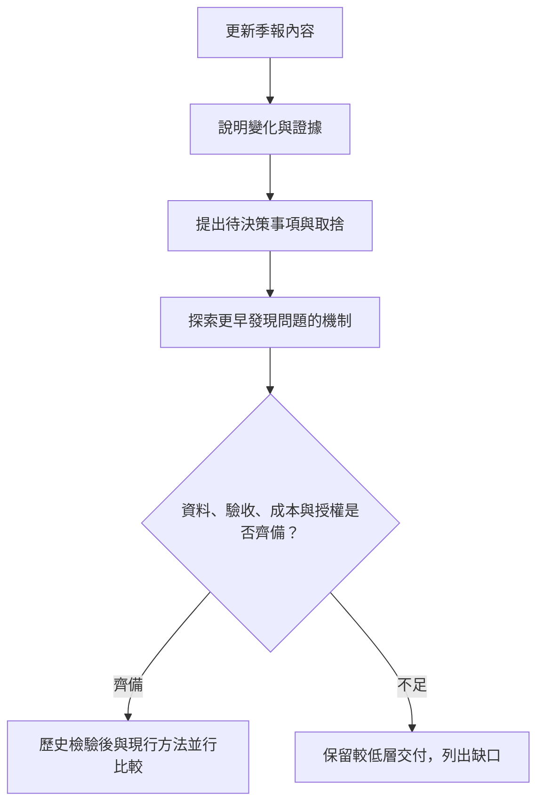
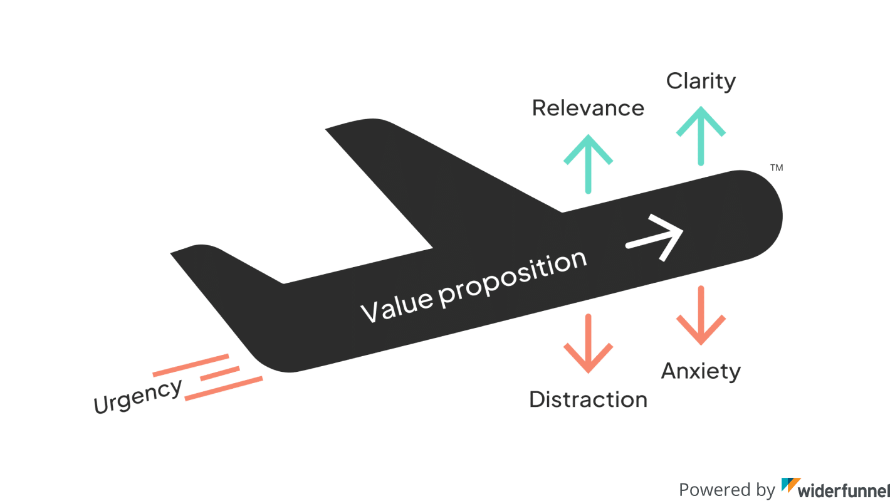
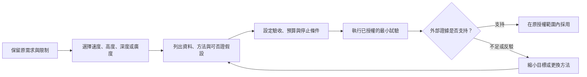

## TL;DR

- Felix 把 AI 任務的改善分成速度（Speed）、高度（Altitude）、深度（Depth）與廣度（Range）。先確認真正要改變的成果，再選適合的方向。
- Gary Chen 用季報與首頁文案解說原文；原文另有較完整的工具環境、原始資料、假設挑戰、未見資料與外部驗證要求。
- 「要求頂尖專家品質」要落到專家的資料、方法與驗收；角色扮演、更多 agent 或更強硬的語氣都不能代替這些條件。
- 本篇提供讀者練習、通用任務卡，以及 [raise-ai-ceiling skill](../skills/raise-ai-ceiling/SKILL.md)。這是研究者整理的衍生方法，非 Felix 或 Gary 發布的官方 skill。
- 可以提高挑戰目標，但須保留權限、成本與可否證性。目標設定的人類研究沒有直接證明這套 prompt 或 skill 能提升 LLM 成效；本次未做效益實驗。

## 摘要（Summary）

這篇將 Gary Chen 的〈想把 AI 用得好，你得再瘋一點〉與其介紹的 Felix Rieseberg 原文合併，回答一個實際問題：**當 AI 已能替我完成小任務，我該如何找出更有價值的問題，並知道它真的做得更好？**

原文提供思考方向；影片讓它貼近日常工作；本文再整理成可交接的方法、與既有 V-model 的對照，以及可攜帶的 skill。閱讀時可先看第 2 節比較，再從第 6 節選一個真實任務練習。

## 來源歸屬與驗證範圍

| 內容 | 歸屬與取得方式 | 證據界線 |
| --- | --- | --- |
| 四方向、季報案例、App 當機、專業深度與跨領域方法 | Felix 原文，2026-10-13；以瀏覽器讀取並保存頁面 | 作者的經驗與方法主張，不是受控效益研究；作者自述在 Anthropic 工作，不代表公司產品承諾 |
| 首頁文案、LIFT、五秒測試、影片中的 Claude 回答 | Gary Chen，2026-11-07，13:34 | 講者的解說與自述；沒有把他的示範當成本機實測 |
| 全片文字來源 | `youtube-transcript-api`，392 段 `zh-TW`，末段至 13:33.049 | API 標記非自動生成；仍未逐句聽音人工校對，不等於人工核實逐字稿 |
| 目標設定的研究限制 | Locke、Latham，2002 年綜述，原文直接引用的 PDF | 研究對象與論證是人類工作／動機，不直接證明 LLM 的能力會因激勵語句提高 |
| LIFT、五秒測試的用途 | Chris Goward 本人文章、Lyssna 官方說明 | 核對方法用途；沒有重做其案例、測試平台或網站實驗 |
| 任務卡、V-model 對照、skill 與停止條件 | Codex 依上述來源設計 | 研究者補充；文件與語法檢查不等於工作流或 skill 成效驗證 |

本篇主日期依原文發布日；影片較晚發布的日期另外保留。影片說明欄連到 Gary 的 Skool 社群，片尾提及會員文章及提示詞。本次未取得會員內容，因此沒有把自編 skill 寫成他的原版提示詞。

## 關鍵洞察（Key Insights）

1. **把能力上限拆成能改善的條件。** 本文的分析是：結果會受到目標、資料、工具、方法、驗證及時間共同影響。把所有失敗歸因於使用者野心不足，會漏掉實際環境限制。
2. **高度與深度可以分開選。** 有時交付物已固定，改進專業方法就有價值；有時真正問題是交付了文件，卻沒有支援任何決策。
3. **人也要得到新理解。** 要求 AI 說明採用方法、反證與未知處，讓讀者學會如何判斷；只收到更長的答案，不能代表認知提高。
4. **AI 要得到能行動與受檢查的環境。** 原始資料、版本、測試與外部回饋比「你是頂尖專家」更具體。與 [[2026-10-26-GENERAL-CODE-REVIEW-WORKFLOWS-CODEX-CLAUDE-CODE|通用 review 研究]]相同，換 reviewer 仍需合適的輸入與證據。

## 詳細內容（Details）

### 1. 四個方向分別改善什麼？

以下定義依 [Felix 原文][felix]整理；「操作問題與產物」是本文的應用設計。

| 方向 | 原文重點 | 操作問題與產物 |
| --- | --- | --- |
| 速度（Speed） | 同一件事更快完成，原文簡略帶過 | 比較完整交付時間，包括檢查與返工，品質標準相同 |
| 高度（Altitude） | 提高抽象層級，把焦點移向任務背後的成果 | 這份交付物要幫誰做什麼決定？產出成果、限制與驗收的對照 |
| 深度（Depth） | 接觸專家使用的原始材料、工具與問題 | 哪個假設未被檢驗？需要什麼方法及外部證據？ |
| 廣度（Range） | 借用其他領域的知識、工具與技術 | 用作用描述工作，找出可移用機制、改造方法及失效條件 |

> [!note] 深度與範圍
> 深化分析可以維持原有功能與期限。提高高度則可能改變目標；這種改變需要明確呈現，不能悄悄混進實作。

### 2. 原文與影片如何互補？

| 主題 | Felix 原文 | Gary 影片 | 本文處理 |
| --- | --- | --- | --- |
| 高度 | 季報從填資料，走向決策，再思考檢討機制 | 02:11 起逐層解說，強調追問後續結果 | 分清探索選項與已同意的執行範圍 |
| App 當機 | 明列報告取得、App 版本對應 commit，以及各平台重現環境 | 約 03:09 起用較短的故事說明 | 補回原文的基礎設施前提；不把「不當機」當成保證 |
| 深度 | 客戶流失、資料庫、統計模型、挑戰假設與未見資料預測 | 05:33 起換成首頁轉換率／文案案例 | 保留兩個不同領域的例子，標明各自來源 |
| 四個專業提問 | 專家行動、最原始材料、方法工具、外部驗收 | 約 06:46 起轉成工作問句 | 自編任務卡，避免只要求專家語氣 |
| 不合理目標 | 本來就有網站 10 秒、5 秒與 200ms 的說法 | 08:43 起再連到目標設定研究 | 不歸成影片獨創，也不把人類研究當成模型實驗 |
| 廣度 | 季報、跨領域團隊、Blender 與首頁；提醒避免角色扮演 | 09:21 起用首頁及五秒注意力解說 | 選可驗證的方法，不把 agent 數量當成廣度 |
| 開口嘗試 | 自我效能、歷史故事與接受失敗 | 11:08 起強調先試一次；另引 Sam Altman | 歷史故事作為啟發，不能證明特定 prompt 有效；外部行動的失敗成本另計 |

影片時間點以取得的字幕與說明欄標記，可直接回看：[四個問題 01:27](https://www.youtube.com/watch?v=MzklWMQ87Yw&t=87s)、[高度 02:11](https://www.youtube.com/watch?v=MzklWMQ87Yw&t=131s)、[深度 05:33](https://www.youtube.com/watch?v=MzklWMQ87Yw&t=333s)、[廣度 09:21](https://www.youtube.com/watch?v=MzklWMQ87Yw&t=561s)、[開口之前 11:08](https://www.youtube.com/watch?v=MzklWMQ87Yw&t=668s)。

### 3. 提高高度：從交付物追到用途

原文的季報例子可以理解成四層：更新資料、說明變化、支援決策、重新設計發現問題的方式。這些是逐步增加責任的選項，不是所有公司都必須一次爬完的流程。[來源：Felix][felix]



圖中檢查資料、成本與授權的分支是本文補充。原文已提出用歷史資料檢查新方法，並與季報並行一季；仍須注意事後知道答案可能造成回測偏誤。若用這段資料設計了規則，就需要另留資料或前瞻觀察驗證。

對 App 修復也是如此。從「修這個 bug」提升到「持續降低當機」，至少要有報告、版本追溯、可重現環境與回歸測試。只交代高層目標，沒有這些條件，AI 仍可能只能猜測。原文的 Windows／macOS／Linux 是作者案例；本文的使用者本機工作只限 Mac，不因此新增其他平台。

### 4. 增加深度：讓資料與方法改變

Felix 的深度案例是檢查客戶流失（customer churn）：不要先把「新手引導不好」當成答案，要從原始資料重建、挑戰解釋，再找能在未見資料上成立的新訊號。預測成立也不能自動推論因果。[來源：Felix][felix]

Gary 把問題換成首頁：想改善文案前，先問轉換下降是否可能來自受眾、效能或追蹤。這是講者自述與 Claude 對話得到的分析，不是已完成的網站診斷。本篇依 [Chris Goward 的原始說明][lift]核對 LIFT 六項，整理成可搜尋的表格：

| LIFT 面向 | 檢查問題，本文改寫 |
| --- | --- |
| 價值主張（Value proposition） | 訪客為何願意交換時間、資料或金錢？ |
| 相關性（Relevance） | 進站前的期待與頁面內容是否吻合？ |
| 清晰度（Clarity） | 產品、對象、價值與下一步是否容易理解？ |
| 急迫性（Urgency） | 現在行動有何真實理由？ |
| 焦慮（Anxiety） | 承諾、費用、隱私或信任有哪些疑慮？ |
| 分心（Distraction） | 哪些元素與選項把注意力帶離目標？ |

LIFT 是形成待測假設的框架；它本身不能證明轉換會提高。[Lyssna 的五秒測試說明][five]則是在短暫看圖後詢問記憶與理解，適合評估第一印象。它測到的清晰度與真實購買效果不同；流量分配、樣本量與結果指標仍要另外設計。本篇沒有執行 A/B 測試，也不套用來源公司的成效數字。



圖源為 Chris Goward／Conversion 的 LIFT 說明。已看圖核對：它是因素關係示意，非表格截圖；六項檢查另以原生表格整理。原文的其他網站案例圖未作為本文證據或資產收錄。

### 5. 不合理目標：可以拿來探索，不能當成事實

200ms 的網站目標確實出現在 Felix 原文。Gary 連接到 Locke 與 Latham 的研究，說明具體、困難目標可能比模糊要求更有幫助。

但 [2002 年綜述][goal]也談能力上限、承諾、回饋與任務複雜度；陌生的複雜任務可能需要學習目標，而非只加壓成果目標。它不直接研究 LLM，更沒有驗證本篇 skill。據此，本文建議把極端目標改成**探索假設**，要求測量與可行性分析，保留不可行結論。

以「10 秒改成 200ms」為例，先界定測的是伺服器回應、首屏、LCP 或完整載入；固定冷／熱快取、裝置與網路條件，再看哪些做法能改變限制。這些是本文的工程補充。更改量測條件卻宣稱達標，無法回答原本的效能問題。

> [!warning] 失敗成本依行動改變
> Gary 所說的低成本嘗試，較適合提問與受限探索。把同樣思路交給有寫入、寄信、付款、部署或客戶資料權限的 agent 時，成本可能遠超 token。更大的目標不會自動擴張授權。

### 6. 讀者與 AI 都能用的任務重構

以下流程是本文衍生設計，可手動做，也可使用 skill。讀者負責價值、取捨與不可變更事項；AI 提出方法、查找資料並執行已授權工作；外部證據協助判斷成果。



循環受預算與停止條件約束；不代表持續重試直到 AI 自稱成功。

**先用一個正在做的任務填這張卡：**

| 欄位 | 讀者與 AI 要共同寫下什麼 |
| --- | --- |
| 原需求 | 原本交付物與服務對象 |
| 真正成果 | 做完後，希望哪件事改變？ |
| 保留限制 | 範圍、格式、期限、權限與不可改動事項 |
| 專業深度 | 最原始資料、具體方法、要挑戰的假設 |
| 跨領域方法 | 從哪個領域借哪項機制，為何適用？ |
| 外部驗收 | 可重現測試、未見資料、使用者或權責者判斷 |
| 最小試驗 | 原方法、候選方法及比較條件 |
| 停止與回復 | 預算用完、缺資料、沒新證據或效果變差時怎麼做 |

不必四個方向全做。若本週必須照公司範本交季報，優先改善數字可追溯與決策摘要，流程重設可留待後續。若本來只要求翻譯一句話，就直接完成。

### 7. Skill 交付與使用方式

可攜帶的完整資料夾在 [skills/raise-ai-ceiling](../skills/raise-ai-ceiling/SKILL.md)，包含：

```text
skills/raise-ai-ceiling/
├── SKILL.md
├── agents/openai.yaml
└── references/task-cards.md
```

- `SKILL.md`：任務選擇、四方向、證據、驗收、預算與執行範圍。
- `references/task-cards.md`：讀者直接貼用的 prompt、任務卡與三個自編案例，按需讀取。
- `agents/openai.yaml`：Codex 的顯示資訊與起始提示。核心流程沒有指定模型、付費服務或其他 skill 依賴。

**直接閱讀使用**：把任務卡貼進 AI 對話，填原需求與限制即可，不一定要安裝。需要 skill 時，把整個資料夾放進目前工具支援的 skill 目錄，依宿主提供的方式載入；不可只複製 `SKILL.md` 而遺漏參考文件。

本篇不假設所有產品都使用相同的 `/` 或 `$` 前綴。對支援 `$skill-name` 的 Codex 入口，可以使用以下起始提示；其他工具直接指向 `SKILL.md` 並要求依其內容處理：

```text
使用 $raise-ai-ceiling 改善這個任務：幫我更新本季簡報。
目標是讓主管決定下一季的重點；本週要交，不能改會議制度。
資料只限現有的匿名彙整。先重構任務並列最小驗證方案。
```

這是研究者自編示例，不是已執行結果。本次把 skill 發布在 KB，沒有修改讀者的全域設定、安裝其他服務或替案例執行部署。

### 8. 接到既有 V-model 與 Matt Skills

沿用 [[2026-10-21-MATT-POCOCK-SKILLS-V-MODEL-WORKFLOW-MAPPING|原本的需求、計畫、設計、實作、需求變更、除錯與 bug fix 流程]]。新 skill 的作用是改善工作定義；Matt 的技能可在需要的節點提供方法。以下是本文建議，非 Matt 官方組合，也未做跨宿主執行驗證。

| 既有階段 | 本 skill 的貢獻 | 可接的既有方法與交接產物 |
| --- | --- | --- |
| 需求 | 明確寫出成果、受益者與限制 | `grilling` 類釐清；輸出待決策問題及驗收標準 |
| 計畫 | 把挑戰目標拆成可驗證試驗 | 規格／工作拆分方法；輸出資料、預算、依賴與里程碑 |
| 設計 | 比較專業與跨領域方法，保留反例 | `domain-modeling`、`prototype` 等；輸出設計取捨及驗證方法 |
| 實作 | 依已同意的目標與範圍執行 | 既有實作／TDD 流程；保留測試、版本與結果 |
| 需求變更 | 辨識提高高度是否改變既定需求 | 更新需求與受影響驗收；提案與已同意變更分開 |
| 除錯 | 挑戰直覺解釋、找原始資料 | `diagnosing-bugs`；交付重現、假設與反證 |
| bug fix | 用回歸與原問題驗收收斂 | 修復與 review；附證據、剩餘風險及驗收缺口 |

V-model 右側的驗證仍要對回原需求。跨領域構想應接受同一驗收條件，不因為方法新穎就降低標準。詳細技能組合與權限設計可續讀 [[2026-10-17-MATT-POCOCK-SKILLS-V13-GRILLING-COMPOSITION-AND-DELIVERY-WORKFLOW|grilling 主篇]]。

### 9. 圖片告訴我們什麼？


Felix 原文以 Francisco Goya 的《Modo de volar／A Way of Flying》作為配圖。已逐圖檢視：這是飛行意象的藝術作品，沒有流程、表格或實驗結果。它協助理解探索能力邊界的比喻，不能當成框架成效的證據；作者頭像排除。

## 我的心得（My Takeaways）

以下為研究者的應用判斷：最值得帶走的是「升級問題時也升級驗證」。只提高目標卻不改善資料與回饋，可能只增加自信與返工。

對使用者現有流程，先把這個方法用在需求或除錯的問題定義即可，不必另建一套管理系統。對讀者，最有價值的產物是一張能看出假設、方法與成功標準的任務卡；對 AI，則是更清楚的目標、實際可用的工具，以及可以辨識失敗的訊號。

## 待補充（Open Questions）

- 相同模型、資料與時間下，四方向任務卡比原始 prompt 改善哪些結果，會增加多少檢查成本？搜尋：`problem framing LLM task performance controlled evaluation`。
- 什麼情境適合提高成果層級，什麼情境保留人的創作控制或固定交付物更好？搜尋：`outcome delegation human agency AI creative work`。
- 極端挑戰目標會帶來新方法，還是增加錯報完成與指標投機？本篇沒有直接的模型實驗。搜尋：`LLM stretch goals reward hacking benchmark`。
- 模型提出的專家方法由誰確認適用，尤其在讀者不熟悉該領域時？搜尋：`domain expert validation AI generated methodology`。
- 季報改為持續監測，如何比較提前發現時間、誤報與決策負擔，且避免回測資料洩漏？搜尋：`prospective validation early warning temporal leakage`。
- 這份 skill 在不同宿主是否保留相同範圍與停止行為？目前只完成文件／結構檢查。搜尋：`agent skills behavioral evaluation cross platform`。

## 相關連結（Related）

- [[2026-10-17-MATT-POCOCK-SKILLS-V13-GRILLING-COMPOSITION-AND-DELIVERY-WORKFLOW]]：釐清、共用方法與交付流程，協助把升級後任務接到工作流。
- [[2026-10-21-MATT-POCOCK-SKILLS-V-MODEL-WORKFLOW-MAPPING]]：沿用需求至修復的日常階段，保留需求追溯與驗收。
- [[2026-10-26-GENERAL-CODE-REVIEW-WORKFLOWS-CODEX-CLAUDE-CODE]]：外部回饋、審查輸入與驗證界線；另一模型同意不等於驗收。
- [raise-ai-ceiling skill](../skills/raise-ai-ceiling/SKILL.md)：本篇衍生的操作方法與讀者任務卡。

## 知識層次分析（Bloom's Taxonomy Analysis）

| 認知層次 | 核心目的 | 對本文的具體應用 |
| --- | --- | --- |
| 記憶（被動） | 記住可搜尋的核心概念 | 四方向、原始材料、外部驗證、未見資料、停止條件 |
| 理解（半被動） | 連接問題與方法 | 高度改變負責的成果；深度改變方法；廣度改變方法來源；速度檢查總交付成本 |
| 分析（主動） | 找出未成立的推論 | 拆開專家口吻與專家方法、人類心理研究與模型實驗、預測與因果、清晰度與轉換 |
| 應用（主動） | 形成可立即執行的工作 | 為一份季報填任務卡；為一個 bug 列出版本、重現與回歸條件；未授權案例維持規劃層級 |
| 評估（主動） | 比較價值與代價 | 固定小任務適合直接處理；複雜問題可採框架；高風險或領域未知時優先補專家與證據 |

### 分析型追問（Socratic Follow-up）

- **澄清**：你說的「上限」指成果價值、任務規模、品質還是自主程度？用什麼觀察辨認？
- **假設**：若 AI 取不到原始資料或不能跑工具，提高目標還能改善哪一部分？
- **證據**：能否設計同資料、同預算的比較，讓新 prompt 也有可能輸？
- **觀點**：需要精確控制的作者或設計師，會如何反對把工作提高到更抽象的成果？
- **後果**：採用持續監測一年後，是否增加誤報、依賴與治理負擔，如何知道？

### 方案批判三問（Critical Evaluation）

1. **最大的風險是什麼？** 把探索性目標當成已授權任務，或用自評冒充驗收，可能造成範圍膨脹、錯誤決策與外部副作用。任務卡須保留原需求與證據狀態。
2. **什麼情況下會失敗？** 缺資料、沒有適當判定方式、量測條件不一致、因果推論過強，或預算不足以反駁假設時。此時交付缺口與較小成果，保留未完成狀態。
3. **有沒有更好的替代方案？** 已知清楚的小任務可直接執行；陌生領域先請專家設計方法；創作可用多版本試讀保留作者控制。四方向適合打開解法空間，無需套到每次操作。

## 六頂思考帽回饋（Six Thinking Hats Feedback）

### 藍帽：問題與範圍

這次要回答如何把影片與原文變成可重用方法，同時保留使用者既有工作流；不評選最強模型，不替未執行案例宣布成功。

### 白帽：事實與未知資訊

原文日期、392 段字幕、LIFT 原作者說明與人類研究已核對。新 skill 的跨宿主行為、實際成效及極端目標對 LLM 的效果仍未知。

### 紅帽：直覺與讀者反應

「再瘋一點」可能讓讀者敢試，也可能使資源不足的人覺得被責怪。閱讀引導應讓人看見可掌握的小實驗；此處是編輯判斷，未收集讀者回饋。

### 黃帽：價值與可保留內容

四方向容易記憶，專業方法與成果的區分能幫讀者發問；一張任務卡可以直接進入現有計畫與驗收流程。

### 黑帽：風險與限制

模型可能產生看似專業的方法或過度承諾。跨領域類比可能不適用，過大目標可能超出權限，文件完整也不能證明有效。

### 綠帽：替代方案與新應用

讓讀者先選一個方向改善，保留原版任務作比較。既有任務若已清楚，就用同一框架檢查證據與驗收，不必提高範圍。

### 藍帽：修改項目與下一步

- 已把來源、影片示例與自編方法分開，補回工具與外部驗證前提。
- 已把挑戰目標接到指標、預算與停止條件，附完整 skill 與案例。
- 後續如要測成效，先選一個低成本任務固定資料與驗收；本次不把這項待驗證工作寫成完成。

## References

- [Felix Rieseberg：How to be more ambitious，2026-10-13][felix]：四方向與案例的主要來源。
- [Gary Chen：想把 AI 用得好，你得再瘋一點，2026-11-07][video]：影片解說與首頁例子。
- [Chris Goward：The LIFT Model，Conversion，2021-04-11][lift]：模型作者的原始方法說明。
- [Lyssna：Five-second test sections][five]：五秒呈現與後續問題的測試用途。
- [Locke、Latham：Building a Practically Useful Theory of Goal Setting and Task Motivation，2002][goal]：American Psychologist 57(9)，705–717；DOI `10.1037/0003-066X.57.9.705`。
- [de Bono 官方六頂思考帽說明](https://www.debono.com/_files/ugd/acf405_0ec0d7f959d7424fad5a9f9e9ec581e.pdf)：回饋結構沿用知識庫規範，本次未重做理論研究。

[felix]: https://felixrieseberg.com/how-to-be-more-ambitious-a-tutorial-for-humans-with-models/
[video]: https://www.youtube.com/watch?v=MzklWMQ87Yw
[lift]: https://www.conversion.com/blog/the-six-landing-page-conversion-rate-factors/
[five]: https://help.lyssna.com/en/articles/4952945-five-second-test-sections
[goal]: https://med.stanford.edu/content/dam/sm/s-spire/documents/PD.locke-and-latham-retrospective_Paper.pdf
