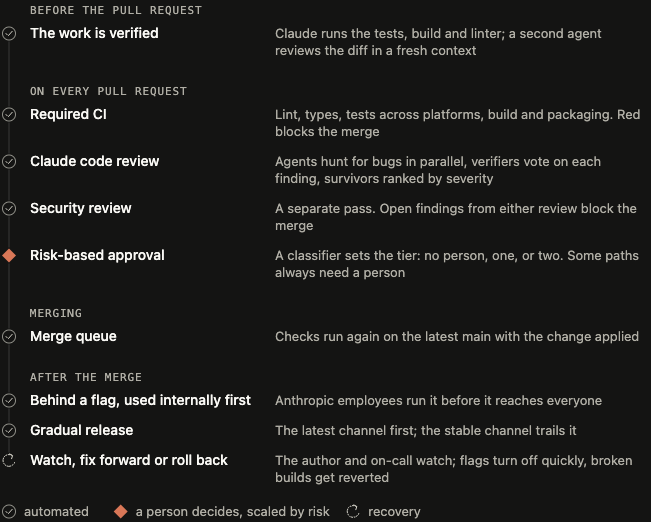
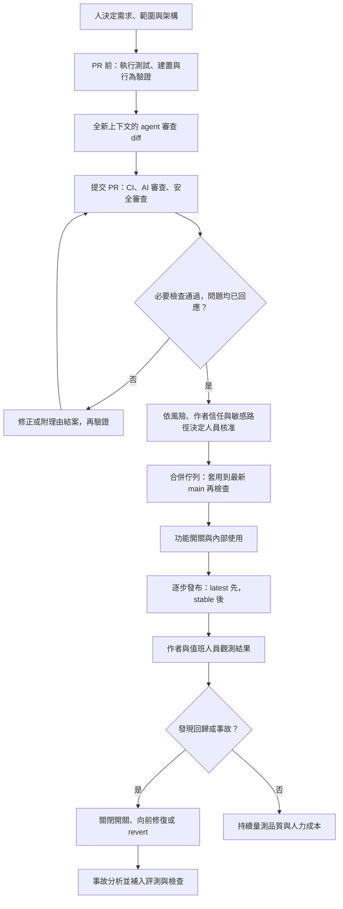
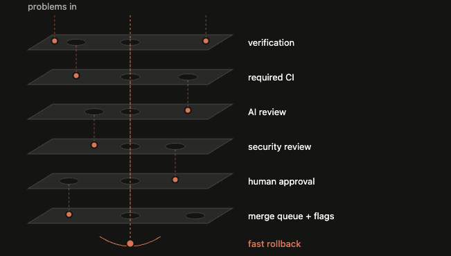
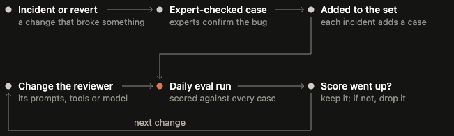
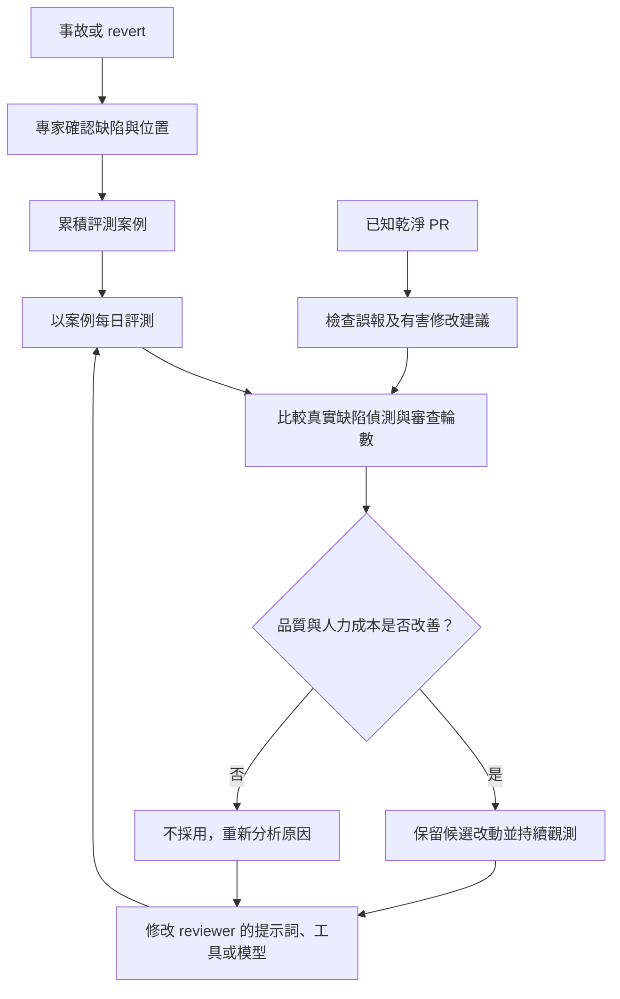

## TL;DR

- 原文以 Claude Code 團隊的內部流程，說明如何在 AI 大量產生程式碼時，把人的注意力留給需求、架構、風險與結果責任。
- 審查涵蓋 PR 前驗證、PR 檢查、依風險核准、合併佇列、逐步發布與快速回復；每一層都有漏失的可能。
- 低風險免人工核准有受信任作者等前提；必要的人員核准不能由 AI 代替，核准也只涵蓋特定 commit。
- 審查器要同時追蹤真實缺陷、誤報與收斂輪數。超過三輪時提醒作者重新檢視方案，而非持續追加微小修改。
- 影片補充四階段導讀與具體例子；「縮小重審範圍幾乎不漏問題」等解釋不視為原文已證明的結論。

## 摘要（Summary）

本文以 Anthropic 於 **2026-10-15** 發布的〈How the Claude Code team does code review〉為主，整理團隊如何將程式碼審查（Code Review）放進完整交付流程。再以馬克於 **2026-10-25** 發布的 24:34 影片補充章節導覽、教學例子與容易混淆之處。

原文的目標，是在回復提交（revert）與事故（incident）沒有惡化的條件下，降低每份 PR 消耗的人力。只縮短看 diff 的時間，卻增加後續救火時間，不能算節省。這個觀點可接到既有的 [[2026-10-21-MATT-POCOCK-SKILLS-V-MODEL-WORKFLOW-MAPPING|V-model 與 Matt skills 對照]]：需求與設計決定該做什麼，驗證與交付證據決定能否放心交付。

## 來源歸屬與驗證範圍

| 內容 | 來源 | 本文如何使用 |
| --- | --- | --- |
| 內部七層流程、風險政策、指標與限制 | Anthropic 原文及其官方 Markdown | 本文主體；數字均為作者的內部自述，未取得原始資料重算 |
| 四階段教學、函式改動例子、個人判斷 | 馬克影片；取得 978 段 `zh-Hant` 字幕 | 作為補充；字幕 API 標記為非自動產生，本文未逐字人工校對音訊 |
| 公開 Code Review 服務的權限與行為 | [Claude Code 官方產品文件](https://code.claude.com/docs/en/code-review)，2026-10-26 查核 | 補足內部制度與對外產品的邊界 |
| 中文 Mermaid、與個人流程的對照、採用順序與範本 | **Codex 整理與建議** | 未在使用者專案實施，亦未驗證 Claude Code 審查服務 |

> [!important] 本篇完成的是來源研究與文件驗證
> 沒有建立 Claude Code 審查服務、風險分類器、分支保護或正式環境回復機制。原文的成效、影片的解釋與本篇建議，均不代表這些流程已在使用者環境驗收。

## 關鍵洞察（Key Insights）

1. **審查同時負責抓錯與傳播知識。** 自動化接手大量程式閱讀之後，仍需安排理解模組與架構的方式。
2. **人力成本包含審查與修復。** 原文追蹤人員核准數的中位數及第 95 百分位、人類留言量、等待人員的時間，並以 revert／incident rate 作為限制條件。
3. **驗證能力要先於放寬人工核准。** 執行輸出、CI、風險限制與回復能力，是採用較輕核准流程的前提。
4. **收斂也是審查品質。** 每輪都多找出一個問題，可能造成 agent 作者反覆修改、重新提交與重跑檢查；輪數必須與缺陷偵測一起量測。
5. **公開審查產品與內部合併政策分開。** 安裝 AI reviewer 不會自動得到 Anthropic 的風險分類與合併規則。

## 詳細內容（Details）

### 1. 先確認原文數字在說哪個範圍

| 原文敘述 | 範圍與讀法 | 無法據此推論的事 |
| --- | --- | --- |
| Claude 約寫出 Claude Code 自身 90% 的程式碼 | 作者對該產品的描述 | 不能擴張成 Anthropic 所有程式碼或所有團隊 |
| 6–9 月合併 PR 數超過兩倍，需 revert 的比例下降超過 40% | Claude Code codebase 的期間比較；下降的是比例 | 沒有絕對 PR 數、事故細項及控制組，不能斷言純由 AI 審查造成 |
| 5 月每日約 2,500 個變更，9 月超過 30,000 個 | **Anthropic monorepo**；原文明說 Claude Code 是另一個 repo | 不能把此量直接套到 Claude Code repo |
| 得到實質審查留言的內部 PR 比例由 16% 變成 54% | Code Review 研究預覽推出時的觀察 | 留言覆蓋率不等於缺陷召回率、準確率或每份 PR 都有 bug |

原文也引用 Boris 對「提供驗證方式能讓結果更好」的估計。這是具名經驗判斷，本文不將其當成可重現的品質提升倍數。

來源：[原文開頭與審查流程](https://claude.dev/blog/solving-code-review-at-anthropic/)。

### 2. 全貌：從作者環境到使用者



原文將細節拆為七層；影片在 [01:25](https://www.youtube.com/watch?v=h0ALH6qBb7k&t=85s) 先整理成 **PR 前、PR 中、合併時、合併後** 四個階段。以下中文圖是 Codex 依原文重整的概念流程；同屬 PR 的檢查列為一組，不宣稱所有工作必須嚴格循序執行。



### 3. PR 前：先讓工作可驗證，再交給另一個上下文

原文第 1 層先要求 agent **實際執行**測試、建置、lint，或拿畫面與設計比較；交付執行結果。接著由有全新上下文（fresh context）的子代理人（subagent）審查 diff。團隊也使用內部方法找 bug、簡化 diff、檢查端到端行為；UI 變更另依設計準則檢查。

影片 [02:58](https://www.youtube.com/watch?v=h0ALH6qBb7k&t=178s) 把它整理成「確保能正常運作」與「檢查程式碼品質」兩步；[03:46](https://www.youtube.com/watch?v=h0ALH6qBb7k&t=226s) 解釋沿用原作者的推理上下文，可能延續相同盲點。這是講者對 fresh-context review 的教學說明，不能推成「新 agent 一定客觀」或「相同模型的盲點完全獨立」。

重複出現的審查問題，應移到能持續作用的位置：

| 產物 | 原文中的責任 |
| --- | --- |
| `CLAUDE.md` | 專案技術、慣例、目標與範圍；保持精簡並指向細部文件。審查也看變更是否讓其中內容過時 |
| `REVIEW.md` | code owner 定義該區域最重要的失敗型態、略過路徑、瑣碎意見上限與證據要求；還要另外檢查 reviewer 是否確實遵循 |
| lint／可執行檢查／skill | 將可機械檢查的規則固化，減少每份 PR 再解釋一次 |

**Codex 建議**：在本機工作流把可執行驗證入口列入 `AGENTS.md`，審查規則另放 `REVIEW.md`。這是給 Codex 的對應方法，並非宣稱 Claude Code 會自動把兩份入口檔視為同一種設定。

### 4. PR 中：AI 找錯、交叉驗證、逐項回應

原文第 2 層要求每份 PR 先經 Claude review。它會把 diff、整個 repo 的脈絡與 PR 意圖一起閱讀：是否解決需求、是否符合系統、是否破壞其他地方；bug fix 也要追到根因。

多個 agent 並行找問題，再由另一組驗證者對候選發現進行判斷；達到足夠共識才送出。團隊以 A/B 測試評估過濾規則，降低只談風格、診斷或清理的意見。最後以 inline comment 呈現，並標記 `Important`、`Nit` 或 `Pre-existing`。**既存問題的歸屬和嚴重度是不同事情**，不能因為不是本次新增就自動認定不重要。

每條發現都要回應：修正，或寫理由後結案。原文也提到有時 agent 夜間接手修復，讓作者隔日看到已多跑一輪的 PR；這是內部工作流描述，不代表公開 review 服務本身會推送修正。

### 5. 安全審查與 CI：各自有責任與阻擋規則

原文第 3、4 層包括獨立安全審查（Security Review）與必要 CI：lint、型別檢查、跨平台測試、建置及封裝。內部政策要求一般／安全審查的未結案問題均處理後，才能合併。後續 commit 若修掉問題，發現可自動解除；誤報也可附理由結案。

PR template 要說明如何測試及如何撤回，由提出變更的人確認。原文提供 `/security-review`、安全審查 GitHub Action 等採用入口，但這不等於使用者 repo 已具備相同的阻擋政策。

> [!warning] 公開 Code Review 服務的能力邊界
> 2026-10-26 查核的[官方產品文件](https://code.claude.com/docs/en/code-review)說明：服務讀取 diff 與周邊程式碼，**不建置或執行程式碼、不推送 commit，也不核准或阻擋 PR**。必要 CI、thread resolution、分支保護與人員核准，需由團隊的 repo 政策另外提供。服務讀取的 `REVIEW.md` 來自 base／default branch，而非 PR 自己修改的版本。文件查核不等於本機服務驗收。

官方文件也列出 Team／Enterprise、Quick／Standard／Deep 等使用條件與深度選項。原文的採用原則是依漏失代價選審查深度；本文沒有測試方案開通、價格或各深度的偵測效果。

### 6. 人員核准：風險分級只是第一步

以下是**原文內部政策**，不是建議直接套用到所有 repo 的預設值。

| 風險 | 原文例子 | 基本人員核准需求 |
| --- | --- | --- |
| 低 | 文件、文案、僅供內部使用的功能、藏在開關後的增量變更 | 自動審查及安全檢查通過後，可以不要求人員核准；仍受下列限制 |
| 中 | 一般產品變更、快取、自動更新、system prompt 等敏感區域 | 一人 |
| 高 | 最高風險程式碼，以及固定要求雙人核准的少數路徑 | 兩人 |

原文另加上幾項限制：

- **風險取決於變更內容。** 一個分類器決定等級，另一個判斷此變更是否仍需多一人介入。
- **較輕的核准路徑只開放給受信任清單中的作者。** 其他作者仍需第二個人核准。
- **敏感路徑及 CI workflow 檔案一定要有人看。** 路徑政策不能被低風險分類直接略過。
- **agent 核准不算人員名額。** 指揮 agent 寫程式的人可算其中一名必要審查者，但仍要承擔確認責任。
- **核准綁定特定 commit。** 後續 agent push 或人工解衝突等新增提交，若系統無法確認仍受原核准涵蓋，就需要重新核准。

因此「大多數 PR 最多一人參與」與「低風險可以零人工」都有條件；影片 [14:50](https://www.youtube.com/watch?v=h0ALH6qBb7k&t=890s) 的三檔介紹可當導讀，實作政策仍須讀完整限制。

### 7. 合併與發布：再次驗證組合結果，縮小影響範圍

原文第 6 層用合併佇列（Merge Queue），把變更套用到最新 `main` 後重跑檢查，降低「兩份 PR 個別通過，合在一起出錯」的風險。影片 [15:49](https://www.youtube.com/watch?v=h0ALH6qBb7k&t=949s) 用兩份 PR 依序排隊的例子，說明第二份要面對包含前一份變更的新基線。

接著通常以功能開關（Feature Flag）先開給大量使用產品的內部員工，再逐步公開；`latest` 先於 `stable`。**原文沒有固定一週的等待承諾**；影片 [17:43](https://www.youtube.com/watch?v=h0ALH6qBb7k&t=1063s) 提到約一週，是講者的補充，不能當成本篇的原文結論。

原文第 7 層處理漏失：作者與值班人員觀察結果；可關閉開關、向前修復（fix forward）或 revert。功能開關可以不重新部署就關閉，但「關閉功能」與「所有副作用都已撤回」在實務上是兩回事。後者是 Codex 對資料寫入、外部操作等情境的提醒，非原文已驗證的保證。



> [!note] 多層防護的限制
> 原文說每層都可能漏錯；圖中的缺口是概念示意，不是量測出的攔截率。若各層依賴相同錯誤假設，其失效可能相關，不能把幾個成功率相乘後當成整體可靠度。

原文也明說，當 revert／incident 指標惡化時，**尚未有自動提高核准要求的斷路機制（circuit breaker）**；目前仍靠作者、值班人員及儀表板發現問題。這點不能寫成已完成的自動風險控制。

### 8. 審查器如何變好：真實事故、誤報與收斂一起看

#### 8.1 把事故變成評測案例

團隊收集造成事故的 PR、其 fix-forward 與 revert，請熟悉該程式碼的工程師確認缺陷及位置，形成評測資料集（evaluation set）。審查器每日跑這些案例，提示詞、工具或模型改動都要重新評估。



影片 [07:30](https://www.youtube.com/watch?v=h0ALH6qBb7k&t=450s) 以抓到問題得一分、沒抓到得零分來教學。**這是講者為解釋評測而設的簡化例子**；原文沒有公布完整評分函數、資料集或可重跑的基準程式。

#### 8.2 也看無缺陷樣本與有害建議

原文把作者對留言的處理分成修正、判定錯誤、表示刻意如此、認為不重要，作為觀察訊號；也在已知乾淨的 PR 上觀察，哪些發現可能誘使人做出有害修改。

影片 [09:48](https://www.youtube.com/watch?v=h0ALH6qBb7k&t=588s) 將後三類統稱無效意見，方便教學。本文保留區別：**作者回應是代理指標（proxy），不是客觀正誤標籤**。修正不代表一定該改，拒絕也不代表 reviewer 一定錯；有害修改更值得獨立追蹤。

#### 8.3 防止 agent 作者與 reviewer 無限互改

原文有一份 CLI PR 一夜超過 50 輪的例子。團隊追查 reviewer 持續標出的程式碼，約 **59% 在第一輪審查時就已存在**。這不等於 59% 都是 PR 之前就有的舊 bug，不能與 `Pre-existing` 標記混為一談。

原文列出的調整：

1. 三輪後提醒作者退一步重新檢視做法。
2. 前幾輪過後，改成只針對新 diff 重審。
3. 指出一類 bug，讓作者修正所有同類實例。
4. 不重複發布已提出的發現。

另外，review agent 每晚掃描既有程式碼，讓舊問題有獨立處理管道。

| 內部 PR 指標 | 調整前 | 調整後 |
| --- | --- | --- |
| 一輪審查與修正後通過 | 65% | 78% |
| 需要五輪以上 | 8.9% | 1.5% |
| 平均通過所需審查次數 | 2.08 | 1.32 |

上表由原文 Fig D 的數值比較圖轉成原生 Markdown，已核對三組數字，避免只在圖片裡才能查到。原文未提供樣本量、信賴區間及各措施獨立效果；只能視為整組調整前後的內部觀察。

> [!warning] 縮小重審範圍是取捨
> 影片 [13:04](https://www.youtube.com/watch?v=h0ALH6qBb7k&t=784s) 對漏失的描述較樂觀。原文並未保證 diff-only re-review 不漏錯，也沒有說後續只看幾行就不需理解影響範圍。Codex 建議：新 diff 若改介面、權限或共同假設，仍依影響範圍升級檢查；這是建議，未在本文實測。

以下是 **Codex 的量測整理圖**；原文支持事故案例、乾淨 PR、每日評測及收斂指標，圖中的整合判斷步驟供採用時參考。



### 9. 人仍負責方向、架構、證據與後果

原文保留給人的工作包括：決定該不該做、審高風險區域、把關會成為後續樣板的架構、閱讀驗證證據，以及為交付結果負責。若說不清楚目前檢查會漏什麼，就該要求真正的深入審查。

原文也承認，**知識分享尚無正式完整流程**。團隊會請 Claude 對即將修改的模組寫說明，有人再做成適合自己學習的互動產物；公開協作頻道也幫助大家看到其他人在做什麼。


這張圖補足「逐行閱讀變少後怎麼學程式碼」的問題：理解任務集中在**即將修改的那個切片**。它不是團隊已證明能全面取代人類共同理解的實驗結果。

交付者通常最有脈絡，因此也負責小型／中型變更出錯後的修復。原文強調小變更、可回復、依影響範圍增加審查，以及快速觀測；事故檢討看系統，不等於追究個人。若工作方向不對，應早在協作討論中提出，必要時關閉或重塑 PR；不能因為程式已快速寫好，就認為一定要合併。

### 10. 影片補充導覽與原文界線

| 影片時間 | 補充價值 | 閱讀時要保留的界線 |
| --- | --- | --- |
| [01:25](https://www.youtube.com/watch?v=h0ALH6qBb7k&t=85s) | 用四階段建立交付全貌 | 原文細節以七層及後續改良機制展開 |
| [02:58](https://www.youtube.com/watch?v=h0ALH6qBb7k&t=178s) | 把可執行驗證與新上下文審查分開 | 新上下文降低沿用既有思路的機會，不保證無共同盲點 |
| [05:09](https://www.youtube.com/watch?v=h0ALH6qBb7k&t=309s) | 說明 CI 的測試、型別及建置責任 | CI 證據與只讀式 AI review 分開 |
| [05:49](https://www.youtube.com/watch?v=h0ALH6qBb7k&t=349s) | 發現、篩選、處理問題的教學分解 | 多代理驗證不能代替團隊的合併政策 |
| [07:15](https://www.youtube.com/watch?v=h0ALH6qBb7k&t=435s) | 以真實案例評測、噪音與收斂解釋改良 | 二元評分例子不是原文公布的 benchmark |
| [09:48](https://www.youtube.com/watch?v=h0ALH6qBb7k&t=588s) | 以作者回應說明無效意見 | 作者行為只是一種訊號，需另檢查客觀缺陷與有害建議 |
| [13:04](https://www.youtube.com/watch?v=h0ALH6qBb7k&t=784s) | 解釋縮小重審範圍 | 不將「基本不漏」視為已證明的保證 |
| [14:31](https://www.youtube.com/watch?v=h0ALH6qBb7k&t=871s) | 提醒安全審查是另一層 | 原文安全政策需與產品能力分開 |
| [14:50](https://www.youtube.com/watch?v=h0ALH6qBb7k&t=890s) | 三檔風險的快速導讀 | 補讀作者信任、敏感路徑、第二分類器與 commit 核准限制 |
| [15:49](https://www.youtube.com/watch?v=h0ALH6qBb7k&t=949s) | 兩份 PR 的合併佇列例子 | 降低組合失效風險，不保證 `main` 永遠無問題 |
| [16:44](https://www.youtube.com/watch?v=h0ALH6qBb7k&t=1004s) | 區別合併與公開使用 | 原文只說 `latest` 先於 `stable`，未承諾固定一週 |
| [20:30](https://www.youtube.com/watch?v=h0ALH6qBb7k&t=1230s) | 整理人的五種責任 | 包含理解檢查的限制，不能只看綠燈 |
| [22:03](https://www.youtube.com/watch?v=h0ALH6qBb7k&t=1323s) | 連到 Harness Engineering 的人機分工觀點 | 與 OpenAI 的呼應是講者綜合判讀，並非共同驗證過同一套制度 |

### 11. 接到自己的需求、計畫、設計、實作、變更與修復

以下是 **Codex 對使用者既有流程的建議**，與 [[2026-10-21-MATT-POCOCK-SKILLS-V-MODEL-WORKFLOW-MAPPING|既有 V-model 專篇]]互補。這篇不更動任何已安裝 skill，也不宣稱 Matt skills 或使用者專案已有 Anthropic 內部的風險分類器。

| 原有工作 | 本篇可補上的產物或判斷 |
| --- | --- |
| 需求 | 該不該做、成功條件、誰確認結果 |
| 計畫 | 測試入口、審查範圍、發布與撤回方法、人員責任 |
| 設計 | 高風險與難以撤回的部分；架構是否會被後續實作照用 |
| 實作 | 可讀取的測試輸出、獨立上下文審查、明確 diff |
| 需求變更 | 更新成功條件、驗證案例與風險；舊核准是否仍涵蓋新 commit |
| 除錯 | 根因與可重現條件；先處理事故影響，再追查哪層漏失 |
| bug fix | 修復與回歸測試；將事件加入未來審查器評測案例 |

**建議的採用順序**：先在一個 repo 建立可執行檢查、短版審查規則、PR 證據與回復欄位；收集幾週真實回饋後，再決定是否放寬人工核准。已有自己的開發流程時，可只補缺少的驗證與發布環節。

以下為 **Codex 自編的 `REVIEW.md` 起始範本**，不是 Anthropic 內部檔案，尚未實測；審查規則仍須依 repo 調整。

```markdown
# Review priorities

- Review the change against its stated intent and the surrounding code.
- Prioritize behavior regressions, security boundaries, and broken invariants.
- For each finding, give a file and line, impact, and supporting evidence.
- Distinguish newly introduced issues from pre-existing issues.
- State whether a claim is inferred or backed by an executed check.
- Leave formatting and mechanical style rules to the configured linters.
- Start the summary with the finding count; say clearly when it is zero.
- Do not repeat a finding already recorded in this review.
- Group instances of the same bug class within the agreed scope.
- After three review/fix rounds, request a human reassessment of the approach.
```

原文要求略過路徑與瑣碎意見上限；此範本先保留通用骨架，採用時還需填入專案具體路徑、數值與主要失敗型態。安裝此文件本身不會設定任何 GitHub 合併限制。

## 我的心得（My Takeaways）

以下為 Codex 的研究心得。最有用的是把「提出要求、提出證據、作決策」分開：agent 或工具可以供應證據，人要判斷證據能回答什麼，以及哪些風險仍未被覆蓋。

對個人專案，可先增加可重跑的驗證、變更範圍與回復說明；多人團隊才逐步導入 reviewer 調校、敏感路徑與核准政策。把所有工具一次裝齊，無法證明交付品質改善。

與 [[2026-08-07-OPEN-CODE-REVIEW-ALIBABA-AI-CODE-REVIEW-CLI-CODE-ANALYSIS|Open Code Review 專用 reviewer 分析]]對讀時，應分清「單次審查器能力」與「包含 CI、發布、觀測及責任制度的交付系統」。兩者的成本、偵測範圍與基準資料不同，本文沒有做同場測試，也不能只憑 token 或留言數判斷優劣。

## 待補充（Open Questions）

1. 風險分類器的誤判率與第二分類器介入條件為何？敏感路徑是否有可公開驗證的測試集？建議搜尋：`Anthropic code review risk classifier false negative sensitive paths`。
2. 原文每日事故評測的樣本量、評分函數、資料切分與防止對案例過度調整的方法為何？建議搜尋：`Claude Code review incident eval dataset scoring holdout`。
3. diff-only re-review 對跨檔案／介面變更的缺陷召回率有何影響？哪些情況會恢復較大範圍審查？建議搜尋：`incremental code review cross-file regression recall`。
4. 作者回應分類與真正有害建議之間如何校準？是否另有獨立專家標註？建議搜尋：`AI code review harmful suggestions precision human feedback bias`。
5. 降低人工閱讀後，團隊對架構與模組的理解是否變差？按需說明及互動產物如何量測學習效果？建議搜尋：`AI review shared codebase understanding knowledge transfer measurement`。
6. 什麼 revert／incident 指標及觀測區間應觸發更嚴格核准？如何避免分級政策隨時間放寬卻無法及時收回？建議搜尋：`risk based code review circuit breaker incident thresholds`。

## 相關連結（Related）

- [[2026-10-21-MATT-POCOCK-SKILLS-V-MODEL-WORKFLOW-MAPPING]]：把審查、證據與回歸測試接到需求至修復的既有流程；避免把 skill 名稱當成驗收。
- [[2026-02-11-HARNESS-ENGINEERING-LEVERAGING-CODEX-IN-AN-AGENT-FIRST-WORLD]]：影片片尾的人機分工參照；可對讀環境、可執行規則及回饋機制。
- [[2026-08-07-OPEN-CODE-REVIEW-ALIBABA-AI-CODE-REVIEW-CLI-CODE-ANALYSIS]]：比較專用 reviewer 的偵測與成本取捨，和完整交付防護之間的差異。

## 知識層次分析（Bloom's Taxonomy Analysis）

本節為 Codex 對閱讀與應用的分析。

| 認知層次 | 核心目的 | 對本文的具體應用 |
| --- | --- | --- |
| **記憶（被動）** | 記住可辨識的概念與限制 | fresh-context review、`REVIEW.md`、risk-based approval、Merge Queue、Feature Flag；記住信任與 commit 限制 |
| **理解（半被動）** | 解釋彼此關係 | CI 提供執行證據、AI review 找可疑缺陷、核准政策決定責任，發布與回復處理剩餘風險 |
| **分析（主動）** | 拆解假設與證據 | 區分不同 repo／時期的數字；反問多層失效是否相關、作者回應是否能作為真值 |
| **應用（主動）** | 套入具體工作 | 在一個 repo 記錄 Testing／Risk／How to revert；把一個真實 bug 建成回歸與 reviewer 案例；先量測輪數再調規則 |
| **評估（主動）** | 比較方案及採用條件 | 小專案先保留人工與簡單檢查；高流量團隊評估深度 reviewer 加分層發布；不可逆變更維持更嚴格核准 |

### 分析型追問（Socratic Follow-up）

- **澄清**：自己的「低風險」是程式碼少、能回復，還是實際影響小？三者是否被混為一談？
- **假設**：若缺少內部大量使用者與快速關閉功能的能力，哪些免人工核准條件就不成立？
- **證據**：要判斷人力真的減少，除了等待時間，還需記錄多少事後修復與值班負擔？
- **觀點**：由接手維護的人來看，按需解說是否足以替代閱讀同事變更所累積的理解？
- **後果**：若回歸案例多來自已知事故，十二個月後是否反而較難抓到新型缺陷？

### 方案批判三問（Critical Evaluation）

1. **最大的風險是什麼？** 把綠燈、零留言與低風險分類當成安全保證；在共同盲點或難以撤回的變更上，可能讓錯誤越過多層並擴大影響。
2. **什麼情況下會失敗？** 缺少可信測試、可觀測性、必要人員核准、快速回復或可比較的品質基線；也可能因重審太窄、規則過時或作者回應偏誤而失效。
3. **有沒有更好的替代方案？** 低流量 repo 可先用小 PR、機械檢查與一位獨立人工 reviewer，維護成本較低；對資料遷移、權限或不可逆外部動作，較嚴格的人員審查與演練可能比低人工合併更合適。

## 六頂思考帽回饋（Six Thinking Hats Feedback）

以下是 Codex 對本篇內容與採用方式的回饋，不是原作者或講者逐字陳述。

### 藍帽：問題與範圍

判斷哪一種檢查適合攔住哪一類問題，以及人在哪裡必須介入。範圍包括審查至發布回復，不以安裝單一 reviewer 為完成條件。

### 白帽：事實與未知資訊

已取得原文、官方 Markdown、978 段字幕、官方產品文件與五張來源圖。原文的數字與政策可查；原始案例集、分類器、統計方法及使用者環境的成效仍未知。

### 紅帽：直覺與讀者反應

把逐行閱讀壓力交給工具，可能帶來鬆一口氣的感覺；「程式碼不由我逐行寫或看，卻要我負責」也可能讓讀者不安。這是可能的讀者反應，非受訪或量測結果。

### 黃帽：價值與可保留內容

把需求決策、可執行證據、風險核准與回復能力串在一起，比只追求 reviewer 多留幾則留言更容易對應真實交付問題。事故案例與輪數也讓改良有可觀察的對象。

### 黑帽：風險與限制

內部成效未提供足夠資料建立因果結論；多層不代表獨立。影片有較簡化、較肯定的解釋；公開產品沒有內部政策的全部能力。

### 綠帽：替代方案與新應用

先將現有的一個 bug 整理成包含輸入、預期、實際結果與錯誤位置的案例，再比較 reviewer 改動前後。對低流量 repo，可先保留單一人工審查，集中改善最耗時的驗證步驟。

### 藍帽：修改項目與下一步

1. 在一個 repo 補齊可執行驗證、短版審查規則與回復說明。
2. 累積缺陷、有害建議、審查輪數與事後修復時間，先建立基線。
3. 有足夠觀察與明確回復能力後，再決定是否放寬人工核准。

## References

- [Anthropic 原文：How the Claude Code team does code review](https://claude.dev/blog/solving-code-review-at-anthropic/)，2026-10-15；本文的主要來源。
- [官方 Markdown 版本](https://claude.dev/blog/solving-code-review-at-anthropic.md)，與網頁文字及圖說交叉核對。
- [馬克影片：如何审核 AI 写的代码？从写代码到上线，一套保证产品质量的全流程](https://www.youtube.com/watch?v=h0ALH6qBb7k)，2026-10-25；978 段繁體中文字幕，未逐字人工校對音訊。
- [Claude Code 官方 Code Review 文件](https://code.claude.com/docs/en/code-review)，2026-10-26 查核公開服務的讀取、執行、提交及核准邊界。
- [原文模組學習示意圖](https://claude.dev/media/d4fafcbf3d2137bc64eb7f0707ba91809ff1ed4d098785e36d7422b3b07f6c40.png)；另三張流程圖取自原文 inline SVG，保留來源文字與配色後轉成 PNG。Fig D 的數字另列為 Markdown 表格。
