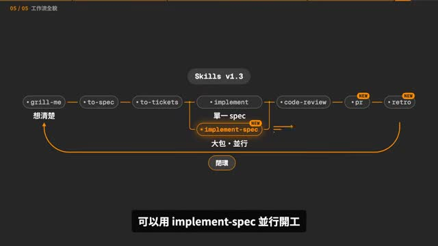
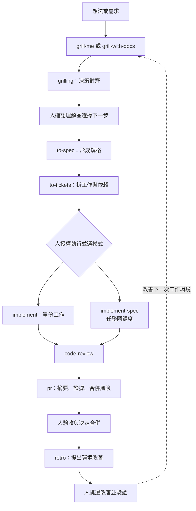
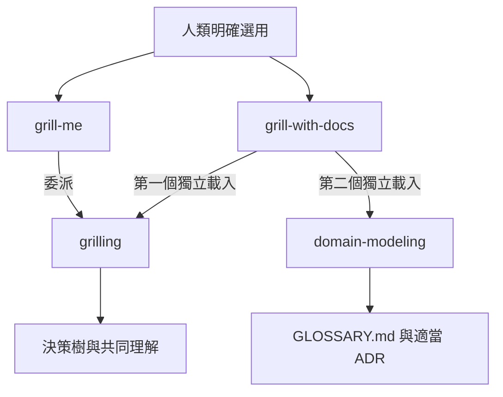
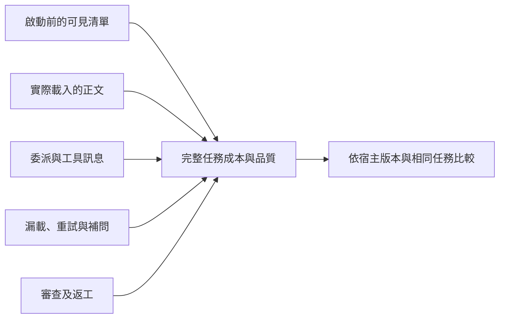

## TL;DR

- v1.3 補上執行、交付與回顧：`implement-spec` 調度整份規格的 tickets，`pr` 呈現驗收證據與合併風險，`retro` 找出工作環境需要改善的地方。
- `grill-me` 已成為人類入口；`grilling` 承載可共用的問答方法。`grill-with-docs` 再組合 `domain-modeling`，讓決策留下術語與 ADR。
- A→B 跨平台組合時，父 skill 可寫子 skill 名稱、載入要求與停止條件；Claude Code 的 `/`、Codex CLI／IDE 的 `$` 留在使用者入口。父入口可設 explicit-only，子方法保留模型可呼叫能力；這種寫法仍須依宿主驗證。
- 三個設計目的須分開驗證：入口控制有作用，共用結構成立；省 context 取決於可見性與描述長度，跨宿主載入及完整流程仍可能失敗。
- 本次重算修正一個口徑：目前解析後的全部／可見描述為 **3,870／2,150 字元**；原研究的 3,888／2,156 包含 YAML 引號與跳脫字元。兩者都不等於實際 token 成本。
- 優先建立「理解確認、實作授權、交付驗收」三個明確邊界，再考慮平行代理與技能組合；`CONTEXT.md` 改名為 `GLOSSARY.md` 的遷移也不能漏掉。

## 摘要（Summary）

本文把 Gary Chen 的版本更新影片與使用者提供的 `handoff.md` 合成同一個主題：**如何將可共用的思考方法接成可審查、可追溯的 Agent 工作流。** 影片提供流程全貌，研究紀錄檢查這套設計的權限、context 成本與實際失敗回報；最後以固定版本的原始檔及官方文件補充核對。

快速閱讀：先看第 1–3 節理解更新；要設計自己的 skills，看第 4–8 節；要實驗與選型，看第 9 節。本文是整合研究，非逐字稿，也未安裝、啟動或修改 Matt 的 skills。

## 關鍵洞察（Key Insights）

1. **同一個 frontier 思想，解決兩種不同問題。** `grilling` 找出前提已確定的決策問題；`implement-spec` 找出依賴已解除的 tickets。前者要等人做決定，後者在授權範圍內讓代理執行。
2. **共用方法與工作流控制是不同層。** 抽出 `grilling` 可集中維護，但 user-only 入口無法自行阻止模型用其他工具實作。可與 [[2026-09-06-CLAUDE-CODE-SKILL-INVOCATION-PERMISSION-MATRIX]] 對照。
3. **交付要檢查產物，不能只看有沒有載入 skill。** `domain-modeling` 已載入卻未產生應有文件，與完全沒載入，是兩種不同故障。
4. **改進環境要留下可執行檢查。** 固定語法錯誤交給 lint／test／CI，涉及取捨的規範交給審查；單純加長 `AGENTS.md` 會讓下一輪更難讀。

## 詳細內容（Details）

### 0. 來源、版本與證據界線

| 來源 | 本文如何使用 | 能證明與不能證明的事 |
| --- | --- | --- |
| Gary Chen 影片，2026-10-17，10:43 | 全片人工繁中字幕；抽樣畫面與關鍵畫面核對 | 講者如何介紹更新、示例及觀點；不當成效能基準 |
| 使用者的 `handoff.md`，2026-10-18 | 合併設計沿革、字元核算、issue／PR 回饋及研究缺口 | 使用者先前查核的紀錄；未重新讀取的討論串明列為研究紀錄轉述 |
| `mattpocock/skills` 固定 commit `49dd158…` | 本次 clone 後核對 manifest、核心 SKILL.md、呼叫政策、歷史版本；重算描述字元 | 靜態結構與文字事實；不等於實際宿主執行保證 |
| 作者 v1／v1.3 公告、Claude Code 與 Codex 文件 | 交叉核對意圖、遷移與呼叫機制 | 依查閱日期及版本解讀，不外推所有宿主 |

本次取得的 repo HEAD 與 handoff 固定版本相同；manifest 為 **v1.3.1、27 個 skills**。影片使用 v1.3 作為版本主題，兩者並不矛盾。影片標題的「28 萬星」只保留為來源名稱，本文未以它衡量品質，也未驗證即時星數。

> [!warning] 證據分層
> 原始檔、官方文件、作者手寫回覆、作者帳號發布的 AI triage、使用者回報、本文推論，不能混成同一種證據。沒有執行實際 grilling、跨宿主 A/B、runtime prompt 擷取或端到端成本測試；issue 關閉也不代表修復。

### 1. 先看整個流程：把決策、執行與證據串起來

影片 [01:04](https://www.youtube.com/watch?v=QqhyqMvdx5Q&t=64s) 回顧前半段：釐清想法、形成規格、必要時拆 tickets，再實作與審查。[09:37](https://www.youtube.com/watch?v=QqhyqMvdx5Q&t=577s) 把新 skills 接到後半段。



原圖的單一規格／大包並行是講者的簡化；固定版本的 `implement` 定位更精確地說是處理一份工作或一組 tickets，`implement-spec` 則調度整份 spec 的 ticket graph。下圖另標出本文建議的人工界線；**不是自動串接器已實作的保證**。



這個流程有三個不同的「可以」：理解正確、授權執行、接受交付。若把三者壓成一句「OK」，就容易在討論完成後直接開工，或把產生 PR 當成已驗收。

### 2. 三個新 skills 分別解決什麼

#### 2.1 implement-spec：把 tickets 視為有依賴的任務圖

影片 [01:46](https://www.youtube.com/watch?v=QqhyqMvdx5Q&t=106s) 描述反覆派 ticket、等待、檢查、清 context 的人工循環。[02:48](https://www.youtube.com/watch?v=QqhyqMvdx5Q&t=168s) 用 spec **#87** 與 tickets **#88–#97** 示範整包委派。

固定版本的 [implement-spec](https://github.com/mattpocock/skills/blob/49dd158d1076134a641b33efb035946536778336/skills/engineering/implement-spec/SKILL.md) 要求：

1. 讀 spec、tickets 與 blocking relationships，找出可開始的 frontier。
2. 必要時先由探索代理找資料，把研究存成後續代理可讀的檔案；跨代理盡量傳檔案、ticket、commit 指標，減少重複貼全文。
3. 建立 integration branch。每個 implementer 使用獨立 branch／worktree，從 integration branch 起步，套用 `tdd`。
4. 完成前先整合 integration branch 的最新內容，再由 merger 將成果合回 integration branch；依賴解除後啟動新 tickets。
5. 全部完成後在整合分支做 `code-review`，修正問題。依 issue tracker 的結案方式處理 tickets／PR，最後清理工作用 worktrees。

**完成目標是 integration branch，不保證必須開 PR，更不是自動合進 main。** 原始檔只在 tracker 以 PR 結案或使用者要求時建立 draft PR，且要等首次合併有實際差異後才開。

影片用首頁按鈕、設定排版、登入 bug 示範可能獨立的工作，並以時間縮為三分之一說明並行效益。那是示意，未提供 benchmark。不同檔案仍可能共享資料模型；worktree 把同時編輯隔開，語意衝突會留到整合時才暴露。

作者另明確比較人工循環、固定腳本循環與 Agent 循環：**對多數人仍推薦可預測的腳本循環**，`implement-spec` 是尚未調好完整自動化時的起點。這是影片「並行很方便」之外的重要取捨。[v1.3 公告](https://www.aihero.dev/skills-changelog-v13-implement-spec-pr-retro-and-glossary-md)

#### 2.2 pr：讓審查者快速找到變更、證據與風險

影片 [04:06](https://www.youtube.com/watch?v=QqhyqMvdx5Q&t=246s) 將瓶頸移到人類審查；[05:12](https://www.youtube.com/watch?v=QqhyqMvdx5Q&t=312s) 指出勾選清單可能只代表測試計畫，並不表示真的測過。

依固定版本 [pr/SKILL.md](https://github.com/mattpocock/skills/blob/49dd158d1076134a641b33efb035946536778336/skills/engineering/pr/SKILL.md)，PR body 分成三段：

| 區塊 | 應放什麼 | 驗收時要追問 |
| --- | --- | --- |
| Summary | 最小且有用的圖、呼叫樹、檔案樹、偽碼或 diff | 是否一眼看出這次改動的關係？ |
| Evidence | Before／After 截圖、輸出或測試結果 | 有實際命令、結果與可追溯產物嗎？ |
| Merge Danger | 可逆性與影響範圍 | 回退程式碼能否真的還原外部效果？哪些使用者或系統受影響？ |

影片畫面把可回退與影響範圍分開顯示，這兩個軸比單一「低風險」更有用。`pr` 原始檔也要求使用 `GLOSSARY.md` 的領域語言；視覺呈現的來源致謝為 Dex Horthy／Humanlayer 的 `show-me`。


> [!warning] 模板無法代替驗證
> 要求 Evidence 可能促使代理多跑測試，但也可能得到沒有產物的宣稱。驗收應確認可讀取的結果與適用範圍；只測單元測試就不能寫成整個部署已通過。`pr` 是 model-invoked 的寫作方法，這不授權自行發布 PR 或合併。

#### 2.3 retro：從 session 的摩擦改善工作環境

影片 [07:02](https://www.youtube.com/watch?v=QqhyqMvdx5Q&t=422s) 提醒：功能成功，可能掩蓋背後反覆找檔、重試與浪費。[08:18](https://www.youtube.com/watch?v=QqhyqMvdx5Q&t=498s) 將機械檢查與判斷型規範分開。

固定版本 [retro/SKILL.md](https://github.com/mattpocock/skills/blob/49dd158d1076134a641b33efb035946536778336/skills/engineering/retro/SKILL.md) 從真實 session 找七類改善：

| 面向 | 要找的摩擦 | 適合的處置 |
| --- | --- | --- |
| 導航 | 找不到檔案、隱藏依賴 | 補精準導覽指標 |
| 自動檢查 | 錯誤本可攔下；現有檢查沒接上 | 先讀既有 lint／check／CI，再修接線或補檢查 |
| Coding standards | 審查漏掉問題 | 機械規則寫成檢查；跨檔一致性等判斷交給 reviewer |
| 全域 AGENTS.md | 指令過長，混入只適合特定階段的規範 | 把細節移到對應文件或檢查 |
| 工具成本 | 工具輸出或呼叫過於昂貴 | 調整介面與回傳範圍 |
| 無效果指令 | 指令很長但不改變行為 | 刪除或改成可檢驗條件 |
| 資訊取得 | 缺 log、文件或唯讀資料 | 補合宜的資訊管道與權限 |

先提出候選、依嚴重度排序，由人挑選，再修改並驗證。影片 [08:47](https://www.youtube.com/watch?v=QqhyqMvdx5Q&t=527s) 特別反對無人監督地一直改環境，避免把誤判變成永久規則。

### 3. 影片之外的版本銜接：GLOSSARY.md 與舊筆記

v1.3 公告指出 `CONTEXT.md`／`CONTEXT-MAP.md` 改為 `GLOSSARY.md`／`GLOSSARY-MAP.md`。團隊要一起遷移，避免新 skill 另建一份空白 glossary、舊文件卻還存在。這是需檢查的更新，**本文沒有替任何專案改名**。公告也移除了 `resolving-merge-conflicts`，並修正部分 description 未正確引用冒號導致的 YAML 問題。[來源](https://www.aihero.dev/skills-changelog-v13-implement-spec-pr-retro-and-glossary-md)

這個名稱更符合 [domain-modeling 原始檔](https://github.com/mattpocock/skills/blob/49dd158d1076134a641b33efb035946536778336/skills/engineering/domain-modeling/SKILL.md) 的責任：

- `GLOSSARY.md` 記錄領域詞彙，不作為規格、草稿或實作決策雜物箱。
- 多個 bounded contexts 才用 `GLOSSARY-MAP.md` 指向各自文件。
- 術語確定時即時記錄；有實際內容才建立檔案。
- ADR 要同時符合難以逆轉、缺背景會令人意外、確實存在取捨。每個小決定都建立 ADR 會增加雜訊。
- 只是讀 glossary 沿用詞彙，並不等於啟動主動的 domain-modeling。

KB 先前的 [[2026-03-23-GRILL-ME-SKILL-DEEP-DIVE]] 與 [[2026-05-18-GRILL-ME-VS-PLAN-MODE-COEXISTENCE-RESEARCH]] 保留早期單檔方法的歷史價值。但其「沒有自動觸發」或「所有 harness 都能直接共存」等敘述，不能直接套用今天的 wrapper／共用方法架構。

### 4. grill-me 與 grilling：入口、方法、文件責任分開

#### 4.1 固定版本的依賴關係

| Skill | Claude frontmatter | Codex `agents/openai.yaml` | 實際責任 |
| --- | --- | --- | --- |
| `grill-me` | `disable-model-invocation: true` | `allow_implicit_invocation: false` | 要求載入 `grilling` 的人類入口 |
| `grill-with-docs` | 同上 | 同上 | 要求分別載入 `grilling` 與 `domain-modeling` |
| `grilling` | 未禁止模型呼叫 | 未關閉 implicit invocation | 共用問答方法，也可由人明確選用 |
| `domain-modeling` | 未禁止模型呼叫 | 未關閉 implicit invocation | 挑戰術語、具體情境與領域界線，產生 glossary／適當 ADR |

來源：[grill-me](https://github.com/mattpocock/skills/blob/49dd158d1076134a641b33efb035946536778336/skills/productivity/grill-me/SKILL.md)、[grill-with-docs](https://github.com/mattpocock/skills/blob/49dd158d1076134a641b33efb035946536778336/skills/engineering/grill-with-docs/SKILL.md)、[grilling](https://github.com/mattpocock/skills/blob/49dd158d1076134a641b33efb035946536778336/skills/productivity/grilling/SKILL.md)、[Codex metadata](https://github.com/mattpocock/skills/blob/49dd158d1076134a641b33efb035946536778336/skills/productivity/grill-me/agents/openai.yaml)。



圖中兩個共用方法也允許人或模型直接選用；`triage`、`wayfinder` 等父流程同樣會使用 `grilling`。這些額外入口見上表，圖只展開兩個 wrappers 的依賴。

repo 沒有名為 `grill` 的 skill。Claude 常見入口是 `/grill-me`，plugin namespace 依實際選單；Codex 可明確寫 `$grill-me`。成功載入後，wrapper 與直接 `grilling` 共用同一套方法；差異在探索、政策與多一層委派，無須想成兩套問答演算法。這些指令僅供理解，本文沒有執行。

#### 4.2 現行 grilling 的一輪怎麼運作

1. 把尚未定案的決策及前提整理成 design tree。
2. 找出前提已解決、現在就能問的問題 frontier。
3. 同輪提出這些問題，每題附建議答案，等人回答。
4. 若所需資訊能從檔案、工具、環境查得，由代理查；該結果仍未返回時，只等待依賴它的問題，不阻塞其他獨立問題。
5. 回答改變決策樹後重新計算 frontier；依賴本輪未決答案的題目留待下一輪。
6. frontier 清空後確認共同理解。後續執行邊界仍須另行說清楚。

「事實由代理查、決定由人做」很重要。一次一題可以另提需求，但**目前預設是分輪批次提問**，不能沿用早期逐題描述。使用者說「yes」會接受推薦答案，有降低回答負擔的好處，也可能增加錨定偏誤。

#### 4.3 演進不是單純改名

下表依 handoff 的 git history 查核整理；本次另核對相關版本內容與字元數。短 SHA 可在固定 repo 的完整歷史重查。

| 版本／事件 | 變化 | 解讀 |
| --- | --- | --- |
| `78649ba`，2026-02-25 | 問答方法原先就在 `grill-me` 內 | 早期單檔設計 |
| `d1beb4f`，2026-03-13 | metadata 標準化 | 不應誤認成 grilling 改名起點 |
| `221ffca`，作者日期 2026-05-31；PR #291 於 06-17 合併 | 修改 grill-me、增加 grilling；另抽領域方法 | `--no-renames` 顯示修改加新增，`--follow` 的 rename 推測不能單獨證明動機 |
| `801a01c`／`bc4cf90`／`df129fc`，06-17 | 明確區分兩類 invocation、context／cognitive load；增加 router | 降低模型描述負擔，也要照顧人找入口的負擔 |
| `850873c`，06-29；`170ad48`，07-13 | prototype 改可由模型選用；grilling 擴到一般決策 | 分類依用途演進，不只看是否共用 |
| PR #593 | 批次問答併入 grilling | 修改一份共用方法，影響多個父流程 |
| PR #878／#880，08-15 | 改明確要求 Skill tool；修正試圖呼叫 user-only 依賴的指令 | 工具措辭與呼叫資格是兩個問題 |

保留 `grill-me` 名稱確實有延續使用習慣的效果；研究未找到足夠證據，能把「向後相容改名」說成主要設計原因。作者 v1 公告強調的是使用者選擇流程、共用方法與降低描述成本。[設計意圖來源](https://www.aihero.dev/skills/skills-changelog-v1-announcement)

### 5. 三條呼叫路徑與權限邊界

| 路徑 | 例子 | 要驗證的問題 |
| --- | --- | --- |
| 人明確選用 | `$grill-me`、由 picker 選 skill | 該宿主能否解析 canonical name 並載入 explicit-only 項目？ |
| 模型自行選用 | 自動選擇 `grilling` 或 `pr` | description 是否命中？會否誤觸？政策是否允許？ |
| 父 skill 委派 | `grill-with-docs` 載入兩個方法 | 子項是否安裝、可發現、可呼叫？兩個都載入且遵循了嗎？ |

**父入口是 user-only，不代表它不能使用可由模型呼叫的子方法。** 這與「子項也設為 user-only，父項卻想直接呼叫它」不同。[專案 invocation 約定](https://github.com/mattpocock/skills/blob/49dd158d1076134a641b33efb035946536778336/.agents/invocation.md) 對後者要求交回使用者明確選用。

但專案的跨工具約定，不能自動當成所有宿主完全相同的安全規格。Codex 官方文件支持的窄結論是：`allow_implicit_invocation: false` 關閉隱式選用，明確 `$skill` 仍可用；不應從欄位名稱推論所有 A→B 授權細節。[Codex 官方文件](https://learn.chatgpt.com/docs/build-skills)

Claude Code 文件則說明 `disable-model-invocation`、描述可見性與載入生命週期；具名 skill 的調用限制與底層工具權限仍是不同層。[Claude Code 官方文件](https://code.claude.com/docs/en/skills)

實際反例是 [#975](https://github.com/mattpocock/skills/issues/975)：使用者回報問答對齊後直接進入 implementation，跳過預期的 spec／tickets；作者帳號的回覆明示是 AI triage，仍將完成後的行為列為設計問題。本次重讀時為 open；未在本機重現。這說明「入口有分權」不足以支持「整個階段有硬性保護」。

> [!tip] 本文的設計建議，尚未實作
> 結束問答時先保存已定案／未定案項目，明列這次只確認理解；後續選擇產規格、原型或實作，依既有授權範圍處理。高風險寫入應由工具權限與可驗證的階段狀態攔截，不能只依靠 Markdown 裡一句提醒。

#### 5.1 A skill 使用 B skill：跨平台 prefix 怎麼寫？

2026-10-22 補充：**在 A 的 `SKILL.md` 引用 B 的名稱與載入要求，讓 agent 依宿主可用的機制執行；使用者手動選用時再使用該平台的 prefix。** 以 A＝`grill-me`、B＝`grilling` 為例：

| 情境 | Claude Code | Codex CLI／IDE |
| --- | --- | --- |
| 使用者手動啟用 A | `/grill-me` | `$grill-me`，或從 skill picker 選取 |
| A 的正文要求使用 B | 引用 `grilling`，透過可用的 Skill tool 載入 | 引用 `grilling`，依宿主提供的 skill 載入指示操作 |
| 已安裝名稱帶 namespace | 依實際註冊名稱解析 | 依實際註冊名稱解析 |

手動入口語法依 [Claude Code 官方文件](https://code.claude.com/docs/en/skills) 與 [Codex 官方文件](https://learn.chatgpt.com/docs/build-skills)。表中的名稱是示例；安裝成 plugin 後，應以目前環境註冊的名稱為準。把 `/grilling` 換成 `$grilling` 寫進父 skill，仍未解決載入介面與政策差異。

固定版本的 `grill-me` 正文實際只有一句：`Call the Skill tool with "grilling".`。[原始檔](https://github.com/mattpocock/skills/blob/49dd158d1076134a641b33efb035946536778336/skills/productivity/grill-me/SKILL.md) 它已經省略使用者入口的 prefix，但仍指定 Skill tool；第 7 節所列的跨宿主問題因此仍需處理。

若自行撰寫跨平台 A skill，可採用以下**候選範本**。這是本文的流程建議，未修改上游，也未完成跨宿主實測：

```markdown
Before implementation, use the `grilling` skill to clarify the plan.

Resolve its registered name from the skills available in this environment,
then load and follow it using the host's supported skill mechanism.
Respect its invocation policy.

If the skill is unavailable or invocation is disallowed, report the blocker.
Do not bypass the restriction by copying or directly executing its instructions.

Resume this workflow only after the user confirms shared understanding,
and continue within the user's existing authorization.
```

這段 Markdown 指示 agent 找到並載入 B；沒有提供跨平台自動轉譯、安裝依賴或保證執行的 API。若宿主的既定載入方式是讀取 `SKILL.md`，仍須遵守第 9 節的政策與語意限制；不能自行假定讀檔等同完整的原生 invocation。

#### 5.2 explicit-only 放在哪一層？

對「使用者啟動 A，再由 A 使用 B」的組合，建議將 **A 設為 explicit-only，B 保留讓模型呼叫的能力**：

| 層級 | Claude Code `SKILL.md` frontmatter | Codex `agents/openai.yaml` |
| --- | --- | --- |
| A：人類入口，例如 `grill-me` | `disable-model-invocation: true` | `policy.allow_implicit_invocation: false` |
| B：共用方法，例如 `grilling` | 省略該欄位，或設為 `false` | 省略該欄位，或設為 `true` |

這與第 4.1 節的上游結構一致。B 保留模型可呼叫能力，也代表它可能被模型依用途自行選用；這個組合並未提供「只有 A 能呼叫 B」的存取控制。

若 B 本身設為 user-only，A 裡面一句「使用 B」不能代替使用者的明確選用。Claude Code 文件明確說明 `disable-model-invocation: true` 會限制模型自行呼叫，遭攔截後也不應改用其他方式重演步驟。[Claude Code 呼叫控制](https://code.claude.com/docs/en/skills#control-who-invokes-a-skill) Codex 文件則明確保證關閉 implicit invocation 後仍可明確使用 `$skill`；完整委派行為仍保留為待驗證項目。[Codex invocation policy](https://learn.chatgpt.com/docs/build-skills#optional-metadata)

> [!important] 入口語法、名稱解析與呼叫資格要分開檢查
> 省略 `/`、`$` 可避免將父流程綁在單一使用者入口語法；仍要確認 B 已安裝、名稱可解析、宿主有可用的載入機制，而且有效政策允許該次呼叫。

### 6. Context 究竟省在哪裡：重算與反例

#### 6.1 本次重算方法

逐版本讀 `.claude-plugin/plugin.json` 的 skills 清單，用 PyYAML 解析每份 frontmatter，將 description 空白正規化；計算 UTF-16 code units，以接近原研究 PowerShell `.Length` 的口徑，再依 `disable-model-invocation` 區分可見項目。

不計 skill 名稱、路徑、namespace、正文、宿主包裝與工具訊息。這是 **靜態描述文字核算**，不是 tokenizer 或 runtime benchmark。可重現程式：[check-description-cost.py](assets/2026-10-17-matt-pocock-skills-v13/check-description-cost.py)。需要 Python、PyYAML、Git 及包含這些 commits 的完整上游 clone。

```sh
python3 check-description-cost.py /path/to/mattpocock-skills
```

| Git ref | Skills 數 | 預設可見數 | 全部描述字元 | 可見描述字元 |
| --- | ---: | ---: | ---: | ---: |
| `221ffca^` | 15 | 12 | 3,527 | 2,837 |
| `221ffca`，初次拆分 | 18 | 5 | 3,421 | 1,782 |
| `6a62d72^`，PR #291 合併前 | 15 | 12 | 3,527 | 2,837 |
| `6a62d72`，合併後 | 17 | 5 | 2,338 | 941 |
| `47bde84` | 17 | 5 | 2,338 | 941 |
| `49dd158`，本次解析後口徑 | 27 | 11 | **3,870** | **2,150** |

**對 handoff 的補正：** 原表最後一列為 3,888／2,156。本次發現，直接計算 YAML `description:` 後面的原始字串，可完全重現這兩數；YAML 解析後會移除引號與跳脫表示。差額為全部 18、可見 6 字元，來自八個引用式描述，其中 `code-review` 另含跳脫引號。原始檔量與解析後文字量都能量測，但不能混用。舊表保留為來源紀錄，本文成本比較採解析後口徑。

- PR #291 前後可見描述由 2,837 降至 941，減少約 **66.8% 字元**；同時改了技能清單與描述文字，無法只歸因於旗標。
- 固定同一批 27 skills，全部可見 3,870 與目前可見 2,150 相比，減少約 **44.4% 字元**，較能隔離可見性選擇。
- 作者宣稱的 **63%** 指 skill descriptions 的 token 成本，本文沒有重現其 tokenizer 與量測條件；不能把 66.8% 當成驗證 63%。[作者 v1 公告](https://www.aihero.dev/skills/skills-changelog-v1-announcement)

#### 6.2 拆分本身不是省 context 的充分條件

| grilling 家族階段 | 預設可見描述 | 字元 |
| --- | --- | ---: |
| 拆分前 | grill-me 231 ＋ grill-with-docs 278 | 509 |
| 初次拆分 | grilling 351 ＋ domain-modeling 513 | 864 |
| PR #291 合併後 | grilling 155 ＋ domain-modeling 216 | 371 |
| 固定版本目前 | grilling 152 ＋ domain-modeling 151 | 303 |

初次拆分反而增加 **69.7%**。後續縮短描述才形成淨節省。現在只裝 `grilling` 的可見描述為 152 字元；加上隱藏的 `grill-me` wrapper，仍是 152。假設把完整方法放進單一 user-only skill，啟動前可見描述可為零，但也放棄模型自行發現的能力。最後一種是設計反事實，並非上游現在的實作。

完整任務成本還應分開量測：



清單預算可能截短或省略描述；隱藏一項也可能只是讓其他項保留較完整，未必讓整體 prompt 同比例縮短。再加上載入後正文、工具往返、快取與重試，單看字元數無法判定完整任務變便宜。

### 7. 真實回饋告訴我們：可共用不等於可靠組合

以下將 handoff 的回饋研究分成七類。除明列本次重讀的 #975、#1123 外，其他討論沿用使用者提供的研究紀錄，**未把舊狀態冒充即時狀態，也未自行重現問題**。

| 類型與來源 | 研究紀錄中的證據 | 可採用的結論／界線 |
| --- | --- | --- |
| 1. Runtime composition 與 build-time inlining：[#369](https://github.com/mattpocock/skills/issues/369) | 使用者回報漏載 domain-modeling，提出產出自足 skill；作者帳號 AI triage 表達保留 runtime 選擇、不加建置步驟 | 有明確設計取捨；不能當成任一方式較省 token 的實驗 |
| 2. 載入了卻沒做到：[#556](https://github.com/mattpocock/skills/issues/556) | 使用者說明確工具措辭較好但非 100%；Matt 手寫回覆關注行為而非只有 activation，考慮 blocking ticket | 分開量載入、遵循及文件產物；討論中的方案未等於已實作 |
| 3. 修復說法與重現不一致：[#426](https://github.com/mattpocock/skills/issues/426) | 初次聲稱已好，後又回報重複失敗；後續 AI triage 以明確兩次呼叫作為修復說明 | 需要固定版本重測；留言宣稱修好不足以證明跨宿主可靠 |
| 4. 父流程改變問答語意：[PR #461](https://github.com/mattpocock/skills/pull/461) | wayfinder 情境下模型替使用者自問自答；修正事實查詢與人類決定的分工 | 單獨可用的方法，嵌入父任務後仍可能偏離 |
| 5. 依賴沒一起安裝：[#685](https://github.com/mattpocock/skills/issues/685)、[#1084](https://github.com/mattpocock/skills/issues/1084) | 個別選裝可能缺子項；社群提依賴 manifest、compose／override／cycle detection；AI triage 未接受擴大範圍 | Clone、安裝入口、安裝完整依賴，是三件事；社群規格仍是提案 |
| 6. 工具名稱與宿主不相容：[PR #878](https://github.com/mattpocock/skills/pull/878)、[#1123](https://github.com/mattpocock/skills/issues/1123) | 移除 slash 語法後仍指定 Skill tool；Codex／Pi 使用者回報沒有這個工具，本次重讀確認 | canonical name 與載入介面都要處理；直接讀檔的 workaround 未證明等價保留所有政策與 hooks |
| 7. 對齊品質退化：[#1093](https://github.com/mattpocock/skills/issues/1093)、[#1106](https://github.com/mattpocock/skills/issues/1106)、[#1245](https://github.com/mattpocock/skills/issues/1245) | 研究紀錄提到 gate 衝突、重問已定案項、尚未做背景研究就問 | 這組只讀到 issue body／搜尋結果，不能寫成完整根因或已確認修復 |

第六類與影片新功能直接相連：`implement-spec` 也需載入 `tdd`／`code-review`，`retro` 需載入 `writing-for-agents`。因此共用方法的載入問題會影響整條工作流，不只兩個 grill wrappers。原始檔可確認依賴；跨宿主故障則仍屬回報證據。

其他易誤判的來源：

- [#1052](https://github.com/mattpocock/skills/issues/1052) 的錯誤名字是 `grill-me`，不能據此證明父旗標連帶封鎖 `grilling`；[#740](https://github.com/mattpocock/skills/issues/740) 提醒「模型清單看不到」不等於「沒安裝」。
- Claude Code [#86763](https://github.com/anthropics/claude-code/issues/86763) 提出區分 user／proactive／delegated；[#43809](https://github.com/anthropics/claude-code/issues/43809)、[#59363](https://github.com/anthropics/claude-code/issues/59363) 的關閉不能單獨當成修復證據。
- Codex [#40600](https://github.com/openai/codex/issues/40600) 留言指出 debug prompt-input 不等於實際 turn pipeline；[#43727](https://github.com/openai/codex/issues/43727) 的 canonical name 修正有版本與路徑範圍；[PR #36976](https://github.com/openai/codex/pull/36976) 的測試限於 orchestrator explicit-only 路徑。
- [#1175](https://github.com/mattpocock/skills/issues/1175) 的一鍵串接提案被關閉，不代表 #975 的跳階段問題已解；[#1262](https://github.com/mattpocock/skills/issues/1262) 對 `pr` 自動選用的回覆含 AI triage，仍有使用者不認同取捨。

### 8. 三個設計目的的判決，以及 description 怎麼寫

| 設計目的 | 有支持的部分 | 目前不能保證的部分 |
| --- | --- | --- |
| 使用者掌握流程 | 人類入口與模型可用方法分開；入口政策可限制具名選用 | 模型不會自行用底層方法、直接實作或跨過授權界線 |
| 降低 context | 隱藏部分描述、縮短文字，可減少靜態可見描述 | 每次完整任務更省 token；拆 wrapper 必然省成本 |
| 共用、組合方法 | 多個父 skill 指向一份 grilling，集中維護成立 | 依賴必裝、必載入、語意不變、必產文件、各宿主都可用 |

依 [SKILL-MECHANICS.md](https://github.com/mattpocock/skills/blob/49dd158d1076134a641b33efb035946536778336/skills/productivity/writing-for-agents/SKILL-MECHANICS.md)，描述也應跟讀者分工：

- **人類入口**：給 picker／選單看的短摘要，減少不必要的觸發詞。靠 policy 關閉隱式呼叫，不能用刪除 description 取代設定。
- **模型可用方法**：清楚說明用途與觸發條件；付出可見描述成本，換取自主發現或父流程可達性。
- **共享參考文件**：不一定要包成自動 skill。多個手動入口共用一份普通文件，是上游 mechanics 也承認的選項。
- **Router**：像 `ask-matt` 可幫人找應該用的入口；列出名稱不等於獲准代為執行 user-only skill。

handoff 追查的 description commits 還顯示：刪除過長委派條件、以 `Grill` 這類熟悉詞開頭、讓 `domain-modeling` 聚焦領域詞彙而不重複父流程描述，都是作者群降低描述負擔的嘗試。這些是設計意圖，未附受控觸發率實驗；其中部分 commit 作者是 Claude，不能一律當成 Matt 親自撰寫的說明。

### 9. 如何借用：方案比較與最小驗證計畫

以下是根據來源提出的方案，**未在本次安裝或實作**。

| 方案 | 適合情境 | 代價與限制 |
| --- | --- | --- |
| Runtime skill 組合 | 子方法需獨立發現、可給多個流程使用 | 多一次載入、依賴安裝及宿主介面問題 |
| 普通 shared reference | 只需共用知識，不需自動選用 | 入口要明確讀取；無 skill picker／政策語意 |
| Build-time inlining | 發布時想產生自足文件 | 重複內容、版本生成與同步成本；上游曾不採納 |
| Dependency manifest ＋ host adapter | 要跨多宿主，集中處理載入與依賴 | 需自己實作版本、循環檢查與政策映射；不是目前 repo 現成功能 |
| 固定腳本／工具調度 | 工作圖、重試、結果驗證可形式化 | 初期建置成本；但執行路徑更可預測，權限與停止條件較能落實 |

讀取 `SKILL.md` 的替代載入只能在該方法本來就允許且宿主支援時考慮；不能用讀檔繞過 user-only 或其他授權政策，也不能假定它會複製 hooks、工具範圍或特殊 context 行為。

建議驗證順序：

1. **固定環境**：宿主／版本、模型、安裝方式、上游 commit、技能清單與有效政策；檢查 YAML、canonical name、依賴是否齊全。
2. **分三條路徑**：人明確選用、自然語言隱式命中、父 skill 委派；中英文各有正例與不應觸發的反例。
3. **分三層結果**：記錄子 skill 是否載入、是否依方法執行、應有產物是否存在。`grill-with-docs` 兩個子方法要個別記錄；沒有符合條件的 ADR 也不應強迫產生。
4. **測故障與停止**：缺依賴、名稱碰撞、只有一個子項載入、不同父流程；確認理解後有沒有停在指定邊界。
5. **最後才比成本**：相同工作量與驗收品質下，分開記初始清單、正文、工具訊息、重試、審查與端到端成本。

最先值得借用的是 `pr` 的證據格式與 `retro` 的檢查分工，之後再擴大共用方法與並行調度。理由是前兩者可先改善「怎麼判斷完成」，避免把尚未驗證的工作流更快地放大。

### 10. 影片案例與回看索引

| 時間 | 講者的例子／主張 | 本文如何使用 |
| --- | --- | --- |
| [00:23](https://www.youtube.com/watch?v=QqhyqMvdx5Q&t=23s) | Gary 偏好 implement-spec，解決人工搬 tickets；提到自己的 implement-tickets | 個人痛點與自訂流程，不當成上游內建功能 |
| [02:21](https://www.youtube.com/watch?v=QqhyqMvdx5Q&t=141s) | 展示 Matt 對 worktree／Sandcastle 的回覆 | 講者展示的訊息，未獨立驗證私人往來 |
| [02:48](https://www.youtube.com/watch?v=QqhyqMvdx5Q&t=168s) | spec #87、tickets #88–#97 | 整份規格委派示例，非本次實跑 |
| [03:23](https://www.youtube.com/watch?v=QqhyqMvdx5Q&t=203s) | 依賴分析；首頁按鈕、設定排版、登入 bug | 檢查邏輯獨立性後才平行；三分之一時間為示意 |
| [05:12](https://www.youtube.com/watch?v=QqhyqMvdx5Q&t=312s) | PR 的 Test Plan 可能是尚未執行的待辦 | 區分測試計畫與測試結果 |
| [05:31](https://www.youtube.com/watch?v=QqhyqMvdx5Q&t=331s) | 精簡示意、前後截圖或數字、合併風險 | 建立可審查 PR 的三段結構 |
| [06:18](https://www.youtube.com/watch?v=QqhyqMvdx5Q&t=378s) | 可回退、只影響登入頁的低範圍示意 | 可逆性與影響範圍分開評估；核心資料變動另需審查 |
| [06:41](https://www.youtube.com/watch?v=QqhyqMvdx5Q&t=401s) | Gary 自訂白話 PR，讓非工程讀者理解 | 依讀者調整表達；未取得其課程版實作 |
| [07:31](https://www.youtube.com/watch?v=QqhyqMvdx5Q&t=451s) | 找不到檔案、缺導航、AGENTS.md 太長 | retro 要讀 session，才能看到成功背後的浪費 |
| [08:18](https://www.youtube.com/watch?v=QqhyqMvdx5Q&t=498s) | 禁用 API、import 寫法、放錯目錄，對比架構風格 | 前者用可執行檢查，後者保留審查判斷 |
| [08:47](https://www.youtube.com/watch?v=QqhyqMvdx5Q&t=527s) | 人挑選要改的檔案、內容與預期行為 | retro 不應自行無限擴張修改；白話變體未驗收 |
| [09:37](https://www.youtube.com/watch?v=QqhyqMvdx5Q&t=577s) | 整體工作流；後續提到 wayfinder／prototype | 與共用方法研究整合；預告未展開內容不自行補成影片結論 |

## 我的心得（My Takeaways）

這兩份資料合讀後，最有用的是把責任拆清楚：**方法負責如何思考，流程負責何時交棒，工具與驗證負責哪些事真的可以做、做到哪裡。** 可共用的 Markdown 能減少維護重複，但仍需要宿主與測試支撐。

對自己的 KB／skill 工作流，我會先保留來源與版本、把結論對應到證據、在交付時附實際驗證結果；涉及改 skill 行為或建立跨宿主 adapter，則另開有明確範圍的實驗。本文只建立知識筆記，沒有把研究中的候選改法套進現有 skills。

## 待補充（Open Questions）

1. 相同任務與品質門檻下，wrapper、直接 primitive、普通 reference、inline 的完整 token／延遲差多少？搜尋：`skill composition runtime prompt token benchmark`。
2. 各宿主的明確、隱式及委派呼叫，哪些政策真正等價？需固定版本與真實 turn 測試。搜尋：`allow_implicit_invocation delegated invocation Skill tool`。
3. #975 後續是否加入明確的停止及交棒語意，能否阻止跳過 spec／tickets？搜尋：`mattpocock skills 975 confirmation implementation`。
4. domain-modeling 漏做文件的主要因素是未載入、父任務覆蓋、context 壓力，還是 ADR 本來不符合條件？搜尋：`grill-with-docs 556 426 artifact evaluation`。
5. manifest／host adapter 能否保留授權與 hooks 語意，又比單純 reference 更可靠？搜尋：`skills dependency manifest 1084 1123 host adapter`。
6. `implement-spec` 在共享資料模型、長依賴鏈、巨大 integration branch 時，與固定腳本循環的審查成本如何比較？搜尋：`implement-spec Sandcastle integration branch semantic conflict`。

## 相關連結（Related）

- [[2026-03-23-GRILL-ME-SKILL-DEEP-DIVE]]：早期單檔訪談方法；本文補上後來抽出 grilling 的版本差異。
- [[2026-05-18-GRILL-ME-VS-PLAN-MODE-COEXISTENCE-RESEARCH]]：保留「對齊方法與宿主模式不同層」的比較，但現行觸發與跨宿主結論須依新版證據重驗。
- [[2026-09-06-CLAUDE-CODE-SKILL-INVOCATION-PERMISSION-MATRIX]]：比較 user-only 子項被呼叫的限制，與本文可供模型使用的子方法。
- [[2026-04-24-MATT-POCOCK-AI-CODING-WORKFLOW-FULL-WALKTHROUGH]]：早期完整工作流；本文接續 v1.3 執行、交付及回顧階段。

## 知識層次分析（Bloom's Taxonomy Analysis）

| 認知層次 | 核心目的 | 對本文的具體應用 |
| --- | --- | --- |
| 記憶（被動） | 掌握角色與術語 | grill-me 是入口，grilling 是共用方法；記住 frontier、integration branch、Evidence、Merge Danger |
| 理解（半被動） | 串起責任 | 決策問答產生規格，依賴圖支援執行，PR 呈現證據，retro 改善下一輪環境 |
| 分析（主動） | 拆開假設與反例 | 分辨具名入口控制與工具授權；用初次拆分增加 69.7% 字元反駁「拆分必省」 |
| 應用（主動） | 建立可檢查的工作方式 | PR 補前後證據；為機械錯誤接上既有檢查；記錄 skill 的載入、行為及產物三層結果 |
| 評估（主動） | 選擇合適方案 | 小型手動流程可用普通 reference；需要自主發現才負擔 helper 描述成本；重複可形式化任務評估固定腳本 |

### 分析型追問（Socratic Follow-up）

- **澄清**：說「成功呼叫」時，究竟指文件載入、方法被遵循，還是產物達標？三者需要不同證據。
- **假設**：若宿主沒有 Skill tool，這個共用設計還剩下哪些可直接使用的能力？
- **證據**：描述少了，完整任務卻可能多次重試；需要哪些量測才能判定值得？
- **觀點**：反對者若主張全部寫成自足入口，如何用維護成本與可重現測試回答，而非只訴諸模組化美感？
- **後果**：一年後 helper 變多，會否產生描述競爭、隱藏依賴與過期政策？誰負責版本及驗收？

### 方案批判三問（Critical Evaluation）

1. **最大的風險？** 把確認理解當成實作或外部寫入的授權，跳過規格與驗收；其次是用漂亮 PR 摘要掩蓋未執行測試。
2. **什麼情況下失敗？** 依賴沒裝、宿主不支援載入介面、父流程改變語意、平行 tickets 有共享模型衝突，或檢查存在卻沒接到實際流程。
3. **替代方案？** 小型明確需求直接執行並驗證即可；共用知識用普通 reference；固定任務用腳本。只有在獨立發現與組合價值足夠時，才加模型可用的 helper。

## 六頂思考帽回饋（Six Thinking Hats Feedback）

### 藍帽：問題與範圍

本篇判斷的是 v1.3 工作流與 grilling 共用設計能提供什麼、要如何驗證。範圍限於來源整理、靜態查核與後續實驗設計，不延伸成安裝或改寫現有技能。

### 白帽：事實與未知資訊

已核對固定版本、人工字幕、核心原始檔與六組靜態計數；已解釋 YAML 原字串與解析後數字的差異。仍缺跨宿主真實執行、完整成本及採樣品質評分。

### 紅帽：直覺與讀者反應

一口氣委派整份規格很有吸引力；多層 skill 名稱、工具差異與未知停止條件也容易讓人不放心。這是閱讀感受，不能拿來代替可靠度資料。

### 黃帽：價值與可保留內容

可保留 frontier、共用方法的單點維護、PR 的前後證據與風險軸，以及 retro 將機械錯誤移到可執行檢查的分工。這些概念能各自使用，不需一次採用整套。

### 黑帽：風險與限制

不可把 user-only 說成全面安全隔離，把字元縮減說成 token 實測，把 worktree 說成沒有整合衝突，或把 AI triage／closed issue 說成作者手寫認證與修復證據。

### 綠帽：替代方案與新應用

可在未來實驗建立一張依賴驗收卡：入口、子方法、政策、預期產物、停止位置、測試證據。不同宿主用同一份案例，比較 runtime 組合、普通 reference 與發布時 inline，避免先決定架構再替它找證據。

### 藍帽：修改項目與下一步

- 已納入：補上 `GLOSSARY.md` 遷移、解析後字元口徑及舊筆記版本警示。
- 已納入：流程圖標出人工選擇與驗收，回饋表區分來源性質，避免誤讀為既有自動保證。
- 後續若另行實驗：先驗三條呼叫路徑與停止行為，再測相同品質下的端到端成本；本篇 Open Questions 保留未驗證項目。

## References

- [Gary Chen：28 萬星的 Matt Pocock skill 更新拆解！](https://www.youtube.com/watch?v=QqhyqMvdx5Q)，2026-10-17。人工 `zh-TW` 字幕以 youtube-transcript-api 讀取，另以 yt-dlp 保存；圖片取自 06:18、10:03。
- 使用者提供的 `handoff.md`，2026-10-18：〈Matt Pocock grilling skills 的設計、權限與 context 成本查核〉。來源原檔保留於本機 Downloads；不公開其中本機環境路徑。本文第 7–8 節部分討論證據沿用該紀錄，非全面重新爬取。
- [固定版本 repo](https://github.com/mattpocock/skills/tree/49dd158d1076134a641b33efb035946536778336)、[manifest](https://github.com/mattpocock/skills/blob/49dd158d1076134a641b33efb035946536778336/.claude-plugin/plugin.json)。核心原始檔連結隨各節列出，避免 main 移動後混淆版本。
- [Matt Pocock：v1 公告](https://www.aihero.dev/skills/skills-changelog-v1-announcement)、[v1.3 公告](https://www.aihero.dev/skills-changelog-v13-implement-spec-pr-retro-and-glossary-md)。作者意圖與版本銜接補充，不作為 runtime benchmark。
- [Claude Code Skills](https://code.claude.com/docs/en/skills)、[Codex Build Skills](https://learn.chatgpt.com/docs/build-skills)，2026-10-18 查閱；2026-10-22 再核對手動入口與 invocation policy，補上第 5.1–5.2 節的跨平台候選寫法。精確行為須再固定宿主版本驗證。
- 本文重算程式、原始口徑差異及來源指紋：[查核紀錄](assets/2026-10-17-matt-pocock-skills-v13/research-receipt.md)。

研究限制：handoff 的 issue 搜尋有每次上限與關鍵字偏差；部分 PR／Discussions 尚未完整查閱。本篇是有界的證據整合，未宣稱窮盡所有回饋。
