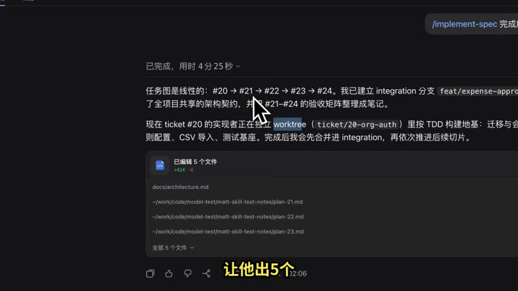
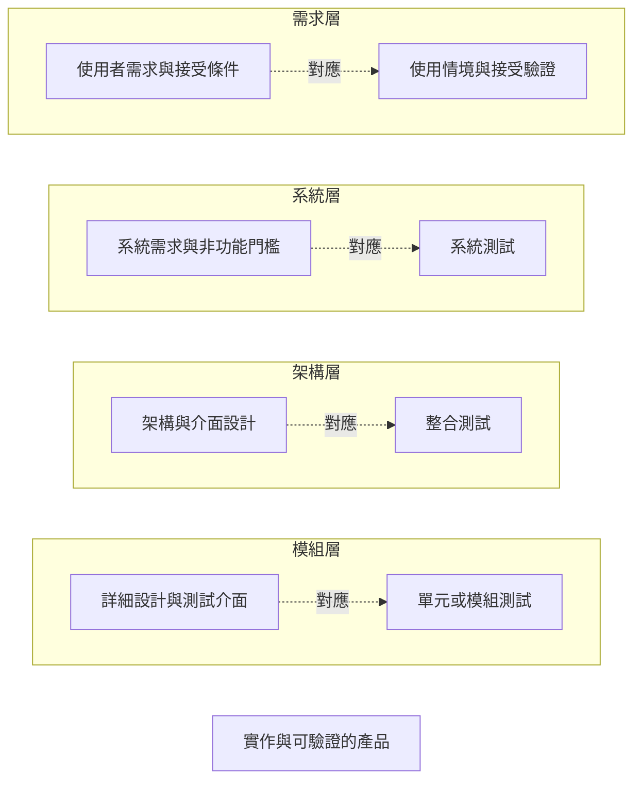
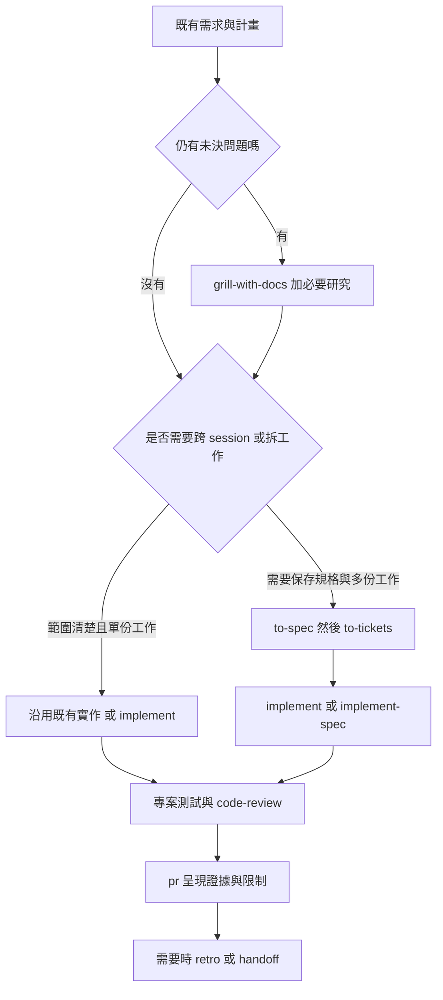

## TL;DR

- **沿用你的流程當主軸**：需求、計畫、設計、實作、需求變更、除錯、bug fix。Matt 的 skills 作為各階段可選工具；下面的 mapping 是 Codex 建議，尚未做整套工作流實測。
- **需求／設計釐清**可選 `grill-with-docs`；**計畫與跨 session 保存**可選 `to-spec`，需要拆工作才接 `to-tickets`；**實作**按規模選 `implement` 或 `implement-spec`。
- **除錯與修復有不同管理目的**：`diagnosing-bugs` 本身已包含診斷、修正與回歸測試；將它分成「找到原因」與「完成修復」兩個出口，是本文配合你的流程提出的管理方式。
- **V-model 右側仍要由專案的驗證補上**：TDD、code review、PR 說明各有用途，不能替代完整的單元、整合、系統與使用情境驗收，也不會自動產生完整需求追溯。
- **舊文需要補實務對照，無須宣稱正式版本升級**：新片展示從 setup 到整份規格實作；靜態比對確認舊文版本與目前 main 的 27 個正式 skills 未變，差異在未正式收錄的實驗稿。

## 摘要（Summary）

這篇從 AI随风的常用 skills 實測影片出發，與 [2026-10-17 的 grilling／v1.3 主篇](./2026-10-17-MATT-POCOCK-SKILLS-V13-GRILLING-COMPOSITION-AND-DELIVERY-WORKFLOW.md) 對照，回答實際問題：**已經有自己的開發流程，如何只在需要的節點借用 Matt 的方法？**

使用者提供的流程是「需求、計畫、設計、實作、需求變更、除錯、bug fix」，並指定 V-model。本文把「計畫」視為跨階段管理，把「需求變更／除錯／修復」整理成可回到受影響階段的路徑；右側另列驗證對應。這是 Codex 對使用者流程的整理方式，不宣稱 Matt 已提供 V-model 套件。

快速閱讀：先看**第 4 節七階段對照**；查個別 skill 看第 3 節；需求變更與除錯看第 7 節；想直接套入既有文件則看第 8 節交接欄位。

## 來源歸屬與驗證範圍

| 內容 | 來源／作者 | 本文的證據界線 |
| --- | --- | --- |
| 影片的操作選擇、報銷審批案例與經驗 | AI随风，2026-10-21，22:34 | 講者的展示與自述；不當成本機成功或受控效能實驗 |
| 正式 skills 的名稱、責任、依賴與預期產物 | Matt repo 固定 commit，plugin manifest 1.3.1 | 靜態查核正式清單與正文；沒有執行這些工作流 |
| 舊文的版本差異與已研究主題 | 2026-10-17 主篇及其固定 commit | 保留歷史研究；本篇新增比較與使用者情境 |
| 需求追溯、變更管理與驗證方法的參考 | NASA Systems Engineering Handbook | 借用可追溯與保留證據的觀念，不宣稱本方案符合 NASA 或其他認證 |
| 七階段 mapping、分類、流程圖、交接欄位與自編案例 | **Codex 建議** | 尚未做完整執行驗證；不歸給講者、Matt 或使用者本人 |

> [!important] 沒有將「研究」寫成「已實測」
> 沿用使用者先前說明，目前沒有可用的 Claude 驗證環境。本文未在 Claude Code／Codex 執行所建議的 V-model 組合。影片轉錄、畫面核對、原始檔比較與文章語法檢查，和產品／工作流驗收分開記錄。

**影片取得與核對方式**：字幕 API、yt-dlp 與播放器均未提供字幕，因此下載音訊，以 MLX Whisper small 全片轉錄，得到 343 段，涵蓋至 22:34。另抽樣檢視 8 個時間點的畫面。機器工作稿中的英文技能名有辨識錯誤，本文依 repo 原始檔校正名稱；這不是人工逐字校對稿，也不是影片示範系統的驗收。

## 關鍵洞察（Key Insights）

以下為 Codex 依來源提出的分析：

1. **階段與 skill 不必一對一。** `domain-modeling` 能支援需求、設計與變更；`handoff` 可用於任一階段的交接。將每項 skill 硬排成一次性的必經步驟，會增加流程負擔。
2. **先看本次工作缺什麼，再選方法。** 缺共同理解用釐清，缺可延續規格用文件，缺工作拆分才用 tickets；已有清楚需求與實作範圍時，可沿用原有實作方式。
3. **需求變更與 bug 的分流點是既定期望是否改變。** 改期待行為，要更新基線與受影響測試；既有期待未變卻行為錯誤，才先診斷。
4. **V-model 的連接點是可核對的產物。** 需求、設計、ticket、commit、test case 與執行證據要能互相追溯；一串 skill 名稱本身不會建立這些關係。

## 詳細內容（Details）

### 1. 新影片與舊文章有什麼不同？要更新哪裡？

| 面向 | 2026-10-17 主篇 | 2026-10-21 新影片 | 本次整合方式 |
| --- | --- | --- | --- |
| 重心 | v1.3 新增交付環節、grilling 組合設計、成本與權限 | 以報銷審批系統展示常用流程 | 舊文保留設計研究；新篇補操作與 V-model 對照 |
| 進入點 | 從想法釐清延伸到交付 | 先 setup tracker／文件配置，再用 ask-matt 選路 | 新篇加「專案前置」與「開發階段」的區別 |
| 計畫與規格 | 有整體流程，但非逐步實測教學 | 展示 grill-with-docs、to-spec、to-tickets | 補每階段輸入、預期產物與交接條件 |
| 實作 | 深入 implement-spec 任務圖與 integration branch | 展示工作拆分與子代理／worktree 執行 | 對照直接實作、單份工作與多票調度的適用範圍 |
| 需求變更與 bug fix | 未以使用者的日常階段作為主索引 | 片尾介紹其他常用方法，未提供完整 V-model 映射 | 由 Codex 補變更、診斷、修復三條路線，明列為建議 |
| 可靠性與效率 | 原始檔、issues、context 字元與失敗回報 | 講者的操作經驗與時間／代理數敘述 | 保留證據層級；不把講者一次經驗當成保證 |

**靜態查核結果**：舊文固定 `49dd158…`，本次 main 為 `5beb35b…`；plugin 仍是 **1.3.1、27 個正式 skills**。兩版差異只出現在 `skills/in-progress/chief-of-staff/SKILL.md` 與對應 changeset，正式 skills 與 manifest 無變更。[固定版本比較][compare]、[正式清單][manifest]

因此建議更新的是實務導讀、使用者流程對照與影片差異，無須將舊文改成「正式 skills 又升級」或重新安裝的結論。

### 2. 影片裡可回看的操作節點

時間點依影片章節與機器轉錄交叉定位；內容以講者介紹與畫面為來源，並由 repo 正文校正名稱與責任。雖然片名寫「全技能實測」，講者在 [22:24](https://www.youtube.com/watch?v=cN0xrbc_7uQ&t=1344s) 說明還有很多技能未介紹；第 3 節完整 27 項分類來自 repo 查核，不表示影片逐項測過 27 項。

| 時間 | 影片內容 | 對你原有流程的用途 |
| --- | --- | --- |
| [01:14](https://www.youtube.com/watch?v=cN0xrbc_7uQ&t=74s) | setup：issue tracker、triage labels、領域文件配置 | 採用工程 skills 前的專案設定，不是每個需求重跑的開發階段 |
| [04:56](https://www.youtube.com/watch?v=cN0xrbc_7uQ&t=296s) | ask-matt：不知道選哪個方法時請它建議 | 可選導航；不取代你的既有階段管理 |
| [05:41](https://www.youtube.com/watch?v=cN0xrbc_7uQ&t=341s) | grill-with-docs：釐清報銷審批需求並保存共識 | 需求、設計與變更中的未決問題 |
| [11:27](https://www.youtube.com/watch?v=cN0xrbc_7uQ&t=687s) | to-spec：將討論整理成規格 | 跨 session 保存需求與測試決策 |
| [13:47](https://www.youtube.com/watch?v=cN0xrbc_7uQ&t=827s) | to-tickets：拆工作並建立阻塞關係 | 計畫與多份工作的依賴安排 |
| [17:55](https://www.youtube.com/watch?v=cN0xrbc_7uQ&t=1075s) | implement-spec：依任務圖推進實作 | 已有 spec／tickets 的大型工作 |
| [19:35](https://www.youtube.com/watch?v=cN0xrbc_7uQ&t=1175s) | 講者回顧此次執行的耗時與代理數 | 單次經驗，不當成效能保證或本機驗收 |
| [20:18](https://www.youtube.com/watch?v=cN0xrbc_7uQ&t=1218s) | pr、retro、teach、writing-for-agents、bug 方法、handoff、prototype 等 | 分別放到交付、回顧、學習、診斷與設計支援 |

#### setup 補的是設定，不是產品驗收

影片 [03:30](https://www.youtube.com/watch?v=cN0xrbc_7uQ&t=210s) 畫面詢問 triage label，並提示當時示範目錄尚缺可直接使用的 Git repo／remote。原始檔的配置包含 `docs/agents/issue-tracker.md`、`docs/agents/domain.md`，有安裝 triage 才設定 `triage-labels.md`；導覽寫入既有 `CLAUDE.md` 或 `AGENTS.md`，不是一定兩份都新建。[setup 原始檔][setup]

五個預設 triage 狀態角色是 `needs-triage`、`needs-info`、`ready-for-agent`、`ready-for-human`、`wontfix`。它們管理分流與可處理性，不等同「未開始／實作中／測試通過／已驗收」四種進度。**將角色與執行／驗收狀態分開管理，是 Codex 的整合建議。**

#### 依賴圖決定可並行程度

影片 [19:00](https://www.youtube.com/watch?v=cN0xrbc_7uQ&t=1140s) 中的 agent 文字回報稱，任務圖為 `#20 → #21 → #22 → #23 → #24`，並提到 integration branch 與 worktree。這能證明畫面展示了這種安排的回報；本研究沒有讀取示範 repo 的 Git 狀態或驗證實際執行。**Codex 的判讀**：若依賴確為線性，不能只靠增加票數保證加速。



講者在 [19:35](https://www.youtube.com/watch?v=cN0xrbc_7uQ&t=1175s) 自述此次花 **1 小時 18 分鐘、開啟 9 個智能體**；在 [20:12](https://www.youtube.com/watch?v=cN0xrbc_7uQ&t=1212s) 接著提到後續可提 PR 或自行測試。本研究沒有相同任務的序列組、成本或驗收品質對照，也沒有取得示範 repo 核實上述執行結果。

#### 影片用語與固定 repo 正文，要分開引用

| 講者說法／示範 | 固定版本原始檔與本文判讀 |
| --- | --- |
| [03:16](https://www.youtube.com/watch?v=cN0xrbc_7uQ&t=196s) 用未開始、執行中、完成、驗收解釋 labels | setup 的五個預設值是 triage 狀態角色；本文另區分工作進度與驗收證據。[setup][setup] |
| [14:04](https://www.youtube.com/watch?v=cN0xrbc_7uQ&t=844s) 提到垂直或水平拆分 | to-tickets 原則是端到端垂直切片，wide refactor 才有 expand–contract 等例外。[to-tickets][to-tickets] |
| [15:46](https://www.youtube.com/watch?v=cN0xrbc_7uQ&t=946s) 強調建立 tickets 一定要有 spec | to-tickets 正文也接受 plan 或目前討論；implement-spec 則明確以 spec 及關聯 tickets 為前提。使用者可保留足夠的既有計畫。[to-tickets][to-tickets]、[implement-spec][implement-spec] |
| [19:08](https://www.youtube.com/watch?v=cN0xrbc_7uQ&t=1148s) 概述每票 review、PR、關票與清理 | implement-spec 的目標是整份規格整合到 integration branch；最後審查整合分支，PR 依 tracker 結案方式或使用者要求，不能簡化成每票固定開 PR。[implement-spec][implement-spec] |
| [20:29](https://www.youtube.com/watch?v=cN0xrbc_7uQ&t=1229s) 說 retro 可定時回顧 | repo 正文提供回顧方法，沒有在該 skill 內實作排程器；定期執行需要宿主或使用者另行安排。[retro][retro] |
| [21:49](https://www.youtube.com/watch?v=cN0xrbc_7uQ&t=1309s) 以單頁、多風格 UI 介紹 prototype | 這是 UI 用法；repo 也包含 logic prototype，並將原型定位為可拋棄的設計實驗。[prototype][prototype] |

這些差異用來校正適用範圍，不代表本研究已執行其中任何工作流。

### 3. 先把正式 27 項分成功能類別

**下表分類為 Codex 整理，不是上游新增的 metadata。** 計數只依 plugin manifest；附檔、misc 與 in-progress 不另算正式 skill。每項名稱連到固定版本原始檔。

| 功能類別 | Skill | 放入你的工作流程 | 原始檔的用途／預期產物 |
| --- | --- | --- | --- |
| 導覽／環境 | [ask-matt][ask-matt] | 各階段卡在選方法時 | 建議路線，不是全流程執行器 |
| 導覽／環境 | [setup-matt-pocock-skills][setup] | 專案前置 | tracker、triage 詞彙、領域文件與 agent 導覽配置 |
| 需求／知識 | [grill-me][grill-me] | 需求、設計、變更 | 載入 grilling 的對談入口，沒有自行存檔步驟 |
| 需求／知識 | [grill-with-docs][grill-with-docs] | 需求、設計、變更 | 組合 grilling 與 domain-modeling |
| 需求／知識 | [grilling][grilling] | 有未決問題的階段 | 決策樹、分輪問題與共同理解；沒有固定輸出檔 |
| 需求／知識 | [research][research] | 需求、計畫、設計、變更影響 | 背景研究與有來源的 Markdown |
| 需求／知識 | [to-questionnaire][to-questionnaire] | 需由他人提供資料時 | 可交給指定對象填答的問卷 |
| 設計 | [domain-modeling][domain-modeling] | 需求、設計、變更 | 術語與領域界線；適當時保存 glossary／ADR |
| 設計 | [codebase-design][codebase-design] | 設計、可測試性改善 | 模組介面、seams 等設計詞彙與原則 |
| 設計 | [prototype][prototype] | 設計未知點 | 可拋棄的 logic／UI 原型及設計結論 |
| 設計 | [improve-codebase-architecture][architecture] | 既有架構改善 | 候選報告，再討論所選改善 |
| 計畫 | [to-spec][to-spec] | 需求定稿、計畫、變更 | 已有討論的規格、排除範圍與實作／測試決策 |
| 計畫 | [to-tickets][to-tickets] | 大型計畫、變更重排 | 可驗證工作切片、acceptance criteria、blocking edges |
| 計畫 | [wayfinder][wayfinder] | 超過一個 session 的大型未知工作 | map、決策 tickets、解答與來源指標 |
| 實作／驗證 | [implement][implement] | 單份實作、明確 bug fix | 當前工作範圍的程式、測試、commit 與 review |
| 實作／驗證 | [implement-spec][implement-spec] | 整份 spec 的多票實作 | 任務圖調度、worktrees 與 integration branch |
| 實作／驗證 | [tdd][tdd] | 實作、bug fix | 在同意的測試介面上逐步先紅後綠 |
| 實作／驗證 | [code-review][code-review] | 實作或修復後 | Standards／Spec 雙軸審查；不是執行測試的替代品 |
| 維護／交付 | [triage][triage] | 外來需求、變更、bug 回報入口 | 分類、驗證回報、狀態與 agent brief |
| 維護／交付 | [diagnosing-bugs][diagnosing-bugs] | 除錯、bug fix | 重現迴圈、假說、探針、修正、回歸與清理 |
| 維護／交付 | [pr][pr] | 實作或修復的交付 | Summary、Evidence、Merge Danger 的 PR 文字 |
| 維護／交付 | [retro][retro] | 一輪工作結束後 | 根據 session 提出環境改善候選 |
| 橫向支援 | [handoff][handoff] | 任一階段交接 | 指向既有產物的交接 Markdown |
| 橫向支援 | [writing-for-agents][writing-for-agents] | 維護 agent 文件 | 文件結構、精準指標與完成條件 |
| 橫向支援 | [wizard][wizard] | 必須人工處理的操作 | 互動 bash 操作引導 |
| 橫向支援 | [teach][teach] | 學習與新人導入 | 教材、練習與學習紀錄 |
| 橫向支援 | [wait-what][wait-what] | 任一階段理解落差 | 重述上一段說明，不是重跑整個流程 |

### 4. 七階段 mapping：輸入、選用方法、產物與交接條件

**整張表都是 Codex 未實測的組合建議。** 沿用你的階段名稱；可只選其中一個方法，產物也可由既有流程與工具完成。

| 你的階段 | 輸入 | 可選 skills | 預期產物 | 建議交接條件 |
| --- | --- | --- | --- | --- |
| 需求 | 問題、現況、使用情境、限制 | grill-with-docs／grill-me；需要時 research、to-questionnaire | 範圍、可觀察行為、術語、未決項 | 每項需求有來源與可判定接受條件 |
| 計畫 | 已釐清需求、資源與時程 | 跨 session 可用 to-spec；需拆工作才用 to-tickets；大型未知才 wayfinder | 規格、依賴、風險與驗證安排 | 工作範圍清楚，票有驗收條件，blockers 可追溯 |
| 設計 | 規格、既有架構、異常情境 | domain-modeling、codebase-design；必要時 prototype／架構健檢 | 介面、狀態轉換、seams、適當 ADR | 設計覆蓋需求與失敗情境；原型與正式驗證分開 |
| 實作 | 明確工作與設計／seams | implement 或 implement-spec；其中使用 tdd、code-review；交付可用 pr | 程式、測試、commit／整合分支與證據 | 實際測試結果對應需求；未測項明列 |
| 需求變更 | 舊基線、新要求、理由與版本 | 需要時 triage／grill-with-docs；更新 spec、設計、tickets | 差異、影響分析、變更後的文件與測試範圍 | 確定採用範圍；標出失效舊證據與重驗範圍 |
| 除錯 | 既定期望未達成、症狀、版本、log | diagnosing-bugs 的診斷部分 | 真正能抓症狀的重現命令、最小案例、根因或 unknown | 假說有證據；無法重現時不假裝已找到原因 |
| bug fix | 已知原因、有效 repro、影響範圍 | diagnosing-bugs 後半；或明確工作交給 implement／tdd，再 review | 最小修正；有正確 seam 才加回歸測試，否則記錄缺口 | 原始案例已重跑；相關回歸與審查完成，限制明列 |

`to-spec` 的正文負責彙整既有對話，不是重新做需求訪談；仍有未決需求時先釐清。`wayfinder` 的主要產物是大型工作的決策地圖；`to-tickets` 則拆可實作的工作，兩種票不能混成同一層。[to-spec][to-spec]、[wayfinder][wayfinder]、[to-tickets][to-tickets]

**V-model 的階段與 ticket 切分是兩個維度。** `to-tickets` 原始檔可接受既有 plan、spec 或當前討論，並以能獨立展示／驗證的端到端垂直切片為原則；跨全庫的機械式重構另有 expand–contract 例外。**Codex 的映射建議**：每張功能票仍走適當的需求、設計、實作與驗證，不直接把「資料庫全部做完／再做全部 API／最後 UI」當成預設分票方式，也不為了使用工具而重寫已足夠的既有計畫。[to-tickets 原始檔][to-tickets]

### 5. V-model 的左側與右側怎麼對應？

下圖與表格是 **Codex 為本次需求畫的對照**。它表示需求／設計與驗證的關係，不是 Matt 或 NASA 發布的標準圖，也不是已運作的自動化流程。



| 左側定義 | skills 可以協助的材料 | 右側要真正完成的驗證 |
| --- | --- | --- |
| 使用者需求 | grilling 的共同理解、spec stories、接受條件 | 使用情境與接受驗證；是否符合使用者期待 |
| 系統需求 | spec 的測試決策與限制 | 系統功能、效能、可靠性、資安等符合性結果 |
| 架構與介面 | codebase-design 的邊界、domain-modeling 的詞彙、介面契約 | 跨模組／服務整合、失敗路徑、相容性與時序 |
| 詳細設計與程式 | tdd、適當 seam 的 bug regression | 單元／模組測試的實際結果與覆蓋範圍 |

NASA 的需求管理章節支持維護需求基線、變更影響與跨文件追溯；驗證章節要求對照指定需求及接受條件，並保留執行資料。本文借用這些觀念補足交接欄位，沒有要求你採用 NASA 的整套程序。[需求管理][nasa-requirements]、[產品驗證][nasa-verification]

> [!warning] 現有 27 項沒有替你完成整條 V 的保證
> `tdd` 支援部分行為測試；`code-review` 審查規範與規格；`pr` 呈現證據。專案的整合、系統、非功能及目標環境驗證仍需自己的方法。合進 integration branch 不代表整合測試通過，prototype 可操作也不等於正式驗收完成。

### 6. 如何組合連接：原始檔的依賴與你的流程分開看

| repo 正文的直接依賴 | 本文如何解讀 |
| --- | --- |
| grill-me → grilling | wrapper 載入共用問答方法 |
| grill-with-docs → grilling、domain-modeling | 分別載入問答與領域文件方法 |
| implement → tdd、code-review | 在原始檔適用條件下使用實作／審查方法 |
| implement-spec → tdd、code-review | 調度 implementer 及整合審查；**正文沒有要求呼叫 implement skill** |
| retro → writing-for-agents | 回顧環境前使用文件寫作原則 |

這些箭頭是原始檔的載入要求，並非本次執行結果。下面的階段串接則是 **Codex 建議的人工／文件交接路線**，不表示 A 會自動成功呼叫整串 B：



跨宿主的名稱、載入機制與 user-only 限制詳見 [[2026-10-22-SKILL-TO-SKILL-DELEGATION-CLAUDE-CODE-CODEX-WORKAROUNDS-AND-EVIDENCE|A→B 暫解與證據專篇]]。本篇不新增「只寫名稱就必然載入」的保證。

### 7. 三種回返路徑：需求變更、除錯、bug fix

以下三條是 **Codex 為你的流程提出的分流方式，未實測**。它們可以在任何適用階段開始，不需要每次從需求第一步重跑。

| 情境 | 判斷依據 | 建議連接方式 | 回到哪一層 |
| --- | --- | --- | --- |
| 需求變更 | 希望的行為、限制或接受條件改了 | 比較基線 → 影響分析 → 必要釐清 → 更新 spec／設計／tickets／測試 → 實作與重驗 | 回到最早受影響的需求或設計層 |
| 除錯，原因未知 | 既定期待沒改，但觀察到失敗、錯誤或效能退化 | diagnosing-bugs：建可判定症狀的迴圈 → 重現／縮小 → 假說／探針 → 根因或 unknown | 根因所在層；不要先假定一定要改程式 |
| bug fix，原因已有證據 | 已有有效 repro、原因與原本期待 | 有正確 seam 才做 failing regression，否則記錄缺口 → 最小修正 → 原始情境與相關回歸 → review／交付 | 修正程式或設計，再走受影響的驗證 |

#### 7.1 需求變更：先更新判定標準，再看哪些證據失效

正式 27 項中沒有專用的 change-control skill。`triage` 可處理外來原始請求，`grill-with-docs` 可釐清未決取捨，`to-spec`／`to-tickets` 可協助保存與重排；**把這些接成變更管理路線是 Codex 建議**。

建議在既有變更紀錄中加入：舊行為、新行為、理由、受影響需求／設計／介面、需重驗項目，以及哪些舊結果仍適用。更新文件時保留原基線與差異，避免把「改了期待」誤記成「修掉了舊 bug」。

#### 7.2 除錯：先取得能抓到症狀的迴圈

[diagnosing-bugs 原始檔][diagnosing-bugs] 的六個階段為：建立 feedback loop、重現與最小化、提出可否證假說、加入對應探針、修正與回歸測試、清理。它要求先有已執行、能對使用者精確症狀判紅／綠的命令，再進入後續診斷。

根因可以是需求不清、設計缺口、程式錯誤、資料或環境問題。本文建議將**根因有證據**作為可交給修復的出口；若無法建立重現條件，則標記為**暫停／阻塞、unknown，並列出缺口**，不稱為除錯完成。

#### 7.3 bug fix：上游 skill 已包含這一段

`diagnosing-bugs` Phase 5–6 已涵蓋 fix、regression 與 cleanup，並非還要找另一個名叫 `bug-fix` 的正式 skill。影片口語提及的 bug 方法，在本次固定清單中對應的是 **`diagnosing-bugs`**。

若原因已知、工作範圍清楚，也可把有效 repro 與驗收條件交給 `implement`。這是 Codex 的選路建議。原始檔特別要求回歸測試必須在能抓到真實 bug 型態的 seam 上；若沒有正確 seam，就記錄缺口，不能用太淺的測試製造安心感。[diagnosing-bugs][diagnosing-bugs]、[implement][implement]

### 8. 讓 skills 接在一起的最小交接契約

**以下欄位與格式由 Codex 提出，未自動實作。** 如果你已有需求文件、issue tracker 或測試管理工具，直接在既有產物保存即可，不必另外再建一套相同文件。

| 交接內容 | 最小欄位 | 對 V-model 的作用 |
| --- | --- | --- |
| 本次工作 | 類型：feature／change／debug／fix；範圍與排除範圍 | 避免需求釐清直接擴成未要求的實作 |
| 需求與基線 | REQ ID、版本、來源、接受條件 | 知道右側正在驗證哪一份期待 |
| 設計 | 介面、狀態／資料規則、必要 ADR、test seam | 讓測試能抓到對應設計的失敗 |
| 工作依賴 | spec／ticket、blocking edges、目前狀態 | 決定哪些工作能開始，哪些必須等 |
| 驗證 | test case ID、命令／程序、環境、build／commit、結果與證據 | 區分已測、失敗、未測與環境不可用 |
| 變更影響 | 受影響項、失效舊結果、重驗範圍 | 防止沿用已不適用的綠燈 |
| 下一步 | 下一階段、待處理問題、交接檔案指標 | handoff 能延續工作，不必再猜背景 |

```text
REQ ID ↔ 規格／設計 ↔ ticket／commit ↔ test case ↔ 執行結果
```

這條追溯鏈是本篇建議保存的關係，不是 `to-spec` 或 `pr` 必然完整產生的資料模型。NASA 的需求管理文件也強調跨基線與工作產物的追溯；具體 ID、表格與工具選擇則是本篇的自編方案。[需求管理][nasa-requirements]

可複用的交接指示如下。這是 **Codex 自編範本，未實測**，其中 skill 名稱仍須依宿主實際註冊名稱解析：

```markdown
Continue within my existing development workflow.

Current stage: <requirements | planning | design | implementation | change | debug | fix>
Task type and scope: <what this work must accomplish>
Requirement baseline: <requirement IDs, version, source, acceptance criteria>
Existing artifacts: <spec, design, tickets, code, logs, test results>
Known decisions and open questions: <record both>

Choose only the skills useful for this stage and explain the choice briefly.
Resolve registered skill names and respect the host's invocation policy.
If a skill cannot be loaded, report that result instead of claiming it ran.

Before handing off, record:
- the artifacts created or changed;
- the requirement and design items they address;
- checks actually executed, with environment and results;
- checks not performed and the reason;
- affected old evidence and the next step.
```

### 9. 自編例子：用同一個報銷需求走三條路

影片使用報銷審批系統；**以下規則、金額、ID 與 bug 均由 Codex 自編，並非影片逐字內容，也沒有執行結果**。

#### 9.1 新功能

假設 `REQ-EXP-01 v1` 是「超過 10,000 元的報銷，必須由主管核准後才可付款；小於或等於 10,000 元免主管核准，但仍須通過其他既定審查」。另有 `REQ-PAY-01 v1`：「同一張單據最多成功付款一次」。這兩條都是自編的需求基線。

| 你的階段 | 建議操作與產物 | 對應的驗證問題 |
| --- | --- | --- |
| 需求 | 必要時 grill-with-docs，釐清等於門檻、退件、代理主管等條件 | 使用者是否接受這份規則與異常情境？ |
| 計畫 | 已清楚的小工作直接沿用計畫；跨 session 才保存 spec，需拆工作才建 tickets | 哪些工作能獨立驗收？哪些互相阻塞？ |
| 設計 | 確定審批狀態、權限、付款介面與 test seams | 跨模組及異常路徑怎麼驗？ |
| 實作 | implement 或既有流程，必要時 TDD | 邊界條件與狀態規則是否被正確實作？ |
| V-model 右側 | 模組規則、審批／付款整合、完整報銷情境 | 每個結果能否回指 REQ-EXP-01 v1？ |

#### 9.2 需求變更

若門檻由 10,000 改成 20,000，且「門檻以下含等於時免主管核准」的規則不變，先記錄新基線 `REQ-EXP-01 v2`，並確認改動是否影響舊單據、既有審批與權限。更新設計／設定與受影響測試，再實作。

原本對 15,000 元要求主管核准的測試，不能原封不動當成 v2 的正確結果。這個例子說明為什麼需求變更需要管理「哪些舊證據失效」，而非只把 ticket 從未開始改成完成。

#### 9.3 bug fix

若既定的 `REQ-PAY-01 v1` 未變，卻觀察到「同一張單可重複付款」，先以 diagnosing-bugs 建立能穩定觀察重複付款的 repro，檢查根因。

若證據指向併發狀態更新，才依證據選擇修正，再以能涵蓋多次呼叫／併發的 seam 做回歸。只測一個函式單次返回成功，未必能抓到原始問題。修正後還要重跑原來的報銷與付款情境。以上是診斷計畫，沒有預先斷言某個具體根因。

### 10. 我建議你先怎麼用？

以下是 **Codex 的採用優先順序，未經使用者流程實測**：

1. **先補你現有流程的交接證據。** 沿用需求、計畫、設計文件；為每次實作／修復記下驗收條件、實際測試及限制。需要整理交付說明時才用 `pr`。
2. **遇到不確定點才選專用方法。** 需求未決用 `grill-with-docs`；根因未知用 `diagnosing-bugs`；設計未知用 `prototype` 或 `codebase-design`。不為已定案內容重新訪談。
3. **工作跨多個 session 才提高文件與調度強度。** 用 `to-spec` 保存、需要時 `to-tickets` 拆分，再依規模選 `implement`／`implement-spec`。先有實際切分需求，再考慮並行。

`setup` 是配置前置，`ask-matt` 是選路支援，`handoff` 是交接，`retro` 是回顧，`teach` 是學習。它們可以圍繞你的原有流程使用，無須成為每次必經的主線。

## 我的心得（My Takeaways）

**本節為 Codex 的分析與建議。** 這次最有用的整合是把「skill 的方法」與「你的流程控制」連起來：先用階段與產物決定需要什麼，再挑一個能補缺口的方法。

舊文回答這套 skills 如何設計、為何組合會失敗；新片補一條操作路線；本篇將兩者整理成可查的工作對照。這三份材料有不同用途，不需要把舊文整篇換掉。

## 待補充（Open Questions）

1. 在你實際專案中，哪些工作可在單次 session 完成，哪些真的需要 spec／tickets？搜尋：`task scope context session decomposition`；未來以實際任務紀錄判斷。
2. 哪個既有工具適合保存需求 ID、設計、測試與結果的雙向追溯，避免重複抄寫？搜尋：`requirements traceability existing issue tracker test evidence`。
3. 目前缺可用 Claude 驗證環境；未來哪個宿主能保留依賴載入、權限與交接語意？搜尋：`skill composition delegated invocation host compatibility`。
4. 你的系統／整合／非功能／目標環境驗證有哪些既有命令與門檻，哪些仍需人工觀察？搜尋：`verification plan target environment acceptance criteria`。
5. 原因已知的修復交給 implement，與完整 diagnosing-bugs 流程相比，何時省成本且不漏回歸？搜尋：`known cause bug fix regression seam workflow evaluation`。
6. 相同任務與品質門檻下，多 worktree 並行相較序列實作的時間、token、整合成本如何？搜尋：`critical path parallel agent worktree benchmark`。

## 相關連結（Related）

- [[2026-10-17-MATT-POCOCK-SKILLS-V13-GRILLING-COMPOSITION-AND-DELIVERY-WORKFLOW]]：[v1.3／grilling 主篇](./2026-10-17-MATT-POCOCK-SKILLS-V13-GRILLING-COMPOSITION-AND-DELIVERY-WORKFLOW.md)，保留版本、組合、權限、成本與交付研究；本篇補工作流映射。
- [[2026-10-22-SKILL-TO-SKILL-DELEGATION-CLAUDE-CODE-CODEX-WORKAROUNDS-AND-EVIDENCE]]：A→B 的官方說明、具名回報與未實測暫解，解釋流程箭頭的執行限制。
- [[2026-04-24-MATT-POCOCK-AI-CODING-WORKFLOW-FULL-WALKTHROUGH]]：較早的完整操作研究，可與本片與使用者階段對照閱讀。

## 知識層次分析（Bloom's Taxonomy Analysis）

本節由 Codex 編寫，屬於學習與分析框架，沒有新增工作流執行證據。

| 認知層次 | 核心目的 | 對本文的具體應用 |
| --- | --- | --- |
| 記憶 | 分辨工具用途 | 記住需求釐清、規格彙整、任務拆分、診斷、實作、審查各有不同方法 |
| 理解 | 連接原有流程 | 一個階段可用多種方法，一個方法也可跨多個階段；計畫與驗證不只各出現一次 |
| 分析 | 檢查不當等同 | 問答對齊不等於需求驗收；合併分支不等於整合測試；有 PR 不等於證據已存在 |
| 應用 | 加入既有工作 | 為一個真實任務標示階段與接受條件；為一次變更記錄失效舊測試；為 bug 建立有效 repro |
| 評估 | 比較採用成本 | 小工作沿用現況，跨 session 才保存／拆分，明確區分文件成本與並行收益 |

### 分析型追問（Socratic Follow-up）

- **澄清**：你說的「需求完成」是共同理解，還是已可用接受條件驗證？
- **假設**：若工作切成多票卻形成單一依賴鏈，並行調度還帶來多少收益？
- **證據**：如果只有 review 結論，如何證明系統或硬體上的原始失敗已消失？
- **觀點**：對已有成熟 V-model 與文件的人，哪些 skills 會重複現有步驟？
- **後果**：需求改版時，哪些舊測試結果會失去適用性，誰負責標記？

### 方案批判三問

1. **最大的風險是什麼？** 將一串 skill 名稱或完成票數當作 V-model 驗證完成，遺漏需求追溯與系統層結果。
2. **什麼情況下會失敗？** 依賴載入不成功、需求基線未更新、錯用 test seam、工作看似獨立卻共享狀態，或缺少實際驗證環境。
3. **有沒有更好的替代方案？** 對已清楚的小工作保留原流程，只補精準問題與證據欄位；大型未知或多 session 工作才增加規格、票與調度。

## 六頂思考帽回饋（Six Thinking Hats Feedback）

本節由 Codex 編寫，是文章回饋與採用建議，不代表講者、Matt 或使用者已驗證的結論。

### 藍帽：問題與範圍

以使用者原有 V-model 工作流程為主，評估每個方法在哪個缺口有幫助，而非要求更換整套流程。

### 白帽：事實與未知資訊

已知影片的發布日期、章節與示範畫面，也已查核正式 27 項原始檔及版本差異。未知的是映射在使用者實際任務中的成本、誤觸發與端到端驗證結果。

### 紅帽：直覺與讀者反應

多了一套技能名稱，容易讓已有流程的人感到必須重學。用熟悉的階段作索引，可先找到眼前需要的一項方法。

### 黃帽：價值與可保留內容

保留既有流程與驗證習慣，再加入文件化決策、有效重現迴圈及精準交接，可能比全面搬用一條示範路線更容易評估成效。

### 黑帽：風險與限制

影片的單次展示不能證明並行必然省時；靜態依賴不能證明宿主載入成功；TDD／review 不能涵蓋所有系統與目標環境驗證。

### 綠帽：替代方案與新應用

將七階段表作為自己的查詢索引，保留既有工具；若常有相同交接缺口，再考慮自動整理追溯關係與驗證證據。

### 藍帽：修改項目與下一步

1. 選一個實際任務，先以階段與交接欄位記錄現況。
2. 只在明確缺口加入一項方法，保留採用前後的產物與成本。
3. 有可用環境後再驗證宿主組合，不把本文的 mapping 當成已安裝流程。

## References

- [AI随风：本次影片](https://www.youtube.com/watch?v=cN0xrbc_7uQ)
- [Gary Chen：舊文影片](https://www.youtube.com/watch?v=QqhyqMvdx5Q)
- [Matt repo：正式 plugin manifest][manifest]
- [舊文與本次 repo 的固定版本比較][compare]
- [Matt：選路說明 ask-matt][ask-matt]
- [Matt：Skill mechanics][mechanics]
- [NASA：Requirements Management][nasa-requirements]
- [NASA：Product Verification][nasa-verification]

[manifest]: https://github.com/mattpocock/skills/blob/5beb35b040e3de97e54fa9e386d7e42d15c295c2/.claude-plugin/plugin.json
[compare]: https://github.com/mattpocock/skills/compare/49dd158d1076134a641b33efb035946536778336...5beb35b040e3de97e54fa9e386d7e42d15c295c2
[ask-matt]: https://github.com/mattpocock/skills/blob/5beb35b040e3de97e54fa9e386d7e42d15c295c2/skills/engineering/ask-matt/SKILL.md
[setup]: https://github.com/mattpocock/skills/blob/5beb35b040e3de97e54fa9e386d7e42d15c295c2/skills/engineering/setup-matt-pocock-skills/SKILL.md
[grill-me]: https://github.com/mattpocock/skills/blob/5beb35b040e3de97e54fa9e386d7e42d15c295c2/skills/productivity/grill-me/SKILL.md
[grill-with-docs]: https://github.com/mattpocock/skills/blob/5beb35b040e3de97e54fa9e386d7e42d15c295c2/skills/engineering/grill-with-docs/SKILL.md
[grilling]: https://github.com/mattpocock/skills/blob/5beb35b040e3de97e54fa9e386d7e42d15c295c2/skills/productivity/grilling/SKILL.md
[research]: https://github.com/mattpocock/skills/blob/5beb35b040e3de97e54fa9e386d7e42d15c295c2/skills/engineering/research/SKILL.md
[to-questionnaire]: https://github.com/mattpocock/skills/blob/5beb35b040e3de97e54fa9e386d7e42d15c295c2/skills/productivity/to-questionnaire/SKILL.md
[domain-modeling]: https://github.com/mattpocock/skills/blob/5beb35b040e3de97e54fa9e386d7e42d15c295c2/skills/engineering/domain-modeling/SKILL.md
[codebase-design]: https://github.com/mattpocock/skills/blob/5beb35b040e3de97e54fa9e386d7e42d15c295c2/skills/engineering/codebase-design/SKILL.md
[prototype]: https://github.com/mattpocock/skills/blob/5beb35b040e3de97e54fa9e386d7e42d15c295c2/skills/engineering/prototype/SKILL.md
[architecture]: https://github.com/mattpocock/skills/blob/5beb35b040e3de97e54fa9e386d7e42d15c295c2/skills/engineering/improve-codebase-architecture/SKILL.md
[to-spec]: https://github.com/mattpocock/skills/blob/5beb35b040e3de97e54fa9e386d7e42d15c295c2/skills/engineering/to-spec/SKILL.md
[to-tickets]: https://github.com/mattpocock/skills/blob/5beb35b040e3de97e54fa9e386d7e42d15c295c2/skills/engineering/to-tickets/SKILL.md
[wayfinder]: https://github.com/mattpocock/skills/blob/5beb35b040e3de97e54fa9e386d7e42d15c295c2/skills/engineering/wayfinder/SKILL.md
[implement]: https://github.com/mattpocock/skills/blob/5beb35b040e3de97e54fa9e386d7e42d15c295c2/skills/engineering/implement/SKILL.md
[implement-spec]: https://github.com/mattpocock/skills/blob/5beb35b040e3de97e54fa9e386d7e42d15c295c2/skills/engineering/implement-spec/SKILL.md
[tdd]: https://github.com/mattpocock/skills/blob/5beb35b040e3de97e54fa9e386d7e42d15c295c2/skills/engineering/tdd/SKILL.md
[code-review]: https://github.com/mattpocock/skills/blob/5beb35b040e3de97e54fa9e386d7e42d15c295c2/skills/engineering/code-review/SKILL.md
[triage]: https://github.com/mattpocock/skills/blob/5beb35b040e3de97e54fa9e386d7e42d15c295c2/skills/engineering/triage/SKILL.md
[diagnosing-bugs]: https://github.com/mattpocock/skills/blob/5beb35b040e3de97e54fa9e386d7e42d15c295c2/skills/engineering/diagnosing-bugs/SKILL.md
[pr]: https://github.com/mattpocock/skills/blob/5beb35b040e3de97e54fa9e386d7e42d15c295c2/skills/engineering/pr/SKILL.md
[retro]: https://github.com/mattpocock/skills/blob/5beb35b040e3de97e54fa9e386d7e42d15c295c2/skills/engineering/retro/SKILL.md
[handoff]: https://github.com/mattpocock/skills/blob/5beb35b040e3de97e54fa9e386d7e42d15c295c2/skills/productivity/handoff/SKILL.md
[writing-for-agents]: https://github.com/mattpocock/skills/blob/5beb35b040e3de97e54fa9e386d7e42d15c295c2/skills/productivity/writing-for-agents/SKILL.md
[wizard]: https://github.com/mattpocock/skills/blob/5beb35b040e3de97e54fa9e386d7e42d15c295c2/skills/engineering/wizard/SKILL.md
[teach]: https://github.com/mattpocock/skills/blob/5beb35b040e3de97e54fa9e386d7e42d15c295c2/skills/productivity/teach/SKILL.md
[wait-what]: https://github.com/mattpocock/skills/blob/5beb35b040e3de97e54fa9e386d7e42d15c295c2/skills/productivity/wait-what/SKILL.md
[mechanics]: https://github.com/mattpocock/skills/blob/5beb35b040e3de97e54fa9e386d7e42d15c295c2/skills/productivity/writing-for-agents/SKILL-MECHANICS.md
[nasa-requirements]: https://www.nasa.gov/reference/6-2-requirements-management/
[nasa-verification]: https://www.nasa.gov/reference/5-3-product-verification/
