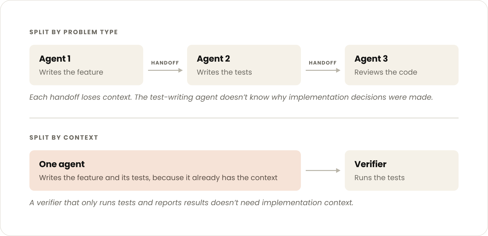
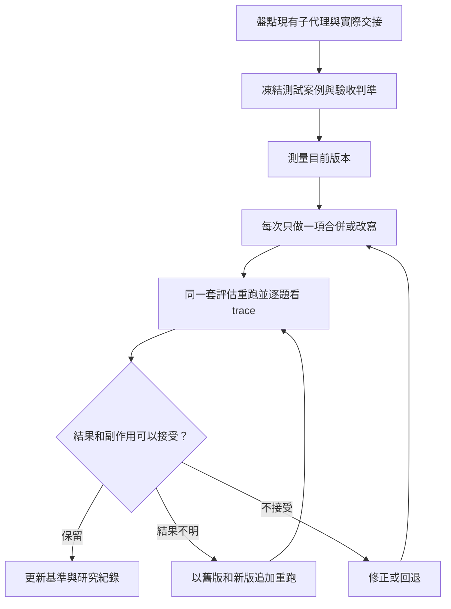
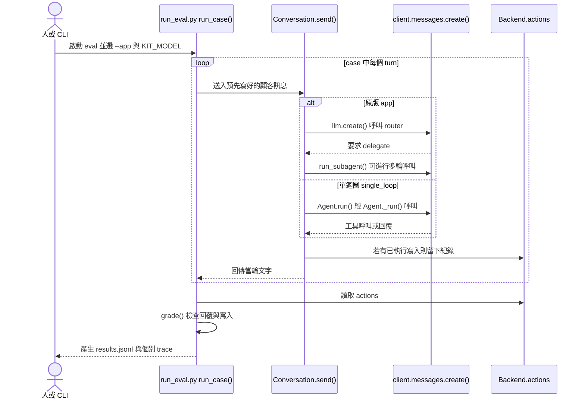
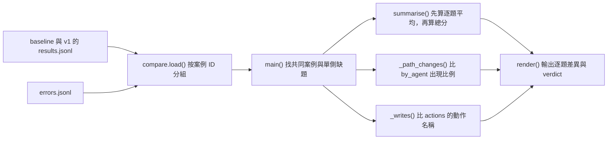
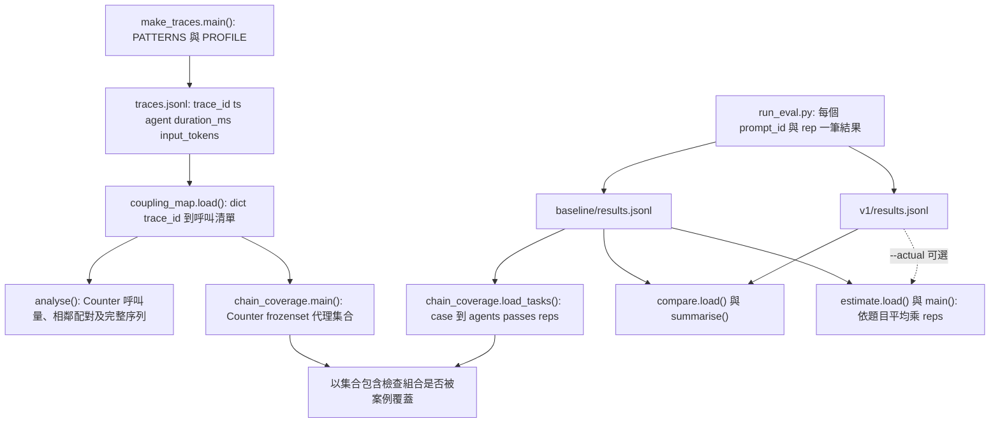

## TL;DR

- **問題**：一個客戶任務跨越多個子代理時，下游只收到摘要，容易遺失證據。每層還增加模型呼叫、提示詞與維護成本。
- **方法**：先建立端到端評估。每次只改一個邊界，選擇合併常一起出現的子代理、把領域步驟併成 Skill 與工具，或保留獨立子代理但改由主 Agent 當工具呼叫。
- **結果**：樣本客服系統併入退貨子代理後，平均延遲由 27.3 降至 19.4 秒，完成由 22/24 增至 23/24，但原本通過的查件情境有一次退步。把 diagnostics 改成工具的全套首輪由 32/34 降至 31/34，追加重跑後作者保留該分支。
- **怎麼用**：拿同一批案例比完成、路徑、寫入副作用、延遲和 token。把獨立驗證、大量資料、權限隔離和可平行研究視為保留獨立上下文的候選理由。

## 摘要（Summary）

Diane Sarkis 的文章談的是一個已經部署了 router／orchestrator 加 specialist subagents 的團隊，如何在保留能力的前提下減少重複協調。配套的 `single-agent-loop-kit` 是 Apache-2.0 的 Python 參考專案，包含遷移 Skill、共用評估工具、單一迴圈範例和可跑的虛構家電客服系統。原文另報告一位企業客戶的單迴圈約快兩倍。該數字屬於客戶經驗，配套 GitHub 提供的是另外兩項小規模試驗的原始記錄。[Anthropic 原文](https://claude.com/resources/articles/building-agents-when-to-fold-subagents-into-your-main-agent-loop) · [固定版本 repo](https://github.com/anthropics/single-agent-loop-kit/tree/c43796287b83bec847db923f07131d1cc8de750d)

## 為什麼要改（Why）

照部門分代理，起初能快速分工。但「包裹沒送到，可否退貨」可能跨訂單、物流、退貨。下游如果只拿到上游一句「已確認」，就失去原始查詢和判斷依據。各組只看自己的評估，還可能看不到整件事是否完成。原文希望改用**上下文依賴**決定代理邊界。高度依賴同一段對話、同一筆資料或同一條決策鏈的任務，可以先測合併。低耦合、需要大量獨立探索的任務，適合保留局部上下文。



上圖的例子由同一個 Agent 寫功能和測試，另一個角色只跑測試並回報。這是一種分工示意。若要評估規格是否完整或測試是否測錯，仍需為驗證者提供規格與獨立判準。[原圖](https://assets.claude.com/cd4b9c4417d5ba31776e8aa79e204966c08c6a43.png)

## 方法與架構（What & How）

### 漸進揭露（Progressive Disclosure）

主 Agent 預先看到技能與工具的簡短索引，工作做到相應領域才讀完整 Skill 或查出對應工具。Skill 管程序及判斷，工具做即時查詢、固定格式輸出和外部操作，知識庫存參考資料。不可省略的業務檢查、授權和寫入限制由程式執行。原文也建議由小型核心團隊維護系統提示詞和端到端測試，各領域團隊維護自己的技能、工具和測試案例。[Anthropic 原文](https://claude.com/resources/articles/building-agents-when-to-fold-subagents-into-your-main-agent-loop#how-several-teams-can-contribute-to-a-single-agent)

```text
┌──────────────────┐     ┌─────────────────────────────┐
│ 使用者與對話歷程 │ ──► │ 主 Agent 與同一份執行上下文 │
└──────────────────┘     └─────────────┬───────────────┘
                      ┌────────────────┼───────────────────┐
                      ▼                ▼                   ▼
                技能按需載入     資料工具與寫入閘     保留的獨立子代理
                      └────────────────┴─────────┬─────────┘
                                         結果回到主迴圈
```

| 判斷 | 如何做 | 客服例子 |
| --- | --- | --- |
| **Merge** | 合併經常串接或經常交換資料的子代理，縮減交接次數 | 稽核把 orders 和 shipping 列為候選。實驗紀錄沒有執行這一項。 |
| **Fold** | 將領域指示變成按需讀取的 Skill，資料查詢或動作變成薄工具 | returns 的程序進 Skill，主 Agent 可使用退貨相關工具。 |
| **As tool** | 讓主 Agent 維持對話，用有結構回傳的工具呼叫獨立子代理 | diagnostics 在獨立上下文讀裝置日誌，回傳精簡診斷資訊。 |
| **Keep** | 保留既有分工，明定輸入、輸出和獨立上下文的理由 | 例如結果須獨立驗證、任務可並行、指示衝突、或測得主上下文明顯膨脹。 |

### 遷移流程

```text
[盤點分工與 trace] → [固定評估和 baseline] → [只改一個邊界]
                                                  │
                                                  ▼
[更新計畫，進下一項] ← [人決定保留／修正／回退／追加重跑]
                                                  ▲
                                                  │
                             [比較每題、路徑、寫入及資源]
```



> [!note] 評估要能抓到交接消失後的退步
> 每條會被改動的交接鏈都需要案例，且要評分到鏈尾。套件可檢查關聯的子代理集合有無測試，仍需人工閱讀驗收條件，確認必要工具、寫入和拒絕分支真的有被評分。結果通過但路徑繞遠，也可能多花時間和 token。

## Repo 入口與使用案例

| 使用案例 | 入口 → 處理 → 產物 |
| --- | --- |
| 安裝遷移 Skill | README 的 clone 和 copy → 來源 `skill/` 複製到目標專案 `.claude/skills/single-agent-loop/`。在 Claude Code 明確要求使用後，`SKILL.md` 按需讀 `steps/00-audit.md` 到 `05-upkeep.md`，工作紀錄落在目標 repo 的 `single-loop/PLAN.md` 和 `inventory.tsv`。 |
| 驗證範例能否跑起來 | `examples/support-desk/evals/run_eval.py` → `app/orchestrator.py` 和 `app/subagents.py` → `app/fake_model.py`；預設輸出到範例內 `.claude/hillclimb/support-desk/<variant>/`，包含結果、trace 和執行資訊。付費路徑才走 `app/llm.py` 的 Anthropic SDK。 |
| 分析路徑與估算 | `skill/scripts/coupling_map.py` 讀 trace 匯出，找共現與覆蓋率；`chain_coverage.py` 檢查哪些組合缺案例。 |
| 比較改動 | `skill/scripts/compare.py` 讀兩個 variants 的 `results.jsonl` 等檔案，輸出逐題結果、模型呼叫、token、路徑、寫入及延遲；`estimate.py` 從已測資料估下輪 token。 |
| 參考執行迴圈 | `reference_loop/loop.py` 的 `Agent.run` → 讀取對話與工具定義 → 批次執行 → 把結果放回同一段對話；讀取可並行，寫入依序走批准 callback。提供 turn、token 與 batch 限制、按需 Skill、延遲載入工具與可選 verifier。 |
| 範例終態與歷史變更 | `examples/support-desk/single_loop/agent.py` 是可讀的終態示例。兩次歷史評估各有自己的 `.diff` 和記錄，可對照單項變更。 |

`reference_loop` 要求寫入工具有批准 callback，之後按實際 usage 才記 token。若需要控制付費上限，還要核對模型呼叫前的預算管理及子代理是否有回報用量。整套範例是參考實作，README 明示不維護。實際使用時，在 clone 路徑以 Python 3.10+ 可直接跑離線測試。即時模型路徑另需 Python 虛擬環境、`anthropic` SDK、`KIT_MODEL` 與 SDK 可用憑證。[參考迴圈](https://github.com/anthropics/single-agent-loop-kit/blob/c43796287b83bec847db923f07131d1cc8de750d/reference_loop/loop.py) · [操作手冊](https://github.com/anthropics/single-agent-loop-kit/blob/c43796287b83bec847db923f07131d1cc8de750d/examples/support-desk/RUNBOOK.md)

## Python 檔案索引（20 支）

依固定版本的 Git 追蹤清單盤點，包含套件入口、範例、腳本、範本與測試。每個檔案連到同一個 commit。客服範例中的路徑相對於 `examples/support-desk/`，其餘相對於 repo 根目錄。

**閱讀順序**：先從 `app/orchestrator.py` 看原版怎麼派工，再看 `single_loop/agent.py` 怎麼重新分工。要移植執行架構，接著看 `reference_loop/loop.py`。要核對遷移結果，從 `evals/run_eval.py` 讀到 `skill/scripts/compare.py`。

### 客服範例｜原版多代理

| 檔案 | 功能 | 什麼時候用 |
| --- | --- | --- |
| [`app/__init__.py`](https://github.com/anthropics/single-agent-loop-kit/blob/c43796287b83bec847db923f07131d1cc8de750d/examples/support-desk/app/__init__.py) | 對外匯出 `orchestrator.new_conversation`。 | 讓評估器用 `--app app` 建立原版對話，與改版共用同一個入口名稱。 |
| [`app/backend.py`](https://github.com/anthropics/single-agent-loop-kit/blob/c43796287b83bec847db923f07131d1cc8de750d/examples/support-desk/app/backend.py) | 提供固定日期與合成資料，模擬訂單、物流、退貨、帳號、裝置日誌與理賠。每次寫入會追加到 `actions`。 | 做成可重複的測試環境。評估器可以查系統是否真的建立退貨或更改資料。 |
| [`app/fake_model.py`](https://github.com/anthropics/single-agent-loop-kit/blob/c43796287b83bec847db923f07131d1cc8de750d/examples/support-desk/app/fake_model.py) | 提供 `FakeClient`，用關鍵字和預先定義的規則模擬模型回覆、工具呼叫與交接。 | 設定 `KIT_MODEL=fake` 時離線測試管線。模型品質和新版選路能力需要其他測試。 |
| [`app/llm.py`](https://github.com/anthropics/single-agent-loop-kit/blob/c43796287b83bec847db923f07131d1cc8de750d/examples/support-desk/app/llm.py) | 讀取 `KIT_MODEL`，選擇假模型或 Anthropic SDK，集中 API 呼叫並透過 `Meter` 按代理記錄呼叫與 token。 | 讓原版與改版使用同一套模型介接及用量統計。 |
| [`app/orchestrator.py`](https://github.com/anthropics/single-agent-loop-kit/blob/c43796287b83bec847db923f07131d1cc8de750d/examples/support-desk/app/orchestrator.py) | 維護主對話，依 router 的工具請求委派給五類專家，或把整段對話轉交 `ClaimsSession`。 | 讀懂遷移前有哪些路由、交接及回傳邊界。 |
| [`app/subagents.py`](https://github.com/anthropics/single-agent-loop-kit/blob/c43796287b83bec847db923f07131d1cc8de750d/examples/support-desk/app/subagents.py) | 載入各專家的 prompt、執行獨立工具迴圈並回傳最終文字。`ClaimsSession` 則跨使用者回合保留理賠對話。 | 分辨一次性委派與整段對話移交，也可追蹤個別代理的使用量和工具呼叫。 |
| [`app/tools.py`](https://github.com/anthropics/single-agent-loop-kit/blob/c43796287b83bec847db923f07131d1cc8de750d/examples/support-desk/app/tools.py) | 為各專家定義可見工具和參數，將呼叫派到 backend；退貨、改地址等寫入需通過批准 callback。 | 查某個代理能用哪些工具，以及會有什麼副作用。 |

### 客服範例｜單迴圈改版

| 檔案 | 功能 | 什麼時候用 |
| --- | --- | --- |
| [`single_loop/__init__.py`](https://github.com/anthropics/single-agent-loop-kit/blob/c43796287b83bec847db923f07131d1cc8de750d/examples/support-desk/single_loop/__init__.py) | 對外匯出 `agent.new_conversation`。 | 讓評估器改用 `--app single_loop`，沿用相同的測試入口。 |
| [`single_loop/agent.py`](https://github.com/anthropics/single-agent-loop-kit/blob/c43796287b83bec847db923f07131d1cc8de750d/examples/support-desk/single_loop/agent.py) | 把客服工作組成主迴圈。訂單與物流整合成查件工具，退貨使用 Skill 和工具，診斷保留為子代理工具，理賠維持移交。 | 看不同遷移方式怎麼共存，並對照批准、驗證診斷回傳格式與用量紀錄如何接入。 |
| [`single_loop/customer.py`](https://github.com/anthropics/single-agent-loop-kit/blob/c43796287b83bec847db923f07131d1cc8de750d/examples/support-desk/single_loop/customer.py) | 以 session 提供的客戶身分包裝 backend，核對訂單、追蹤碼、裝置等紀錄的歸屬。 | 讓主代理與子代理共用資料權限層，避免模型用聊天內容指定要操作的客戶身分。 |

### 客服範例｜評估與資料

| 檔案 | 功能 | 什麼時候用 |
| --- | --- | --- |
| [`evals/run_eval.py`](https://github.com/anthropics/single-agent-loop-kit/blob/c43796287b83bec847db923f07131d1cc8de750d/examples/support-desk/evals/run_eval.py) | 載入 golden cases，替每次執行建立新 backend，按回覆和實際動作評分。輸出 `results.jsonl`、個別 trace、`run.json`，另記錄執行錯誤。 | 用同一批任務比原版與改版，或用離線替身驗證評估管線。 |
| [`traces/make_traces.py`](https://github.com/anthropics/single-agent-loop-kit/blob/c43796287b83bec847db923f07131d1cc8de750d/examples/support-desk/traces/make_traces.py) | 用固定亂數種子與預設流量分布產生合成 trace，每行代表一次子代理呼叫。 | 做可重現的稽核輸入，供 `coupling_map.py` 與 `chain_coverage.py` 練習；樣本流量屬於示範資料。 |

### 通用單迴圈

| 檔案 | 功能 | 什麼時候用 |
| --- | --- | --- |
| [`reference_loop/__init__.py`](https://github.com/anthropics/single-agent-loop-kit/blob/c43796287b83bec847db923f07131d1cc8de750d/reference_loop/__init__.py) | 標記 `reference_loop` 為 Python 套件，檔案僅含授權標頭。 | 程式從 `reference_loop.loop` 匯入；套件初始化沒有額外執行邏輯。 |
| [`reference_loop/loop.py`](https://github.com/anthropics/single-agent-loop-kit/blob/c43796287b83bec847db923f07131d1cc8de750d/reference_loop/loop.py) | 定義 `Agent`、`Tool`、`Budget`、`Result`。管理多輪訊息、按需載入 Skill 和工具、並行讀取、依序批准寫入及可選的回覆驗證。 | 要移植單迴圈時從這裡看。客服業務規則由範例的工具和資料層提供。 |

### 遷移分析工具

| 檔案 | 功能 | 什麼時候用 |
| --- | --- | --- |
| [`skill/scripts/coupling_map.py`](https://github.com/anthropics/single-agent-loop-kit/blob/c43796287b83bec847db923f07131d1cc8de750d/skill/scripts/coupling_map.py) | 把 JSONL 依 trace 分組，計算代理出現比例、配對共現、呼叫序列和合併候選。 | 稽核哪些工作經常跑在一起。共現結果用於挑候選，仍要確認是否真的依賴相同資料。 |
| [`skill/scripts/chain_coverage.py`](https://github.com/anthropics/single-agent-loop-kit/blob/c43796287b83bec847db923f07131d1cc8de750d/skill/scripts/chain_coverage.py) | 比對 production trace 中出現的代理集合與 baseline 評估結果。如果某個組合缺案例，回傳非零狀態。 | 改動前找未覆蓋的交接。是否測了正確的結果與副作用，還要閱讀案例的評分條件。 |
| [`skill/scripts/compare.py`](https://github.com/anthropics/single-agent-loop-kit/blob/c43796287b83bec847db923f07131d1cc8de750d/skill/scripts/compare.py) | 把兩個 variant 的共同案例對齊，比較完成率、延遲、呼叫與 token，也列出路徑和寫入差異；有輸入價格才估成本。 | 重算封存結果，或判斷一項變更該保留、修正、回退或追加重跑。 |
| [`skill/scripts/estimate.py`](https://github.com/anthropics/single-agent-loop-kit/blob/c43796287b83bec847db923f07131d1cc8de750d/skill/scripts/estimate.py) | 從已量測的 probe 或 baseline 讀取 token，依案例數、重跑次數和較重任務估算下一輪，可與實際結果對照。 | 在付費評估前估計規模，或核對用量偏差。 |
| [`skill/templates/skill_loader.py`](https://github.com/anthropics/single-agent-loop-kit/blob/c43796287b83bec847db923f07131d1cc8de750d/skill/templates/skill_loader.py) | 提供可移植的 Skill 載入範本。讀取 `SKILL.md` 的名稱與描述，產生工具定義，按需回傳全文，也能略過指定 Skill。 | 為自有 harness 加入漸進揭露，並做有／無 Skill 的對照。 |

### 測試

| 檔案 | 功能 | 什麼時候用 |
| --- | --- | --- |
| [`tests/test_kit.py`](https://github.com/anthropics/single-agent-loop-kit/blob/c43796287b83bec847db923f07131d1cc8de750d/tests/test_kit.py) | 用 fixtures、替身模型和 `unittest` 驗證遷移腳本、原版與改版範例、工具權限、預算與 verifier 行為。 | 在 repo 根目錄跑 `python3 -m unittest discover tests`，確認範例和分析管線仍可運作。 |

## 從程式碼看遷移工具怎麼運作

### 1. 客服是由誰呼叫模型？

**人可以啟動評估，也可以在 Claude Code 下達遷移任務。客服評估中的顧客由測試資料扮演。** `evals/run_eval.py` 裡的 `run_case()` 依序把 `golden.jsonl` 的 `case["turns"]` 送進 `Conversation.send()`。Python 應用程式才是每次模型請求的呼叫者，沒有真人逐輪扮演客服顧客。同一段顧客輸入可能觸發多次模型呼叫。



`get_client()` 在 `KIT_MODEL=fake` 時回傳規則式 `FakeClient`，指定真實模型 ID 時建立 Anthropic SDK client，由程式送請求。範例的 `single_loop.new_conversation()` 為 eval 注入 `allow_all_writes`，讓假資料的寫入可以在測試中執行。實際產品要另接使用者的批准 callback。這也和外層「人核准付費評估或遷移變更」是兩個不同的人工介入點。[評估入口](https://github.com/anthropics/single-agent-loop-kit/blob/c43796287b83bec847db923f07131d1cc8de750d/examples/support-desk/evals/run_eval.py#L74) · [模型介接](https://github.com/anthropics/single-agent-loop-kit/blob/c43796287b83bec847db923f07131d1cc8de750d/examples/support-desk/app/llm.py#L44) · [單迴圈入口](https://github.com/anthropics/single-agent-loop-kit/blob/c43796287b83bec847db923f07131d1cc8de750d/examples/support-desk/single_loop/agent.py#L211)

### 2. 怎麼比較 results.jsonl？

一行代表一個案例的一次重跑（rep）。`run_case()` 先執行對話，`grade()` 再用規則檢查回覆應包含或排除的文字、必要動作及其參數、禁止動作，以及是否有其他寫入。所有檢查通過才產生 `grade.task_complete = 1`。下列是封存的 returns 改版 t11 第 0 次結果，僅摘錄比較需要的欄位：

```json
{"prompt_id":"t11","rep":0,"status":"ok","grade":{"task_complete":1},"actions":[{"name":"create_return","args":{"order_id":"5001","reason":"changed_mind"}}],"by_agent":{"router":{"calls":4,"input_tokens":10934,"output_tokens":1748},"shipping":{"calls":2,"input_tokens":1388,"output_tokens":258}},"latency_s":30.03,"in_tokens":12322,"out_tokens":2006,"model_calls":6}
```



| 比較項目 | 實際讀哪些欄位 | 報表怎麼解讀 |
| --- | --- | --- |
| 完成率 | `prompt_id`、`grade.task_complete`，也可用 `--metric` 指定其他分數 | 相同案例 ID 才比較。每題先平均各 rep，再等權平均題目。缺少新版評分時顯示尚不能判定。 |
| 執行成本 | `latency_s`、`model_calls`、`in_tokens`、`out_tokens`、`by_agent` | 跨共同案例的所有有效 runs 平均。延遲是整段測試對話的計時。只有提供輸入與輸出單價才估金額。 |
| 路徑 | `by_agent` 的代理名稱 | `_path_changes()` 算每題多少次 rep 曾呼叫各代理，例如 0/2 變 2/2。實際先後順序要打開逐輪 trace。 |
| 寫入 | `actions` | `_writes()` 比逐次寫入的動作名稱，`grade()` 按案例規則查參數。名稱相同而參數不同，要另外看 `checks` 或原始 trace。 |
| 評估缺漏 | `status`、`errors.jsonl`、兩邊的案例 ID 與 `rep` | 執行錯誤另列。若相同 ID 和 rep 後來成功，該次錯誤不再算未解決。 |

例如 t11 從 0/2 變成 2/2，封存改版真的留下 `create_return`。同一份報表也顯示 t01 從 2/2 變成 1/2。即使總分上升，仍應查看退步案例的檢查和路徑。 `--fail-if-worse` 主要以總分較差或新版缺失基準案例決定回傳 1。個別題退步、路徑或寫入改變，仍須讀報告，不能只看 exit code。[compare.py](https://github.com/anthropics/single-agent-loop-kit/blob/c43796287b83bec847db923f07131d1cc8de750d/skill/scripts/compare.py)

### 3. 合成 trace 如何產生？

`traces/make_traces.py` 的 `PATTERNS` 定義代理序列和預設比例，`PROFILE` 定義各代理的基礎耗時與輸入 token。例如 `(["orders", "shipping"], 0.38)` 用 `round(0.38 × 200)` 先配置 76 條完整序列。每個序列的數量先固定，`random.Random(7)` 再打散這些序列，並為事件間隔、耗時和 token 加上可重現的變動。每次代理呼叫寫一行，同一個對話內的呼叫共用 `trace_id`。重跑得到 **200 條 trace、322 行子代理呼叫**，本機輸出與封存 `traces.jsonl` 逐位元組相符。這份資料模擬 production export 的形狀，來源是預設分布，沒有真實客戶流量或模型呼叫。[產生器](https://github.com/anthropics/single-agent-loop-kit/blob/c43796287b83bec847db923f07131d1cc8de750d/examples/support-desk/traces/make_traces.py#L17)

### 4. 遷移分析工具的模組與資料流

兩種 JSONL 有不同的行粒度。**事件檔一行是一次代理呼叫，結果檔一行是某案例的一次 eval。** 分析與覆蓋工具使用前者描述工作在現場怎麼串接，用後者檢查基準有沒有案例走到相同的代理組合。估算和比較直接讀結果檔。



#### 路徑與合併候選：coupling_map.py

1. `load()` 將 JSONL 依 `trace_id` 分桶，每桶用 `_when(ts)` 排序。排除 router 等角色是在分組時處理，配對反映過濾後的序列。
2. `analyse()` 的 `calls` 計每次呼叫，`in_traces` 先用 `set(names)` 去重再計該代理出現在哪些 trace。 `trace_share` 等於含該代理的 trace 數除以總 trace 數。每個代理另算有資料的呼叫耗時與 token 中位數。
3. `sequences` 計整條有順序的代理名稱。 `chains` 用 `zip(names, names[1:])` 計有方向的**相鄰配對**，同一 pair 在一條 trace 重複出現只算一次。因此中間隔著其他代理時，即使同 trace 共現，也不算這個 pair。
4. 對每組 pair，`coupling = 含該相鄰配對的 trace 數 ÷ 含較少出現之代理的 trace 數`，`share = 配對 trace 數 ÷ 全部 trace 數`。兩者同時達到預設門檻 50% 與 5% 才列候選。

實際重跑中，`orders → shipping` 作為完整序列出現 76 條，作為較長序列中的相鄰配對也算時共 96 條。shipping 共出現於 96 條，所以 coupling 是 **96/96 = 100%**，pair share 是 **96/200 = 48%**。報表列為合併候選。這只能說它們常接在一起，是否應共用上下文還要檢查資料與權限依賴。另 `time_share` 是各呼叫的時間加總之比，並行時不可當成總經過時間。[coupling_map.py](https://github.com/anthropics/single-agent-loop-kit/blob/c43796287b83bec847db923f07131d1cc8de750d/skill/scripts/coupling_map.py#L53)

#### 交接覆蓋：chain_coverage.py

`main()` 把每條事件 trace 拿掉重複代理後轉成 `frozenset`，用集合計頻率，只把一個原始順序留作表格示意。 `load_tasks()` 把同一案例所有有效 reps 的 `by_agent` 鍵名做聯集，整理成 `{agents, passes, reps}`。用 `chain <= info["agents"]` 判斷有沒有案例包含該組合，預設忽略出現少於 2 條的組合，可用 `--agent returns` 只看某代理涉及的鏈。因為是**集合對每題的聯集**，同一 rep 是否真的走完整條、順序是否一致、鏈尾是否驗收成功，都需要另外查 trace 和評分規則。

| 重跑範圍 | `account → returns` | `orders → shipping → returns` | exit code |
| --- | --- | --- | --- |
| returns 相關，12 題舊基準 | 6 條 trace，沒有測試題涵蓋 | t11 涵蓋，0/2 通過 | `1` |
| returns 相關，17 題後續基準 | t13 涵蓋，2/2 通過 | t11 仍是 0/2 | `0` |

有覆蓋缺口會回傳 1。若每個組合都有案例，但涵蓋案例都未能穩定通過，工具列警示，仍可回傳 0。這個工具回答的是「有沒有案例可查」，基準能否抓到回歸還需要驗證。[chain_coverage.py](https://github.com/anthropics/single-agent-loop-kit/blob/c43796287b83bec847db923f07131d1cc8de750d/skill/scripts/chain_coverage.py#L42)

#### Token 估算：estimate.py

`load()` 保留有 `in_tokens`、`out_tokens` 的有效結果並按題分組。全量測試時，`main()` 先對每題的 rep 取平均，再把每題平均加總並乘預計 reps。只有 probe 時，輸入量以最輕、最重樣本外推範圍，`--heavy` 可指定假設有幾題接近重樣本。多個 probe 以讀取量選題，輸出只列粗估下界。 `--actual v1` 用實際結果檔的 token 加總對照估算，但它不會代替使用者檢查兩組 run 的案例與 reps 有沒有對齊。

本機以 12 題 baseline 預估各跑兩次，得到約 **440,000 input／37,000 output**。封存 v1 實際為 **436,880／25,235**。若只拿 2 題 probe 估 19 題各兩次，輸入範圍約 **150,000–2,700,000**，假設 3 題接近重樣本時估 **550,000**。兩種算法都不計 Claude Code 讀程式和修改的用量。[estimate.py](https://github.com/anthropics/single-agent-loop-kit/blob/c43796287b83bec847db923f07131d1cc8de750d/skill/scripts/estimate.py#L66)

### 5. Skill 會改 app 嗎？

**會。** 人啟動遷移 Skill 後，Claude Code 依步驟文件工作。 `00-audit.md` 盤點並寫 `single-loop/PLAN.md` 和 `inventory.tsv`，`01-baseline.md` 建立比較基準。人看過盤點與基準、同意下一項變更後，`02-merge.md`、`03-fold.md` 或 `04-as-tool.md` 會指示 coding agent 在獨立 branch 或 commit 修改實際程式、prompt、Skill 或工具，先測再比較。fold 有新增 Skill 時，另做有／無 Skill 的對照。每次改完由人判斷保留、修正、回退或追加重跑。

`coupling_map.py`、`chain_coverage.py`、`compare.py`、`estimate.py` 讀資料並輸出分析。改 app 的是遵循 Skill 步驟的 coding agent。 `reference_loop/loop.py` 提供可參考的執行架構，`examples/support-desk/single_loop/` 是預先提供的完整終態示例。歷史 returns 與 as-tool 的實驗只各自改了一個邊界，應以封存 diff 對照當次結果。[遷移 Skill](https://github.com/anthropics/single-agent-loop-kit/blob/c43796287b83bec847db923f07131d1cc8de750d/skill/SKILL.md) · [Fold 實作步驟](https://github.com/anthropics/single-agent-loop-kit/blob/c43796287b83bec847db923f07131d1cc8de750d/skill/steps/03-fold.md)

## 結果（Results）

### 官方封存資料重算

兩次歷史實驗皆用 `claude-opus-5`，基準和變更各每題跑兩次。下表以成功次數表示完成率，延遲與 token 為每個案例執行的平均。兩次的題庫大小不同，各自和自己的 baseline 比。

| 比較 | 完成次數 | 平均延遲 | 模型呼叫／次 | 輸入／輸出 token |
| --- | --- | --- | --- | --- |
| returns 併入主迴圈，12 題 | 22/24 → 23/24 | 27.3 → 19.4 秒 | 6.3 → 4.8 | 18,154／1,539 → 18,203／1,051 |
| diagnostics 改成工具，17 題首輪 | 32/34 → 31/34 | 30.8 → 28.3 秒 | 6.3 → 6.0 | 15,377／1,774 → 15,832／1,611 |
| diagnostics 比較追加重跑，只看 t01、t10 | 8/8 → 8/8 | 25.1 → 29.4 秒 | 6.8 → 7.4 | 7,549／1,240 → 9,074／1,495 |

- **returns**：跨領域 t11 從 0/2 到 2/2，兩次都完成建立退貨。查件 t01 則從 2/2 到 1/2，其中一次漏了依賴物流查詢的確認。原版 12 題還缺 `account → returns` 串接和禁止退貨的情境，也沒有完成有／無 Skill 的對照。整體改善不能回答這些情境。[returns 封存說明](https://github.com/anthropics/single-agent-loop-kit/blob/c43796287b83bec847db923f07131d1cc8de750d/examples/support-desk/example-run/README.md)
- **diagnostics**：首跑 t01 從 2/2 降到 1/2，追加的兩題兩邊都通過，但 t10 的路徑仍有變動。作者最後保留該分支。當時的 router 沒有可獨立覆核診斷的資料工具，也尚未實測第二輪才提供序號與不存在序號的兩題。[diagnostics 封存說明](https://github.com/anthropics/single-agent-loop-kit/blob/c43796287b83bec847db923f07131d1cc8de750d/examples/support-desk/example-run/as-tool/README.md)

### 本機驗證與快速上手

以下在已下載的 repo 根目錄起跑。這次 48 個 unit tests 通過，離線替身模型跑 19 個案例、0 個 harness error，三組封存比較均成功重算。替身只按規則選路，離線結果用來確認管線。模型品質、企業部署成效與實際 API 帳單未在本機重測。

```sh
python3 -m unittest discover tests
cd examples/support-desk
KIT_MODEL=fake python3 evals/run_eval.py --variant smoke
python3 ../../skill/scripts/compare.py example-run/results baseline v1
python3 ../../skill/scripts/compare.py example-run/as-tool/results baseline v1
python3 ../../skill/scripts/compare.py example-run/as-tool/results baseline-t01-t10 v1-t01-t10
```

## 我的心得（My Takeaways）

對接已有 V-model 與 HITL 的工作流程時，可以把改動前後的驗收與逐題 trace 當成設計變更證據。適合按需載入的是大家都在同一上下文中讀得到、又能單獨維護的規則。重要的操作則要能由工具或外層流程強制檢查。需要隔離的 reviewer 可以使用獨立上下文，並帶著工單規格、明確的驗收問題及可比對的證據。這樣才能分清楚省下的是模型呼叫、經過時間，或人的審查時間。

## 待補充（Open Questions）

- 當工作經常跨領域，什麼程度的 trace 共現才代表同一上下文有益？搜尋 `agent trace coupling handoff quality`。
- 併入 returns 後，移除 Skill 是否立刻使重要退貨案例退步？搜尋 `skill ablation task completion eval`。
- 以獨立驗證或不同資料權限為主的工作，什麼隔離程度能兼顧評分品質與成本？搜尋 `independent verifier context isolation agent evaluation`。
- 長對話的上下文膨脹、快取、多人審查與 P95 延遲，如何影響是否併入的決定？搜尋 `long horizon agent cache human review latency`。

## 相關連結（Related）

- [[2026-11-18-AGENTIC-V-MODEL-OBSERVABILITY-HITL-AND-SHARED-KNOWLEDGE]] — 對照第二課 Google Cloud 退款案例、人的審查與時間量測。
- [[2026-07-19-AGENT-HARNESS-VS-LOOP-VS-GRAPH-ENGINEERING-THREE-LAYERS]] — 對照工具迴圈、外層 graph 和執行邊界。
- [[2026-10-22-SKILL-TO-SKILL-DELEGATION-CLAUDE-CODE-CODEX-WORKAROUNDS-AND-EVIDENCE]] — 對照 Skill 按需載入及跨工具的組合限制。

## 知識層次分析（Bloom's Taxonomy Analysis）

| 層次 | 本文可練習的事 |
| --- | --- |
| 記憶 | 說出 fold、merge、as tool、keep 各保留了多少上下文。 |
| 理解 | 解釋一條交接鏈如何因摘要遺失細節，及為何共用上下文可能改善。 |
| 分析 | 從 t01／t11 的變化分析平均值掩蓋了什麼，找出是否有路徑或寫入變化。 |
| 應用 | 盤點一條高頻交接鏈，挑出一個必跑檢查及例外情境，再固定案例跑基準。 |
| 評估 | 比較同一迴圈、獨立工具式子代理、舊路徑三種做法的完成、延遲與權限成本。 |

### 分析型追問

- **澄清**：共用角色和共用上下文有何區別？
- **假設**：按需載入的 Skill 沒被模型選到時，哪個規則仍會執行？
- **證據**：若 t01 在基準也偶爾失敗，要怎麼重跑和定位？
- **觀點**：維護既有獨立代理的團隊，會要求保留什麼資料權限？
- **後果**：若半年後主要任務的上下文加倍，哪些量測能看出原決定需要重審？

### 方案批判三問

1. **最大風險**：逐題退步或越權副作用被整體指標掩蓋。
2. **失敗條件**：跨領域的關鍵鏈沒有測試、工具選擇出現可量測的退化，或主上下文承擔原需隔離的資料。
3. **替代方案**：需要隔離或可靠並行時，保留子代理並以固定 schema 回傳。流程依賴明確時，用程式固定必要步驟，調查環節仍可交給 Agent。

## 六頂思考帽回饋（Six Thinking Hats Feedback）

| 思考帽 | 回饋 |
| --- | --- |
| 藍 | 每次決定一個代理邊界，用同一套評估比較。 |
| 白 | 已重算兩次封存比較與追加重跑，本機另有 48 個測試和 19 個離線案例。 |
| 紅 | 平均延遲變短會讓人想立即採用，但原本正常的客戶流程退步時很容易反感。 |
| 黃 | 領域邏輯保留原始證據，子代理的上下文可留給真的有獨立價值的工作。 |
| 黑 | 樣本很小。規則、路徑和副作用若漏測，較快的版本仍可能造成客戶問題。 |
| 綠 | 保留審查代理、只合併高耦合程序，或把強制檢查放回外層 graph 都值得比較。 |
| 藍 | 先補 t01 類查件、失敗寫入和未覆蓋交接，再談架構取捨。 |

## References

- [Diane Sarkis，Building agents: When to fold subagents into your main agent loop](https://claude.com/resources/articles/building-agents-when-to-fold-subagents-into-your-main-agent-loop)
- [Anthropic single-agent-loop-kit，固定版本](https://github.com/anthropics/single-agent-loop-kit/tree/c43796287b83bec847db923f07131d1cc8de750d)
- [原文架構比較動畫](https://assets.claude.com/a7cb2cf08bfcef461166310c0c55f28b72c33b0d.gif) · [原文遷移方法動畫](https://assets.claude.com/ed6bd97496ffdab88763806d9e14f1ec61ed9255.gif)
