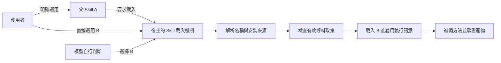
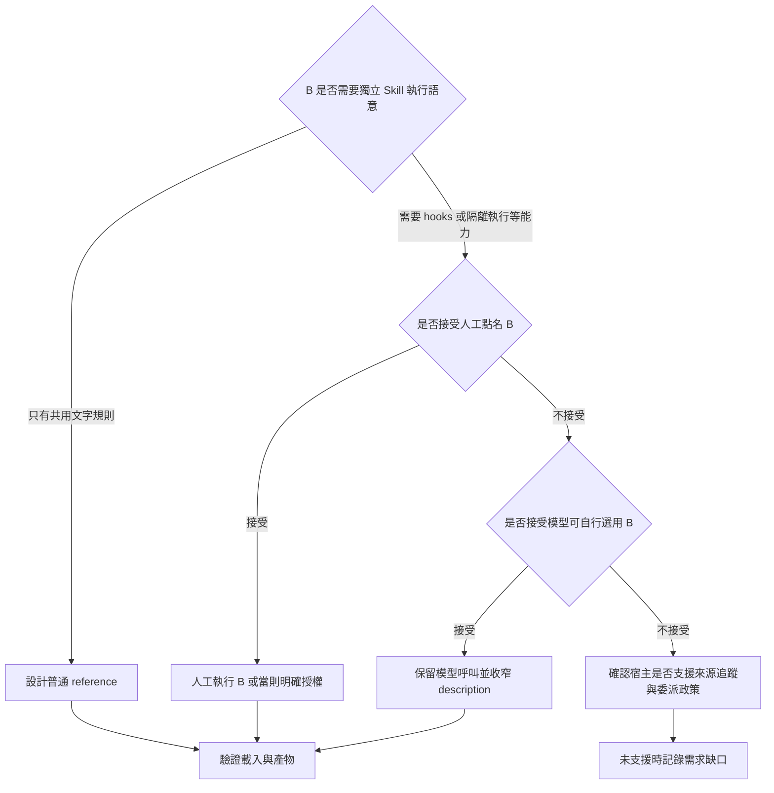

## TL;DR

- A→B 要分開檢查名稱解析、載入機制、呼叫資格與完成結果。把 Claude 的 `/B` 改成 Codex 的 `$B`，只能處理使用者入口的語法。
- Matt 的 `grill-me`／`grill-with-docs` 明確點名共用方法；`grilling` 保留模型可呼叫能力，也保留自主觸發條件。它沒有實作「B 只接受 A 委派」。
- 部分暫解可用：人工執行 B 後返回 A、使用者當則訊息明確授權 B、將純共用指示拆成 reference。各自的人工成本與原生 skill 語意不同。
- 窄 description 能降低誤觸發；`allowed-tools`、auto mode、隱藏選單及監測欄位各處理不同問題。查核到的資料未證明它們能通用地強制「允許委派、禁止自主選用」。
- 本文是 2026-10-22 的多來源研究，附官方文件、固定原始碼及 issue 留言。尚未在 Claude Code／Codex 跑 A→B 實驗；不要把來源查核當成本機驗收。

## 摘要（Summary）

本篇專門回答：**如何讓使用者啟動 Skill A，再由 A 使用 Skill B，同時避免 B 因一般對話被自行選用？** 它從 [[2026-10-17-MATT-POCOCK-SKILLS-V13-GRILLING-COMPOSITION-AND-DELIVERY-WORKFLOW|Matt Pocock v1.3 與 grilling 工作流研究]] 延伸，集中保存跨宿主寫法、社群暫解、版本變更與證據。

本文日期是這份原創綜合研究的建立日。各 issue 的原始發布日期另列，並非將 #86763 的發布日改成今天。快速查詢：第 2 節看官方設定，第 3 節看別人怎麼寫，第 4 節比較暫解，第 7 節看驗證方式。

## 關鍵洞察（Key Insights）

1. **組合呼叫與自主發現需要分開設計。** B 可供模型呼叫，未必代表希望模型自行挑選 B；#86763 正是在要求將兩者分開控制。
2. **description 承擔選用提示，無法驗證呼叫者。** 「只在 A 委派時使用」是可測試的提示設計，不能當成 caller allowlist。
3. **能讀到方法與能原生執行 skill 有不同結果。** 需要 hooks、參數處理或隔離 context 時，直接讀 Markdown 不足以證明那些機制已啟用。
4. **暫解的有效性取決於你願意交換什麼。** 人工操作換取啟動控制；開放模型呼叫換取自動組合；普通 reference 換取共用內容與較少的獨立觸發項目。

## 詳細內容（Details）

### 1. 三種啟動來源，四個檢查點

| 啟動來源 | 例子 | 要問的問題 |
| --- | --- | --- |
| 使用者明確選用（user invocation） | 人輸入 `/B`，或在 Codex 明確選取 B | 宿主是否解析到正確名稱與版本？ |
| 模型自行選用（proactive／implicit invocation） | 使用者只說「檢查方案」，模型選了 B | description 是否符合？政策是否允許？ |
| 父流程委派（delegated／nested invocation） | 人啟動 A，A 要求模型載入 B | 父流程的要求如何交給宿主？B 是否可被呼叫？ |

這是本文分析用的三分法。它不表示每個宿主都提供三個獨立設定。#86763 提出同樣的區分，目前仍是 open 的功能要求。[問題與提案](https://github.com/anthropics/claude-code/issues/86763)



圖中畫的是應檢查的步驟。它沒有假定宿主會替父流程保留委派來源，也沒有假定三條入口得到同樣授權。可與 [[2026-09-06-CLAUDE-CODE-SKILL-INVOCATION-PERMISSION-MATRIX|既有觸發權限矩陣]] 對照。

### 2. 官方文件明確支持什麼

| 設定／介面 | 已有說明 | 對 A→B 的意義 |
| --- | --- | --- |
| Claude `disable-model-invocation: true` | 限制模型呼叫；遭攔截時不得另行重演該流程 | A 的文字不能自行解除 B 的限制 |
| Claude `user-invocable: false` | 關閉人類 slash 入口，模型仍可呼叫 | 不會禁止自主選用 |
| Claude `allowed-tools` | 為列出的工具提供當則的免詢問核准；未列工具仍依一般權限設定處理 | 不等於工具白名單或 B 的呼叫者限制 |
| Claude `skillOverrides: name-only` | 只列名稱；此設定不適用 plugin skills | 不能當成 delegated-only 開關 |
| Codex `policy.allow_implicit_invocation: false` | 關閉依 prompt 的隱式選用；使用者明確 `$skill` 仍可用 | 官方這項說明未完整定義父流程委派資格 |

來源：[Claude Skills 官方文件](https://code.claude.com/docs/en/skills)、[Codex Skills 官方文件](https://learn.chatgpt.com/docs/build-skills)。兩個欄位不能僅因名稱相近，就假定所有宿主語意完全相同。

使用者入口可寫 Claude `/B`、Codex CLI／IDE `$B`；父文件則點名 B，依實際註冊名稱與宿主機制載入。plugin 可能帶 namespace，不能只比短名。這是命名與載入的設計規則，仍須驗證可用性。[Matt 呼叫約定](https://github.com/mattpocock/skills/blob/5beb35b040e3de97e54fa9e386d7e42d15c295c2/.agents/invocation.md)

### 3. 別人實際怎麼做

#### 3.1 Matt：人類入口 A，模型可呼叫的方法 B

固定 commit 的 `grill-me` 正文要求：

```text
Call the Skill tool with "grilling".
```

`grill-with-docs` 要求分別呼叫 `grilling` 與 `domain-modeling`。A 可以是人類入口，B 則承載共用方法；這種組合沒有靠 B 的 description 取得委派授權。[grill-me 原始檔](https://github.com/mattpocock/skills/blob/5beb35b040e3de97e54fa9e386d7e42d15c295c2/skills/productivity/grill-me/SKILL.md)、[grill-with-docs 原始檔](https://github.com/mattpocock/skills/blob/5beb35b040e3de97e54fa9e386d7e42d15c295c2/skills/engineering/grill-with-docs/SKILL.md)

`grilling` 的 description 仍涵蓋壓力測試想法及 grill 關鍵詞，允許模型直接選用。相近的 `codebase-design` 也有「其他 skill 需要共用詞彙」的條件，但同時保留直接觸發條件；兩者都不是 delegated-only 範例。[grilling](https://github.com/mattpocock/skills/blob/5beb35b040e3de97e54fa9e386d7e42d15c295c2/skills/productivity/grilling/SKILL.md)、[codebase-design](https://github.com/mattpocock/skills/blob/5beb35b040e3de97e54fa9e386d7e42d15c295c2/skills/engineering/codebase-design/SKILL.md)

歷史 commit `54bc6b6` 刪掉 `domain-modeling` description 中重述委派的條件：父 skills 已明確點名，應由父流程寫清楚何時呼叫。該 commit 作者標示為 Claude；這是可檢查的 repo 設計紀錄，不當成 Matt 本人手寫背書。[完整差異與理由](https://github.com/mattpocock/skills/commit/54bc6b604075c18293d38e9e294a2c96f365f104)

#### 3.2 跨宿主使用者：Skill tool 指令無法照抄

Matt repo [#1123](https://github.com/mattpocock/skills/issues/1123) 指出 `Call the Skill tool` 綁定載入介面。Codex 使用者回報環境沒有這個工具，並建議改成明確讀取依賴檔案。[2026-09-26 留言](https://github.com/mattpocock/skills/issues/1123#issuecomment-5846657237)

本次查核 #1123 仍 open，固定原始檔仍採 Skill tool 措辭。直接讀檔是該討論的替代提案；若要採用，須另確認路徑解析與執行語意，不能寫成 upstream 已完成通用 adapter。

#### 3.3 審查工作流：人工執行 B，再把結果交回 A

`SteveM74` 的 `/gt-review` 原本組合內建 `code-review` 和 `security-review`。受限後，實際暫解是停下流程，讓開發者手動執行 `/code-review`，再將結果納回。[採用者留言](https://github.com/anthropics/claude-code/issues/79560#issuecomment-5028888183)

這保留真正的 B，代價是人工交接。它提供了「工作能繼續」的案例，沒有提供全自動委派。

#### 3.4 同一套 skills 用在 Codex／Claude：使用者經驗有差異

`SebastianoTomasi` 表示，Codex 設 `allow_implicit_invocation: false` 後，仍可由其他 skills 明確呼叫；在 Claude 則須開放 B 的模型呼叫。[2026-10-09 留言](https://github.com/anthropics/claude-code/issues/86763#issuecomment-6089675182)

另一篇 [Matt Discussion #786](https://github.com/mattpocock/skills/discussions/786) 回報，從 agent 指示引用這類 skill 會遇到發現問題。兩者可能涉及不同版本、入口及載入機制，資料不足以直接判定矛盾。第一則未附完整重現步驟，不能推成所有 Codex 安裝的保證。

### 4. 暫解比較：解決了什麼，保留了什麼

| 暫解 | A→B 自動化 | B 不自主選用 | 原生 B 語意 | 證據與判斷 |
| --- | --- | --- | --- | --- |
| 人工執行 B，再返回 A | 需人工交接 | 可保留 user-only 設計 | 保留 | #79560 有採用者紀錄 |
| 使用者當則訊息明確授權 B | 可能在同則回覆內銜接；完整案例待測 | 不必全域開放模型呼叫 | 依宿主正常載入 | 官方有當則授權說明，非 A 自行授權 |
| 移除 B 的 disable-model-invocation | 恢復模型呼叫資格 | 不保留硬限制 | 保留 | #43809 的 workaround，也明說代價 |
| 保持可呼叫，收窄 description | 可以組合 | 依模型遵循提示，無強制保證 | 保留 | 本文候選設計，須測誤觸發 |
| 將共用規則設計為普通 reference | A 按需讀取 | 沒有獨立 B skill 觸發項目 | 不具獨立 skill 語意 | Matt 設計文件有此做法 |
| A 讀現有 B 的 SKILL.md | 讀到指示 | 視原政策；不得用來規避限制 | 不等價 | #86763 明列語意落差 |
| allowed-tools／auto mode | 可減少核准中斷 | 不控制自主路由 | 要先有呼叫資格 | #56912 處理核准問題 |
| name-only／隱藏選單 | 視宿主與安裝方式 | 未提供只允許委派的保證 | 視載入結果 | 顯示設定與呼叫政策須分開看 |
| requires／skill-allowlist | 尚無已驗證實作 | 尚無已驗證實作 | 未定 | #55989 是提案 |

表中的「保留」只描述機制取捨，不代表本文已在本機完成執行驗收。

#### 4.1 當則訊息明確授權 B：有官方依據的候選操作

Claude 文件說明，slash 名稱放在一般文字後、以空白分隔且沒有黏附標點時，代表使用者允許模型在當則回覆期間呼叫該 skill，不會立即執行。以下是本文自編的操作示例，完整 A→B 行為仍待測：

```text
請執行 /a-workflow 並在檢查步驟使用 /b-review
```

這裡的授權來自使用者訊息。A 正文內的 `/b-review` 不能直接獲得相同地位；這段說明也不保證授權會傳遞給 subagent，跨回合續跑應另驗證。[官方訊息位置說明](https://code.claude.com/docs/en/skills#where-you-write-the-skills-name)

#### 4.2 reference：適合只有共用文字規則的 B

Matt 的設計文件明確提出：多個人類入口需要的共用參考內容，可以放在 skill 系統之外的普通檔案。[SKILL-MECHANICS.md](https://github.com/mattpocock/skills/blob/5beb35b040e3de97e54fa9e386d7e42d15c295c2/skills/productivity/writing-for-agents/SKILL-MECHANICS.md)

本文建議的目錄與父流程寫法如下，尚未套用到現有 `kb-create`：

```text
kb-create/
├── SKILL.md
└── references/
    └── review-method.md
```

```markdown
At the review step, read references/review-method.md relative to this skill.
Apply its review criteria to the draft and record the findings.
Resume the workflow only after the review's required outputs are present.
```

此方案把共用指示重新設計為 reference。若 B 依賴 `context: fork`、hooks、參數替換等機制，就需要另外的執行設計；詳見 [[2026-04-16-CLAUDE-CODE-SKILL-FRONTMATTER-FORK-AGENT-HOOKS-SOURCE-DEEP-DIVE|frontmatter 與執行語意研究]]。遭宿主明確禁止的 user-only workflow，不能改用讀檔重演來規避。

#### 4.3 為何 allowed-tools 和 auto mode 不足以解這一題

#56912 的父 skill 列出 `Skill(commit-style)`，仍在 default mode 被詢問；auto mode 則不問。子 skill 使用的是 `user-invocable: false`，並未證明它能越過 `disable-model-invocation: true`。該案是 Claude Code 2.1.114 的核准行為回報，後因 inactivity 關閉。[原始設定與重現步驟](https://github.com/anthropics/claude-code/issues/56912)

因此，將 `Skill(B)` 加入 allow 規則可以是核准設定的一環，但無法據此宣稱 B 已變成「僅限 A 呼叫」。

### 5. description 怎麼寫：減少誤觸發的候選範本

以下內容由本文提出，未經觸發率評測，也不是 Matt repo 的現成設定。

**A 的責任：點名 B、提供輸入、要求完成證據。** 跨宿主父文件可採用以下候選指示：

```markdown
At the review step, resolve the registered `a-review-helper` skill.
Load and follow it using this host's supported skill mechanism.
Respect its effective invocation policy.

Provide the draft and review criteria.
If loading is unavailable or denied, report that result and stop this step.
Resume only after receiving the helper's findings and completion status.
```

**B 的責任：把觸發範圍綁在具體委派情境。** 避免只寫廣泛的 review、plan、feedback 觸發詞：

```yaml
---
name: a-review-helper
description: >-
  Internal review step for the a-workflow skill.
  Use only when an active a-workflow explicitly delegates its review step
  and supplies the draft and review criteria.
  Do not select this skill independently from a user's request to review,
  critique, plan, or discuss skills.
---
```

B 正文再要求必要輸入、產出格式及缺資料時的處理方式。這能讓行為更容易評測，但模型聲稱「來自 A」不構成宿主驗證的 provenance。若需求是嚴格禁止其他呼叫者，仍需宿主提供來源追蹤與限制。

**不要省略 description 來賭不會觸發。** 各宿主對缺欄位的處理不同；維持明確且窄的說明，才能定義應觸發與不應觸發的測試案例。

### 6. Issue 狀態與版本：關閉原因要讀，不能只看 closed

以下是 2026-10-22 的查核快照。issue 版本均為提報者當時的環境；未外推至目前全部安裝。

| 來源 | 狀態／版本 | 可支持的結論 |
| --- | --- | --- |
| [Claude #86763](https://github.com/anthropics/claude-code/issues/86763) | 2026-08-14 建立；open | 三種呼叫模式獨立控制仍是功能要求 |
| [Claude #43809](https://github.com/anthropics/claude-code/issues/43809) | 2.1.92；closed / not_planned，inactivity | 移除旗標的暫解犧牲自主選用限制；未確認修復 |
| [Claude #77795](https://github.com/anthropics/claude-code/issues/77795) | 2.1.210；open | Agent prompt 的 slash 文字可能未載入 skill |
| [Claude #55989](https://github.com/anthropics/claude-code/issues/55989) | closed / not_planned，inactivity | requires／skill-allowlist 尚無此案的實作證據 |
| [Claude #56912](https://github.com/anthropics/claude-code/issues/56912) | 2.1.114；closed，inactivity | 核准提示差異，不能證明委派權限已解決 |
| [Claude #79560](https://github.com/anthropics/claude-code/issues/79560) | closed；修復留言後仍有反例 | code-review 曾有特定回歸與 server-side 差異 |
| [Matt #1123](https://github.com/mattpocock/skills/issues/1123) | open | 載入措辭跨宿主問題仍有討論 |

#86763 的概念設定如下，**僅是提案，請勿當成可用 frontmatter**：

```yaml
invocation:
  user: true
  proactive-model: false
  delegated: true
```

#### 6.1 code-review：已有恢復呼叫的變更，但不提供通用 delegated-only

[#79560 的關閉留言](https://github.com/anthropics/claude-code/issues/79560#issuecomment-5303328132) 由 `bcherny` 帳號發布，標示 Claude Code 生成，稱 2.1.233 的 first-party 情境成功。隨後使用者仍回報 2.1.234、組織管理的 first-party 帳號失敗，指出 gate 與快取差異。[反例與環境](https://github.com/anthropics/claude-code/issues/79560#issuecomment-5360398546)

較新的官方 changelog **2.1.246** 明確重新開放 `code-review` 的模型自主啟動，包含 Bedrock、Vertex、Foundry、Claude apps gateway，以及關閉 telemetry 或 non-essential traffic 的環境。它修補特定內建功能的可呼叫性，也允許自主啟動；不能推論自訂 B 已獲得「僅限委派」機制。[固定版本更新紀錄](https://github.com/anthropics/claude-code/blob/1132b8a98e93300bb3822197fb7eee12ce4fb906/CHANGELOG.md#21246)

#### 6.2 失敗偵測與監測，可以讓暫解更可驗證

#77795 的留言建議在 spawn 前檢查引用能否載入，將結果分成 `SUCCESS`、`EXPLICIT_FAILURE`、`SILENT_TIMEOUT`。這是使用者的設計建議，未附程式碼或測試產物。[2026-09-18 留言](https://github.com/anthropics/claude-code/issues/77795#issuecomment-5732207208)

官方 monitoring 文件已有 `invocation_trigger`，值為 `user-slash`、`claude-proactive`、`nested-skill`。它可用於觀察啟動來源；成功的 nested 事件仍不代表已驗證呼叫者資格，也不能證明方法與產物正確。[官方事件欄位](https://code.claude.com/docs/en/monitoring-usage#skill-activated-event)

### 7. 如何選擇與驗證



選型後，用同一份無副作用測試資料分開測三條入口。以下是**驗證計畫，並非已通過的結果**：

| 測試 | 輸入情境 | 要留下的證據 |
| --- | --- | --- |
| 人明確選用 | 使用者正常選取 B | 解析名稱、載入結果、B 的輸出 |
| 一般語意 | 只要求 review，沒有 A 或 B 名稱 | 是否誤觸；保留失敗案例 |
| 只討論 skill | 詢問「B 的用途是什麼」 | 是否誤執行 |
| A 有效委派 | A 在指定步驟附草稿與標準 | B 的載入、輸入及完成結果 |
| 缺輸入／缺 B | 缺草稿、名稱錯誤或未安裝 | 明確失敗，不聲稱已完成 |
| B 禁止模型呼叫 | 測試父文字是否遭攔截 | 宿主拒絕訊息，不改走替代路徑重演 |
| 多回合與多父流程 | 下一則訊息續跑，或換另一個父 skill | 權限生命週期與誤觸發差異 |

固定宿主版本、provider、安裝方式、實際註冊名稱、設定及模型；分別記錄「有載入」「依方法執行」「產物符合要求」。單次未誤觸只代表該次結果，不能推成永遠不會觸發。

本次本機唯讀版本檢查為 Claude Code `2.1.261`、Codex CLI `0.163.0`。來源查核與文章驗證有完成；上述 A→B 呼叫矩陣尚未執行。

## 我的心得（My Takeaways）

對自己的 `kb-create`，我會先判斷共用部分是否只是寫作、證據分級或回饋規則。這些內容適合 reference，減少獨立 skill 的路由問題。只有確實需要獨立執行語意時，才保留 B，並接受相應的宿主限制與測試成本。

最值得借用的是 #77795 的可觀察性要求：父流程應拿到 B 的載入結果與完成證據，不能僅因 prompt 寫了名稱就往下走。本文沒有修改現有 skill 行為；這是一項可另行實作與評測的建議。

## 待補充（Open Questions）

1. Codex `0.163.0` 在不同明確入口下，是否都能委派 implicit-disabled B？搜尋：`Codex allow_implicit_invocation delegated skill explicit mention`。
2. Claude 使用者當則訊息授權 B，對 user-only B、多回合 A 及 namespaced plugin 是否一致有效？搜尋：`Claude inline slash skill permission nested turn`。
3. 相同任務下，窄 description 在中英文 prompt 的誤觸發率、漏觸發率有多少？搜尋：`skill description trigger evaluation false positive`。
4. #86763 是否會新增可驗證的父呼叫者限制及來源繼承？搜尋：`86763 delegated invocation caller allowlist provenance`。
5. reference 與原生 B 在相同驗收品質下的 context、延遲與維護成本有何差異？搜尋：`skill composition reference runtime benchmark`。

## 相關連結（Related）

- [[2026-10-17-MATT-POCOCK-SKILLS-V13-GRILLING-COMPOSITION-AND-DELIVERY-WORKFLOW]]：[grilling 主篇](./2026-10-17-MATT-POCOCK-SKILLS-V13-GRILLING-COMPOSITION-AND-DELIVERY-WORKFLOW.md) 涵蓋 v1.3 與交付流程，本篇集中保存 A→B 暫解、官方語意及 issue 證據。
- [[2026-09-06-CLAUDE-CODE-SKILL-INVOCATION-PERMISSION-MATRIX]]：觸發權限基礎；本篇補當則授權、版本變更與暫解取捨。
- [[2026-04-16-CLAUDE-CODE-SKILL-FRONTMATTER-FORK-AGENT-HOOKS-SOURCE-DEEP-DIVE]]：解釋直接讀 Markdown 為何不能當成 fork、hooks 與工具政策都已啟用。

## 知識層次分析（Bloom's Taxonomy Analysis）

| 認知層次 | 核心目的 | 對本文的具體應用 |
| --- | --- | --- |
| 記憶 | 記住術語與設定 | 分辨明確、自主、委派三種來源；記住兩家 invocation 欄位的不同 |
| 理解 | 串聯概念 | A 的指示、宿主載入與 B 的執行結果是不同檢查點 |
| 分析 | 拆解假設 | 檢查「允許工具」是否被誤當成「允許 B」；檢查 closed 的原因 |
| 應用 | 套用到工作 | 盤點共用內容能否轉 reference；為需要獨立 B 的流程建立正反觸發案例 |
| 評估 | 比較取捨 | 用人工成本、原生語意與自主啟動限制選方案，不只比較是否少一行設定 |

### 分析型追問（Socratic Follow-up）

- **澄清**：「呼叫 B」需要讀到文字，還是需要執行其 hooks 與隔離 context？
- **假設**：若父流程來源沒有宿主追蹤，B 如何分辨 A 委派與模型自行聲稱委派？
- **證據**：哪個案例附了版本與工具結果？哪個只有成功敘述？
- **觀點**：若人工交接成本很低，保留 user-only 是否比追求全自動更合適？
- **後果**：共用 B 改版後，哪些父流程必須重驗，如何發現不再相容？

### 方案批判三問

1. **最大的風險是什麼？** 父流程在 B 未載入或產物不符時仍繼續，卻把檢查標記完成。
2. **什麼情況下會失敗？** 名稱碰撞、政策限制、版本／provider 差異、只有 slash 文字或缺必要輸入，都可能令組合失效。
3. **有沒有更好的替代方案？** 純方法用 reference；需要人工控制的原生 B 由使用者明確啟動；需要嚴格來源限制的自動流程則等待或實作宿主可驗證的委派機制。

## 六頂思考帽回饋（Six Thinking Hats Feedback）

### 藍帽：問題與範圍

評估「A 能使用 B，B 的啟動仍符合使用者意圖」，將名稱、載入、權限及產物分開檢查。

### 白帽：事實與未知資訊

已知有原始檔、官方說明、版本變更與使用者回報。未知的是這些方案在本機兩個宿主的完整正反例結果。

### 紅帽：直覺與讀者反應

希望只輸入 A 就完成整個流程，很容易讓人把一行 delegate 指示讀成整合已完成。本文用候選範本與證據欄位降低這種閱讀誤差。

### 黃帽：價值與可保留內容

保留 Matt 的方法共用設計、社群人工暫解，以及明確的載入結果檢查；它們能直接改善流程可維護性。

### 黑帽：風險與限制

窄 description 沒有強制呼叫者驗證；單一內建 skill 的修復不能證明通用機制完成；更新後的版本也可能仍受 provider 差異影響。

### 綠帽：替代方案與新應用

將文字規則集中成 reference；把原生 B 視為需要明確輸入與輸出的步驟；建立可重複的觸發評測集，而非持續堆疊 description。

### 藍帽：修改項目與下一步

1. 實作前先確認 B 是否需要獨立執行語意。
2. 用固定版本完成第 7 節的正反案例，保存載入與產物證據。
3. 追蹤 #86763；新機制確認支援後，再更新選型與測試結果。

## References

- [Claude Code：Skills 官方文件](https://code.claude.com/docs/en/skills)
- [Codex：Build skills 官方文件](https://learn.chatgpt.com/docs/build-skills)
- [Claude Code：Skill activated event](https://code.claude.com/docs/en/monitoring-usage#skill-activated-event)
- [Matt skills：固定版本 invocation 約定](https://github.com/mattpocock/skills/blob/5beb35b040e3de97e54fa9e386d7e42d15c295c2/.agents/invocation.md)
- [Matt skills：固定版本 Skill mechanics](https://github.com/mattpocock/skills/blob/5beb35b040e3de97e54fa9e386d7e42d15c295c2/skills/productivity/writing-for-agents/SKILL-MECHANICS.md)
- [domain-modeling description 的歷史改動](https://github.com/mattpocock/skills/commit/54bc6b604075c18293d38e9e294a2c96f365f104)
- [Matt #1123：跨宿主 Skill tool 指令](https://github.com/mattpocock/skills/issues/1123)
- [Matt Discussion #786：Codex 下 explicit-only skills 的發現問題](https://github.com/mattpocock/skills/discussions/786)
- [Claude #86763：三種呼叫模式的分離提案](https://github.com/anthropics/claude-code/issues/86763)
- [Claude #43809：disabled skills 的委派限制](https://github.com/anthropics/claude-code/issues/43809)
- [Claude #77795：Agent prompt 的 slash 指示未載入 skill](https://github.com/anthropics/claude-code/issues/77795)
- [Claude #55989：requires／skill-allowlist 提案](https://github.com/anthropics/claude-code/issues/55989)
- [Claude #56912：nested Skill 的核准提示](https://github.com/anthropics/claude-code/issues/56912)
- [Claude #79560：內建 code-review 組合回歸](https://github.com/anthropics/claude-code/issues/79560)
- [Claude Code：固定 changelog，含 2.1.246](https://github.com/anthropics/claude-code/blob/1132b8a98e93300bb3822197fb7eee12ce4fb906/CHANGELOG.md#21246)
