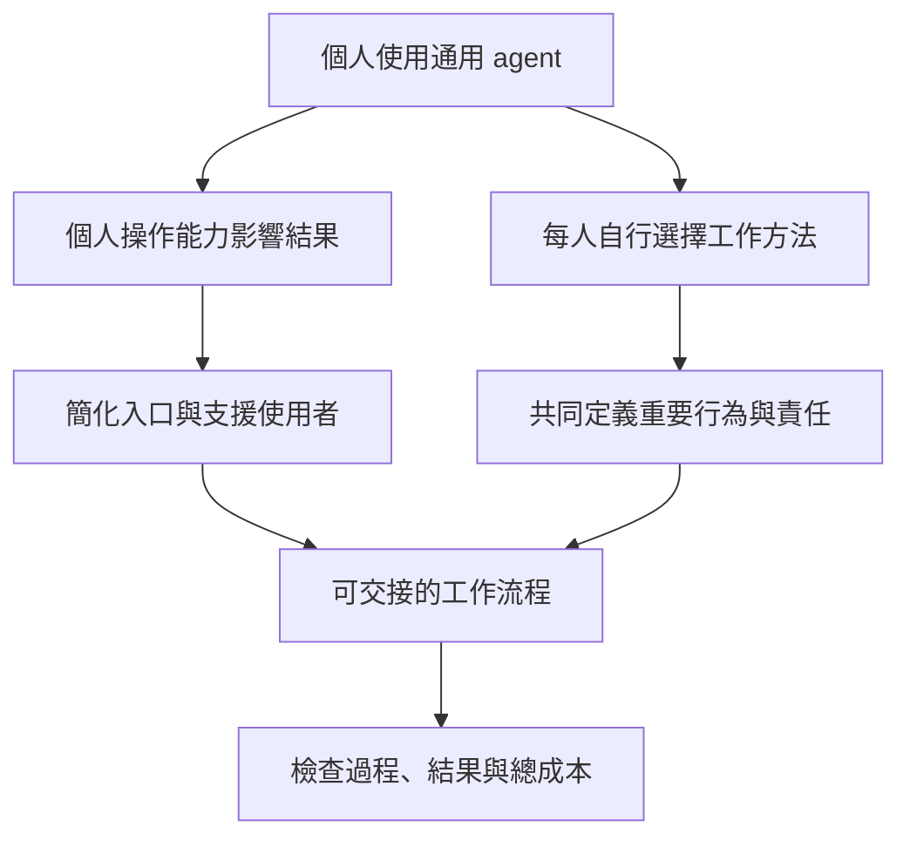
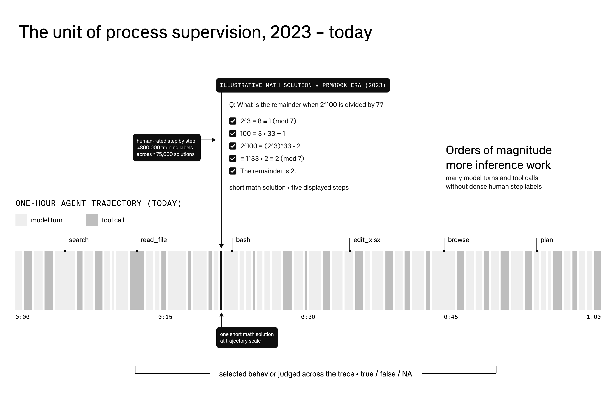
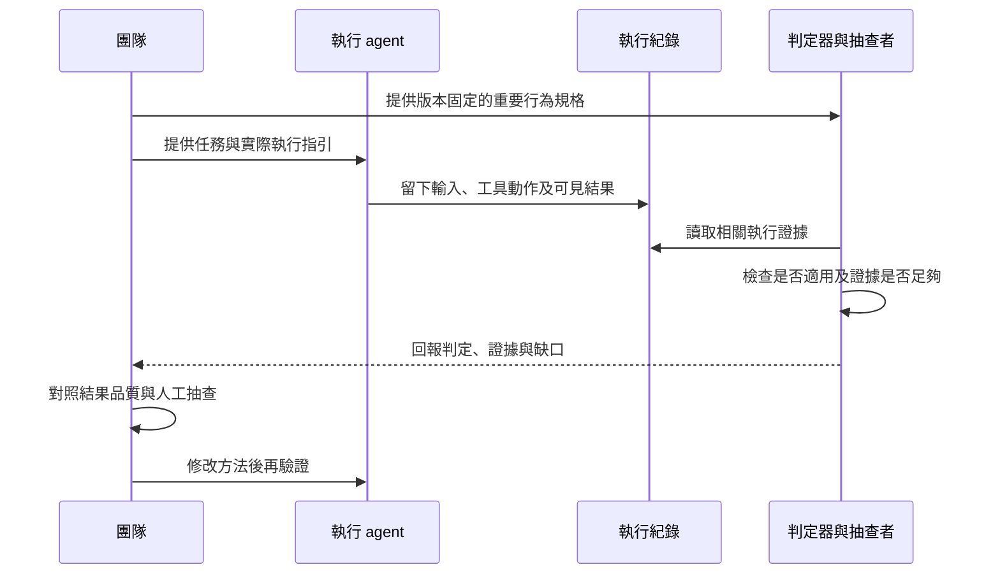

## TL;DR

- 找到原文：[Basis 官網同題文章][basis-talk]，2026-11-04；它是演講導讀，完整論證在 [AI Engineer 原講][original]。另有 Basis／Braintrust 於 2026-07-29 發表的 [行為規格原文][basis-specs]，能補足技術方法。
- Mitch 將個人與企業落差分成能力落差（competency gap）與流程落差（process gap）：工具把操作複雜度交給個人，也把工作方法交給個人決定。這是他的解釋框架，沒有證明企業問題只剩這兩項。
- 技術重點是：先定義值得遵守的行為，用實際執行紀錄檢查，再以分叉與模擬診斷。`BEHAVIOR.md` 是評估標準，與執行用的 prompt／skill 有不同職責，寫下檔案不會自動強制遵循。
- 已讀取原講 40 則與中文版 5 則公開留言，並找到相關標準的 LinkedIn 討論。有人支持可預期流程，也有人質疑 100 倍、產品立場、權責與集中監督瓶頸；下面保留具名連結及適用範圍。
- **100 倍是講者個人估計，沒有公開計算方式；流程遵循也不保證結果正確。** 本次完成來源研究，未執行 Basis、judge、分叉模擬或企業成效實驗。

## 摘要（Summary）

AI懶人報的〈EP466：個人用 AI 快了 100 倍，公司卻沒感覺？〉介紹 Basis 共同創辦人 Mitchell Troyanovsky 的演講。本篇回到原始文章與全場演講，再把行為規格的正式文件及公開回應放在一起，討論：**企業需要什麼條件，才能把個人可用的 agent，變成團隊可以交接、檢查與負責的工作方式？**

快速閱讀：第 1 節看來源鏈，第 3–6 節看方法，第 7 節看別人的評價，第 8 節接到自己的工作流。本文沒有新安裝 skill 或服務；範例只用來解釋如何區分執行與驗收。

## 來源歸屬與驗證範圍

| 來源 | 本次取得內容 | 能支持與不能支持什麼 |
| --- | --- | --- |
| Basis 同題文章，2026-11-04 | 第一方短文、作者、日期與原講連結 | 確認出處及作者主張；短文並非完整逐字稿 |
| AI Engineer 原講，2026-11-04 上傳 | 550 段英文自動字幕、影片說明與章節 | 對照完整技術說法；字幕未逐句人工聽音核對 |
| AI懶人報，2026-11-09 | 197 段 `zh-TW` 字幕，API 標記非自動生成 | 中文作者的解說與台灣工作例子；不能代替原講缺漏內容 |
| Basis／Braintrust 行為規格原文與標準 | 2026-07-29 文章、官網文件與固定 repo revision | 定義、格式、評估方法與設計意圖；非本機實測或跨產品載入保證 |
| 兩支影片留言 | 依熱門排序有界取得 40／5 則，含回覆；閱讀後挑選實質意見 | 發言者的公開看法與自述；不是隨機樣本，數量不代表全站留言總數或社群共識 |
| LinkedIn 公開貼文與可見留言 | 對較早發布之同一行為標準的支持與批評 | 相關方法討論；不是直接評論這場 11 月演講 |
| 本文分析與範例 | Codex 對照來源後提出 | 不歸給 Mitch、中文作者或留言者，也不當成已驗證方案 |

評論擷取時間為 2026-11-09。留言會修改、刪除或排序變動；本文不使用按讚數當作可信度，也不把相對發布時間轉寫成精確日期。原文作者是企業 agent 供應商；Braintrust 是共同推出標準的合作方，兩者都應標成第一方立場。

中文字幕在夾入英文原講片段時有空段，197 段不代表逐字涵蓋整支影片音軌；本篇以另外取得的英文原講補核對相關內容。兩份文字都保留 `human_verified: false`。

## 關鍵洞察（Key Insights）

1. **先找組織的約束，才知道局部變快能否轉成整體改善。** 本文認為，個人完成得更快仍可能增加審核、交接或維護工作；演講的 100 倍不能直接換算成企業投資報酬。
2. **執行標準與評估標準需要對照。** Skill 說明如何做；行為規格說明哪些行為值得要求與檢查；trace 留下實際發生的事。三者不能只剩同一段口號。
3. **穩定失敗只讓限制可辨識。** 固定在同一個節點停下來，比隨機亂做容易管理；若工作要求該能力，仍須改善或轉交，不能把一致錯誤當成可接受品質。
4. **監督要追蹤自己的失敗。** 規則可能不合理，judge 可能誤判，trace 可能不完整；再加一個 AI 並沒有自動解決這些問題。

## 詳細內容（Details）

### 1. 原文找到了什麼？

來源鏈如下，日期不同各有意義：

| 層級 | 連結 | 用途 |
| --- | --- | --- |
| 使用者提供的中文解說 | [AI懶人報：PEUs59xg-uo][chinese] | 日常工作比喻與重點整理，14:14 |
| 中文片說明欄指向的原講 | [AI Engineer：JGtkTjn4120][original] | Mitch 全場論證，yt-dlp 元資訊為 19:12；部分導讀頁標 19:13，本文依影片元資訊記錄 |
| 原作者公司發布的同題短文 | [Why AI Makes You 100x Faster but Not Your Company][basis-talk] | 2026-11-04；不是另一份長篇獨立研究 |
| 主辦方的文字導讀 | [AI Engineer 演講頁][host] | 方便跳轉逐字稿及資源，仍須與原講核對 |
| 方法的較早第一方文章 | [Behavior specs，Basis][basis-specs]、[Braintrust 同題文章][braintrust] | 2026-07-29；補格式、judge 與持續評估的設計 |
| 開放文件及固定原始檔 | [agentbehavior.dev][standard]、[repo snapshot][snapshot] | 本次固定 `1866cff…`，不把浮動 main 當成不可變證據 |

### 2. 個人變快與公司變快，分母不同

原講約 [00:42](https://www.youtube.com/watch?v=JGtkTjn4120&t=42s) 開始，Mitch 估計自己的生產力可能提高約 100 倍，並觀察企業沒有同等改變。原講未提出相同工作集合、品質基準、時間紀錄或公司對照組。[來源：原講][original]

因此，這段應讀成引出問題的個人感受，不能寫成「研究發現企業沒得到 AI 生產力」。連個人到底是更快完成、能做原本不會的工作，還是增加產出種類，也沒有共同定義。

本文建議企業改看一個完整交付的週期：投入工作、等待、核對、返工、交接與交付後問題。減少其中一段的耗時，不保證瓶頸所在的另一段也縮短。這是本篇的分析方式，不是演講提供的計算公式。

### 3. 兩個落差與「有既定做法」的 agent

原講 [03:29](https://www.youtube.com/watch?v=JGtkTjn4120&t=209s) 起提出兩個落差：

| 問題 | 講者的意思 | 不能直接推出的結論 |
| --- | --- | --- |
| 能力落差（competency gap） | 使用者必須管理 skills、記憶、委派時機，以及理解 agent 可能如何行動 | 每個人多學 prompt，就能排除全部企業阻礙 |
| 流程落差（process gap） | 各人自行選方法，主管難以知道結果怎麼來、如何核對 | 所有流程都必須由高層獨力設計，或個別員工不能改進方法 |

Mitch 主張組織靠流程管理本來就不完美的人，agent 也要有可預期的方法。他所稱的「有既定立場／做法」（opinionated），指先選好資料來源、工具與取捨，不是讓模型有個性。[來源：原講及 Basis][original]



圖為本文對講者框架的整理，最後的過程／結果／成本檢查是本文的收斂建議，不是已證明的因果模型。

### 4. 中文版之外，原講還有哪些技術內容？

中文片重點在落差、簡單可靠與信任，並加入報帳、業績月報等在地例子。原講後半則詳細說明以下方法：

| 原講時間 | 內容 | 如何解讀 |
| --- | --- | --- |
| [05:57](https://www.youtube.com/watch?v=JGtkTjn4120&t=357s) | 選擇固定的 PDF 處理方法；正確性與延遲要取捨 | 例子列出多種讀 PDF 路線，沒有證明其中一套永遠最佳 |
| [09:02](https://www.youtube.com/watch?v=JGtkTjn4120&t=542s) | 有限的結果評測難涵蓋大量正式情境 | 講者仍說結果評測重要；不能摘要成「outcome evals 沒用」 |
| [10:18](https://www.youtube.com/watch?v=JGtkTjn4120&t=618s) | 銀行對帳有差異時，解釋差異，不憑空補分錄湊平 | 是對 agent 行為的具體要求；本文不據此提供會計或稅務建議 |
| [12:03](https://www.youtube.com/watch?v=JGtkTjn4120&t=723s) | 先寫重要行為意圖，再以它檢查軌跡 | 只挑值得持續量測的行為，避免重複抄所有 context |
| [13:24](https://www.youtube.com/watch?v=JGtkTjn4120&t=804s) | 在錯誤決策附近分叉，改 context 比較 | 資料庫、工具與環境也要重建；複製聊天不足以重播正式系統 |
| [15:15](https://www.youtube.com/watch?v=JGtkTjn4120&t=915s) | 用子代理模擬正式 agent 的情境 | 講者自述較便宜、較快，也明說保真度較低 |
| [17:10](https://www.youtube.com/watch?v=JGtkTjn4120&t=1030s) | 先承擔窄任務，再按表現與影響提高信任 | 不能從一次成功推論所有高風險工作可省略審查 |
| [18:10](https://www.youtube.com/watch?v=JGtkTjn4120&t=1090s) | 用 AlphaGo 第 37 手比喻創新與穩定交付的取捨 | 是說明性類比，沒有比較企業創新與流程控制的效益 |

原講把 context 比喻為執行時的訓練資料，同時澄清不是實際訓練。本文將它理解成會影響當下行為的輸入；不寫成推論時已更新模型權重。

### 5. Behavior spec 與 Skill、AGENTS.md 有什麼不同？

[標準文件][standard]與 [Basis／Braintrust 方法文][basis-specs]把行為規格放在 `.agents/behaviors/{name}/BEHAVIOR.md`，讓審查者及評測設計者讀取。它描述跨任務反覆重要的行為，主體是 Markdown 與 YAML 前置資料（frontmatter）。

| 產物 | 核心問題 | 主要對象 |
| --- | --- | --- |
| System prompt／AGENTS.md | 目前執行要怎麼做？ | 執行 agent |
| Skill | 這類任務有哪些方法、參考資料與工具？ | 執行 agent，需要時載入 |
| Behavior spec | 在相關情境中，哪些行為應該發生？ | 審查者、評測作者、檢查 trace 的 agent |
| 執行軌跡（trace／trajectory） | 實際讀了什麼、做了什麼、結果如何？ | 審查與除錯工具、人員 |
| 評測（eval） | 規格適不適用，實際行為有沒有符合？結果是否正確？ | 判定器與維護者 |

> [!important] 檔案存在不代表執行與強制生效
> `.agents/behaviors/` 是此標準的檔案慣例，不是本文已證明 Codex 或 Claude Code 會自動載入的目錄。標準也不建議把所有規格直接塞進 runtime prompt。需要接上 trace、判定器及流程，才能量測遵循情況；權限邊界還要由實際工具與宿主控制。

方法文強調只保留值得檢查的重要行為；模型已能穩定做到時，應重新檢視是否可退休相關規格。它也明說：評測可檢查有沒有遵循立場，卻不能證明該立場本身正確。這能回應「流程越寫越死」的疑慮，但不等於已解決治理問題。[來源：Basis][basis-specs]



圖源：Basis／Braintrust 方法文。已看圖確認為尺度與資料流示意，非表格；其中的數學例子、訓練標記與時間軸不是本次企業生產力數據。本文沒有把早期數學過程監督研究的結果外推為此企業方法已獲實證。

### 6. 如何檢查行為，又如何避免誤讀分數？

第一方方法文對單項行為採用三種標記。以下情境由本文改寫，並未執行銀行對帳：

| 情境 | 官方標記的意思 |
| --- | --- |
| 本次根本沒有需要處理的對帳差異 | `NA`：行為不適用 |
| 出現差異，agent 保留證據並說明，沒有無根據湊平 | `true`：相關行為符合要求 |
| 出現差異，agent 沒有依規格處理 | `false`：相關行為不符合要求 |

不能把 `NA` 算成成功。若要計算遵循率，本文建議至少同時呈現 `true`、`false`、`NA` 的數量、適用率與抽樣方式；分母應明確，例如 `true / (true + false)`。這是本篇對報表的建議，不是標準強制的唯一公式。

上表是方法文的簡化情境，不能把所有 `NA` 都解讀為「沒遇到該情況」。本次另讀固定版本的 [官方示例 judge.ts][judge-example]，它使用小寫 `na`，並區分 `not_applicable`、`insufficient_evidence`、`behavior_not_judgeable`。在紀錄完整、條件已觸發時，缺少應有的可見行為應判 `false`；紀錄明確不完整等情況，才依示例規則使用有原因的 `na`。這是該示例的介面，不宣稱所有判定器都相同。

因此，本文建議報表再拆出 `NA` 的原因，將真正不適用、證據不足及規格無法判定分開。若工具或判定程序失敗，也要記錄錯誤，不默默當成成功或一般不適用。這是報表與管線設計建議，沒有另創第四種官方 verdict。



圖為本文建議的檢查流程。原講的 fork 是改變某個決策附近的 context 再觀察，subagent simulation 則是低成本近似；兩者都需對照真實系統。事後問模型「為什麼」只能取得另一份解釋，不能獨自證明它忠實反映原決策原因。

### 7. 別人真的有評價、留言或討論嗎？

**有，而且有具體反對意見。** 以下全為意譯摘要，不是逐字引言或代表性民調；帳號自述的身分、公司經驗與效益未由本文獨立核實。

#### 7.1 直接針對這兩支影片的留言

| 發言者與直接連結 | 評價／疑問摘要 | 本文如何看待 |
| --- | --- | --- |
| [@mrner67，原講](https://www.youtube.com/watch?v=JGtkTjn4120&lc=UgwWGAfFoXsr8C8zWhN4AaABAg) | 肯定演講品質，認為近期同題中表現出色 | 是正面觀感，沒有提供成效資料 |
| [@user-sunsun0115，中文版](https://www.youtube.com/watch?v=PEUs59xg-uo&lc=UgzXo-ztsVDgaFRIvGJ4AaABAg) | 熟練者能運用自由度，一般作業者可能更適合明確 SOP，兩種方式應依情境並存 | 直接支持分層設計，不必只選全自由或全固定 |
| [@hankjwang，中文版](https://www.youtube.com/watch?v=PEUs59xg-uo&lc=Ugz1YKspdO0k8iM5oeJ4AaABAg) | 自述導入積極，但同事迴避工具，擔心被取代，也以監管需真人為理由 | 提醒組織採用還有誘因與焦慮；留言不是法規證據，不能據此認定法律要求 |
| [@ogourment，原講](https://www.youtube.com/watch?v=JGtkTjn4120&lc=Ugzn0bB4iFWQYf0VMHJ4AaABAg) | 質疑框架貼近供應商想賣的產品；需要溝通、嘗試與反覆修正的工作，未必能靠預設立場處理 | 是利益與適用範圍的質疑，不能據此判定產品無效 |
| [@iperov，原講](https://www.youtube.com/watch?v=JGtkTjn4120&lc=UgwoPZSMSsa6y0rpccx4AaABAg) | 專業與情境原本分散在人員身上，集中到一個操作／監督者可能丟失現場資訊並形成瓶頸 | 重要的組織設計反例；需要量測決策等待與主管負荷 |
| [@bhekan，原講](https://www.youtube.com/watch?v=JGtkTjn4120&lc=UgyB0dPBKAWl_MJvvpZ4AaABAg) | 認為公司品質還仰賴階層、責任與後果，不能只歸因於流程 | 本文保留權責議題；不推論 agent 需要模擬人類對失業的恐懼 |
| [@altvali1，原講](https://www.youtube.com/watch?v=JGtkTjn4120&lc=Ugz7jqhCvb8l1J4l1cx4AaABAg) | 認為內容仍像加入 judge／回饋再重試，沒有充分回答如何明列全部行為或真正自主改進 | 可用來要求更具體的工具與驗證；標準作者自己也主張不必抄下所有行為 |
| [@efrenUtube，原講](https://www.youtube.com/watch?v=JGtkTjn4120&lc=UgwN3wgCOceWSlyHfeh4AaABAg) | 擔心預設做法限制有效解法，認為只要達到安全且正確的成果，細節可有多種 | 提醒區分必要限制與可替換實作，避免只評「像不像標準路線」 |
| [@lezaaarman6964，原講](https://www.youtube.com/watch?v=JGtkTjn4120&lc=Ugzm4mVd-svkryTBj914AaABAg) | 自述看過公司已有流程所以更快，自己做專案反而因反覆改需求變慢 | 是與開場假設相反的經驗，不能用單一框架涵蓋所有組織 |
| [@krellin 的討論串](https://www.youtube.com/watch?v=JGtkTjn4120&lc=UgwtSv28nY8b-IKcvs14AaABAg)；[回覆 @uaer309](https://www.youtube.com/watch?v=JGtkTjn4120&lc=UgwtSv28nY8b-IKcvs14AaABAg.Acmb9RzHxMQAcmbpUH80Ki) | 前者質疑 100 倍與技術債，回覆者自述得到更大的改善；同串也爭論記憶陳舊與 context 管理 | 顯示「生產力」定義與經驗差異。雙方都沒有可比較的量測，本文不採任一方倍率作基準 |

#### 7.2 同一行為標準的其他公開討論

[Sheel Mohnot 的 LinkedIn 貼文][linkedin]針對 Basis／Braintrust 先前推出的標準表達肯定，並解釋為何只看最後答案會漏掉過程。同頁可見兩類實質留言：

- **Pranav Sahai**：肯定一致、可稽核、可改進的流程，認為這更接近評估人類工作的方式。
- **Sharad Singh**：指出 `NA` 決定評估母體；兩隊同樣報出高遵循率，可能是在不同的適用樣本上計算，應把不適用比例一起揭露。這是評論者提出的方法論問題，沒有指控某家實際灌水。

這是**相關標準**的回應，不假裝是看過本場演講的評論；公開頁面只顯示部分留言，本文未登入取得隱藏討論。也沒有查證發文者及所有留言者與供應商的商業關係。

另找到 [Intelligent Artifact 的同題整理][artifact]，其編輯文字提醒沒有比較性的可靠度結果，遵循流程仍不保證正確；它是第三方摘要，未見具名實驗與完整測試資料。搜尋也出現聚合導讀與官方轉貼，本文不把它們累加成獨立驗證。針對影片 ID、原講標題及講者搜尋，這次未找到可核對、直接以此演講為主題的 Hacker News／Reddit 深度串；這不代表全網不存在。

### 8. 對我們既有工作流，最有用的用法

這篇與 [[2026-10-13-HOW-TO-BE-MORE-AMBITIOUS-A-TUTORIAL-FOR-HUMANS-WITH-MODELS|前篇「放大上限」]]可以分工：探索時擴大解法空間；交付時固定必要的證據、權責與驗收。若找到更好的方法，可以驗證後更新標準，不必永久凍結每個工具選擇。

沿用 [[2026-10-21-MATT-POCOCK-SKILLS-V-MODEL-WORKFLOW-MAPPING|V-model 對照]]，可在需求／設計端寫下少數重要行為，在驗證端檢查 trace 與結果。與 [[2026-10-15-HOW-THE-CLAUDE-CODE-TEAM-DOES-CODE-REVIEW|程式碼審查主篇]]一樣，不能把「有跑 review」當成「需求與結果都已驗收」。以下是本文的應用建議，尚未執行：

| 工作階段 | 可留下的標準 | 核對證據 |
| --- | --- | --- |
| 需求與計畫 | 不把未知前提當成已同意需求；記錄決策者 | 需求、決策及變更紀錄 |
| 設計與實作 | 方法可變，但維持已同意的介面與授權範圍 | 設計、diff、工具呼叫及版本 |
| 除錯與 bug fix | 先重現與檢驗假設；無法驗證時明記缺口 | 原失敗案例、修復後結果及回歸 |
| 交付 | 最終驗證對應目前產物，不使用修改前的舊結果 | commit、檔案雜湊、測試／渲染及發布 receipt |

**不一定要先裝平台。** 可以先選一條真的重要、能從紀錄辨識的行為，對近期工作做人工抽查。下面是本文自編、未安裝的 `BEHAVIOR.md` 教學例子，非上游原碼：

```markdown
---
name: verify-current-artifact
description: 交付驗證必須對應目前產物，缺少證據時清楚揭露。
---

# 驗證目前產物

意圖：讓接收者分清已檢查結果與待驗證內容。
證據：目前版本、檔案識別、適用檢查及實際輸出。
判斷：確認檢查在最後一次相關修改之後，且涵蓋要交付的範圍。
執行：引用能對回目前版本的結果，分別說明通過與缺口。
失敗處理：無法執行時記錄原因與未完成狀態，不回報已通過。
失效例：修改後沿用舊截圖；只驗語法卻回報功能正常。
```

這張規格仍需要執行指引、工具與審查來落實。人工抽查應包括不適用、符合、不符合及證據缺漏的案例；若未來要用模型 judge，先比較它與人員的判定分歧，再決定能承擔多少責任。這些步驟是候選驗證設計，本次沒有啟動新 reviewer 或重啟先前取消的 review。

## 我的心得（My Takeaways）

本文最有用的收穫是把「可靠」改成能討論的問題：重要行為由誰決定、紀錄是否足以核對、結果是否也正確、限制與失敗如何交接。若只增加 SOP 字數，卻沒有判定與改善機制，仍可能製造更多審核工作。

公開回應也提醒，企業問題包含人的誘因、責任與分散知識。供應商的兩落差框架值得拿來找問題，但不適合直接當成唯一診斷或採購理由。

## 待補充（Open Questions）

- 在相同任務與品質下，行為規格能降低多少審查、返工與事故成本？目前沒有這場演講的對照資料。搜尋：`behavior specs controlled evaluation enterprise productivity`。
- 專家提出的行為立場由誰確認正確，錯誤或過時時誰能修改？搜尋：`agent behavior governance specification retirement`。
- 不同 judge 對適用性及 `NA` 的分歧多大，是否造成遵循率看似進步？搜尋：`LLM judge applicability NA denominator calibration`。
- 正式環境的 fork 要保存哪些外部狀態，才能合理比較 context 修改效果？搜尋：`agent trajectory replay environment state reproducibility`。
- 子代理模擬能預測真實系統哪些錯誤，又會漏掉哪些工具與權限問題？搜尋：`agent simulation fidelity production validation`。
- 當監督集中到少數人，節省的執行時間是否轉成決策等待與負荷？搜尋：`AI adoption coordination bottleneck distributed knowledge`。

## 相關連結（Related）

- [[2026-10-13-HOW-TO-BE-MORE-AMBITIOUS-A-TUTORIAL-FOR-HUMANS-WITH-MODELS]]：探索時提高目標與方法，交付時補上可檢查的必要行為。
- [[2026-10-15-HOW-THE-CLAUDE-CODE-TEAM-DOES-CODE-REVIEW]]：連接風險、審查與發布證據，防止把流程通過等同成果正確。
- [[2026-10-21-MATT-POCOCK-SKILLS-V-MODEL-WORKFLOW-MAPPING]]：將需求端的預期行為接到驗證端，沿用自己的工作階段。

## 知識層次分析（Bloom's Taxonomy Analysis）

| 認知層次 | 核心目的 | 對本文的具體應用 |
| --- | --- | --- |
| 記憶（被動） | 保存可追蹤的概念 | 能力落差、流程落差、behavior spec、trace、fork、simulation |
| 理解（半被動） | 說明各產物關係 | 預期行為與 runtime 指引各有用途，trace 才能連到實際結果 |
| 分析（主動） | 拆開論證與證據 | 分清 100 倍自述、對流程的立場、遵循率、企業效益與供應商利益 |
| 應用（主動） | 接到真實工作 | 為目前產物驗證寫一條規格；抽查近期交付；記錄適用與缺漏，不急著部署 judge |
| 評估（主動） | 比較候選做法 | 直接測結果最清楚時先做結果測試；長流程再加行為監督；探索工作保留可驗證的替代方法 |

### 分析型追問（Socratic Follow-up）

- **澄清**：公司要改善的是週期、交付量、品質、成本，還是個人覺得更輕鬆？
- **假設**：如果瓶頸是審批與誘因，而非操作能力或方法，兩落差框架還能解釋多少？
- **證據**：哪些必要行為與更好的成果有關，哪些只增加延遲？怎麼比較？
- **觀點**：若是探索新產品的人，哪些預設路線會讓你失去有效解法？
- **後果**：把監督集中在少數人之後，誰會承擔以前分散的情境與責任？

### 方案批判三問（Critical Evaluation）

1. **最大的風險是什麼？** 錯誤規則被穩定執行，再被有偏差的 judge 認定通過，造成形式合規與錯誤信任。需要對照結果品質與人工抽查。
2. **什麼情況下會失敗？** 規格不清、適用性不一致、工具紀錄不全、fork 狀態不一致、模擬無法重現正式依賴，或任務本身需要探索而標準限制過多。
3. **有沒有更好的替代方案？** 窄且答案可驗證時，直接用確定性的檢查與少量人工審查；方法尚未成熟時，先由專家做小範圍試點。行為監督是補充訊號，平台不是所有工作的起點。

## 六頂思考帽回饋（Six Thinking Hats Feedback）

### 藍帽：問題與範圍

這次要找到原文、補齊中文片略過的方法，並呈現支持與反對的可核對回應，不評估或採購 Basis 產品。

### 白帽：事實與未知資訊

第一方文章、兩份字幕、開放標準及 45 則有界擷取留言已取得。企業效益、judge 準確度、模擬保真度與實際導入成本仍未知。

### 紅帽：直覺與讀者反應

「個人快 100 倍」容易吸引注意，也容易讓讀者質疑量測。中文版的員工焦慮留言讓議題更貼近日常，但不能推論所有員工都這樣想。

### 黃帽：價值與可保留內容

重要行為可供討論與抽查，能讓「可靠」具體化。保留結果測試，再補過程訊號，比只看最後答案更能定位待查位置。

### 黑帽：風險與限制

流程不保證正確，規格與 judge 都可能出錯；留言不是調查，轉述不是驗證。供應商的產品方向也可能影響問題的切法。

### 綠帽：替代方案與新應用

先選一條可核對行為手動抽查，再決定是否接平台。探索與穩定交付分別設計，並定期刪除已無必要的規格。

### 藍帽：修改項目與下一步

- 已把同題短文、完整演講、較早方法文及具名討論分開標示。
- 已補 `BEHAVIOR.md` 與 skill 的區別，保留 `NA`、規則正當性與結果驗證問題。
- 後續若要試用，先固定任務、版本、證據與抽查方式；本篇只記候選方法，不回報成效已驗證。

## References

- [Basis：同題原文，2026-11-04][basis-talk]。
- [AI Engineer：完整原講][original]、[主辦方文字頁][host]。
- [AI懶人報：中文解說，2026-11-09][chinese]。
- [Basis：Behavior specs，2026-07-29][basis-specs]；[Braintrust 共同方法文][braintrust]。
- [Agent behavior 標準文件][standard]；[固定 repo revision][snapshot]。本次只讀文件與示例，未跑程式。
- [固定版本官方 judge 示例][judge-example]：核對 `na` 原因與紀錄完整性的判斷，未執行該 judge。
- [Sheel Mohnot 的相關標準貼文與公開留言][linkedin]。
- [Intelligent Artifact：同題整理][artifact]，列為第三方摘要，非獨立效益測試。
- 影片的具名評論直接連結列於第 7.1 節；本文只意譯實質觀點，不收錄個人攻擊及無關廣告。

[basis-talk]: https://www.getbasis.ai/blogs/why-ai-makes-you-100x-faster-but-not-your-company
[original]: https://www.youtube.com/watch?v=JGtkTjn4120
[chinese]: https://www.youtube.com/watch?v=PEUs59xg-uo
[host]: https://ai.engineer/talks/JGtkTjn4120-why-ai-makes-you-100x-faster-but
[basis-specs]: https://www.getbasis.ai/blogs/behavior-specs-an-open-standard-for-supervising-long-horizon-agents
[braintrust]: https://www.braintrust.dev/blog/behavior-specs
[standard]: https://www.agentbehavior.dev/
[snapshot]: https://github.com/braintrustdata/agentbehavior/tree/1866cffb530c93412719b7d3e243612a11bedf97
[judge-example]: https://github.com/braintrustdata/agentbehavior/blob/1866cffb530c93412719b7d3e243612a11bedf97/examples/tax-research-behavior-eval/src/judge.ts
[linkedin]: https://www.linkedin.com/posts/smohnot_behavior-specs-an-open-standard-for-supervising-activity-7488671715661848576-hpIB
[artifact]: https://intelligentartifact.com/posts/reliable-ai-agents-need-explicit-behavior-specs/
