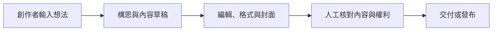
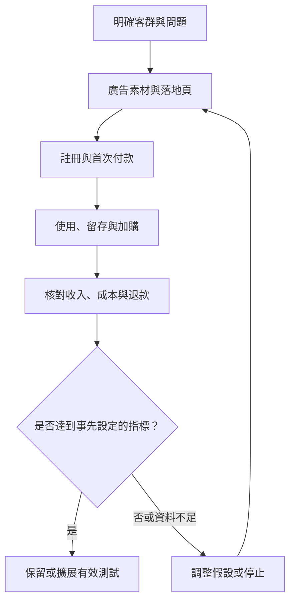

## TL;DR

- GetEbook 創辦人 Bogdan 把自己反覆製作電子書的工作，包成從構想到排版交付的 AI 工具；陌生人付費才是他認為的產品需求驗證。
- 最大獲客渠道據他自述是 Meta 廣告，靠素材、受眾、落地頁與漏斗持續測試。行銷經驗與廣告預算是重要前提。
- 創辦人說不到四個月營收超過 13 萬美元，但畫面範圍顯示「過去 12 個月」；**畫面不能單獨證明四個月營收**。利潤率與廣告成效亦未獨立審計。
- 原片畫面顯示 MRR **7,391 美元**；英文自動字幕與中文字幕誤記成 704,000。營收、月經常性收入及利潤必須分開。
- 可學到先從親身痛點找需求、用付款驗證、控制技術複雜度，並以小規模、可衡量的實驗測試獲客。這些是候選做法，不保證複製成功。

## 摘要（Summary）

本文合併 [Starter Story 原始訪談](https://www.youtube.com/watch?v=P3RVeg8YCg0)與[葛瑞森科技話AI 的中文精華](https://www.youtube.com/watch?v=W27VL50a-YM)。原片涵蓋產品、技術、行銷、財務與展示；中文版擷取核心訪談。兩支是同一案例，不是兩個獨立成功樣本。

英文為 433 段自動字幕，中文為 207 段、API 標記非自動生成；兩份均未逐字人工校對。中文片含原片插段，字幕不代表涵蓋所有聲音。本次抽看原片收入與 MRR 畫面；沒有登入 Stripe、查帳或使用產品。

## 關鍵洞察（Key Insights）

1. **包裝完整工作流可以有價值。** 產品整合生成、格式與交付，減少使用者串接多個工具；價值仍要看實際品質及使用者願不願付費。
2. **既有需求不等於新工具需求。** 創辦人原本賣電子書證明自己有需求；他將陌生人付費視為軟體需求的進一步訊號。
3. **快速產出與可維護性要一起看。** 他自述用 Lovable 建立第一版後，因不理解程式碼而轉用 Claude Code 重寫，重寫後仍有想改善的部分。
4. **行銷、收入與獲利是不同問題。** 廣告能帶來流量，能否獲利則需要核對轉換、退款、工具成本、廣告及後續收入。

## 來源與數字：先核對口徑

| 項目 | 影片口述或畫面 | 可支持的結論與限制 |
| --- | --- | --- |
| 累計收入 | 創辦人說不到四個月超過 130,000 美元；主持人提到約 132,000 | 口述的期間與數字；畫面選的是 **Last 12 months**，Gross volume 顯示約 132K，不能獨立確認四個月口徑 |
| 客戶 | 口述超過 1,700 位付費客戶、約 5,000 次註冊；畫面顯示 new customers 1,736 | 註冊、付費客戶、新客戶與訂閱者不是相同指標；畫面期間為過去 12 個月 |
| MRR | [原片 03:31](https://www.youtube.com/watch?v=P3RVeg8YCg0&t=211s)畫面為 **$7,391**、active subscribers 151 | 字幕誤成 $704,000；畫面是當時儀表板，不能當現況或獨立財報 |
| 收入構成 | 口述有訂閱、額度加購與其他數位產品 | 不可把總營收全部算作訂閱收入；未披露各項比例 |
| 支出與利潤 | 口述每月 Meta 廣告 20,000–30,000 美元，利潤率約 40–50% | 創辦人自述；未提供可核對的成本範圍、時間序列、退款與會計資料 |
| 建立時間 | 原片約 01:08 講者說約兩年前開始建立產品 | 開發起點與受訪時所稱的營收觀察期不同，不可直接寫成四個月從零完成全部事業 |

表格由本篇依字幕與畫面整理，金額均為美元。原片標題寫三個月、講者和主持人說不到四個月，畫面又顯示 12 個月；目前沒有足夠證據調和這三個口徑。產品收款頁面的展示也不等於完整財務審計。

## 詳細內容（Details）

### 1. 從自己的重複工作找產品

創辦人原本使用 ChatGPT、Canva 製作並販售電子書，也做聯盟行銷；他與妻子經營社群行銷公司。這些先前經驗與接觸客群的能力，都是判讀此案例的重要條件。他提出的問題是：能否把構思、研究、寫作與格式整理成較連貫的工具？

產品面向數位產品賣家、行銷人員、創作者、聯盟行銷者與企業。電子書可用於銷售，也可作為潛客磁鐵（lead magnet）；相同產品對不同客群有不同價值主張。

這張圖是本文整理的概念流程；人工核對是本文與講者共同強調的責任，並非本次已驗證產品會強制執行的步驟。

### 2. AI wrapper 賣的是什麼？

主持人承認工具可被稱為 AI wrapper，也認為有人願付費顯示它有價值。創辦人說它讓使用者少做研究、結構、寫作、排版與包裝的重複工作；但 AI 是否真的能完成專業研究或產出正確內容，要個別查核。

產品價值可拆成：目標客群、完成任務所需步驟、內容品質、交付格式及售後支援。單次付款是需求訊號，還需要留存、退款率、使用行為與成本資料，才能判斷長期價值。

### 3. AI slop：講者主張與驗收

受訪者認為大量生成、未審閱就上傳的通用內容可能是 AI slop；他主張仍需要想法、受眾與品質控制。這是他的立場，不代表產品能自動確保內容原創、正確或有授權。

> [!tip] 實務檢查
> 發布前核對關鍵事實、來源、圖片及素材權利、格式與目標讀者需求。若使用 Amazon KDP，依[官方內容規範](https://kdp.amazon.com/en_US/help/topic/G200672390)區分 AI-generated 與 AI-assisted，並確認當時的揭露要求。本文未實測 KDP 發布流程。

### 4. Vibe coding 的快與亂

第一版用 Lovable 快速建置，功能增加後，創辦人說自己難理解與維護，於是用 Claude Code 重建；他同時承認新版也不完美。不能據此推論換工具必然解決技術債。

他自述的技術組合：Claude Code 寫程式、ChatGPT 研究、Supabase 資料庫與認證、Vercel 主機、Resend 行銷信，以及 OpenAI 與 Gemini API 生成內容。這些是訪談時的說法，並非本文對實際系統的獨立盤點。

可從 [[2026-04-29-ANDREJ-KARPATHY-FROM-VIBE-CODING-TO-AGENTIC-ENGINEERING-SOFTWARE-3-0|vibe coding 與 agentic engineering]] 對照：小原型先驗證需求；涉及收款與使用者資料後，明確負責人、紀錄資料流、保留測試、權限與回復方式。這是本文建議，並未對該產品做安全審查。

### 5. 成長流程：測試而非只看廣告花費

Bogdan 自述 Meta 廣告是最大成長來源。他測試素材、角度、優惠、受眾、落地頁與漏斗；例如針對 Amazon KDP 族群設計頁面。他說曾停止推出新素材，之後廣告表現下滑，於是持續製作變體。這是個案觀察，不能單憑先後順序證明下滑原因。

使用者購買後，產品還有額度與教學等加購。創辦人認為客戶價值不只首次訂閱，因此可以承擔較高獲客成本；要驗證此判斷仍需追蹤實際留存與成本。

圖中的指標與停止分支是本文的實驗建議，並非影片已展示的完整實驗設計。以可負擔的預算起步，先訂期間、受眾、主要指標與停止條件，再比較結果；不要把講者的每日 200 美元當成適合所有人的建議預算。

### 6. 將案例轉為可練習的方法

1. **記下重複痛點**：描述誰在何時做什麼，列出現在的替代工具、耗時與不方便之處。
2. **區分假設**：例如有人需要電子書、有人需要更快製作、有人願付費，各自用訪談、使用或付款資料檢查。
3. **做最小產品**：先選一種受眾與交付物，檢查能否可靠完成，並保留人工修改與品質核對。
4. **設計可承受的獲客實驗**：一次記錄受眾、素材、頁面、花費與結果，避免同時改動所有條件卻無法解釋差異。
5. **算完整成本**：收入分訂閱與一次性；另列模型、主機、支付、廣告、人工、退款及稅費。先定義計算口徑，再評估獲利。
6. **定期檢查維護性**：明確資料與權限邊界，寫下核心測試、問題與復原方式；觀察使用者品質回饋。

這套流程可與 [[2026-10-13-HOW-TO-BE-MORE-AMBITIOUS-A-TUTORIAL-FOR-HUMANS-WITH-MODELS|放大 AI 任務上限]] 的任務卡結合：以可衡量的成果與限制取代空泛的「做一個 AI app」。

## 我的心得（My Takeaways）

最有用的啟發是把產品、分發與維護一起看。快速建出原型只回答技術能否做；陌生人付費提供需求訊號，而長期獲利還需要成本、留存與品質證據。主持人認為好的行銷幾乎能讓任何點子成功；這是他的觀點，單一成功案例不能證明這個普遍結論。

## 待補充（Open Questions）

- 四個月收入與 12 個月畫面的精確對帳為何？搜尋：`GetEbook Stripe four month gross volume timeline`。
- 各次性收入、訂閱、退款及廣告成本佔比為何？搜尋：`GetEbook subscription credits revenue profit breakdown`。
- 留存、取消與回本時間如何？搜尋：`GetEbook cohort retention CAC payback`。
- 廣告下滑是否來自素材疲乏，而非受眾或其他因素？搜尋：`Meta creative fatigue causal experiment`。
- 生成內容的正確性、版權及實際讀者滿意度如何評估？搜尋：`AI generated ebook quality evaluation reader outcomes`。

## 相關連結（Related）

- [[2026-04-29-ANDREJ-KARPATHY-FROM-VIBE-CODING-TO-AGENTIC-ENGINEERING-SOFTWARE-3-0]]：比較原型速度與可驗證工程。
- [[2026-10-13-HOW-TO-BE-MORE-AMBITIOUS-A-TUTORIAL-FOR-HUMANS-WITH-MODELS]]：以目標、專業方法與外部驗證規劃任務。
- [[2026-11-04-WHY-AI-MAKES-YOU-100X-FASTER-BUT-NOT-YOUR-COMPANY]]：個人效率、流程品質與數字證據的差別。

## 知識層次分析（Bloom's Taxonomy Analysis）

| 層次 | 對本文的應用 |
| --- | --- |
| 記憶 | AI wrapper、lead magnet、MRR、廣告素材、留存 |
| 理解 | 從個人痛點到產品、付款、獲客與維護，彼此各需驗證 |
| 分析 | 分辨收入、MRR、利潤；核對 12 個月畫面與四個月口述 |
| 應用 | 列一項重複工作及替代方法；設計小預算受眾測試並紀錄成本 |
| 評估 | 比較直接使用通用模型、購買現成工具或自建產品的時間、品質及維護成本 |

### 分析型追問（Socratic Follow-up）

- 客戶購買的究竟是內容、格式還是省下的時間？
- 若流量來自既有行銷能力，無此優勢的人能否複製？
- 哪份資料能同時核對收入期間及利潤口徑？
- 讀者與作者會如何評估電子書品質？
- 廣告成本上升或模型價格改變後，商業模式是否仍成立？

### 方案批判三問

1. 最大風險：誤把收入當利潤、快速生成當內容品質，造成資金損失或發布錯誤內容。
2. 失敗條件：客群不願付費、留存低、廣告成本超過回收、內容品質不佳或技術無法維護。
3. 替代方案：需求尚不清楚時可先手動服務或使用現成工具；已有穩定流程與付費證據時再評估自建自動化。

## 六頂思考帽回饋（Six Thinking Hats Feedback）

### 藍帽：問題與範圍
整合單一創辦人的訪談，學產品與獲客方法。

### 白帽：事實與未知資訊
字幕及畫面已取得；營收期間與完整成本無法核定，方法未實測。

### 紅帽：直覺與讀者反應
高營收標題容易令人興奮，也可能讓人忽略廣告支出與既有經驗。

### 黃帽：價值與可保留內容
親身痛點、真實付款與針對不同客群的測試都可形成具體假設。

### 黑帽：風險與限制
一個案例有倖存者偏差；生成內容、財務口徑與維護成本均需檢查。

### 綠帽：替代方案與新應用
先手動完成少量任務，觀察誰願意付費，再決定是否建立工具。

### 藍帽：修改項目與下一步
- 保留字幕誤辨與畫面日期範圍的差異。
- 後續以可承受的成本測試需求、品質與回收。
- 繼續追查收入、成本及留存證據。

## References

- [Starter Story 原始訪談，2026-11-11](https://www.youtube.com/watch?v=P3RVeg8YCg0)。
- [葛瑞森科技話AI 中文精華，2026-11-16](https://www.youtube.com/watch?v=W27VL50a-YM)。
- [Amazon KDP 內容規範：AI 內容揭露](https://kdp.amazon.com/en_US/help/topic/G200672390)。
