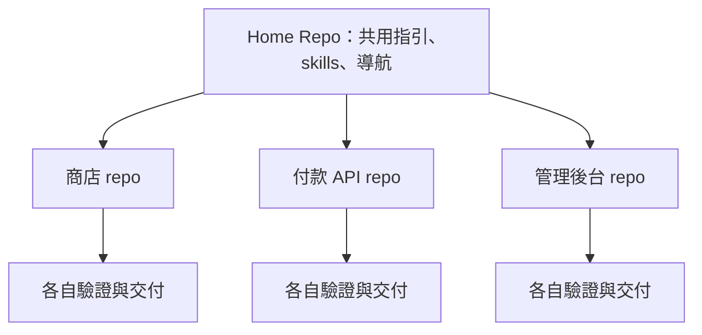
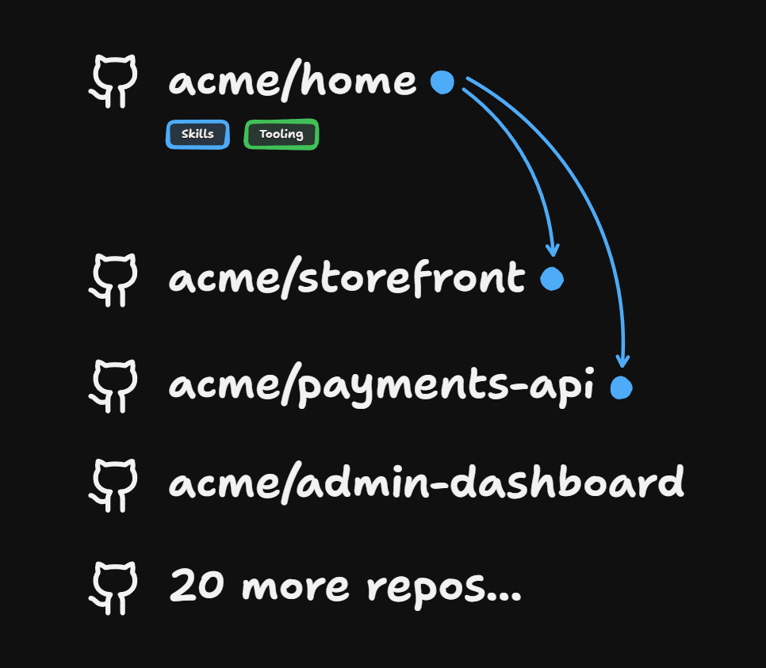
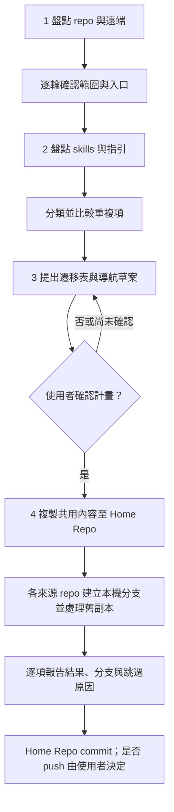

## TL;DR

- Home Repo 是一個獨立版本控制的工作入口，集中共用規則、skills、文件及其他 repo 的路徑；產品程式碼仍各自保留在原 repo。
- 從 Home Repo 啟動 agent，再依任務進入相關 repo，先讀取各 repo 的規則並分別檢查 Git 狀態、驗證與交付。
- 最大好處是共用內容有明確維護位置；前提是每個人更新到相同版本，且 agent 確實能存取目標與載入所需指引。
- 本篇整合三支影片、Matt 原文的四階段設定方法與實務建議。這是候選做法，未在本次執行跨 repo 實驗，也不保證所有工具自動載入相同規則。
- 影片留言既有團隊採用的正面經驗，也有人擔心專案 skills 無法載入、IDE／LSP 限制，以及它和 monorepo、submodule 或 plugin 有何差別；見下方留言整理。
- 01Coder 的 Antigravity 示範補了一個具體案例：在工具 repo 改模板，到內容 repo 驗證。會話入口、目錄存取、skill 發現與 Git 變更歸屬需要各自確認。

## 摘要（Summary）

Matt Pocock 的 [原片](https://www.youtube.com/watch?v=hWe-j78vNpc) 與 AI懶人報的 [中文解說](https://www.youtube.com/watch?v=P_MpsJm4adg) 介紹同一個 Home Repo 方法。前者展示自己的目錄、私人 skills、wiki 與工具；後者用多 repo 的團隊情境比較複製規則、使用者目錄、monorepo 與 Home Repo。[原作者文章](https://aihero.dev/the-home-repo-pattern)提供進一步盤點與規劃方式。

英文字幕 255 段、中文 62 段；英文為自動字幕，中文 API 標記非自動生成。兩份字幕均未人工逐字校對；中文片插入原片片段，字幕不代表涵蓋所有聲音。講者的規模及成效屬經驗與建議，非受控測試。

## 關鍵洞察（Key Insights）

- 共用入口降低維護多份相同規則的負擔，但不能代替各 repo 專屬的需求、測試與權限設定。
- 跨 repo 變更是一個協作任務，仍有多個獨立 Git 歷史；每個 repo 都需要自己的狀態、測試、commit 與 PR。
- Home Repo 設計與 [[2026-10-21-MATT-POCOCK-SKILLS-V-MODEL-WORKFLOW-MAPPING|既有 V-model 工作流]]可以並用：Home Repo 負責導航及共用方法，需求、設計、實作和驗收仍由各階段承擔。

## 詳細內容（Details）

### 問題與解法

Matt 以商店前台、付款 API、管理後台及更多 repo 為例：單一任務可能跨越多個專案，而每個 repo 重複放置 skills 與共用指引，更新可能失步。使用者目錄能跨專案提供設定，卻可能因各人獨立維護而過時。這是講者的經驗，不代表每個團隊的使用者設定必然失控。



各 repo 的專屬規則仍然存在。OpenAI 的 [Codex 指引](https://developers.openai.com/cookbook/examples/gpt-5/codex_prompting_guide)說明 `AGENTS.md` 的發現方式與目錄範圍；從 Home Repo 跨進另一個獨立 repo 時，不能僅憑路徑推斷該 repo 規則已經自動載入。實際依工具、版本與啟動方式核對，必要時明確要求 agent 讀取。

### 四種做法比較

| 做法 | 優點 | 代價與適用條件 |
| --- | --- | --- |
| 每 repo 複製 | 與專案一起版本化，容易獨立使用 | 共用規則多份維護；適合真正不同的專案規範 |
| 使用者目錄 | 個人跨專案方便 | 團隊版本分散；適合個人偏好及個人工具 |
| Monorepo | 原始碼與部分規則集中 | 遷移、權限、建置與組織協調成本；是否值得視情況 |
| Home Repo | 共用入口可版本化，原 repo 保留獨立 | 導航、版本同步、跨 repo 權限和驗收仍需管理 |

Matt 偏好在適合時使用 monorepo，也指出公開與私有 repo 混合、團隊共識不足可能使遷移困難；中文版「能做 monorepo 就做」是簡化表述，不是已證明的通用最佳解。

### 建立方式：可遵循的實務流程

下列順序以 Matt 原文為基礎，加入版本、驗收與權限檢查。**這是導入指南，本次未在使用者環境執行搬遷。**

1. **盤點**：列出相關 repo 的本機路徑、remote、用途、可見性、負責人及未提交變更。不要為了盤點而讀取 `.env` 或其他秘密。
2. **分類**：比較同名 skills 與指引，分成跨 repo 共用、重複但不完全相同、專案專屬、既有安裝套件。先檢視差異，不能單憑修改時間選擇內容。
3. **選定入口**：建立或選用適合團隊權限的 Home Repo。約定從哪裡啟動 agent，以及各人的 repo 如何取得、版本如何更新。
4. **撰寫導航**：在宿主工具實際支援的啟動指引中，記下名稱、用途、本機相對路徑／取得方式及專案專屬規則的位置。路徑只是指示，不自動授予存取或寫入權限。
5. **試跑低風險任務**：先請 agent 跨兩個 repo 讀取並提出變更計畫；核對它實際讀到哪些規則、哪些目錄可存取，然後在已授權範圍執行一個小變更。
6. **各自驗收**：分別核對工作樹、受影響需求、測試及版本，清楚記錄跨 repo 的相依關係。各 repo 的 commit／PR 分別建立；不要把一個 repo 測試通過當成全系統驗收。
7. **維護**：規則修改要有負責人、版本與更新方法；定期檢查路徑是否失效、重複指引是否衝突，以及是否仍有人從舊入口啟動。

> [!tip] 導航示例
> 以下是自編格式，不依賴特定機器的絕對路徑。實際使用前依團隊目錄、remote 與宿主工具調整。

```markdown
## Other Repos
- Storefront：../storefront，使用者介面；修改前讀取該 repo 的 AGENTS.md。
- Payments：../payments，付款 API；修改前核對該 repo 的測試與權限。
- 專案不存在時，先查明正確 remote 與權限，再依授權取得。
```

原作者文章的 setup prompt 建議先盤點、釐清及確認遷移計畫，再開始修改。文章另提供具體範本；不要直接將它當作已在本機執行的操作紀錄。

### Matt 原文的完整建置方法：四階段、先讀取再遷移

[Matt 的實作文章](https://www.aihero.dev/the-home-repo-pattern)提供四階段 setup prompt。它的目的不只是產生一份 `AGENTS.md`：先取得 repo 與既有指引的全貌，再逐輪決定範圍，**計畫核准前只讀取**，核准後才執行。原文建議在放置各 repo 的父資料夾啟動新的 agent session；prompt 會掃描使用者家目錄下的 repo，因此應先依自身情況縮小範圍。



*圖：Matt Pocock／AI Hero，[原文](https://www.aihero.dev/the-home-repo-pattern)。`acme/home` 是導航與共用資源的版本庫；圖上的箭頭是指引，不會自動 clone、賦予權限或同步版本。*



此圖由 Codex 根據原文整理；核准是 **Matt 在其 setup prompt 中設定的工作方式**。它適用於實際執行該 prompt 的遷移工作；本次只更新知識庫，沒有操作或搬遷讀者的 repo。

#### 第 1 階段：盤點 repo，決定哪些納入

Matt 的 prompt 請 agent 找出使用者家目錄下的 Git repo，略過相依套件資料夾，記錄**本機路徑、remote、公開／私有狀態、最後一次 commit 日期**。接著依回合確認：哪些 repo 要納入；Home Repo 是新建或沿用、放在哪裡；是個人或團隊共用；目前 harness 啟動時讀 `AGENTS.md`、`CLAUDE.md`，或兩者都讀。

- 原文建議優先考慮近期仍有提交的 repo，並以新建私有 repo 為起點；這是建議，並非一定合適。
- 每個 repo 必須明確標記「納入／不納入」，才能完成本階段；如無法判定 remote 的可見性，記為未知並查明，別猜成公開或私有。
- 原文要求秘密留在原處，`.env` 與其他 secret 檔不讀取。**Codex 建議**：限定盤點路徑、跳過套件與封存目錄，保留既有工作樹狀態；這些範圍需按個人環境決定。

盤點表示例，內容為 Codex 虛構；不是使用者機器的實際清單：

| repo | 路徑／remote | 最近提交 | 權限 | 決策 |
| --- | --- | --- | --- | --- |
| storefront | `../storefront`；`git@github.com:acme/storefront.git` | 已查日期 | private | 納入 |
| payments | `../payments`；`git@github.com:acme/payments.git` | 已查日期 | private | 納入 |
| archive | `../archive`；remote 待確認 | 已查日期 | 未知 | 暫不納入 |

#### 第 2 階段：盤點指引，分成四類

原文請 agent 在已選 repo 與使用者層級的 skill 目錄中，列出包含 `SKILL.md` 的 skill 資料夾、`AGENTS.md`、`CLAUDE.md`，以及 coding standards、glossary、ADR 等 agent 文件。每項各歸一類：

| 分類 | 判斷 | 原文預定處置 |
| --- | --- | --- |
| 共用（shared） | 對多個 repo 都成立 | 放到 Home Repo |
| 重複（duplicate） | 多處存在同一項 | 比較差異、標示最新版，整併為一份 |
| 專屬（repo-specific） | 僅描述某 repo 的程式、指令或領域 | 留在原 repo |
| 已安裝（installed） | 來自公開 skills repo 或 marketplace | 繼續以安裝來源管理 |

> [!warning] 最新時間不等於正確版本
> 原文以「最新版本」整併重複項；**Codex 建議**先看 `diff`、來源、適用範圍與 Git 歷史。不同 repo 的同名文件可能有必要差異，不能只依檔案修改時間刪掉其他版本。分類不確定時保留待確認。

#### 第 3 階段：呈現遷移計畫與導航草案

原文要求呈現每項「目前位置 → 目的地」及 Home Repo 的 `AGENTS.md` 草案，並逐輪處理相依的決策：一個問題尚未決定時，依賴它的問題留待下一輪。計畫表與指引**都經使用者核准**才進入實際修改。

以下是 Codex 自編的規劃表示例；`copy → compare → decide` 是較保守的遷移方式：

| 項目 | 原位置 | 類別 | 擬定目的地／處置 | 檢查 |
| --- | --- | --- | --- | --- |
| 共用 review skill | `storefront/.agents/skills/review/` | 共用 | 複製完整資料夾到 Home Repo | 包含 `SKILL.md` 與其 scripts、references |
| 付款專案測試指令 | `payments/AGENTS.md` | 專屬 | 保留原處，導航要求先讀 | 不把只適用付款服務的命令提升為共用規則 |
| 已安裝第三方 skill | 使用者安裝目錄 | 已安裝 | 沿用來源安裝方式 | 記錄版本與更新途徑 |
| 名稱相同但內容不同的文件 | 兩個 repo | 待判斷 | 先比較、由維護者確認 | 不以較新日期直接覆蓋 |

導航檔可先從短小的 `AGENTS.md` 開始。以下只是 **Codex 自編範例**，不是原文完整檔案：

```markdown
# Home Repo

本 repo 保存跨專案共用的工作方法與文件。
開始跨 repo 工作前，先確認相關 repo 的 Git 狀態與專屬指引。

## Other Repos

- Storefront：../storefront；網站前台。
  不存在時，依授權從 git@github.com:acme/storefront.git 取得。
  修改前讀取該 repo 的 AGENTS.md，確認測試方式。
- Payments：../payments；付款 API。
  不存在時，依授權從 git@github.com:acme/payments.git 取得。
  修改前讀取該 repo 的 AGENTS.md，確認安全與測試要求。

## Shared Docs

- 團隊準則：docs/coding-standards.md
- 用語：docs/glossary.md
```

原文建議如果 harness 載入不同入口檔，增加一行指向 `AGENTS.md`；例如 `CLAUDE.md` 可以提示先讀取它。**一行文字只是指示**，不能證明 Claude Code、Codex 或其他工具會自動追隨、載入專案 skills，或跨 repo 套用優先順序；應在實際版本檢查讀取結果。若 repo 已存在，應保留並合併原有指引，不能覆寫成單行。

#### 第 4 階段：依核准計畫執行並回報

Matt 建議先建立 Home Repo 與入口指引，將要共用的項目**完整複製**進來；再於各來源 repo 建立新的本機分支，移除已搬遷的重複副本，專屬內容保留。Home Repo 做 commit，是否 push 留給使用者決定。最後逐列報告結果、各來源 repo 的分支及跳過原因。

**Codex 補充的安全與驗收方式**：

1. 開始前記錄各 repo `git status --short --branch`、目前分支與 commit；若有既存工作，保留原狀，另外規劃隔離方式，不覆寫或混入。
2. 複製完整 skill 後比較必要檔案，確認 references／scripts 等相依路徑可找到；從 Home Repo 的實際啟動方式確認工具能發現及讀取，不能只憑檔案存在認定成功。
3. 確認新來源可用、使用者已同意移除且相關引用已更新，再依表格在各 repo 的獨立分支移除舊副本；逐一檢查 diff。若發現未預期的工作或權限限制，先保留並回報。
4. 在每個 repo 分別驗證規則、測試與差異，記錄 commit／分支與相依版本；提交及 push 的授權與範圍分別確認。跨 repo 驗證通過與上線完成也分開紀錄。

#### 在 Home Repo 開始工作：目錄與一個完整任務

原文的基本做法不需要新 CLI；Home Repo 由 Git 管理，其他 repo 可在相鄰目錄，也可依團隊設計 clone 在其中並排除於 Home Repo 追蹤。下面是 Codex 示意，不代表唯一布局：

```text
repos/
├── home/                         # 獨立 Git repo；從這裡啟動 agent
│   ├── AGENTS.md                 # 共用入口與 repo 導航
│   ├── .agents/skills/           # 依實際 harness 的支援位置決定
│   ├── docs/                     # 共用標準、術語與跨專案決策
│   └── repos/                    # 規模大時的分領域導航
├── storefront/                   # 獨立 Git repo 與專屬指引
└── payments/                     # 獨立 Git repo 與專屬指引
```

例如「調整結帳狀態顯示」同時涉及前台與付款 API：

1. 在 `home/` 啟動 session，給出功能目標，請 agent 先讀 Home Repo 入口並定位兩個 repo。
2. 分別確認兩邊的本機路徑、`AGENTS.md`／其他專屬規則、工作樹與當前版本；沒有權限或工作樹不乾淨就記錄限制，不自行清理。
3. 釐清 API 契約、測試與跨 repo 交付順序，先列計畫。若需平行修改，依兩個 repo 的情況各建 worktree／分支，不能共用一個 repo 的 worktree 來取代另一個。
4. 實作後，分別跑前台及 API 的相關測試，再做雙方的契約或整合驗證；記錄各 repo 的檔案、分支、commit 和測試結果。
5. 分別提交／交付各 repo，說明所需相依版本；Home Repo 不提供跨 repo 的原子 commit，若部分交付失敗需有協調或回退方案。

以下可作為任務啟動 prompt，為 **Codex 自編範本**，不是 Matt 原文：

```text
請先讀取本 Home Repo 的 AGENTS.md，協助規劃跨 repo 的結帳狀態顯示。
先找出相關 repo，分別回報路徑、目前分支、Git 工作樹狀態與版本，
並讀取各 repo 適用的專屬指引。請列出 API 契約、預期修改範圍、
每個 repo 的測試、跨 repo 的整合驗證，以及需要決定的事項。
先提出計畫，經我確認後才修改；保留既有未提交工作。
```

#### 規模、其他方案與 CI

- **約 20 個 repo**：Matt 認為平面導航仍可用；**約 400 個**時，他建議按業務領域拆成多份索引，例如 `repos/billing.md`，再由入口指向它們。這些是他的經驗式示例，不是效能測試結論。
- **更多使用者與 repo**：他認為到數千個 repo 時，可考慮 skills marketplace；這是分發及版本治理選項，是否適合取決於管理成本。
- **Submodule／monorepo**：原文認為少量 repo 可以使用 submodule，也可用普通路徑指標；submodule 可記錄特定 commit，但有額外維護成本。能採 monorepo 時它也是可選方案；公開與私有 repo 混用等情境不一定適合遷移。
- **CI／sandbox**：原文構想把 Home Repo 放進 sandbox，依任務 clone 其他 repo。是否能工作仍取決於實際網路、憑證、路徑、觸發條件與存取權限；不要把憑證或 `.env` 提交到 repo。

原文的完整英文 setup prompt 可在[作者文章「Set one up」](https://www.aihero.dev/the-home-repo-pattern)複製。本文以中文拆解其操作與決策，並增加可直接套用的自編範例。


### 01Coder 實例：在工具 repo 修改，到內容 repo 驗證

01Coder（小木頭）於 2026-11-24 發布這支 9 分 37 秒的影片。[YouTube 中文字幕](https://www.youtube.com/watch?v=kwhlEbhhGHg)由 `youtube-transcript-api` 取得，共 235 段。API 將字幕標為非自動生成。本次依字幕整理，未逐句核對音訊，也未重跑影片的 Antigravity 操作。

| 時間 | 影片展示 | 對原筆記的補充 |
| --- | --- | --- |
| [02:19–03:28](https://www.youtube.com/watch?v=kwhlEbhhGHg&t=139s) | Pi 把 coding agent、agent runtime、模型介面與 TUI 等套件放在同一個 Git repo。 | 已有共同 Git 根目錄能涵蓋日常改動時，可直接從該根目錄開始。需要協作的專案保有獨立 Git 歷史與發布流程時，再考慮加 Home。Pi 的公開 repo 可核對套件結構。 |
| [03:29–05:01](https://www.youtube.com/watch?v=kwhlEbhhGHg&t=209s) | `github-home` 放共用原則、任務與導航。Antigravity 專案另外把 `boring-video-studio` 和部落格 `verysmallwoods` 加為資料夾資源。 | 專案配置決定 agent 可以使用哪些目錄，Home 的導航交代目錄的職責。兩者各有一份需要維護的設定。 |
| [05:02–07:01](https://www.youtube.com/watch?v=kwhlEbhhGHg&t=302s) | 在 `boring-video-studio` 改關係流程圖、並列對比、資訊卡片三種模板，到部落格的影片目錄生成樣例並查看結果。 | 同一個 Home 會話可以在不同目錄執行命令。任務應寫清楚修改 repo、驗證 repo 與各自的驗收條件。影片中的樣例驗證屬講者示範。 |
| [07:02–08:16](https://www.youtube.com/watch?v=kwhlEbhhGHg&t=422s) | 講者在這次 Antigravity 設定新增業務目錄後，觀察到可用 skill 清單增加。 | 清單增加只證明示範中有更多項目出現。要確認某個 skill 實際有用，還要核對清單項目指向的來源、能否叫用，以及任務是否執行了所需步驟。 |

> [!tip] 用一筆任務記錄四個位置
> 分別記下會話入口、納入工作區的目錄、每個命令的工作目錄，以及每份變更所屬的 Git repo。若要驗證工具 repo 的候選變更在內容 repo 生效，另記錄驗證端實際載入的工具版本或本機路徑。只留下三張樣例，日後很難確認是否用到新模板。

Google 的文件分別說明 Antigravity 的多資料夾專案與 App、CLI、IDE 的 skill 搜尋位置。試行時可以用同一個 skill 記錄三個結果：目錄可讀、skill 在清單出現、明確叫用後產生預期輸出。各項結果要連同工具介面與版本一起留存。若要保留專案專屬 skill 的單一來源，可在 Home 記錄它的路徑及宿主支援的載入方式，再用樣例確認。 [Antigravity Projects](https://antigravity.google/docs/projects)、[Antigravity Agent skills](https://antigravity.google/docs/skills)

### 01Coder 影片留言：什麼情況只需要全域規則？

2026-11-25 以熱門排序擷取到 6 則留言，包括 3 則主留言與 3 則作者回覆。這是當時的討論快照。

| 討論串 | 留言內容 | 對導入決策的啟發 |
| --- | --- | --- |
| [「本地管家」構想](https://www.youtube.com/watch?v=kwhlEbhhGHg&lc=Ugw1t0oy6pLA_sfkQsF4AaABAg) | 觀眾希望跨專案維護時降低對特定 harness 的依賴，作者追問效果。擷取時還沒有後續成果。 | Repo 導航與任務說明可以用普通 Markdown 保存。要評估跨工具能否共用，仍得逐一核對工作區、指引與 skill 的接入方式。 |
| [初次看完仍不懂用途](https://www.youtube.com/watch?v=kwhlEbhhGHg&lc=UgxeANQofWfR3TCVhkd4AaABAg) | 作者用重複維護相似 `AGENTS.md` 或 skills，以及 Home 內的專案地圖重新說明。 | 導航的第一個例子就寫明「到哪裡改、到哪裡驗」，讀者比較容易掌握為什麼需要這份地圖。 |
| [全域規則就能解決嗎？](https://www.youtube.com/watch?v=kwhlEbhhGHg&lc=UgxjHzIOxFgUVkoBnux4AaABAg) | 觀眾認為需求可能只涉及全域規則，作者回覆這是解決特定問題的個人經驗，可依情境調整。 | 只共用自己的偏好，可以先用宿主的全域設定。經常需要辨識跨 repo 的職責、共用版本化導航、安排修改與驗證時，Home 才有明確的用途。 |

### 問題、原因與處理方式

| 問題 | 可能影響 | 處理方式 |
| --- | --- | --- |
| 專案規則未載入或相互衝突 | agent 用錯測試或覆寫不適用的規範 | 明確讀取目標 repo 規則；核對工具實際優先順序，記錄衝突 |
| 共用入口版本不一致 | 成員仍用舊版技能 | 記錄 Home Repo commit；制定更新與變更通知方式 |
| repo 在不同路徑或缺少憑證 | 找不到專案或 clone 失敗 | 用可設定的根目錄與清楚 remote；報告缺少的權限 |
| 多個 agent 同時修改 | 相互覆寫或混入未提交工作 | 檢查現有工作樹；適當使用 worktree，明確記錄各分支及 repo |
| 每個 repo 驗證通過，介面卻不相容 | 整合後失敗 | 增加跨 repo 介面、整合或契約測試；追蹤版本相依 |
| 私有資料與共用範圍混淆 | 不該分享的知識或憑證外洩 | 私有內容按存取需求分開；不要把秘密提交到共用 repo |
| 導航清單太長 | 難找、維護成本增加 | 依領域分檔、按需讀取；Matt 提出的 20、400 是經驗性示例，不是測試得出的上限 |

### Worktree 與 Home Repo 的關係

Home Repo 解決共用入口和導航；Git worktree 用來讓同一個 repo 的不同工作目錄各自對應分支。跨兩個 repo 的功能，可能需要兩個 repo 各自建立工作目錄與 PR；worktree 不會自動同步相依版本，也不會解除檢查未提交變更的需要。

### 好處與成本如何衡量？

可比較導入前後：共用指引更新所需的修改位置、版本落差次數、建立跨 repo 任務所需時間、規則載入失敗、每個 repo 的驗證及整合缺陷。收集相同期間與任務類型的資料，保留例外與回退成本；沒有量測前不宣稱節省多少時間。

### 熱門留言與使用者經驗：大家怎麼看？

2026-11-18 從 [Matt 的影片](https://www.youtube.com/watch?v=hWe-j78vNpc)依 YouTube 的熱門排序取得前 150 則留言；以下讚數是擷取時的快照，會隨時間變化。**高讚留言與較低讚但提供具體操作、疑慮的留言分開標記**；這不是全部留言的統計，也不能代表所有使用者。留言者身分、團隊規模及成果均未獨立驗證。

#### 較熱門的觀點

| 留言與當時讚數 | 觀眾的觀點 | 本文的判讀 |
| --- | --- | --- |
| [@bashovski](https://www.youtube.com/watch?v=hWe-j78vNpc&lc=Ugxxhz3oyuMArXZdooF4AaABAg)，68 讚 | 覺得這像是逐步重新發明 monorepo。 | 類比有幫助：兩者都想讓跨專案工作更方便；但 Home Repo 本身不會把各產品 repo 的 Git 歷史合成一個，也不提供 monorepo 的原子提交。 |
| [@broomva](https://www.youtube.com/watch?v=hWe-j78vNpc&lc=UgzEo9BCN5k9Xv511ol4AaABAg)，29 讚 | 自述使用類似方式一年以上，覺得累積效益明顯。 | 是個人使用經驗；未提供對照組、時間或品質數據，不能推論一般團隊必然有同樣效果。 |
| [@edoardogiordano3282](https://www.youtube.com/watch?v=hWe-j78vNpc&lc=Ugy0mJhDhms6nz1YHxp4AaABAg)，27 讚 | 使用 umbrella repo，讓子 repo 不納入其追蹤，將 ADR、上下文和文件放在入口；自述目前運作良好。 | 展示一種目錄組織；仍要分別管理子 repo 版本、權限與狀態。 |
| [@yeykawb](https://www.youtube.com/watch?v=hWe-j78vNpc&lc=UgxAhGiLU2g9ZUt0w254AaABAg)，13 讚 | 想進一步了解為什麼要選 monorepo，並質疑這與自己的經驗不同。 | 這是值得討論的取捨，不能從影片推出所有團隊都應遷移到 monorepo。 |
| [@felixkoller5871](https://www.youtube.com/watch?v=hWe-j78vNpc&lc=UgzzNxv7y3ox8lWGKfF4AaABAg)，11 讚 | 自述在多微服務團隊集中 specs、wiki 和 skills，並使用漸進揭露；提及 100 多個 repo、100 多人。 | 是單一留言者的規模與成效自述，不是已稽核的導入案例；仍需了解權限、版本及維護方式。 |
| [@arpitagarwal016](https://www.youtube.com/watch?v=hWe-j78vNpc&lc=UgwsYaEJcjHrHOa3Lw94AaABAg)，7 讚 | 自述帶領約 15 個主要 repo 的團隊，搭配客製工具採用類似方式。 | 客製工具可能是其效果的一部分；單靠目錄結構不能推論同樣結果。 |
| [@fabriciovanazzi5241](https://www.youtube.com/watch?v=hWe-j78vNpc&lc=UgxNeceqYKYmXON1y_J4AaABAg)，5 讚 | 問從 Home Repo 開啟 session 時，如何使用必須留在專案中的 skills 和 MCP。 | 這是實際導入前的重要問題；載入及可見性取決於工具、設定、版本與啟動位置，不能一概認定會或不會載入。 |

#### 其他具體經驗與疑慮

以下留言讚數較低，但補足熱門留言未展開的實作細節，均為留言者自述或提問，**尚未在本次實測**：

- **專案規則載入**：[@JuLabs-v8y](https://www.youtube.com/watch?v=hWe-j78vNpc&lc=Ugzyogt2oViN5fD12GN4AaABAg) 回報自己的類似設定遇到 `CLAUDE.md` 與 path-scoped rules 的延遲載入問題；[@rogersmj](https://www.youtube.com/watch?v=hWe-j78vNpc&lc=UgwTep9TcG8m5IwLRk94AaABAg) 則詢問子 repo 的專屬 skills 是否仍會被發現。這些反映特定經驗與未決問題，不足以判定所有工具都有相同行為。
- **IDE 與語言伺服器**：[@doggnamedchip](https://www.youtube.com/watch?v=hWe-j78vNpc&lc=UgyjQgAxLF2MT1Mq3Gl4AaABAg) 回報自己在 C# 情境下，從 Home Repo 啟動時遇到 LSP 行為問題，懷疑和 solution 目錄有關；[@brandonpaul6139](https://www.youtube.com/watch?v=hWe-j78vNpc&lc=UgxWe_VTKBGn6c33wVd4AaABAg) 問 IDE 整合的 agent session 如何接入。應針對自己的 IDE、語言與啟動目錄驗證，不能由此斷言所有 LSP 都不支援。
- **權限與機密**：[@harambeexpress](https://www.youtube.com/watch?v=hWe-j78vNpc&lc=UgxW9efL3kSYqJnA5FR4AaABAg) 希望依角色分層上下文；[@DerylSpielman](https://www.youtube.com/watch?v=hWe-j78vNpc&lc=Ugz_WYp3dvNLg4s7kk54AaABAg) 詢問不想分享的敏感資訊如何處理。Home Repo 是導航與組織方式，不是存取控制；仍需依實際權限和資料分級配置。
- **目錄與版本替代方案**：[@elementone9513](https://www.youtube.com/watch?v=hWe-j78vNpc&lc=Ugx75XASVo-Ciz7e1k14AaABAg) 自述用 symlink 組出任務工作區；[@williamattie294](https://www.youtube.com/watch?v=hWe-j78vNpc&lc=UgyvllQPM1vNiTKEQzV4AaABAg) 提出 submodule 可固定各 repo 版本；[@NDQ1](https://www.youtube.com/watch?v=hWe-j78vNpc&lc=Ugw0L0nHHZkrWoXCbVN4AaABAg) 詢問只需共用工具時能否使用私人 plugin。它們回答的問題不同：symlink 導航本機位置、submodule 記錄特定 commit、plugin 主要封裝及分發工具；是否能共同使用仍取決於實際環境。
- **平行工作與規則維護**：[@mad_villain8580](https://www.youtube.com/watch?v=hWe-j78vNpc&lc=Ugx4iTBYJO5Hghbjk0h4AaABAg) 自述用附帶建置設定的 worktree 隔離多個 agent；[@LucasHoezee](https://www.youtube.com/watch?v=hWe-j78vNpc&lc=UgyELxogcEV_pUga-P54AaABAg) 自述以 `repos.json` 記錄相依關係，並用初始化 skill 檢查依賴。這些是可研究的設計，不代表已驗證其工具或安全性。
- **共用知識與草稿**：[@gangle7183](https://www.youtube.com/watch?v=hWe-j78vNpc&lc=UgzwoCVyqvbyEkmPIfV4AaABAg) 自述區分共同 wiki 與分支專屬草稿，在重大合併後整理草稿。這啟發一個維護問題：哪些資訊已經核准、何時更新共同知識、誰有權刪除舊草稿，都應由團隊明確定義。

> [!tip] 根據留言補充的試行檢查
> 選兩個 repo，記錄啟動目錄與工具版本；分別確認專案專屬 instructions、skills、MCP、IDE／LSP 及權限是否如預期可用。再讓 agent 回報實際讀到的路徑，並核對兩個 repo 的 Git 狀態與驗證結果。這是 Codex 根據留言提出的試行方式，本次尚未執行。

## 我的心得（My Takeaways）

先用兩個相關 repo 做試點最容易找出規則載入、路徑與權限問題。Home Repo 可做導航與共用方法的單一維護位置，但每個 repo 仍應保有與其程式碼一起版本化的專屬驗收規則。

## 待補充（Open Questions）

- 不同版本 Codex、Claude Code 在跨獨立 repo 讀檔時如何載入指引？搜尋：`agent instruction discovery cross repository`。
- 團隊應以何種機制確認每人使用相同 Home Repo 版本？搜尋：`shared agent config version pinning`。
- 多 repo 同時變更如何確保部署與介面版本相容？搜尋：`cross repository contract testing release coordination`。
- 導航分層何時比平面清單更有效？搜尋：`repository navigation agent context evaluation`。
- 獨立 worktree 與既有未提交工作如何共存並交接？搜尋：`git worktree multi agent shared checkout`。
- 同名 skill 同時出現在 Home、業務 repo 與全域目錄時，各宿主介面會顯示、選用哪一份？新增工作區目錄後何時重新掃描？搜尋：`Antigravity multi-folder skill discovery duplicate skill precedence`。

## 相關連結（Related）

- [[2026-10-21-MATT-POCOCK-SKILLS-V-MODEL-WORKFLOW-MAPPING]]：將需求至驗收階段接到 skills。
- [[2026-10-17-MATT-POCOCK-SKILLS-V13-GRILLING-COMPOSITION-AND-DELIVERY-WORKFLOW]]：共用技能組合與交付證據。
- [[2026-10-03-CODEX-PRACTICAL-WORKFLOWS-CONTEXT-CACHING-SKILLS-AND-TOOLS]]：Codex 上下文、工具及交接流程。
- [[2026-11-18-AGENTIC-V-MODEL-OBSERVABILITY-HITL-AND-SHARED-KNOWLEDGE]] — 延伸閱讀：用 V-model、工單證據與人時／token 比較三套 AI 流程，以及共用知識的取捨。
- [[2026-11-23-HOW-UBER-EVALS-1-MILLION-AGENT-SKILL-INVOCATIONS-A-MONTH]]，從跨 repo 共用設定延伸到 skill 評估、分級發布及版本回報。

## 知識層次分析（Bloom's Taxonomy Analysis）

| 層次 | 本文應用 |
| --- | --- |
| 記憶 | Home Repo、導航指標、專案規則、worktree、跨 repo 驗收 |
| 理解 | 共用入口集中方法，程式碼與 Git 歷史仍分散 |
| 分析 | 指引存在不等於工具已載入；共用不等於版本一致 |
| 應用 | 盤點兩個 repo；列出規則與版本；試做低風險跨 repo 任務 |
| 評估 | 與 per-repo 和 monorepo 比較維護、權限與遷移成本 |

### 分析型追問（Socratic Follow-up）

- 哪些規則真的跨專案共用？
- 不同成員的目錄與權限是否一致？
- 如何證明專案專屬指引已被讀到？
- 對小型單 repo 專案，額外入口是否值得？
- 一年後誰負責移除過時路徑及技能？

### 方案批判三問

1. 最大風險：錯誤套用共用規則或混入另一 repo 的工作；應保留專屬規則及版本證據。
2. 失敗條件：入口未同步、跨目錄權限不足、路徑失效或規則衝突。
3. 替代方案：小型專案直接在 repo 管理；需要一致原子變更的團隊可評估 monorepo，代價是遷移及權限調整。

## 六頂思考帽回饋（Six Thinking Hats Feedback）

### 藍帽：問題與範圍
聚焦可重複的多 repo AI 工作流程及其限制。

### 白帽：事實與未知資訊
原片、中文解說與原作者文章已讀取；跨工具載入與效率尚未實測。01Coder 的案例有模板產出與 skill 清單變化的講者觀察，可據此設計分項驗證。

### 紅帽：直覺與讀者反應
集中入口容易理解；權限及不同 repo 的例外可能讓初學者困惑。

### 黃帽：價值與可保留內容
版本化共用方法、集中導航，降低重複維護。

### 黑帽：風險與限制
規則衝突、舊版本與跨 repo 整合失敗，都可能造成錯誤信心。

### 綠帽：替代方案與新應用
先以兩個 repo 試行；依領域分層導航，保留各專案專屬規範。

### 藍帽：修改項目與下一步
- 確認各工具的實際載入與權限。
- 為每個 repo 記錄驗證及交付狀態。
- 用共同指標比較試行前後成本，並記錄驗證端實際使用的工具版本。

## References

- [Matt Pocock 原影片](https://www.youtube.com/watch?v=hWe-j78vNpc)，2026-11-12。
- [AI懶人報中文解說](https://www.youtube.com/watch?v=P_MpsJm4adg)，2026-11-16。
- [Matt Pocock：The Home Repo Pattern](https://www.aihero.dev/the-home-repo-pattern)，原文標示更新日期 2026-11-12；包含 setup prompt、FAQ 與原文示意圖。
- [OpenAI：Codex Prompting Guide](https://developers.openai.com/cookbook/examples/gpt-5/codex_prompting_guide)。
- [01Coder：试试 Matt Pocock 备受欢迎的 Home Repo 工作模式](https://www.youtube.com/watch?v=kwhlEbhhGHg)，2026-11-24。本文新增個人專案案例及影片留言。
- [Pi 官方 repo](https://github.com/earendil-works/pi)，可核對 monorepo 的套件與職責。
- [Boring Video Studio 公開 repo](https://github.com/sugarforever/boring-video-studio)，影片說明欄連結。
- [Google Antigravity：Projects](https://antigravity.google/docs/projects)與 [Agent skills](https://antigravity.google/docs/skills)，用來核對多資料夾工作區及 skill 搜尋範圍。
