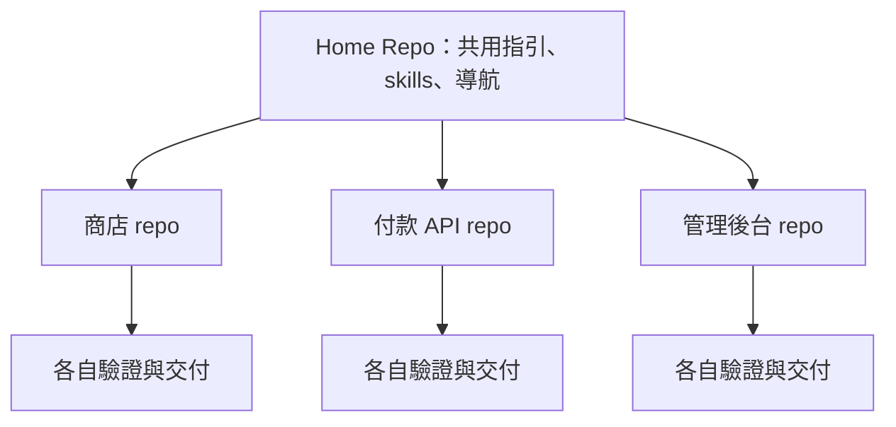

## TL;DR

- Home Repo 是一個獨立版本控制的工作入口，集中共用規則、skills、文件及其他 repo 的路徑；產品程式碼仍各自保留在原 repo。
- 從 Home Repo 啟動 agent，再依任務進入相關 repo，先讀取各 repo 的規則並分別檢查 Git 狀態、驗證與交付。
- 最大好處是共用內容有明確維護位置；前提是每個人更新到相同版本，且 agent 確實能存取目標與載入所需指引。
- 本篇整理兩支影片、Matt 原文與實務建議。這是候選做法，未在本次執行跨 repo 實驗，也不保證所有工具自動載入相同規則。

## 摘要（Summary）

Matt Pocock 的 [原片](https://www.youtube.com/watch?v=hWe-j78vNpc) 與 AI懶人報的 [中文解說](https://www.youtube.com/watch?v=P_MpsJm4adg) 介紹同一個 Home Repo 方法。前者展示自己的目錄、私人 skills、wiki 與工具；後者用多 repo 的團隊情境比較複製規則、使用者目錄、monorepo 與 Home Repo。[原作者文章](https://aihero.dev/the-home-repo-pattern)提供進一步盤點與規劃方式。

英文字幕 255 段、中文 62 段；英文為自動字幕，中文 API 標記非自動生成。兩份字幕均未人工逐字校對；中文片插入原片片段，字幕不代表涵蓋所有聲音。講者的規模及成效屬經驗與建議，非受控測試。

## 關鍵洞察（Key Insights）

- 共用入口降低維護多份相同規則的負擔，但不能代替各 repo 專屬的需求、測試與權限設定。
- 跨 repo 變更是一個協作任務，仍有多個獨立 Git 歷史；每個 repo 都需要自己的狀態、測試、commit 與 PR。
- Home Repo 設計與 [[2026-10-21-MATT-POCOCK-SKILLS-V-MODEL-WORKFLOW-MAPPING|既有 V-model 工作流]]可以並用：Home Repo 負責導航及共用方法，需求、設計、實作和驗收仍由各階段承擔。

## 詳細內容（Details）

### 問題與解法

Matt 以商店前台、付款 API、管理後台及更多 repo 為例：單一任務可能跨越多個專案，而每個 repo 重複放置 skills 與共用指引，更新可能失步。使用者目錄能跨專案提供設定，卻可能因各人獨立維護而過時。這是講者的經驗，不代表每個團隊的使用者設定必然失控。



各 repo 的專屬規則仍然存在。OpenAI 的 [Codex 指引](https://developers.openai.com/cookbook/examples/gpt-5/codex_prompting_guide)說明 `AGENTS.md` 的發現方式與目錄範圍；從 Home Repo 跨進另一個獨立 repo 時，不能僅憑路徑推斷該 repo 規則已經自動載入。實際依工具、版本與啟動方式核對，必要時明確要求 agent 讀取。

### 四種做法比較

| 做法 | 優點 | 代價與適用條件 |
| --- | --- | --- |
| 每 repo 複製 | 與專案一起版本化，容易獨立使用 | 共用規則多份維護；適合真正不同的專案規範 |
| 使用者目錄 | 個人跨專案方便 | 團隊版本分散；適合個人偏好及個人工具 |
| Monorepo | 原始碼與部分規則集中 | 遷移、權限、建置與組織協調成本；是否值得視情況 |
| Home Repo | 共用入口可版本化，原 repo 保留獨立 | 導航、版本同步、跨 repo 權限和驗收仍需管理 |

Matt 偏好在適合時使用 monorepo，也指出公開與私有 repo 混合、團隊共識不足可能使遷移困難；中文版「能做 monorepo 就做」是簡化表述，不是已證明的通用最佳解。

### 建立方式：可遵循的實務流程

下列順序以 Matt 原文為基礎，加入版本、驗收與權限檢查。**這是導入指南，本次未在使用者環境執行搬遷。**

1. **盤點**：列出相關 repo 的本機路徑、remote、用途、可見性、負責人及未提交變更。不要為了盤點而讀取 `.env` 或其他秘密。
2. **分類**：比較同名 skills 與指引，分成跨 repo 共用、重複但不完全相同、專案專屬、既有安裝套件。先檢視差異，不能單憑修改時間選擇內容。
3. **選定入口**：建立或選用適合團隊權限的 Home Repo。約定從哪裡啟動 agent，以及各人的 repo 如何取得、版本如何更新。
4. **撰寫導航**：在宿主工具實際支援的啟動指引中，記下名稱、用途、本機相對路徑／取得方式及專案專屬規則的位置。路徑只是指示，不自動授予存取或寫入權限。
5. **試跑低風險任務**：先請 agent 跨兩個 repo 讀取並提出變更計畫；核對它實際讀到哪些規則、哪些目錄可存取，然後在已授權範圍執行一個小變更。
6. **各自驗收**：分別核對工作樹、受影響需求、測試及版本，清楚記錄跨 repo 的相依關係。各 repo 的 commit／PR 分別建立；不要把一個 repo 測試通過當成全系統驗收。
7. **維護**：規則修改要有負責人、版本與更新方法；定期檢查路徑是否失效、重複指引是否衝突，以及是否仍有人從舊入口啟動。

> [!tip] 導航示例
> 以下是自編格式，不依賴特定機器的絕對路徑。實際使用前依團隊目錄、remote 與宿主工具調整。

```markdown
## Other Repos
- Storefront：../storefront，使用者介面；修改前讀取該 repo 的 AGENTS.md。
- Payments：../payments，付款 API；修改前核對該 repo 的測試與權限。
- 專案不存在時，先查明正確 remote 與權限，再依授權取得。
```

原作者文章的 setup prompt 建議先盤點、釐清及確認遷移計畫，再開始修改。文章另提供具體範本；不要直接將它當作已在本機執行的操作紀錄。

### 問題、原因與處理方式

| 問題 | 可能影響 | 處理方式 |
| --- | --- | --- |
| 專案規則未載入或相互衝突 | agent 用錯測試或覆寫不適用的規範 | 明確讀取目標 repo 規則；核對工具實際優先順序，記錄衝突 |
| 共用入口版本不一致 | 成員仍用舊版技能 | 記錄 Home Repo commit；制定更新與變更通知方式 |
| repo 在不同路徑或缺少憑證 | 找不到專案或 clone 失敗 | 用可設定的根目錄與清楚 remote；報告缺少的權限 |
| 多個 agent 同時修改 | 相互覆寫或混入未提交工作 | 檢查現有工作樹；適當使用 worktree，明確記錄各分支及 repo |
| 每個 repo 驗證通過，介面卻不相容 | 整合後失敗 | 增加跨 repo 介面、整合或契約測試；追蹤版本相依 |
| 私有資料與共用範圍混淆 | 不該分享的知識或憑證外洩 | 私有內容按存取需求分開；不要把秘密提交到共用 repo |
| 導航清單太長 | 難找、維護成本增加 | 依領域分檔、按需讀取；Matt 提出的 20、400 是經驗性示例，不是測試得出的上限 |

### Worktree 與 Home Repo 的關係

Home Repo 解決共用入口和導航；Git worktree 用來讓同一個 repo 的不同工作目錄各自對應分支。跨兩個 repo 的功能，可能需要兩個 repo 各自建立工作目錄與 PR；worktree 不會自動同步相依版本，也不會解除檢查未提交變更的需要。

### 好處與成本如何衡量？

可比較導入前後：共用指引更新所需的修改位置、版本落差次數、建立跨 repo 任務所需時間、規則載入失敗、每個 repo 的驗證及整合缺陷。收集相同期間與任務類型的資料，保留例外與回退成本；沒有量測前不宣稱節省多少時間。

## 我的心得（My Takeaways）

先用兩個相關 repo 做試點最容易找出規則載入、路徑與權限問題。Home Repo 可做導航與共用方法的單一維護位置，但每個 repo 仍應保有與其程式碼一起版本化的專屬驗收規則。

## 待補充（Open Questions）

- 不同版本 Codex、Claude Code 在跨獨立 repo 讀檔時如何載入指引？搜尋：`agent instruction discovery cross repository`。
- 團隊應以何種機制確認每人使用相同 Home Repo 版本？搜尋：`shared agent config version pinning`。
- 多 repo 同時變更如何確保部署與介面版本相容？搜尋：`cross repository contract testing release coordination`。
- 導航分層何時比平面清單更有效？搜尋：`repository navigation agent context evaluation`。
- 獨立 worktree 與既有未提交工作如何共存並交接？搜尋：`git worktree multi agent shared checkout`。

## 相關連結（Related）

- [[2026-10-21-MATT-POCOCK-SKILLS-V-MODEL-WORKFLOW-MAPPING]]：將需求至驗收階段接到 skills。
- [[2026-10-17-MATT-POCOCK-SKILLS-V13-GRILLING-COMPOSITION-AND-DELIVERY-WORKFLOW]]：共用技能組合與交付證據。
- [[2026-10-03-CODEX-PRACTICAL-WORKFLOWS-CONTEXT-CACHING-SKILLS-AND-TOOLS]]：Codex 上下文、工具及交接流程。

## 知識層次分析（Bloom's Taxonomy Analysis）

| 層次 | 本文應用 |
| --- | --- |
| 記憶 | Home Repo、導航指標、專案規則、worktree、跨 repo 驗收 |
| 理解 | 共用入口集中方法，程式碼與 Git 歷史仍分散 |
| 分析 | 指引存在不等於工具已載入；共用不等於版本一致 |
| 應用 | 盤點兩個 repo；列出規則與版本；試做低風險跨 repo 任務 |
| 評估 | 與 per-repo 和 monorepo 比較維護、權限與遷移成本 |

### 分析型追問（Socratic Follow-up）

- 哪些規則真的跨專案共用？
- 不同成員的目錄與權限是否一致？
- 如何證明專案專屬指引已被讀到？
- 對小型單 repo 專案，額外入口是否值得？
- 一年後誰負責移除過時路徑及技能？

### 方案批判三問

1. 最大風險：錯誤套用共用規則或混入另一 repo 的工作；應保留專屬規則及版本證據。
2. 失敗條件：入口未同步、跨目錄權限不足、路徑失效或規則衝突。
3. 替代方案：小型專案直接在 repo 管理；需要一致原子變更的團隊可評估 monorepo，代價是遷移及權限調整。

## 六頂思考帽回饋（Six Thinking Hats Feedback）

### 藍帽：問題與範圍
聚焦可重複的多 repo AI 工作流程及其限制。

### 白帽：事實與未知資訊
原片、中文解說與原作者文章已讀取；跨工具載入與效率尚未實測。

### 紅帽：直覺與讀者反應
集中入口容易理解；權限及不同 repo 的例外可能讓初學者困惑。

### 黃帽：價值與可保留內容
版本化共用方法、集中導航，降低重複維護。

### 黑帽：風險與限制
規則衝突、舊版本與跨 repo 整合失敗，都可能造成錯誤信心。

### 綠帽：替代方案與新應用
先以兩個 repo 試行；依領域分層導航，保留各專案專屬規範。

### 藍帽：修改項目與下一步
- 確認各工具的實際載入與權限。
- 為每個 repo 記錄驗證及交付狀態。
- 用共同指標比較試行前後成本。

## References

- [Matt Pocock 原影片](https://www.youtube.com/watch?v=hWe-j78vNpc)，2026-11-12。
- [AI懶人報中文解說](https://www.youtube.com/watch?v=P_MpsJm4adg)，2026-11-16。
- [Matt Pocock：The Home Repo Pattern](https://aihero.dev/the-home-repo-pattern)。
- [OpenAI：Codex Prompting Guide](https://developers.openai.com/cookbook/examples/gpt-5/codex_prompting_guide)。
