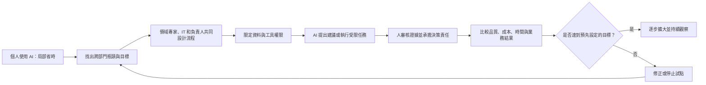

## TL;DR

- 李開復認為，AI 工具讓個人變快只是起點；企業要產生組織價值，還得重新設計決策、資料、工作流程與責任。
- 他以自家「老闆 AI」示範決策支援，並主張讓具名負責人（DRI）管理 agents；這是講者的產品與組織方案，不是已獨立證實的普遍最佳解。
- 簡立峰補充台灣中小企業視角：先找到老闆最有價值的工作，並由領域專家參與；個人可培養主、副專業與溝通能力。
- Fortune 訪談另討論美中 AI、開放權重、投資與就業：大多是李開復的判斷及預測，不能當成確定結果。
- 可從一條工作流程開始，設定財務與品質基線、限定資料權限、要求證據和人工核准，再以試點比較成果。

## 摘要（Summary）

[Fortune Daily 訪談](https://www.youtube.com/watch?v=mEo5rAMcyDk)從美中 AI 競爭、開放權重、Anthropic 的商業前景延伸到李開復的《AI Native》、Boss AI 及就業；[天下文化對談](https://www.youtube.com/watch?v=1xsDhApBGbw)由路怡珍主持，邀李開復及簡立峰討論投資、企業導入與職涯。兩片同日發布、主題重疊，但**不是同一場訪談的中英文版**。

這篇依「問題 → 觀點 → 例子 → 如何採用 → 未知」編排。李開復同時是 01.AI 創辦人與相關產品提供者，兩場訪談也介紹他的書；涉及產品的效益是其自述，應考量商業立場。簡立峰的經驗與預測另行歸屬，不代表所有台灣企業的實測結果。

> [!important] 證據範圍
> Fortune 英文字幕由 YouTube 自動產生，共 1,352 段；天下文化繁體字幕標記非自動產生，共 1,534 段；均未逐句人工核對音訊。本文沒有使用其產品、驗證企業 ROI，或實測所列工作方法。

## 關鍵洞察（Key Insights）

1. **工具採用不等於流程改造。** 個人省時要轉為企業效益，還需改變協作、權責、指標及瓶頸。
2. **決策支援與自主執行是不同風險。** 李開復在 Fortune 說重要決策 agent 供人審閱；有限任務可較自主，但仍需要人訂方向、核准和負責。
3. **工作不是單一職稱。** 任務可能被自動化、重組或新增；個人與企業的適應速度不必然相同。
4. **技術進步與資產定價分開判斷。** 李開復看好 AI 長期價值，同時承認個別公司或估值可能有泡沫。

## 詳細內容（Details）

### 一、兩支影片從哪裡切入？

| 問題 | Fortune Daily：李開復 | 天下文化：李開復與簡立峰 |
| --- | --- | --- |
| 為什麼轉型困難？ | CEO 只把 AI 當軟體交給 CIO，部門各自黏貼工具；未重新設計組織 | 資料基礎、老闆參與與領域知識都影響落地；中小企業有不同資源限制 |
| 怎麼做？ | CEO 使用決策支援，指派 DRI 與 agent；必要時改組 | 領導者親自學習，釐清問題與責權，讓專業人員參與流程再造 |
| 對工作者的影響？ | 推測數位工作先受影響，培養 agent 管理與人際能力 | 討論新人「斷梯」、主管轉型、π 型人才及台灣中小企業 |
| 額外視角 | 美國晶片限制、中國開放權重、模型競爭、投資與 AI 安全 | 台灣實務、老闆 AI 例子、工作四象限 |

### 二、從 AI 增能走向 AI 原生

李開復在 [Fortune 33:47](https://www.youtube.com/watch?v=mEo5rAMcyDk&t=2027s) 將企業購買聊天工具、讓部門各做 agent 稱為「AI 增能」（AI enablement）；他所稱的「AI 原生」（AI-native）則是讓 AI 深入企業的核心流程與組織決策。這是一種**策略主張**，並非「每個局部自動化都沒有價值」的證明。局部工具可能是低成本起點；流程重設也會帶來整合與管理成本。

此圖是 **Codex 對兩片的實務整理**，不是講者展示的既有流程。連接 [[2026-11-04-WHY-AI-MAKES-YOU-100X-FASTER-BUT-NOT-YOUR-COMPANY|個人變快、企業未必變快]]：流程標準、交接和可觀測性仍要一起設計。

### 三、老闆 AI：期待、例子與限制

在[天下文化 08:20 起](https://www.youtube.com/watch?v=1xsDhApBGbw&t=500s)，李開復提出讓 CEO 的助手整合會議、文件與 ERP／CRM，協助發現跨部門資訊。他介紹 01.AI 的平台萬策（True North）與「老闆 AI」，另提及銷售及投資等應用。

| 講者自述的情境 | 想解決的問題 | 讀者應如何看待 |
| --- | --- | --- |
| 兩個副總裁各自建造重複的系統，[14:12](https://www.youtube.com/watch?v=1xsDhApBGbw&t=852s) | 跨部門重工不易被 CEO 發現 | 單一自述案例；未公開對照組、錯誤率或財務資料 |
| 員工會議行為改變，被系統標為可能離職，[14:38](https://www.youtube.com/watch?v=1xsDhApBGbw&t=878s) | 讓管理者提早關心潛在問題 | 行為變化不等於離職意圖；可能造成偏誤、寒蟬效應與不當監控 |
| 摘出 CEO 未參與的關鍵爭論，[Fortune 25:00](https://www.youtube.com/watch?v=mEo5rAMcyDk&t=1500s) | 從大量資訊挑出需要處理的事 | 他說答案並非百分之百正確，應附證據鏈並接受 CEO 回饋 |

李開復主張 CEO 可看公司的文件；**公司擁有文件不自動等於可以不受限制地監聽、推論個人狀態或擴大使用員工資料**。採用前須依所在地適用規範與公司政策確認資料目的、告知、存取、保存、權限與申訴程序；敏感人事結論不應只憑模型推論。

他在[天下文化 25:00](https://www.youtube.com/watch?v=1xsDhApBGbw&t=1500s)預期數個季度後能看到財報改善；這是對轉型的主張，非已證實的保證。結合企業既有系統、建立證據鏈及可靠評估，本身可能是大工程。

### 四、DRI 與 agent：誰決定、誰執行、誰負責？

DRI（Directly Responsible Individual）是對一項成果負直接責任的人。[Fortune 30:00 起](https://www.youtube.com/watch?v=mEo5rAMcyDk&t=1800s)，李開復區分兩類：重要決策的 agent 附屬於主管，提供可解釋的建議；某些範圍明確的執行 agent 可放到組織圖，但仍由 DRI 設方向、預算、檢查及必要核准。

| 階段 | 人的責任 | agent 可協助 | 應保留的檢查 |
| --- | --- | --- | --- |
| 需求與設計 | 決定目標、取捨、授權與預算 | 彙整選項及證據 | 預期成果、不可做事項、權限 |
| 執行 | 選擇介入及升級條件 | 蒐集資料、起草、執行授權內工作 | 日誌、品質門檻與錯誤處理 |
| 決策與驗收 | 審閱、核准並承擔結果 | 解釋理由與提供可追溯來源 | 高影響動作由負責人核准；可撤回或補救 |
| 事後改善 | 檢討真實結果與負面影響 | 整理案例、協助評估 | 確認回饋真的改變系統，而非宣稱會自動學習 |

這個表格是 **Codex 建議**；不同 agent 的功能、權限與「學習」方式須依產品實測。人負責也不等於只把風險轉嫁給第一線員工：負責人需要足夠權限、資訊、訓練與資源。

### 五、如何判斷有沒有成效？先釐清 6%

訪談提到 McKinsey 的「6%」並將其描述為看到 ROI 的公司比例。但 [McKinsey 2026 原文](https://www.mckinsey.com/capabilities/quantumblack/our-insights/the-state-of-ai) 將 6% 定義為受訪者中同時回報 **AI 帶來至少 5% EBIT 影響**且具有「顯著價值」的高績效群體；**37%** 的受訪者回報 AI 對企業整體 EBIT 至少有一些影響。這是 1,719 位受訪者的調查，不是公司財報審計，也不等同 ROI 因果估計。2025 調查亦採類似高績效定義；影片未明確指出使用哪一版，不能把兩期當成同一份資料。

> [!tip] 小規模採用範例：Codex 提案，尚未實測
> 選一個可衡量且具代表性的流程，如銷售機會整理或客服分流。先記錄完成時間、人工修正時間、錯誤率和營收／成本指標；再限定資料、指定 DRI 與停用條件，對照導入前後或適當比較組。納入 token、整合、人員訓練、覆核與事故成本；不要把節省分鐘數直接當成利潤。

### 六、美中競爭、開放權重與投資：Fortune 的補充

李開復在 [Fortune 01:30 起](https://www.youtube.com/watch?v=mEo5rAMcyDk&t=90s)主張，美國晶片出口限制促使中國團隊在算力受限下追求效率，開放權重模型競爭也擴大；他以 iPhone／Android 類比封閉與開放生態，估計模型差距約六至十二個月。這是受訪者對政策效果與競爭格局的看法，**不是反事實因果證明，也不是所有任務、模型及時間點通用的差距測量**。

開放權重（open-weight）通常表示可取得模型權重；是否有可商用授權、訓練資料與完整訓練程式，要逐一看各模型條款，不能一概等同完整開源。影片亦談到中國公司商業化、彼此競爭與 DeepSeek 的影響；這些是李開復對產業的觀察，不代表中國所有公司或政策都一致。

[天下文化 01:45](https://www.youtube.com/watch?v=1xsDhApBGbw&t=105s)他認為 AI 技術長期價值巨大，同時指出循環投資、個別公司沒有可持續商業模式與過度擴張可能帶來估值風險。這不是投資報酬預測。Fortune 對 Anthropic 成長、算力支出與上市的討論是**訪談當時**的看法，實際公開文件及數字會變動，不應作為現況報價或投資依據。

### 七、工作與職涯：機會和未解決的斷梯

李開復認為可數位化任務可能較早變化；他提及 DRI、個人創業、具人際信任的工作，以及水電等開放環境的現場工作。天下文化 [31:00](https://www.youtube.com/watch?v=1xsDhApBGbw&t=1860s)談新人透過監督法律 agent 工作，並承認需求人數可能減少；資深管理者也可轉成 DRI 或教練。他對裁員規模、薪資與新職缺的說法是**推測或假設情境**，不是實際預測模型。

[天下文化 40:20](https://www.youtube.com/watch?v=1xsDhApBGbw&t=2420s)簡立峰認為中小企業資源有限，老闆自己的銷售與管理增能可能比省下一個人的工時更有價值；他也建議培養「π 型」能力：主專業、副專業與跨人合作能力。這些都是可嘗試的方向，不能保證任一職位安全或新工作能及時吸收失業者。

李開復以工作環境的**開放程度**與**人際信任需求**來討論職業，[44:00](https://www.youtube.com/watch?v=1xsDhApBGbw&t=2640s)舉重複流水線、水電維修、創作與銷售。這是思考任務組合的框架，不是可推算失業率的模型。各職位同時含多種任務，AI 能力、成本、監管和雇主選擇都會改變結果。[ILO 職業暴露研究](https://www.ilo.org/publications/generative-ai-and-jobs-refined-global-index-occupational-exposure)分析任務的潛在暴露；暴露不等於裁員或整個職業消失。

**給工作者的實作建議（Codex 整理）**：選一項常做任務，列出哪些步驟可交給 AI、哪些需領域判斷和人際協作；保留可驗證的成果，再與主管討論權責。企業則應保留新人學習、受督導練習及晉升路徑，不能假設新人一開始就具備審核所有錯誤的能力。

### 八、逐字稿導覽

| 主題 | Fortune | 天下文化 |
| --- | --- | --- |
| 競爭與泡沫 | [美中與晶片 01:30](https://www.youtube.com/watch?v=mEo5rAMcyDk&t=90s) | [長期技術與估值 01:45](https://www.youtube.com/watch?v=1xsDhApBGbw&t=105s) |
| 企業與產品 | [決策支援 25:00](https://www.youtube.com/watch?v=mEo5rAMcyDk&t=1500s) | [老闆 AI 08:20](https://www.youtube.com/watch?v=1xsDhApBGbw&t=500s) |
| 人與 agent | [組織圖 30:00](https://www.youtube.com/watch?v=mEo5rAMcyDk&t=1800s) | [新人與主管 31:00](https://www.youtube.com/watch?v=1xsDhApBGbw&t=1860s) |
| 個人未來 | [就業與新機會 36:35](https://www.youtube.com/watch?v=mEo5rAMcyDk&t=2195s) | [中小企業與職場 40:20](https://www.youtube.com/watch?v=1xsDhApBGbw&t=2420s) |
| 尚不確定 | [RSI 與安全 46:50](https://www.youtube.com/watch?v=mEo5rAMcyDk&t=2810s) | [工作象限 44:00](https://www.youtube.com/watch?v=1xsDhApBGbw&t=2640s) |

## 我的心得（My Takeaways）

這兩片最實用的是把討論從「買多少 AI 工具」推進到「誰要做什麼決定、依什麼證據、由誰承擔後果」。但領導者親自使用與由上而下推動，仍應搭配領域專家和受影響員工的實際知識；否則可能放大錯誤或資訊落差。[[2026-04-20-AI-REVOLUTION-STARTS-FROM-BOSS-CHIEN-LI-FENG-MEGA-TALK|簡立峰先前對中小企業的看法]]可對照閱讀，[[2026-10-15-HOW-THE-CLAUDE-CODE-TEAM-DOES-CODE-REVIEW|Anthropic 分層審查]]則提供以證據、風險和回復能力安排責任的另一個例子。

## 待補充（Open Questions）

1. 01.AI 是否公開 Boss AI 的具名客戶、對照組、錯誤率及完整成本？搜尋：`01.AI True North Boss AI case study independent evaluation`。
2. 證據鏈完整性、遺漏關鍵會議及角色權限如何量測？搜尋：`enterprise AI decision support provenance recall evaluation`。
3. 真實企業從個人省時到整體 EBIT 改變的因果識別如何設計？搜尋：`enterprise generative AI workflow randomized trial EBIT`。
4. 員工行為推論的誤報、資料使用與申訴如何治理？搜尋：`workplace AI monitoring inference employee privacy evaluation`。
5. 初階職位縮減時，哪些訓練方式能維持審查能力與升遷？搜尋：`AI entry level apprenticeship career ladder longitudinal study`。
6. 模型競爭差距如何依任務、成本和時間比較，出口管制的反事實影響如何估計？搜尋：`AI export controls open weight model benchmark counterfactual`。

## 相關連結（Related）

- [[2026-04-20-AI-REVOLUTION-STARTS-FROM-BOSS-CHIEN-LI-FENG-MEGA-TALK]]：簡立峰對老闆與中小企業的先前論述。
- [[2026-11-04-WHY-AI-MAKES-YOU-100X-FASTER-BUT-NOT-YOUR-COMPANY]]：個人效率與企業流程之間的落差及可評估行為。
- [[2026-10-15-HOW-THE-CLAUDE-CODE-TEAM-DOES-CODE-REVIEW]]：依風險分工、驗證與事故回饋的具體例子。

## 知識層次分析（Bloom's Taxonomy Analysis）

| 層次 | 具體應用 |
| --- | --- |
| 記憶 | AI enablement、AI-native、DRI、Boss AI、開放權重 |
| 理解 | 說明個人省時如何經流程、責任和驗證轉成組織價值 |
| 分析 | 區別產品自述、企業調查、產業預測與獨立因果證據 |
| 應用 | 為一項流程設定基線及 DRI；檢查資料權限與人工核准點 |
| 評估 | 比較局部工具增能與跨部門重設的成本、風險和適用情境 |

### 分析型追問（Socratic Follow-up）

- 澄清：AI-native 究竟需要改到哪些流程，才與工具增能不同？
- 假設：如果 CEO 看不到第一線真實問題，由上而下會漏掉什麼？
- 證據：哪些收益有可追溯的比較組與完整成本？
- 觀點：員工如何看待會議被分析及離職風險被推論？
- 後果：若新人失去練習機會，一年後誰有能力審核 agent？

### 方案批判三問

1. 最大風險：錯誤或有偏差的建議被當成事實，加上過度資料集中，影響個人與決策。
2. 失敗條件：資料不完整、權限設計失當、沒有基線、缺少領域專家或負責人沒有決策權。
3. 替代方案：先用最小權限的單流程工具與人工複核；優點是可控、易衡量，缺點是跨部門綜效較慢顯現。

## 六頂思考帽回饋（Six Thinking Hats Feedback）

### 藍帽：問題與範圍

探討兩場訪談如何解釋企業 AI 轉型及職涯，並分開產品主張和可驗證證據。

### 白帽：事實與未知資訊

兩份字幕和 McKinsey、ILO 原文可查；產品的獨立 ROI、系統效能與具體採用條件未取得。

### 紅帽：直覺與讀者反應

高階管理者可能期待更清楚的決策；員工可能對監控及失業感到不安。這是可能反應，非調查結果。

### 黃帽：價值與可保留內容

把使用工具、設計流程、授權、證據與責任連接，可幫助企業提出更具體的試點問題。

### 黑帽：風險與限制

領導者視角可能忽略一線；單一商業產品案例不足以證明跨企業成效，職涯預測存在不確定性。

### 綠帽：替代方案與新應用

從一條低風險流程與必要資料開始，讓使用者和受影響員工一起制定基線及回饋規則。

### 藍帽：修改項目與下一步

1. 對照工作流程選試點，明確負責人和衡量方式。
2. 檢查資料權限，並讓高影響結果由人確認。
3. 記錄成本與錯誤後再決定擴大或停止。

## References

- [Fortune Daily：Kai-Fu Lee: Why America's AI Strategy Backfired](https://www.youtube.com/watch?v=mEo5rAMcyDk)，2026-11-13，48:16。
- [天下文化：李開復 x 簡立峰](https://www.youtube.com/watch?v=1xsDhApBGbw)，2026-11-13，50:08。
- [McKinsey：The state of AI in 2026](https://www.mckinsey.com/capabilities/quantumblack/our-insights/the-state-of-ai)，核對 6% 與 37% 指標定義。
- [McKinsey：The state of AI in 2025](https://www.mckinsey.com/capabilities/quantumblack/our-insights/the-state-of-ai-2025)，核對高績效群體的定義。
- [ILO：Generative AI and Jobs: A Refined Global Index of Occupational Exposure](https://www.ilo.org/publications/generative-ai-and-jobs-refined-global-index-occupational-exposure)，2025；職業任務暴露研究。
