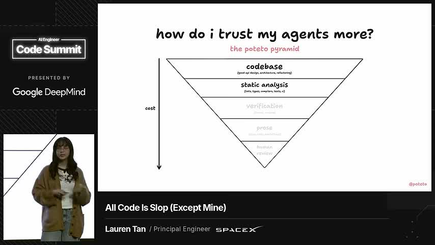
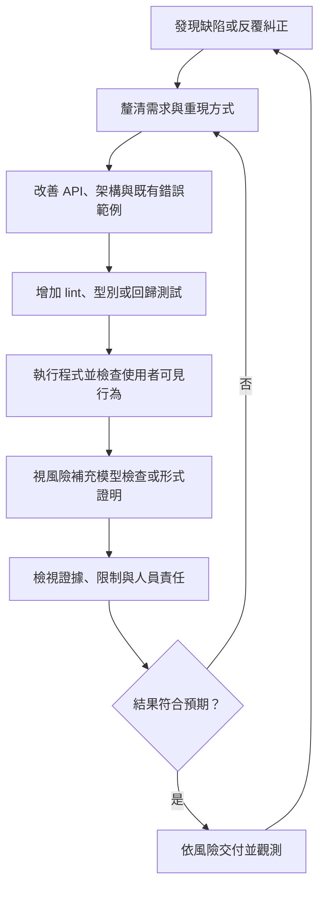

## TL;DR

- AI 加速產出時，壞的既有範例與繞過問題的修法也可能被快速複製；Lauren Tan 主張先改善程式碼結構與可執行約束。
- 她建議依序投資 API／架構、lint／型別與測試、執行期及形式驗證，再用文件與人工判斷補足；自動化建立在這些基礎上。
- 講者回報團隊單月約 11,000 個 PR、revert 比例約 0.5%；這些是團隊自述，PR 數量和 revert 率不足以單獨證明品質或產值。
- 從一個重複出現的問題開始：先重現並測試，建立能擋住錯誤的規則，再檢查實際執行結果和規則的誤判。
- 觀眾對 PR 粒度、驗證成本、系統理解與後續返工提出質疑；這些意見提供待驗證問題，並非已證實的反例。

## 摘要（Summary）

[Lauren Tan 的原始演講](https://www.youtube.com/watch?v=O_zcc6Xl12g)與 [AI懶人報中文整理](https://www.youtube.com/watch?v=DJJJ9ltVuGQ)談的是同一個問題：agent 可以快速產生程式，團隊如何讓變更多、交付快，仍能掌握品質？原講提出由架構與可執行規則開始，再加入 runtime／形式驗證，最後才擴大自動化；中文片以生活化方式整理其例子。

原講發布於 2026-11-14、17:31；中文整理發布於 2026-11-15、09:54。原講取得英文自動字幕 470 段，中文影片取得 API 標記為非自動產生的繁中字幕 150 段，兩者均未逐句對照音訊。數字是講者／影片說法，非公開資料重算；本文建議沒有在讀者專案或 Grok Bot 實測。

## 關鍵洞察（Key Insights）

1. **程式碼庫是 agent 的重要輸入。** 現存 workaround 和不良範例可能被誤認為慣例，因而擴散。
2. **把重複錯誤轉成可執行約束。** 架構邊界、API、lint 和測試比一段祈求遵守的文字更容易重複檢查，但只涵蓋寫入規則的部分。
3. **驗證是取得證據，不是保證需求正確。** runtime、測試、模型檢查與形式證明各有範圍；證明的模型也可能與實際系統不一致。
4. **量化產出要同時看成本與後果。** PR 數、revert 比例、事故、返工、使用者體驗和維護者理解，各回答不同問題。

## 詳細內容（Details）

### 一、問題和主張：先建立值得信任的環境

[原講 02:03](https://www.youtube.com/watch?v=O_zcc6Xl12g&t=123s) 以倒金字塔表示投資順序：先改善程式與可重複執行的檢查，再疊上驗證及需判斷的文字規則。下圖是 Codex 依演講重整的工作循環，非原講已量測的因果模型。

影片截圖顯示講者的倒金字塔；另抽樣檢視原講 9 個畫面，包括資料夾邊界、timer 擴散、feature map 與發布圖。抽樣不等於逐格檢查。

> [!important] 可重複執行不等於必然正確
> 規則可能漏掉錯誤、擋住合法用法或被繞過；工具、輸入與環境不固定也可能讓結果不同。文字規則、設計意圖和人的判斷仍有用途。

### 二、架構：讓錯誤用法更難發生

講者把程式碼庫比作花園：agent 可能複製現有 workaround，讓短期修補變成慣例。[原講 05:00](https://www.youtube.com/watch?v=O_zcc6Xl12g&t=300s) 說明團隊的 Dune 框架：把桌面應用經驗編碼成 API 與規則。

| 例子 | 團隊做法 | 可借鏡的問題 |
| --- | --- | --- |
| React `useEffect` 容易誤用 | 講者說產品程式碼禁止直接使用，Dune API 內有例外 | 能否提供更窄、較安全的 API？這是該團隊政策，不是 React 通則 |
| Electron main／renderer 邊界 | 分開頂層目錄並用依賴分析與 lint 限制相互匯入 | 邊界可否由工具檢查，而非只靠 review 記憶？ |
| 既有 workaround 被複製 | 新增檢查後清理既有實例 | 修掉重複原因，別只新增規則而保留舊範例 |

中文片舉 Cursor 中用 timer 緩解畫面問題、後續被複製的案例。講者認為背後涉及 imperative 與 declarative 架構衝突；這是她對該團隊情境的診斷，不代表所有 timer 或註解都不好。

### 三、lint、註解與驗證：各自解決什麼？

[原講 06:56](https://www.youtube.com/watch?v=O_zcc6Xl12g&t=416s) 說明 agent 可能用註解合理化暫時修法，團隊因此限制絕大多數註解，並讓 lint 訊息指出根因或預期修正方向。**Codex 的取捨建議**：機械規則適合可明確判斷的禁忌；需求理由、硬體限制、非顯而易見的安全假設仍可透過精確註解或文件保存，並評估維護成本。

| 防線 | 能提供的證據 | 不能單獨保證 |
| --- | --- | --- |
| lint／型別／測試 | 特定規則、型別或測試案例有無通過 | 所有需求及真實環境都正確 |
| 執行期驗證（runtime verification） | 執行程式、觀察輸出、截圖或瀏覽器行為 | 未走到的情境或不在截圖中的副作用 |
| 形式驗證（formal verification） | 對明確定義的模型、假設及性質做檢查或證明 | 模型涵蓋所有實作細節或使用者真正需求 |
| 人員審查 | 對目標、架構、證據與風險作判斷 | 人一定發現所有缺陷 |

[原講 09:40](https://www.youtube.com/watch?v=O_zcc6Xl12g&t=580s) 說明以 feature map 讓 agent 找到功能入口與共同詞彙，透過 Chrome DevTools 等工具執行應用，交付影片、截圖、圖表或其他證據。講者提到以 TLA+ 做通知跨裝置的模型檢查，以 Lean 對特定虛擬列表演算法進行證明，並試驗 UI 的 property-based testing；她明言形式驗證不是銀彈。這些是團隊回報的做法，沒有取得模型、證明與 CI 產物獨立重跑。

### 四、從可執行規則到 software factory

[原講 15:11](https://www.youtube.com/watch?v=O_zcc6Xl12g&t=911s) 建議先建立品質基礎，再自動化外層流程。她描述發版後由 Grok Bot 啟動 Cursor 專案，操作應用尋找問題，提出修復 PR 並自動合併。這是講者對其產品環境的描述，流程細節、審核政策和失敗率未公開到足以在此重現。

圖中「既有檢查與驗證」是根據演講整體做法的概念整理，並非已取得這條自動合併管線的逐步執行紀錄。採用時仍需自行決定合併政策、權限與回復方式。

### 五、成效數字怎麼讀？

| 講者回報 | 可得結論 | 尚不能得知 |
| --- | --- | --- |
| 自己上個月約 3,000 個 PR；團隊約 11,000 個 | 宣稱的工作量規模；個人與團隊數字不同 | PR 粒度、實質價值、合併類型、資源成本 |
| 團隊 revert 比例約 0.5%，相對下降 | 團隊對一項事後指標的回報 | 修補但未 revert 的缺陷、事故、長期維護成本；沒有完整基線或外部稽核 |
| 10 月約 227 位貢獻者，客戶端約每日一個 stable | 團隊宣稱的協作及發布頻率 | 每位參與者的工作量或成果品質 |
| 啟動、打字與切換等效能提升 | 講者宣稱相較初版改善 | 實際數值、測試條件、競品比較方法 |
| Cindy 回報 70% token 花在驗證，Lauren 認為自身大部分也是 | 個別工作者的經驗 | 通用最適比例、美元成本或品質提升的因果關係 |

PR 和 revert 數字不能直接相乘宣稱某期間一定有 55 次 revert：兩者統計母體與期間細節未公開。

### 六、熱門留言：讀者認同什麼、質疑什麼？

2026-11-18 取得原講 YouTube 30 則可見留言、中文影片 4 則；下列讚數是取得時快照，可能變動，排序與被平台顯示的範圍也可能改變。留言者身份及斷言均未獨立查證，不能代表所有觀眾。

| 觀點 | 來源與當時讚數 | 應如何解讀 |
| --- | --- | --- |
| 擔心管理者把大量 PR 當成低成本訂閱即可達到的標準 | [@tan.nicolas](https://www.youtube.com/watch?v=O_zcc6Xl12g&lc=UgwFC9KD4smIYx5Bwht4AaABAg)，1,200 | 反映成本與期待落差，並未提供實際 token 或人力帳單 |
| 細小變更都拆成 PR，數量可以很高 | [@juansymontano](https://www.youtube.com/watch?v=O_zcc6Xl12g&lc=UgxtY1wEU6lqb7klP7l4AaABAg)，646 | PR 粒度值得詢問，但留言未證明團隊刻意灌水 |
| 希望看完整工作日與實際變更 | [@tobene](https://www.youtube.com/watch?v=O_zcc6Xl12g&lc=UgwzrD5fuR3jkt5Sm_F4AaABAg)，704 | 可重現的工作紀錄與樣本有助評估主張，目前未取得 |
| 擔心只是「驗證過的 slop」 | [@spalauni](https://www.youtube.com/watch?v=O_zcc6Xl12g&lc=UgySIYyCYD6nu_EBpFx4AaABAg)，814 | 提醒測試與真正品質可能不同；這是諷刺觀點，非對產品的測試結果 |
| 想知道如何持續理解系統，才能參與複雜系統開發 | [@iainmckenzie1](https://www.youtube.com/watch?v=O_zcc6Xl12g&lc=UgzJxbzya1tuyIEB7EV4AaABAg)，182 | 維護者理解及知識傳承是交付速度以外的問題 |
| 應補上 churn／rework 數據 | [@ak681443](https://www.youtube.com/watch?v=O_zcc6Xl12g&lc=UgzkzkXISrbvLDEBJjJ4AaABAg)，67 | 返工值得量測；留言聲稱其增加，本文沒有資料證實 |
| AI 開始寫之前先討論架構 | [@user-hz7nh7be2y](https://www.youtube.com/watch?v=DJJJ9ltVuGQ&lc=UgxegIwNWYg3W__6DS14AaABAg)，5 | 與講者重視架構的方向相近；架構決策仍須依任務風險調整 |

中文片另有留言質疑 PR 性質，以及關於 skills 載入行為的個人說法；前者沒有具體證據，後者受工具及版本影響，此處不當成通用事實。

### 七、讀者如何開始？

以下為 **Codex 綜合建議，尚未在使用者環境實測**：

1. 選一個反覆出現的缺陷，記錄輸入、預期、實際結果與能重現的步驟。
2. 檢查根因是 API、模組邊界、既有範例還是單一實作錯誤；避免只針對症狀增加泛用禁令。
3. 補一個能辨識該問題的測試或規則，並檢查合法案例是否誤報；清理相同的既有錯誤。
4. 要求 agent 執行最接近使用者操作的驗證，保存指令、輸出與尚未驗證的部分；高風險情境保留人工判斷。
5. 比較缺陷、返工、執行時間與維護成本；有足夠數據再逐步自動化，並確定負責人與回復方式。

已有 pstack 研究可參考 [[2026-10-20-PSTACK-C-FREERTOS-LINUX-DRIVER-APPLICABILITY|嵌入式 C／FreeRTOS 的適用性分析]]；要在 Codex／Claude Code 實作獨立審查則可讀 [[2026-10-26-GENERAL-CODE-REVIEW-WORKFLOWS-CODEX-CLAUDE-CODE|通用審查工作流程]]。

## 我的心得（My Takeaways）

最有價值的是將重複糾正轉成可重跑的檢查，並要求實際行為證據。與其把某個 PR 數量當成目標，不如追蹤從需求到運作結果的整個循環，包括人是否理解變更、缺陷修復是否造成返工。這是本文判斷，並非講者提供的實驗結論。

## 待補充（Open Questions）

1. 11,000 個 PR 的粒度、分類與自動合併比例為何？搜尋：`Grok Bot 11000 PR size distribution`。
2. revert 之外的事故、fix-forward、回歸及 churn 如何變化？搜尋：`Grok Bot incident fix forward rework rates`。
3. Dune 的依賴規則與例外機制是否公開，如何衡量誤報？搜尋：`Dune Electron main renderer dependency lint rules`。
4. TLA+ 和 Lean 的模型、假設與實際執行路徑如何對應？搜尋：`Grok Bot TLA Lean notification verification`。
5. 高度自動合併下，團隊如何量測維護者的系統理解與完整成本？搜尋：`AI generated pull request reviewer comprehension cost`。

## 相關連結（Related）

- [[2026-10-20-PSTACK-C-FREERTOS-LINUX-DRIVER-APPLICABILITY]] — Lauren 原版 pstack 與第三方移植版、嵌入式驗證邊界。
- [[2026-10-15-HOW-THE-CLAUDE-CODE-TEAM-DOES-CODE-REVIEW]] — Anthropic 多層防線、人工核准與 review 收斂。
- [[2026-10-26-GENERAL-CODE-REVIEW-WORKFLOWS-CODEX-CLAUDE-CODE]] — 可遷移的獨立 review 與證據任務包。

## 知識層次分析（Bloom's Taxonomy Analysis）

| 層次 | 本文應用 |
| --- | --- |
| 記憶 | 記住架構、lint、runtime、形式驗證與人工判斷各層。 |
| 理解 | 說明既有模式如何影響 agent 產出，以及規則與行為證據如何互補。 |
| 分析 | 區分講者自述與實證、PR 數與價值、模型性質與實際系統。 |
| 應用 | 為一個重複缺陷加回歸測試；對一條真實流程保留執行結果。 |
| 評估 | 比較增加精準 lint 的持續成本與人工審查；對需求變動頻繁之處保留人工判斷。 |

### 分析型追問（Socratic Follow-up）

- 澄清：哪些結果算是已驗證的使用者行為？
- 假設：既有範例如果本來有缺陷，agent 會如何擴散它？
- 證據：還需要哪些資料才能解釋低 revert 率？
- 觀點：維護者如何在少讀 diff 的情況下維持系統理解？
- 後果：一年後累積的 lint 規則會不會互相衝突或阻礙改善？

### 方案批判三問

1. 最大風險：錯誤需求或不完整證據被自動化放大，且品質指標無法揭露實際損害。
2. 失敗條件：規則缺乏維護、測試未覆蓋主要行為、模型假設與現實不一致，或無法撤回副作用。
3. 替代方案：低變更量專案可先使用小 PR、人工 review 和少量高價值測試；代價是吞吐較低，但部署與維護負擔也較低。

## 六頂思考帽回饋（Six Thinking Hats Feedback）

### 藍帽：問題與範圍
聚焦 AI 產出速度提升後，如何維持可理解、可驗證的程式變更。

### 白帽：事實與未知資訊
兩支影片和留言可供查核；PR 原始資料、成本、事故及形式模型未公開供本文驗證。

### 紅帽：直覺與讀者反應
高產量可能令人振奮，也可能讓維護者擔心自己無法掌握系統。

### 黃帽：價值與可保留內容
將重複缺陷轉成可執行檢查，可減少反覆口頭提醒與機械審查。

### 黑帽：風險與限制
規則不等於需求正確；自動合併、誤報、模型落差與返工都可能造成未被數字反映的成本。

### 綠帽：替代方案與新應用
先從一個重現案例和對應測試開始，與既有人工 review 並行，累積資料後再調整。

### 藍帽：修改項目與下一步
1. 先建立失敗案例與執行證據。
2. 比較規則誤報、返工和維護成本。
3. 持續記錄未回答問題，評估是否擴大自動化。

## References

- [Lauren Tan：All Code Is Slop (Except Mine)](https://www.youtube.com/watch?v=O_zcc6Xl12g)，AI Engineer，2026-11-14；英文自動字幕。
- [AI懶人報 EP475：AI 寫的 code 怎麼不變 slop](https://www.youtube.com/watch?v=DJJJ9ltVuGQ)，2026-11-15；繁中字幕。
- [pstack 原始專案](https://github.com/cursor/plugins/tree/main/pstack)；此處僅連結，未在本次執行。
- [TLA+ 官方文件](https://lamport.azurewebsites.net/tla/tla.html)；[Lean 官方網站](https://lean-lang.org/)；原講提及的工具。
