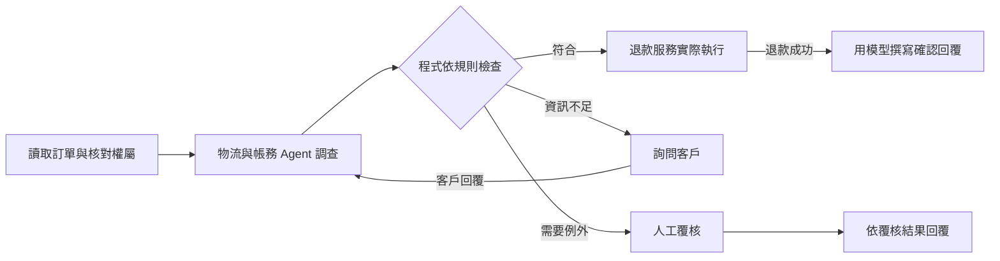
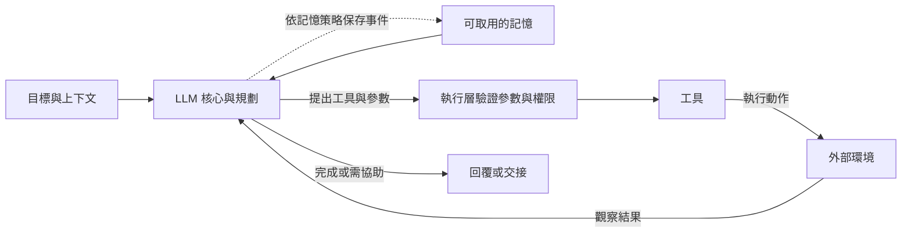
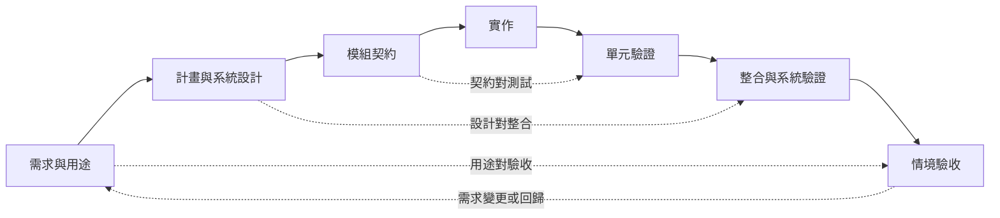
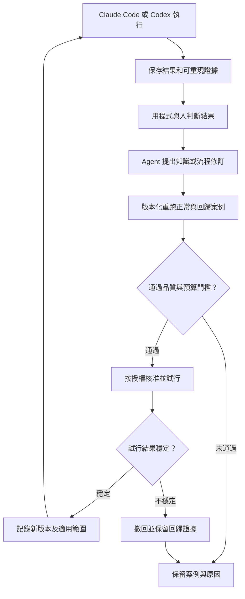

## TL;DR

- 三課先辨識誰決定下一步，再用 Google Cloud 退款案比較架構，最後讀 Stanford 原講，拆解 ReAct、記憶、工具呼叫與可靠性。
- 人力、等待、Agent 花費的時間、token 和交付品質可以各自量測。Claude Code 與 Codex 有部分原生訊號，跨工具比較仍需要同一個工作項目 ID、明確的時間區間和欄位定義。
- 外部做法有共用行為規格、共用可觀測契約、共用知識入口和共用執行平台。每往上一層都多一種協調成本。知識是否值得集中，可量查找成功率、適配與例外維護時間、以及改一次要通知多少流程。
- 本文提供可以回填 A／B／C 的比較表與測量方法。三套流程都已在運作，詳細內容尚未提供，因此各欄維持待填，公開專案只當對照案例。

## 摘要

把影片的 Agent 架構與客服案例放進軟體交付的 V-model，可以同時研究三件事。第一，需求到驗收的證據怎麼連。第二，誰消耗了時間和 token，等在哪裡。第三，一次失敗如何回饋到測試、知識和工作方式。這三個問題有不同的共用範圍。Claude Code 和 Codex 是已知的執行工具，三套流程的領域、責任人、任務類型、資料、審批政策及共用價值都留待觀察。

## 影片講義｜AI Agent 怎麼運作，系統又該怎麼設計？

讀完這節，你應該能分辨單次模型呼叫、工作流程（workflow）和 Agent，並能用同一件退款案，說明為什麼設計者會選單一 Agent、Agent 團隊或圖形工作流程（graph workflow）。第三課用 Stanford 原講的查證案例，補上元件、工具呼叫與可靠性評估。

### 第一課｜AI懶人報想教什麼？從「誰決定下一步」認識 Agent

這支影片整理 Stanford CS329Z 的入門概念。它用一個實用判準來區分不同工具：**拿到結果後，誰決定要不要再做一步，以及下一步做什麼？** 人看完一則 AI 回答再下指令，是人在帶路。程式安排模型和工具依預設路線走，是 workflow。若模型根據剛取得的結果，選擇接下來要查什麼或問誰，這一段就是 Agent 在運作。[影片 01:48](https://www.youtube.com/watch?v=JQye0oXHj1w&t=108s) · [08:56](https://www.youtube.com/watch?v=JQye0oXHj1w&t=536s)

> [!example] 例子一：找不到東西，下一步怎麼辦？
> 打開第一個櫃子，裡面沒有，就換一個找。影片把同樣的概念用在網路搜尋：第一次搜尋沒有找到相關資料，Agent 會依結果換關鍵字。這是「判斷 → 行動 → 看結果 → 再判斷」的迴圈。實作時要能判定何時完成、何時停止重試或交給人。[影片 03:00](https://www.youtube.com/watch?v=JQye0oXHj1w&t=180s) · [05:00](https://www.youtube.com/watch?v=JQye0oXHj1w&t=300s) · [16:22](https://www.youtube.com/watch?v=JQye0oXHj1w&t=982s)

影片把 Agent 拆成五個部分。**模型**解讀請求與結果，**規劃**決定先做哪一步，**記憶**保存已經試過的方法與取得的資料，**工具**讓它能查訂單或操作系統，**環境**則是它讀取或改動的地方，例如物流或客服系統。看新產品時，可以從這五個部分問出它究竟能完成哪類任務。[影片 06:32](https://www.youtube.com/watch?v=JQye0oXHj1w&t=392s)

| 影片中的例子 | 想說明什麼 |
| --- | --- |
| 把一封客訴信整理成三個重點 | 資料和輸出都清楚時，一次模型呼叫通常就足以交出摘要。[12:08](https://www.youtube.com/watch?v=JQye0oXHj1w&t=728s) |
| 大綱→檢查大綱→寫全文，或把客服問題分成退款、帳單、技術問題 | 串接和分流都可以用預先定好的路徑。分流節點即使用模型分類，後續仍由流程規定。[10:30](https://www.youtube.com/watch?v=JQye0oXHj1w&t=630s) |
| 三個章節同時寫，或同一份合約從三個角度審 | 平行化可以事先分好工作。若事先不知道該查哪些系統，可由主 Agent 看過線索再派工。[11:03](https://www.youtube.com/watch?v=JQye0oXHj1w&t=663s) · [14:52](https://www.youtube.com/watch?v=JQye0oXHj1w&t=892s) |
| Agentless 和 SWE-agent 都做修 bug | 影片用這兩者對比預設流程與動態調查。前者按既定階段找位置、修補、驗證。後者可以看結果再選下一個檔案或動作。[09:27](https://www.youtube.com/watch?v=JQye0oXHj1w&t=567s) |
| 一個模型翻譯，另一個對著原文找漏譯 | 產出者加評審者的做法需要清楚的評分依據，才能判斷改稿是否真的進步。[15:13](https://www.youtube.com/watch?v=JQye0oXHj1w&t=913s) |

> [!example] 例子二：草稿可以先寫，寄出由人確認
> 影片用電子郵件說明授權邊界，也援引兩個失敗案例。刪信案例用來說明上下文壓縮可能漏掉關鍵限制，買菜案例則說明缺少地址時，系統應先詢問。工程含意是把重要動作的覆核做進流程或工具，並設重試上限與停止條件。刪信與買菜屬於講者引用的案例。[影片 16:12](https://www.youtube.com/watch?v=JQye0oXHj1w&t=972s) · [16:40](https://www.youtube.com/watch?v=JQye0oXHj1w&t=1000s) · [17:49](https://www.youtube.com/watch?v=JQye0oXHj1w&t=1069s)

### 第二課｜Google Cloud 想教什麼？用同一件退款案比較三種架構

#### 核心主張（Idea）｜用任務的需求選架構

Annie Wang 用一個客戶情境貫穿整支影片：客戶說包裹一直沒到，想退款。系統要找出訂單、取得物流證據、判斷是否符合規則、執行退款，再把實際結果告訴客戶。三種架構分別回答**誰選下一步、誰負責哪一塊、哪些步驟必須依規則發生**。[影片 00:20](https://www.youtube.com/watch?v=czosBPhFnDI&t=20s) · [07:56 架構總覽](https://www.youtube.com/watch?v=czosBPhFnDI&t=476s)

1. **單一 Agent（single agent）讓同一個角色處理全案。** 它先查訂單拿追蹤碼，再查物流。確認遺失就查退款政策，若還在運送就給更新的到貨資訊，找不到訂單就向客戶補問。模型在同一個 Agent 迴圈可以被呼叫多次。退款工具本身仍要檢查操作是否合法。[影片 00:45](https://www.youtube.com/watch?v=czosBPhFnDI&t=45s) · [01:13 案例](https://www.youtube.com/watch?v=czosBPhFnDI&t=73s)
2. **Agent 團隊（agent team）把專業責任拆開。** 協調者先讓物流 Agent 查包裹，再把遺失證據交給帳務 Agent 核對付款與退款資格。兩位專家可使用同一個底層模型，各自有工作指示、可用工具與上下文。這個案子的兩步有依賴，所以影片示範的是交接。多一層交接也會增加延遲、成本和漏傳資訊的機會。[影片 02:43](https://www.youtube.com/watch?v=czosBPhFnDI&t=163s) · [03:12 角色圖](https://www.youtube.com/watch?v=czosBPhFnDI&t=192s)
3. **圖形工作流程（graph workflow）規定步驟、分支與前置條件。** 程式先讀資料並核對訂單歸屬。Agent 團隊回傳調查結果與建議。程式按付款紀錄檢查重複申請並計算可退金額，合格才呼叫退款服務。缺資料就詢問客戶並重回調查，政策例外交給人。付款服務回報成功之後，模型才撰寫退款確認。工作流程可在單一節點內放進一個 Agent 或一整組團隊。[影片 04:43](https://www.youtube.com/watch?v=czosBPhFnDI&t=283s) · [06:00 流程圖](https://www.youtube.com/watch?v=czosBPhFnDI&t=360s)

#### 架構（Architecture）｜各元件負責什麼？

| 架構 | 元件怎麼接 | 何時有用 | 要付出的成本 |
| --- | --- | --- | --- |
| 單一 Agent | 客戶 → 一個 Agent → 訂單、物流、政策、退款等工具 | 一個角色能理解整案，下一步常要視查到的資料決定。 | 工具和政策越多，同一套指示越難維護。模型會多輪選擇工具，需要停止條件。 |
| Agent 團隊 | 客戶 → 協調者 → 物流 Agent／帳務 Agent → 協調者整合 | 不同角色需要不同工具、規則或上下文，可各自維護。 | 交接要保留證據及待確認項目，否則帳務 Agent 可能把推測當成已確認的物流結果。 |
| 圖形工作流程 | 讀取與查核程式 → 調查節點 → 規則分流 → 退款、補問或人工覆核 → 回覆 | 步驟有強依賴，某些檢查每次必跑，完成與例外路徑要能說清楚。 | 要另外定義狀態、分支和恢復點。規則改變時需更新流程和測試。 |

#### 流程（Flow）｜用四個問題走完退款案

1. **這筆訂單是誰的？** 程式先讀訂單和付款資料，確認訂單屬於提出請求的客戶。後續節點才有足夠資料調查。
2. **包裹發生什麼事？** 物流 Agent 查承運商紀錄。帳務 Agent 依物流發現與付款資料，比對退款政策。這一步交付的是調查結果與建議。
3. **現在可以退多少？** 程式按付款紀錄檢查資格、是否重複申請，以及剩餘可退金額。符合條件才呼叫退款函式。資料不足先補問，政策例外轉人工。
4. **真的退成功了嗎？** 付款服務的結果提供可確認的狀態，模型根據結果寫客服回覆。退款函式本身也執行必要檢查，因此換成單一 Agent 或其他架構時，仍有相同的操作邊界。[影片 05:26](https://www.youtube.com/watch?v=czosBPhFnDI&t=326s) · [06:39](https://www.youtube.com/watch?v=czosBPhFnDI&t=399s) · [07:09](https://www.youtube.com/watch?v=czosBPhFnDI&t=429s)

下圖依 Google Cloud 影片 [06:00 的畫面](https://www.youtube.com/watch?v=czosBPhFnDI&t=360s) 重繪，標出 Agent、程式和人的分工。

#### 核心概念與重點（Concepts & Key Takeaways）

- **節點（node）與邊（edge）。** 節點可以是普通程式、單次模型呼叫、一個 Agent 或一組團隊。邊定義何時接下一步、何時分流，以及資料回來後是否重走調查。
- **工具和必跑節點的差異。** 把查核提供為 Agent 工具，執行時點取決於模型是否選它。把查核設成退款前的必要節點，流程可以保證經過這一步。查核的正確性仍要靠程式和測試。
- **分工是一個獨立決策。** 可以採用 graph workflow 搭配單一 Agent，也可以用團隊處理其中一個調查節點。先看是否真的需要不同角色，再決定是否值得增加交接成本。[影片 07:25](https://www.youtube.com/watch?v=czosBPhFnDI&t=445s) · [08:06](https://www.youtube.com/watch?v=czosBPhFnDI&t=486s)

### 第三課｜Stanford CS329Z 原講：拆開一個 AI Agent

#### 核心主張（Idea）

Diyi Yang 在 CS329Z 第一講把課題從「模型能回答什麼」推進到「怎麼把模型、工具、記憶和評估組成可以反覆執行的系統」。課程以較早的 action–observation 迴圈與 AlphaGo 類系統為背景，接到 ReAct 與 LLM Agent。第一課用日常比喻介紹這些概念，這裡把原講的元件、處理流程和評估問題拆開。[Stanford 原講 07:40](https://www.youtube.com/watch?v=DGI4vucR71w&t=460s) · [14:00](https://www.youtube.com/watch?v=DGI4vucR71w&t=840s) · [官方投影片](https://web.stanford.edu/class/cs329z/slides/lecture01.pdf)

#### 架構（Architecture）｜五個部分怎麼接？

| 元件 | 作用 | 用第二課退款案舉例（講義延伸） |
| --- | --- | --- |
| 模型核心（LLM core） | 讀目標、上下文和觀察，提出下一個動作或回覆。 | 理解客戶描述，判斷要先查訂單或補問。 |
| 規劃與推理（planning and reasoning） | 把目標拆成可做的步驟，隨新資料調整。 | 發現包裹已遺失，接著核對退款資格。 |
| 記憶（memory） | 保存可供下一輪取用的事件、事實與方法。 | 本案查過哪些資料、目前採用哪版政策、調查要走哪些步驟。 |
| 工具（tools） | 受控地查詢或改動外部狀態。 | 查訂單、查物流、讀付款紀錄。 |
| 環境（environment） | 接收動作與回傳觀察的外部系統。 | 訂單資料庫、承運商系統、付款服務。 |

下圖參考官方投影片第 30、58 頁重繪，將構成與執行時的資料方向畫在一起。[原講 22:05](https://www.youtube.com/watch?v=DGI4vucR71w&t=1325s) · [投影片第 30 頁](https://web.stanford.edu/class/cs329z/slides/lecture01.pdf#page=30)

#### 流程（Flow）｜ReAct 為何要讓觀察回到模型？

原講的 HotpotQA 例子問 Apple Remote 原本搭配的軟體可用什麼其他方式控制。模型先查 Apple Remote，得到 **Front Row** 這個軟體名稱。直接查名稱找不到合適條目，因此改用含「software」的關鍵字，最後找到鍵盤功能鍵的資料。觀察結果改變了接下來的行動，也提供了可核對的答案依據。[原講 31:13](https://www.youtube.com/watch?v=DGI4vucR71w&t=1873s) · [投影片第 36 頁](https://web.stanford.edu/class/cs329z/slides/lecture01.pdf#page=36)

工具呼叫還有執行層。投影片用讀取 `test.py` 當例子，依序選擇工具、填入檔案路徑、驗證參數型別、執行並把結果帶回上下文。工程上可以分別檢查「參數格式正確」與「此執行環境允許讀取該檔案」。前者由 schema 提供依據，後者由執行權限與沙盒決定。[原講 58:41](https://www.youtube.com/watch?v=DGI4vucR71w&t=3521s) · [投影片第 58 頁](https://web.stanford.edu/class/cs329z/slides/lecture01.pdf#page=58)

#### 概念（Concepts）｜原講多教了哪些東西？

| 概念 | 讀講義時要抓住的差異 |
| --- | --- |
| 推理鏈（CoT）、ReAct、Reflexion | CoT 提供中間推演，ReAct 讓下一步使用外部觀察，Reflexion 則用任務回饋整理失敗經驗，讓後續嘗試能取用。可分別問這一輪是否需要查證、下一輪是否需要保留經驗。[28:19](https://www.youtube.com/watch?v=DGI4vucR71w&t=1699s) · [35:05](https://www.youtube.com/watch?v=DGI4vucR71w&t=2105s) |
| 情節、語意、程序記憶 | 情節記憶保存「上次發生什麼」，語意記憶保存「歸納後知道什麼」，程序記憶保存「下次怎麼做」。同一個退款案可以留下失敗事件、已確認的規則及經驗證的處理步驟。[44:54](https://www.youtube.com/watch?v=DGI4vucR71w&t=2694s) |
| 複合 AI 系統、RAG 與 MCP | 複合系統可以把模型、檢索、工具和驗證組在一起。RAG 先取回相關內容供模型使用，MCP 提供宿主和工具／資料來源的標準連接方式。系統仍需決定步驟、授權和完成條件。[53:31](https://www.youtube.com/watch?v=DGI4vucR71w&t=3211s) · [1:00:14](https://www.youtube.com/watch?v=DGI4vucR71w&t=3614s) |
| 可靠性與安全 | 課程分別問同一任務重跑是否一致、輸入或工具小幅變動時是否穩定，以及失敗是否可預期、可恢復。成功率也要與是否遵守授權一起檢查。[1:01:05](https://www.youtube.com/watch?v=DGI4vucR71w&t=3665s) · [投影片第 61–64 頁](https://web.stanford.edu/class/cs329z/slides/lecture01.pdf#page=61) |

#### 必記重點（Key Takeaways）

1. **觀察要能改變下一步。** 用 trace 檢查 Agent 是否真的讀到工具結果，遇到錯誤時有沒有換路線、補問或停止。
2. **記憶可以分開維護。** 發生過的事件、已查證的規則和可執行的方法，各自需要可追溯的來源與適用範圍。將一次失敗轉成流程改進時，先保留原始事件，再驗證歸納出的做法。
3. **把成功和可靠性都寫成驗收情境。** 退款案可以測正常、資料缺漏、重複退款及工具暫時失敗。每條都要定義應有結果、允許的操作及應保留的證據。這是把原講的評估框架帶回第二課與 V-model 的講義練習。

### 課堂練習｜遇到新任務，先決定哪裡需要判斷

| 題目 | 參考答案 |
| --- | --- |
| 一封客訴信已經在手上，只需要三點摘要。 | 先試單次模型呼叫。 |
| 三種客服問題有對應的處理路徑，但使用者的說法各不相同。 | 模型可分類，workflow 選已定義的分支。 |
| 收到模糊的 bug 描述，要依 log 和程式碼線索找原因。CI 測試有固定清單。 | Agent 選調查順序，CI 執行規定的檢查。這是講義延伸題。 |
| Agent 建議退款，但付款紀錄顯示先前已退過。 | 程式做重複檢查並依規則停止或轉人工覆核，客服只回報已確認的處理結果。 |

三課分別處理辨識 Agent、安排系統分工，以及驗證 Agent 如何行動與失敗。設計時可以逐步問：**哪些步驟要靠觀察才能選路？哪些規則每次都得跑？哪些例外要由人判斷？** 三種架構可以同時出現在同一個系統裡，也可以從固定流程起步。[Google Cloud 07:50](https://www.youtube.com/watch?v=czosBPhFnDI&t=470s)

> [!note] 來源與延伸閱讀
> 第一支依繁中字幕整理，第二支依本機 ASR 與關鍵畫面整理，帳務角色用畫面確認為 billing。第三支依 Stanford Online 英文 CC 和第 1 講官方投影片整理。上述練習是本講義的教學設計。以下各節把概念接到 V-model、可觀測性與工作流程比較。

> [!note] 可觀測性有兩個對象
> Agent 需要看得到工具結果與當前狀態，才能決定下一步。操作者則需要看得到每次執行的證據、責任、等待與成本，才能重現問題、及早介入並比較流程。

## 把 AI 放進 V-model

V-model 在這裡用來配對規格與證據。NASA 手冊區分依要求驗證（verification）與在預期環境確認可滿足用途（validation）。下圖與角色分工是本文的研究基準，可按實際流程調整。[NASA Systems Engineering Handbook](https://www.nasa.gov/wp-content/uploads/2018/09/nasa_systems_engineering_handbook_0.pdf)

| 階段 | Agent 可支援 | 人與程式可負責的證據 |
| --- | --- | --- |
| 需求、需求變更 ↔ 驗收 | 整理歧義、追蹤影響、提出驗收情境 | 人確認目標、變更理由及例外，保留需求版本與實際使用情境。 |
| 計畫、設計 ↔ 整合驗證 | 提出替代方案、分工、列出依賴與回復路徑 | 人確認架構取捨與決策權，CI 產出介面、整合及回復檢查。 |
| 實作 ↔ 單元及回歸驗證 | 更新程式、測試與文件，解釋失敗 | 保存 commit、測試輸出、執行環境與規格版本。固定檢查交給程式，可另外由獨立 reviewer 抽查。 |
| 除錯、bug fix ↔ 回歸與用途確認 | 比對 trace 與已知正常版本、提出假設、建立回歸案例 | 先保留失敗證據，再驗證修正。需要協調的副作用與驗收例外由指定人確認。 |

人工參與（human in the loop, HITL）可以出現在三處。啟動前確認範圍與風險，執行中處理資料缺口、規格衝突或高影響動作，收尾時審查驗證證據和驗收結果。每次介入保存 `checkpoint_id`、請求時間、實際開始處理時間、決定、原因、證據引用、責任角色與逾時處置。等待期間是否釋放 worker，恢復後是否從 checkpoint 接續，以及重送會不會重複產生副作用，都是可驗證的設計問題。

## 人花多久、Agent 跑多久、用了多少 token

### 指標與採集方式

| 要回答的問題 | 操作定義 | 訊號與限制 |
| --- | --- | --- |
| 工作多久才交付？ | 從需求進入可執行狀態到驗收、拒絕或取消的日曆時間。分開看排隊、執行、HITL 等待及回復。 | 工單或 runner 時間戳。事先固定入口與出口定義，保留失敗與取消。 |
| 人實際投入多少？ | 同一人的投入區間先合併，再跨人加總成 person-minutes。至少分需求澄清、審批、閱讀／驗收、手動修正。 | 在研究樣本記開始與結束，或用自填短估計並標記來源。Claude Code 的 `active_time.total` 使用者類別可補充 CLI 中的互動，會議、思考、在 GitHub 審查等須另行記錄。 |
| 卡在人多久？ | 請求送出到有決定的經過時間。若另有開始處理時間，可測排隊與實際判斷。 | 使用 HITL 狀態事件或工具權限等待 span；同時掛起的請求各記錄，算任務經過時間時取區間聯集。 |
| Agent 跑多久？ | 記錄 runner elapsed、模型呼叫與工具 span。報表分開呈現所有 worker 執行區間的聯集與 worker-minutes 加總。 | 同時計算使用同層區間，避免父 span 加子 span 重複。Agent 監控尚未覆蓋的等待、重試與背景執行另標。 |
| Token 和費用多少？ | 保留 provider 原始用量，依 run／attempt／turn 與 provider、model、CLI 版本彙整，含失敗和重試。 | 關聯原生 telemetry 或 JSONL，處理 final 與逐回合來源重疊。快取、推理 token 可能是總量的子項或獨立項，依引擎定義正規化。用量缺失保留未知，費用區分帳單、估算、訂閱額度。 |
| 省力有沒有犧牲結果？ | 驗收通過率、首次通過率、重開／返工、人工接管率、品質漏出、證據覆蓋率、人力與 token 每驗收件。 | 分子應涵蓋同批嘗試的失敗與返工；分母和觀察窗固定。一次成功與抽樣多次成功分開。 |

假設 A 工單 09:00 進入、09:40 驗收。兩個 worker 分別 09:05–09:15 和 09:10–09:20，Agent 覆蓋 15 分鐘，消耗 20 worker-minutes。HITL 09:20 送出、09:32 決定，其中人實際讀證據和判斷 4 分鐘，再花 3 分鐘驗收，合計 7 person-minutes。若人 09:12 邊看證據邊等 Agent，這是兩個資源的重疊，不需要把各欄相加湊成 40 分鐘。這組數字只示範算法。

| 工具 | 文件與原始碼可確認 | 比較時仍需補的資料 |
| --- | --- | --- |
| Claude Code | OpenTelemetry 有 token、估算費用、active time，beta traces 可拆解 interaction、工具、模型呼叫及權限等待。 | 同一工單的跨工具耗時、人的離線活動、業務驗收結果。先固定版本和訊號設定，確認實際收得到對應欄位。 |
| Codex CLI | 非互動模式可用 `codex exec --json` 取得 JSONL，`turn.completed` 可讀取 usage。工具版本和執行 surface 需跟採集資料一起記錄。 | 工單排隊、HITL 和人的工作可由外層紀錄。抽查分支、失敗、中途取消及恢復後的事件覆蓋，出現重送時須能辨識同一次執行。 |

可先用最小事件欄位 `workflow_id`、`work_item_id`、`run_id`、`attempt_id`、`trace_id`、`event_id`、`phase`、`actor`、`start_at`、`end_at`、`outcome`、`evidence_ref`、`schema_version`。保留原始單位、時區、資料缺失原因與採集信心。高基數 ID 放在事件或 trace，聚合 metric 使用有限維度。跨工作流程的共用報表可只接收結果、計數與受控引用，prompt 正文、客戶資料和機密仍依原流程存取政策管理。[Claude Code Monitoring](https://code.claude.com/docs/en/monitoring-usage) · [Codex 非互動模式](https://learn.chatgpt.com/docs/non-interactive-mode) · [OpenTelemetry GenAI conventions](https://github.com/open-telemetry/semantic-conventions/tree/main/docs/gen-ai)

## 別人怎麼做，哪些能拿來比較

| 公開來源 | 已有做法或觀察 | 用在這次研究的問題 |
| --- | --- | --- |
| Stanford CS329Z、Anthropic、Google Cloud | 課程從單次模型呼叫延伸到組合系統與自主 Agent。Anthropic 從可解題的簡單模式開始。Google 展示固定 graph 節點、Agent 團隊及程式可以組合。 | 三套流程可以用相同分類問每個步驟由誰選路、由誰檢查、何時暫停。分類相同仍可採用不同實作。[Stanford](https://cs329z.stanford.edu/) · [Anthropic](https://www.anthropic.com/engineering/building-effective-agents) · [Google Cloud](https://docs.cloud.google.com/architecture/choose-design-pattern-agentic-ai-system/) |
| OpenAI Codex harness 案例 | Agent 用短入口查找 repo 內可版本化的規格與決策，lint 和 CI 檢查文件、程式及架構，維護 Agent 可提出修訂 PR。作者的交付速度估計來自單一內部專案。 | 可對照三套流程是否都需要可查找、可驗證、有人維護的資料，以及各自的資料能否留在原 repo。[OpenAI](https://openai.com/index/harness-engineering/) |
| Anthropic 內部時間研究 | 圖 2 的 agent hours 來自互動 session telemetry，含推理及活躍工具、排除長於 30 分鐘的等待並合計 subagents。人時由人數乘每週假設 40 小時。該口徑下 8 月約為 6 倍。 | 這是組織總量口徑。若要回答每張工單的人力投入與節省，需要同一工作項目的實際人力與驗收證據。[Anthropic](https://www.anthropic.com/research/employment-at-anthropic) |
| METR 與 DORA | METR 早期實驗中，16 名熟悉 repo 的開源開發者使用當時 AI 工具平均耗時多 19%。2026 更新指出樣本選擇及多 Agent 並行讓新估計難解讀。DORA 的研究看到 AI 關聯於更高交付吞吐，也有穩定性代價，提出查核工作可能吸收部分生成節省。 | 量到 token 及程式碼產量後，仍要看人力、完成時間與品質是否一起改善。按任務類型、難度和工具版分層，先報觀察，再談因果。[METR 早期](https://metr.org/blog/2025-07-10-early-2025-ai-experienced-os-dev-study/) · [METR 更新](https://metr.org/blog/2026-02-24-uplift-update/) · [DORA](https://dora.dev/insights/balancing-ai-tensions/) |
| CNCF 平台工程、Matt Pocock Home Repo | CNCF 主張從使用者需求出發，用提供一致介面的薄平台，也可由底層各自實作。Matt 用 home repo 提供多 repo 的導覽及可取用工具。 | 比較共用「入口」「文件內容」「執行能力」各自的效益。集中索引可以在文件分開治理時運作。[CNCF](https://tag-app-delivery.cncf.io/whitepapers/platforms/) · [Matt Pocock](https://www.aihero.dev/the-home-repo-pattern) |
| Anthropic evals、AI Agents That Matter | 前者把任務、試跑、grader 與真實結果拆開，累積可回歸案例。後者提醒準確率同時要和成本比較，測試集也會影響可泛化程度。 | 比較版本時固定任務、環境及品質門檻。保留未參與改良的案例，衡量成功成本與人的介入。[Anthropic](https://www.anthropic.com/research/demystifying-evals-for-ai-agents) · [Kapoor 等人](https://openreview.net/forum?id=Zy4uFzMviZ) |

### 可重用的既有專案線索

公開的 [agents-control-platform（固定版本）](https://github.com/swchen44/agents-control-platform/tree/dc2bb0b847b48c15ac2a3e9dd3000e3bba056df8) 已把 Jira 觸發、隔離工作區、`claude -p`／`codex exec`、結果契約、grader、token 預算及 HITL 恢復放在同一設計。生命週期文件明列等人的情況不占派工並行額度。程式碼可看到 `turn.completed` 讀取用量以及 run 是否收到終結事件的判斷。值得先驗證中途取消是否只留下部分用量，以及不同後端的 token 子欄位是否有同一口徑。這次是文件與原始碼核對，沒有啟動 Jira／runner。[生命週期](https://github.com/swchen44/agents-control-platform/blob/dc2bb0b847b48c15ac2a3e9dd3000e3bba056df8/docs/design/lifecycle.md) · [Raw CLI 實作](https://github.com/swchen44/agents-control-platform/blob/dc2bb0b847b48c15ac2a3e9dd3000e3bba056df8/src/arcp/rawcli/agent.py)

封存的 Codex 範例事件同時提供 16,140 input、4,480 cached input、68 output 和 61 reasoning output。ARCP 的共用 helper 會加總 input、output 與 Claude 命名的兩種 cache 欄位，Codex 的 cache 與 reasoning 細分可從原始事件另外保留。這是欄位差異的實例，實際帳單須用 provider 的計費定義。以 replay 先查同一 turn 有無重送，再接即時報表。[ARCP 封存事件](https://github.com/swchen44/agents-control-platform/blob/dc2bb0b847b48c15ac2a3e9dd3000e3bba056df8/examples/jira-agent-poc/fixtures/codex_exec_real.jsonl#L4) · [Codex CLI 事件定義](https://github.com/openai/codex/blob/main/codex-rs/exec/src/exec_events.rs)

公開的 [claude-code-log-trajectory](https://github.com/swchen44/claude-code-log-trajectory) 可把 Claude Code JSONL 轉成供人讀的 HTML／Markdown，適合當作 trace 抽查的線索。跨工具統計與工單層的人時仍需要另外對齊。這兩個公開 repo 與 A／B／C 的關係未知。

## 三套流程可以共用到哪一層？

| 候選作法 | 共用什麼 | 適用信號 | 反向成本與停止信號 |
| --- | --- | --- | --- |
| 三套各自演進，共用比較表 | 工作項目抽樣方式、時間與品質口徑 | 交付規則不同或仍變動，需要先看差異 | 每次都人工轉換相同欄位，事件語意已穩定且反覆重複。 |
| 共用事件與證據契約 | ID、時間與 outcome、接受何種證據的欄位，工具輕量轉接 | 都在回答同一個量測問題，原生介面可輸出該事件 | `done` 或 `approved` 含義不同。出現大量空值和例外分支時，分開測或保留當地定義。 |
| 共用探索入口，分散維護內容 | 索引、詞彙、查找協議、文件責任人與適用範圍 | 重複找資料，原本各 repo 的規格、權限或版本仍適合各自負責 | 維護同步、權限映射和過期連結，查得到但套到錯流程。用授權、完整性與適用範圍一起驗證。 |
| 共用經實證的知識或執行能力 | 穩定的 rubric、可執行測試模板、runner、預算及 HITL 基礎能力 | 相同變更多次重作，驗收語意相同，維護人與相容策略明確 | 版本協調、轉接和客製增加，更新擴大故障範圍，共用控制成為排隊點。 |

同一段內容要共用，可先查四個條件。三套流程是否用它解同一個問題，詞義和驗收是否一致，變更是否由同一責任人治理，以及共用後是否能以較少工時維護並保持正確。知識條目可加 `owner`、`applies_to`、`version`、`verified_at`、`source_of_truth` 和 `review_due`。若需要局部覆寫，先定義優先順序、衝突為何發生及責任人，並觀察覆寫隨時間增加或減少。

擴展性分三個問題看。**任務量**增加時看排隊、吞吐、p90 等待與預算。**工作流程變體**增加時看新流程接入天數、adapter 開發、例外及版本協調。**人工審查量**增加時看每位 reviewer 的在途工作與接管率，其中一個流程爆量是否會拖慢另外兩個。可用共享測量 + 各自執行、共享索引 + 分散文件、共享執行平台等組合做同樣的比較。

### A／B／C 研究表

| 比較維度 | 流程 A | 流程 B | 流程 C |
| --- | --- | --- | --- |
| 一個完成的工作項目是什麼？如何驗收？ | 待填 | 待填 | 待填 |
| 需求和設計版本可連到哪些驗證？ | 待填 | 待填 | 待填 |
| 哪些步驟固定？哪些可由 Agent 選路？ | 待填 | 待填 | 待填 |
| 使用何種工作方式與版本？人在哪裡可介入？ | 待填 | 待填 | 待填 |
| 人時、等待、worker-minutes、token、缺測比例 | 待量 | 待量 | 待量 |
| 首次驗收、返工比例與人工接管 | 待量 | 待量 | 待量 |
| 重複查找哪些知識？由誰維護？適用例外為何？ | 待填 | 待填 | 待填 |
| 新流程接入、共用知識更新與局部適配成本 | 待量 | 待量 | 待量 |

探索性試跑可以每套選 3–5 個近期工單，包含正常、返工、人工卡關及失敗樣本，先檢查事件能否對上、觀察者能否用同一口徑記錄。進一步比較時才以相近任務和固定驗收作配對，保留模型、工具版本、操作者熟悉度、難度和可否並行等條件。切換共用層前後，記錄知識找到且正確適用的比例、查找時間、每次更新需修改的地方與維護的人時。口徑未穩定時用個案時間軸與原始分母，累積樣本再看中位數和尾端分布。

## Agent 如何從經驗變得更可靠？

在這篇筆記，「自我改進」指 Agent 能把 trace 和人給的回饋整理成可測的提案，例如補回歸測試、修正工作手冊、改善工具說明或變更 routing。知識、流程與模型訓練是三種不同的變更對象。這次研究只討論前兩種的可行條件，模型訓練留作獨立議題。

| 能力或條件 | 什麼時候需要 | 怎麼確認能運作 |
| --- | --- | --- |
| 可重現的狀態與證據 | 任務會暫停、重試或跨 session | version、checkpoint、artifact 都可定位，重試能避免重複寫入或操作。 |
| 獨立驗收與回歸 | Agent 可修改自己的工具說明、流程或測試 | 驗收條件由有責任的人或獨立機制維護。候選版在正常、失敗和保留樣本上比較，出錯能定位。 |
| 人的決策權與升級路徑 | 資訊不足、規格衝突或操作影響超出授權 | 只允許已核准的角色執行，拒絕與撤回皆有效。人看到決策所需的選項、理由、預覽、證據及時限。 |
| 版本、預算與退出 | 迴圈會花錢、工作可能長時間阻塞 | 設 max attempts、牽涉敏感資料的存取限制、時間與 token 上限。記錄停機、恢復、人工接管與撤回結果。 |
| 知識更新流程 | 觀察要跨工作項目重用 | 提案附來源與適用範圍，批准後版本化。上游資料更新後可重新檢查引用，必要時降權或撤回。 |

如有反覆返工，可先讓 Agent 對 trace 產出「可重現的問題、代表案例、候選改法與檢核方式」，將結果配回 V-model 的需求、設計或測試證據。若成效只出現在曾用來修正的樣本，下一輪加保留案例再比。權限、grader、流程與負責人改變也要留下版本，避免把環境差異誤讀成 Agent 進步。

## 我的心得

同時使用 Claude Code 或 Codex，是一個值得驗證轉接成本的線索。更可能形成公因數的是能跨工具解釋、可重現且不會因領域差異失效的部分，例如何時算開始、是否等人、驗收要附哪種證據、以及費用如何對到該次嘗試。適合共用的知識還得檢查內容是否同義、對誰生效及由誰維護。比較表可以容許三套流程得出不同答案。

## 待補充（Open Questions）

- A／B／C 的交付單位、驗收條件及 reopen 規則是否同義？搜尋 `value stream mapping work item definitions`。
- 人在 CLI 外的投入，能用何種低負擔方法估算，並對並行活動去重？搜尋 `developer active time diary parallel task attribution`。
- Claude Code／Codex 在子 Agent、取消、恢復、快取與訂閱情境下有哪些缺測？搜尋 `CLI telemetry failed turn token coverage cached input`。
- 共用知識的查找收益，是否大過跨 repo 的更新、例外與權限維護？搜尋 `thinnest viable platform knowledge discoverability local ownership`。
- 哪些失敗值得跨流程共用回歸案例，誰可變更 grader 與核准發布？搜尋 `agent eval holdout grader governance`。
- 流程真正遇到的規模限制是 worker、token、上下文、人力還是審批隊列？搜尋 `workflow scaling human approval queue throughput`。

## 相關連結（Related）

- [[2026-10-22-BUILDING-AGENTS-WHEN-TO-FOLD-SUBAGENTS]] — 對照 Anthropic 子代理併入準則、按需載入及客服評估結果。
- [[2026-10-21-MATT-POCOCK-SKILLS-V-MODEL-WORKFLOW-MAPPING]] — 既有需求、計畫、設計、實作、需求變更、除錯與 bug fix 的 skill 對照。
- [[2026-11-12-THE-HOME-REPO-PATTERN-MULTI-REPO-AGENT-WORKFLOW]] — 共用入口、工具，及多 repo 原始資料的歸屬。
- [[2026-11-04-WHY-AI-MAKES-YOU-100X-FASTER-BUT-NOT-YOUR-COMPANY]] — 從 Basis 的行為規格與 trace 評估推進到團隊尺度。
- [[2023-07-10-CONTINUOUS-OBSERVABILITY-SHEDDING-LIGHT-ON-CICD-PIPELINES]] — 對照既有 CI/CD 可觀測性和失敗回饋。

## 知識層次分析（Bloom's Taxonomy Analysis）

| 層次 | 本文應用 |
| --- | --- |
| 記憶 | V-model、HITL、工作項目、worker-minutes、驗收證據。 |
| 理解 | Agent 可對局部任務選路，外層流程仍可明確指定不可省略的檢查和責任。 |
| 分析 | 人時、等待與 Agent 執行可能重疊。把等待當人時或把並行時長當交付時長會扭曲比較。 |
| 應用 | 用同一口徑寫出各一張正常及返工時間軸，再拿一段共用知識試填 owner、適用範圍和更新成本。 |
| 評估 | 知識索引用更低的遷移成本換取較少的一致性。共用 runner 有更多重用，也承擔版本和服務共因風險。 |

### 分析型追問（Socratic Follow-up）

- **澄清**：兩套都寫 `approved` 時，一套的權限同意與另一套的需求驗收有什麼差別？
- **假設**：若同一位 reviewer 同時看三套流程，如何估算被打斷的工作？
- **證據**：要怎麼確認重試和已結算的 token 沒少算或重複？
- **觀點**：負責領域知識的人，會接受共享哪些規格？發布責任落在哪裡？
- **後果**：一年後，流程特例若一直加進共用層，該觀察哪項指標決定重新切分？

### 方案批判三問

1. **最大的風險是什麼？** 用不一致的成功和時間定義排名，容易把人力從實作移到查核後誤報為節省，也可能用錯領域規則。
2. **什麼情況下會失敗？** 追蹤無法對齊工單、人工互動缺測、HITL 不能中斷或可被繞過，或回歸評分只看 Agent 自述。
3. **有沒有更好的替代方案？** 發展方向仍在變動時，獨立流程配共同比較表可維持自治。固定介面重複出現時，共用薄契約或索引可能帶來收益，值得和共用執行服務對照。

## 六頂思考帽回饋（Six Thinking Hats Feedback）

| 帽子 | 回饋 |
| --- | --- |
| 藍帽 | 先建立能比較三套流程的研究框架，待有流程資料再判斷可共用的部分。 |
| 白帽 | 三支影片已核對字幕或 ASR，並參照課程投影片與架構畫面。公開專案有靜態證據，三套流程的實測資料仍待提供。 |
| 紅帽 | 讀者可能擔心把時間記錄變成監看個人，也可能對額外登記感到負擔。 |
| 黃帽 | 有一致的工作項目與人工覆核證據後，可以找出真正卡在人的環節，也能復用已經有效的回歸案例。 |
| 黑帽 | 只看通過案例會漏掉返工成本。過早集中規格容易增加例外適配，跨流程更新也可能放大事故。 |
| 綠帽 | 可各自維護文件，用同一入口做搜尋，或只共用事件和評估介面，再用實際適配成本比較。 |
| 藍帽 | 後續依序填入 A／B／C、抽樣核對測量覆蓋、挑一份候選共用知識比對適用性和維護工時。 |

## References

- [AI懶人報 EP480](https://www.youtube.com/watch?v=JQye0oXHj1w)
- [Annie Wang，3 ways to design your agentic system](https://www.youtube.com/watch?v=czosBPhFnDI)
- [Diyi Yang，Stanford CS329Z Lecture 1](https://www.youtube.com/watch?v=DGI4vucR71w)
- [Stanford CS329Z Lecture 1 官方投影片](https://web.stanford.edu/class/cs329z/slides/lecture01.pdf)
- [Stanford CS329Z 課程與原始材料](https://cs329z.stanford.edu/)
- 上文各節連結分別指向架構文件、可觀測性文件、公開研究及固定版本原始碼。
