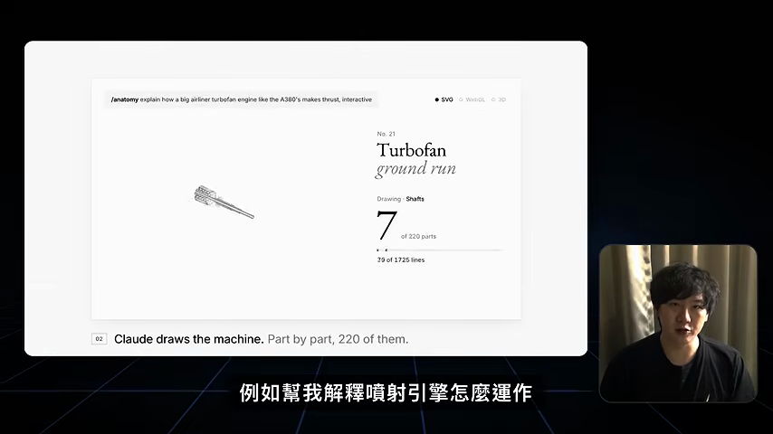
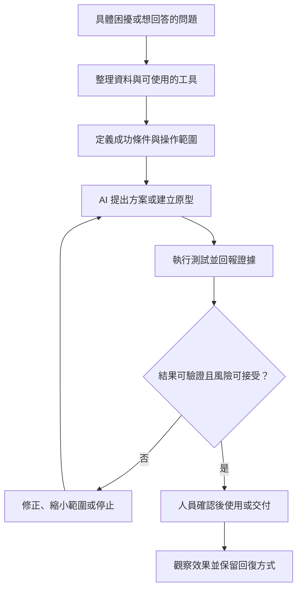

## TL;DR

- 影片以二十多個故事說明 Claude 可以協助整理資料、建立軟體、製作互動圖與控制實體設備；案例來源、完成程度和證據強度各不相同。
- 已找到影片畫面的 [Anatomy 開源 skill](https://github.com/wheresryan22/anatomy)、[Universal Modder](https://github.com/rehan-remade/universal-modder)、[DogKeyboard](https://github.com/cleak/DogKeyboard) 與影片作者的 [PactUp](https://pactup.co/)。
- 病歷整理 skill、Divergence Labs 抗體研究與 NASA 火星車有原始資料；研究結果和展示不等於醫療療效或無人監督。
- 睡眠眼罩案例是研究者回報的權限漏洞：觀察到他人資料，遠端刺激是其推測的可能性，不能寫成已經刺激他人。
- 本文提供案例索引、來源及邊界；專案均未安裝或實測。來源尚未定位的案例明確標記，避免連錯。

## 摘要（Summary）

[酷可實驗室影片](https://www.youtube.com/watch?v=Mm689dbEfCM)按日常、娛樂、健康、實體控制及逆向研究介紹各式 AI 使用案例。影片的核心觀點是：從具體困擾出發，使用 AI 結合工具與外部資料，可以製作原本較難動手的成果；但實體操作與資料存取也會擴大後果。

影片原始繁體中文字幕共 312 段，API 標示非自動產生；尚未逐句人工校對音訊。本次以案例細節尋找專案作者、原始報告與官方網站，並抽查影片 05:01 的圖像，辨識出 `/anatomy` 與其渦扇引擎畫面。研究與專案內容均未執行測試。

> [!important] 來源分級
> **原案**：原作者專案、作者文章或機構原始報告；**轉述**：有相符敘述的報導但未獨立驗證；**未定位**：只有影片敘述，尚未確認專案網址。相似工具不視為同一作品。

## 關鍵洞察（Key Insights）

1. **模型要搭配工具、資料與人類規則。** Momo 案例的核心包括人工設計的提示、輸入過濾與自動回饋，不是狗理解程式設計。
2. **產出形式與可靠度不同。** 3D 圖、估算、診斷與真實物件都需不同的驗證；可互動不代表模型或工程數值正確。
3. **高風險應用需要明確的人類把關。** NASA 的方案經地面模擬與工程師審查；健康案例更不能把摘要或候選物當成診斷與療法。
4. **影片是啟發清單，不是統一 benchmark。** 速度、成本與表現多為個案自述，缺少對照組和完整條件。

## 詳細內容（Details）

### 一、影片提到的專案與原始來源

依影片時間整理；「未定位」不是宣稱專案不存在。日期、版本與價格可能變動。

| 時間與案例 | 解決什麼、影片如何描述 | 專案／來源與可信度 |
| --- | --- | --- |
| [01:09 家用 Wi-Fi](https://www.youtube.com/watch?v=Mm689dbEfCM&t=69s) | 拍路由器，讓 agent 檢查設定、經同意後調整；影片稱測速改善。 | [案例彙整：David Petersen](https://www.whatpeoplemade.com/?tool=claude)；與影片情境相符的轉述，完整設定、測量及原始連結尚未逐項核實。 |
| [01:32 比特幣備份](https://www.youtube.com/watch?v=Mm689dbEfCM&t=92s) | 協助找舊錢包備份；影片強調不是破解。 | [報導](https://www.techradar.com/ai-platforms-assistants/claude-ai-helped-a-bitcoin-owner-recover-nearly-usd400-000-in-lost-crypto-after-spotting-a-forgotten-wallet-backup-hidden-for-more-than-a-decade)：使用者回報；原始私密檔案與完整操作未獨立驗證，價值隨幣價變動。 |
| [02:02 網球教練](https://www.youtube.com/watch?v=Mm689dbEfCM&t=122s) | 用職業賽事與自己影片取得動作資料，讓 Claude 協助分析。 | [作者研究：Claude as a Tennis Coach](https://offpolicyinc.com/work/claude-tennis-coach/)；[延伸專案](https://offpolicyinc.com/tennis/)。作者處理 11 位職業球員的影片與特徵，不代表 Claude 直接理解全部原始影片或經臨床驗證。 |
| [02:26 家具與新家 3D](https://www.youtube.com/watch?v=Mm689dbEfCM&t=146s) | 從影片及房屋資訊建立擺設預覽。 | 未定位到確定原案；尺寸與碰撞仍須實測。 |
| [02:54 買車比價](https://www.youtube.com/watch?v=Mm689dbEfCM&t=174s) | 影片稱先審閱信件，再聯繫車商比價。 | 未定位到與此價格和流程相符的原案。 |
| [03:04 坑洞模擬](https://www.youtube.com/watch?v=Mm689dbEfCM&t=184s) | 六張照片生成路面與事故模擬、估計損失。 | [案例彙整與原帖轉載](https://www.whatpeoplemade.com/i/a-pothole-crash-simulator-got-the-city-to-fill-it-in-two-465007.html)；金額與精度是作者敘述／模型估算，不是事故調查或合格鑑價。 |
| [03:34 樂高 Microduck](https://www.youtube.com/watch?v=Mm689dbEfCM&t=214s) | 影片稱設計使用 1,113 個真實零件與 141 頁說明書。 | [Victor 的說明書](https://huggingface.co/buckets/victor/microduck-lego-booklet/tree/microduck_booklet.pdf)；[發布者敘述](https://www.linkedin.com/posts/julienchaumond_opus-55-designing-lego-victor-mustar-activity-7509219735998263296-PUBu)。實際能否完整組裝、零件庫存及成本未獨立驗證。 |
| [03:54 3D 列印橋梁](https://www.youtube.com/watch?v=Mm689dbEfCM&t=234s) | 五個 AI 設計橋並比較載重。 | 未定位到原始測試；模型差異不能單從兩個載重推成一般能力差距，材料、設計與試驗條件都需確認。 |
| [04:15 遊戲模組](https://www.youtube.com/watch?v=Mm689dbEfCM&t=255s) | Minecraft 與 Elden Ring 混搭，並提到開源工具。 | [Universal Modder](https://github.com/rehan-remade/universal-modder)；[Minecraft in the Lands Between](https://melty.gg/m/minecraft-in-the-lands-between) 的專案頁註明使用該 toolkit。頁面列出特定版本及離線條件，不能推論所有遊戲都相容。 |
| [04:32 狗 Momo 製作遊戲](https://www.youtube.com/watch?v=Mm689dbEfCM&t=272s) | 狗踩鍵盤、取得零食，Claude 將輸入轉成遊戲修改。 | [作者 Caleb Leak 原文](https://www.calebleak.com/posts/dog-game/)與 [DogKeyboard 原始碼](https://github.com/cleak/DogKeyboard)；作者另以 Godot、C#、自動檢查和人工設計的規則串起流程。 |
| [04:54 互動機器圖](https://www.youtube.com/watch?v=Mm689dbEfCM&t=294s) | 輸入需求，產生可探索的渦扇引擎圖。 | [Anatomy](https://github.com/wheresryan22/anatomy)；影片畫面出現 `/anatomy` 與渦扇作品，並與[作者示範](https://comotion.design/v/anatomy)相符。為示意與教學用途，非經認證工程設計。 |
| [05:09 雲霄飛車大亨](https://www.youtube.com/watch?v=Mm689dbEfCM&t=309s) | agent 經營遊樂園但影片稱未蓋好雲霄飛車。 | 未定位到確定原案，無法核對版本及過程。 |
| [05:27 牙科影像](https://www.youtube.com/watch?v=Mm689dbEfCM&t=327s) | 用約 800 個 DICOM 影像做瀏覽器。 | [報導對 Paolo Rosson 案例的整理](https://digg.com/ai/zpwejds0)；未找到確定的公開 viewer repo。能顯示不代表診斷等級、影像尺度或安全性已驗證。 |
| [05:45 癌症照護整理](https://www.youtube.com/watch?v=Mm689dbEfCM&t=345s) | 整理病歷、問題及臨床試驗線索。 | Peter Yang [原文](https://creatoreconomy.so/p/how-im-using-chatgpt-to-help-my-mom-fight-cancer)與 [fuck-cancer skill](https://github.com/petergyang/fuck-cancer)；作者描述家人既往三次罹癌，文章當時尚待釐清此次診斷。來源資料、試驗資格與建議均需醫療團隊確認。 |
| [06:04 食物過敏抗體](https://www.youtube.com/watch?v=Mm689dbEfCM&t=364s) | 影片稱一個月提出約 3.5 萬種設計，早期篩出候選。 | [Anthropic／Divergence Labs 原始報告](https://www.anthropic.com/research/early-progress-drug-development)；候選物經篩選、實驗室測試，**尚非人體療效或上市藥物**。 |
| [06:40 火星車](https://www.youtube.com/watch?v=Mm689dbEfCM&t=400s) | 以 Claude 輔助規劃 Perseverance 路線。 | [NASA 原報告](https://www.nasa.gov/centers-and-facilities/jpl/nasas-perseverance-rover-completes-first-ai-planned-drive-on-mars/)：2025 年兩趟共 456 公尺；JPL 人員使用地面數位分身檢查後才送出命令。不是模型直接在火星即時駕駛。 |
| [06:55 實驗室與工廠](https://www.youtube.com/watch?v=Mm689dbEfCM&t=415s) | 透過共通標準銜接儀器，縮短整合。 | [Model Hardware Standard 研究預覽](https://www.anthropic.com/news/model-hardware-standard-research-preview)；廠商與設備支援、權限及操作安全仍需確認。影片的時間比較不是所有設備的保證。 |
| [07:09 AI 種植物](https://www.youtube.com/watch?v=Mm689dbEfCM&t=429s) | agent 使用鏡頭、感測與工具來控制設備。 | 影片畫面顯示 [Dries Buytaert 對 Sol 的記錄](https://dri.es/claude-is-growing-a-tomato-plant)，對應 Martin DeVido 的 [Sol 官方百日紀錄](https://autoncorp.com/sol.html)；另見 [[2026-11-20-SOL-BIODOME-PLANT-LEARNING-JOURNEY|專篇]]。Tal Raviv 是不同實驗。 |
| [07:33 Luna 店長](https://www.youtube.com/watch?v=Mm689dbEfCM&t=453s) | AI 參與店鋪選品、定價及招募。 | [Andon Labs 原始介紹](https://andonlabs.com/blog/andon-market-launch)與 [Andon Market](https://andonlabs.com/market)；實驗由公司提供資金、店面與人員，不等於 AI 自行承擔法律與財務責任。 |
| [08:17 燈具控制](https://www.youtube.com/watch?v=Mm689dbEfCM&t=497s) | 影片稱花 3.5 小時、91 美元做替代控制程式。 | 尚未定位原始專案，成本與設備未核實。 |
| [08:29 五種家電](https://www.youtube.com/watch?v=Mm689dbEfCM&t=509s) | 影片稱逆向多個自有設備，找到裝置設定及隱藏命令。 | 尚未定位確切原始專案；攝影機燈號與錄影狀態不得假設永遠一致。 |
| [08:45 睡眠眼罩](https://www.youtube.com/watch?v=Mm689dbEfCM&t=525s) | 開發者想解決連線問題，發現可能看到他人資料。 | [研究者 Aimilios 原文](https://aimilios.bearblog.dev/reverse-engineering-sleep-mask/)；觀察與理論風險應分開。未核實廠商現今修補狀態。 |
| [09:28 打勾勾](https://www.youtube.com/watch?v=Mm689dbEfCM&t=568s) | 影片作者製作朋友一起打卡、設定約定的 App。 | 官方網址由影片說明欄提供：[PactUp](https://pactup.co/)；本次網頁工具無法讀取官網內容，功能依影片描述，未註冊或實測。 |

*圖：酷可實驗室影片 [05:01](https://www.youtube.com/watch?v=Mm689dbEfCM&t=301s)；畫面用來辨識專案名稱，圖中模型並未由本文獨立驗證。*

### 二、最值得追的開源專案：用途與邊界

| 專案 | 可做什麼 | 使用前要確認 |
| --- | --- | --- |
| [Anatomy](https://github.com/wheresryan22/anatomy) | agent skill，依 README 建立互動式技術插圖，可涉及 SVG、WebGL 和 3D | 產物的尺寸、物理與工程正確性；本次只核對 repo 和畫面 |
| [Universal Modder](https://github.com/rehan-remade/universal-modder) | 提供遊戲分析、模組開發及測試相關 skills 和工具 | 支援的遊戲／系統版本、授權和線上服務規則；各遊戲差異很大 |
| [DogKeyboard](https://github.com/cleak/DogKeyboard) | 作者用來過濾鍵盤輸入、與 Claude Code 及零食設備串接 | 參考作者的設定和安全條件；不要將案例解讀成狗獨立理解設計需求 |
| [fuck-cancer](https://github.com/petergyang/fuck-cancer) | 整理照護資訊、問題與研究線索 | 內容可能出錯、資料涉及隱私；選擇治療及試驗資格由醫療團隊判斷 |

原影片說明欄直接列出的網站是 PactUp；其餘網址為本次依案例與畫面追查，來源強度如上。**本次沒有下載、安裝或執行這些專案。**

### 三、從案例變成可重複工作方法

此圖是 **Codex 對影片案例的歸納**，不是影片宣稱的唯一流程。可先從不含敏感資料的低風險任務開始：先列輸入、產物、驗收與費用上限；對外發送、設備控制及重要決定保留人工審核。[[2026-10-15-HOW-THE-CLAUDE-CODE-TEAM-DOES-CODE-REVIEW|分層驗證與回復]]可作為後續參考。

### 四、三個容易誤解的重點

1. **模擬不等於真實。** 樂高連接、路面 3D、橋梁載重和牙科影像，各有不同的實體量測與專業驗證需求。
2. **資料可取得不等於有權使用。** 睡眠眼罩作者報告看到其他使用者的資料，以及理論上可透過相同權限下控制命令；不要把理論可能性寫成已對他人送出刺激，也不要將發現漏洞當成取得任意資料的授權。
3. **AI 規劃不等於 AI 單獨負責。** 火星車經 NASA 數位分身及人工審查；Luna 背後有實驗組織與員工。這與 [[2026-09-10-PHYSICAL-AI-THE-HIDDEN-VALUE-POOLS-LEADERS-ARE-MISSING|Physical AI 的部署與驗證]]可對照閱讀。

## 我的心得（My Takeaways）

最值得借鏡的是從小問題構想一個可觀察的工作流，再逐步接上需要的工具。影片中可分享的專案網址有助於追查原始作者；是否值得安裝仍要閱讀其文件、權限與版本。從個人原型走到可信交付時，[[2026-11-12-RETHINKING-CLAUDE-CODE-BEST-PRACTICES-LYDIA-HALLIE|權限、安全與驗證分層]]比展示影片更能說明邊界。

## 待補充（Open Questions）

1. 影片中牙科 DICOM viewer 是否公開原始碼、資料處理方式與測試？搜尋：`Paolo Rosson Claude dental DICOM viewer source`。
2. 五模型橋梁比較的原影片、材料、模型版本及試驗數量為何？搜尋：`AI models 3d printed bridge 130 pounds 17 pounds experiment`。
3. 家具搬家、車商比價、燈具、五設備與雲霄飛車案例的直接作者及原始連結是什麼？搜尋：`Claude Code furniture house tour game park lighting reverse engineering`。
4. 睡眠眼罩廠商是否確認並修補跨使用者資料存取？搜尋：`Aimilios sleep mask MQTT vendor remediation`。
5. Microduck 說明書是否有獨立實際組裝紀錄？搜尋：`Victor Mustar LEGO Microduck physical build`。
6. Sol 的完整原始感測紀錄與程式是否公開？搜尋：`AutonCorp Sol biodome source code Martin DeVido`。

## 相關連結（Related）

- [[2026-11-20-SOL-BIODOME-PLANT-LEARNING-JOURNEY]]：Sol 百日種植、可研究的 Wall-e 程式及學生從人工到 AI 的學習紀錄。

- [[2026-09-10-PHYSICAL-AI-THE-HIDDEN-VALUE-POOLS-LEADERS-ARE-MISSING]]：實體環境與 AI 可靠性。
- [[2026-10-15-HOW-THE-CLAUDE-CODE-TEAM-DOES-CODE-REVIEW]]：分層檢查、人工責任與事故回復。
- [[2026-11-12-RETHINKING-CLAUDE-CODE-BEST-PRACTICES-LYDIA-HALLIE]]：Claude Code 工作流程與權限邊界。

## 知識層次分析（Bloom's Taxonomy Analysis）

| 層次 | 本文應用 |
| --- | --- |
| 記憶 | Anatomy、Universal Modder、DogKeyboard、MHS、PactUp |
| 理解 | AI 建議、工具執行與人類審查如何連接 |
| 分析 | 區分影片敘述、原作者自報、機構報告與尚未定位的案例 |
| 應用 | 先定義低風險任務和驗收方式；閱讀目標專案的權限及文件 |
| 評估 | 比較互動原型與專業工具、設備自動化與人工操作的成本及可驗證性 |

### 分析型追問（Socratic Follow-up）

- 澄清：案例中的 AI 實際接收哪些資料、有哪些工具？
- 假設：若原始資料不完整，生成結果還能否支持判斷？
- 證據：哪些結果由作者以外的人重做或量測？
- 觀點：設備使用者如何看待其資料被第三方看見？
- 後果：接上真實設備與網路後，錯誤如何被發現及回復？

### 方案批判三問

1. 最大風險：把模型猜測、動畫或資料存取結果誤認成正確診斷、工程事實或授權行為。
2. 失敗條件：來源無法追查、測試資料不足、設備權限過大或缺少人員審查。
3. 替代方案：對高風險任務使用已驗證的專業工具與人員，AI 限於整理及輔助；低風險探索可先用隔離原型。

## 六頂思考帽回饋（Six Thinking Hats Feedback）

### 藍帽：問題與範圍
整理影片的案例、可取得的專案以及證據範圍。

### 白帽：事實與未知資訊
取得字幕、專案頁與部分機構原報告；多個個案的原始網址仍未找到，專案未實測。

### 紅帽：直覺與讀者反應
互動案例可能激發好奇；眼罩和醫療案例可能令人不安。這是推測，不是讀者調查。

### 黃帽：價值與可保留內容
以具體困擾、工具與回饋組成小型工作流，可降低探索門檻。

### 黑帽：風險與限制
個案自述與精彩畫面不能代表普遍效果；真實設備、健康資訊與人員資料提高錯誤成本。

### 綠帽：替代方案與新應用
先使用公開示例或不含機密的資料試做互動解說，再用人工與已知資料核對。

### 藍帽：修改項目與下一步

1. 優先追查仍缺失的原始案例連結。
2. 在真正使用前核對文件、授權、版本及權限。
3. 留下測試與結果，再決定是否推廣。

## References

- [酷可實驗室：大家現在拿 AI 做的事，越來越扯了](https://www.youtube.com/watch?v=Mm689dbEfCM)，2026-11-20。
- [Anatomy](https://github.com/wheresryan22/anatomy)、[Universal Modder](https://github.com/rehan-remade/universal-modder)、[DogKeyboard](https://github.com/cleak/DogKeyboard)、[fuck-cancer](https://github.com/petergyang/fuck-cancer)。
- [NASA 火星車報告](https://www.nasa.gov/centers-and-facilities/jpl/nasas-perseverance-rover-completes-first-ai-planned-drive-on-mars/)、[Anthropic 藥物研究](https://www.anthropic.com/research/early-progress-drug-development)、[Model Hardware Standard](https://www.anthropic.com/news/model-hardware-standard-research-preview)。
- [睡眠眼罩研究原文](https://aimilios.bearblog.dev/reverse-engineering-sleep-mask/)、[PactUp](https://pactup.co/)；各案例連結及限制見正文。
