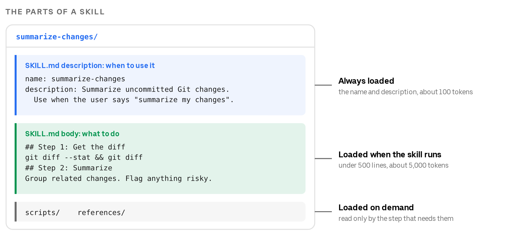
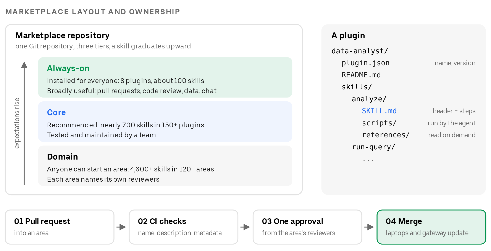
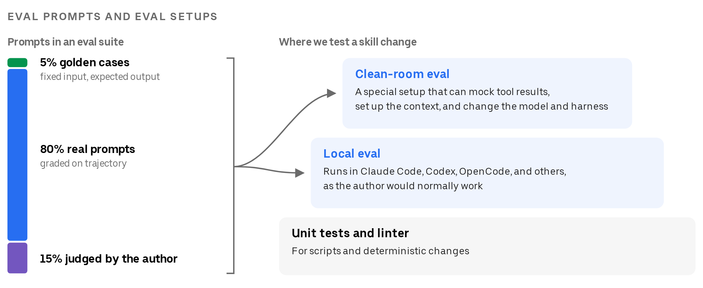
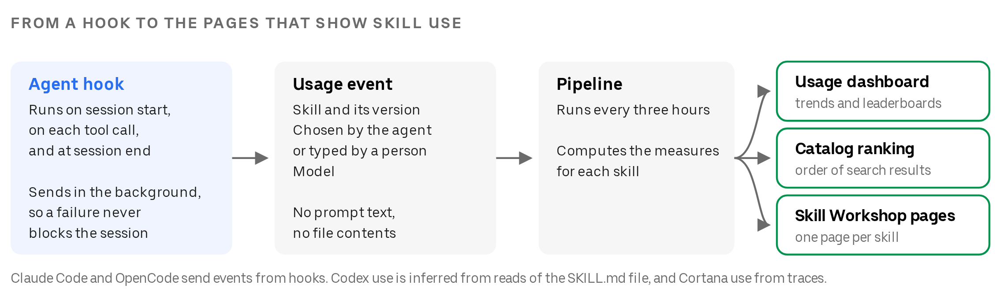
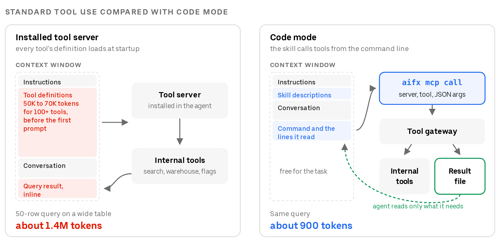

## TL;DR

- Uber 用一個 Git 市集分發 skills，依使用範圍提高品質門檻，讓各團隊保有自己的維護者。
- 評估拆成觸發、執行軌跡、任務成果和成本。相同任務有／無 skill 的盲測，可辨識哪些 skill 還有增益。
- 回報先包含預期與實際結果。有人確認值得修後，把它變成回歸案例，並在合併版本上重跑。
- 小團隊先選一個工作流，固定版本與 fixture，跑通一次「回報 → 重現 → 修正 → 複驗」。有了可重跑的基線，再決定是否需要更多平台功能。

## 摘要（Summary）

Uber Engineering 報告，skills 市集自 2025 年 10 月的 1 項長到逾 5,000 項，圖 2 後段標示逾 5,300 項。圖 3 記錄至 2026 年 10 月，單月超過 100 萬次呼叫。呼叫量是使用紀錄，文章另以部分常用技能的對照試驗衡量效果。中文解說沿用 Uber 的資料，片尾建議定期重做「有／無 skill」實驗。 [Uber Engineering 原文](https://www.uber.com/us/en/blog/optimizing-ubers-agent-skills/) · [影片解說](https://www.youtube.com/watch?v=K_ixtIBNQbw)

## 關鍵洞察（Key Insights）

- **規格保存工作流的意圖。** 寫明輸出、必做與禁止的工具操作、支援的宿主與模型。Uber 的 Skill Workshop 再以規格產生 `SKILL.md` 和評估提示。
- **一次比較只能回答一個問題。** 有／無對照回答技能的增益，舊／新版本對照回答變更造成的差異，同條件重跑則提供波動基準。
- **用量適合排序，失敗案例才給修正方向。** 跨宿主的資料來源可能不同，圖 9 區分原生 hooks、從 `SKILL.md` 讀取推定和分析 traces 的做法。
- **確定的步驟交給程式。** 大型結果留在檔案或工具側，模型取摘要與必要切片。計算是否省成本時一起看完成率。

## 詳細內容（Details）

### 分發與所有權

Uber 用漸進揭露（progressive disclosure）減少啟動時的上下文。探索先讀名稱和描述，啟用再讀正文，執行需要時才取 scripts／references。文章以約 100 tokens 的描述和少於 500 行的正文說明其配置。

| 層級 | 管理方式 |
| --- | --- |
| Domain | 團隊自建領域與 reviewer，同行核准並通過 CI 後發布。 |
| Core | 高使用量或跨團隊的技能由指定團隊維護，每次變更由平台團隊審查。 |
| Always-on | 約 100 個廣泛使用的技能預設提供。升級前評估效益與品質。 |

`aifx` 保存安裝選擇，再翻譯成各宿主配置。Uber 的設定由公司、團隊／計畫、repo、工作目錄、使用者、local override 逐層合併。後面的層可增加 plugins。技能搜尋再綜合分類、eval 和使用量，讓大量技能可以按任務找到。若團隊的瓶頸在共用設定與跨 repo 工作入口，可以先參考 [[2026-11-12-THE-HOME-REPO-PATTERN-MULTI-REPO-AGENT-WORKFLOW|Home Repo 的做法]]。

### 評估與盲測

| 要問的問題 | 可留下的證據 |
| --- | --- |
| 會不會在對的時候觸發？ | 正例、相近反例、實際啟用事件，以及其他 skill 共存時的結果。 |
| 任務過程是否正確？ | 執行軌跡（trajectory），包括工具、順序、錯誤與恢復步驟。 |
| 交付是否成功？ | 可機器檢查的檔案或結果。語意品質另用有人工標註錨點的 rubric。 |
| Skill 有增益嗎？ | 相同輸入及環境重跑有／無 skill，隱藏分組身分判斷結果。用相同對相同的重跑估計噪音。 |
| 換宿主或環境還能跑嗎？ | 乾淨環境（clean room）測試版本、fixture、依賴與配置。作者電腦上的成功結果只代表該環境。 |

Uber 的 eval 配比建議約 5% 固定輸入與預期結果的 golden cases、80% 真實提問的 trajectory 評估、15% 作者評分。文章也描述幾項 lint 規則，例如每步有單一目的、核對工具結果後再往下、錯誤處理要有具體行動。70–90% 有時比滿分套件更能區分行為，是對評測辨識力的觀察。必須遵守的動作仍應獨立用確定性判準檢查。

圖 13 有 11 個技能。文件下載在 91% 的比較中勝出，資料倉儲查詢技能為 87%。有 4 個技能在這次對照中看不出明確差異。圖中的橫線是 95% 區間，灰帶是相同條件重跑的噪音；資料分析的 67% 被圖標為臨界，會受噪音帶估法影響。這些數字描述 Uber 的樣本與環境。資料倉儲例中，無 skill 的組別多 13% 工具呼叫、約 6 倍工具錯誤、耗時多 31%。

### 使用量與成本

Uber 記錄 skill 身分、版本及由人或模型觸發等事件，原文表示使用事件不含 prompt 或檔案內文。圖 10 列出的 12 類指標包括使用量、留存、觸及、共同使用、成本、上下文、延遲、錯誤、工具、版本、agent、安裝。可先挑和目前決策最相關的幾項。

原文用呼叫前後的累計 session 成本快照估算該次成本。視窗包含其他工具與後續回合，歸因有誤差。Code Mode 把固定工作移到腳本，模型只讀必要結果。圖 14 的 **約 140 萬 vs. 900 tokens** 是該 50 筆寬表查詢的估算。另一個 tracing skill 的 worker 改動前後成本差 **46%**，部署 skill 第一週沒有下降。要把收益套用到其他工作流，需重做相同輸入的品質、延遲與成本對照。

### 讓失敗變成回歸案例

`log-papercut` 回報意圖、執行內容、預期、實際結果與修正線索。圖 16 示範六步。收案後由人分流，建立測試與基線，提出變更並由維護者覆核，合併後重跑，通過才關閉。日後若匹配的問題再現可重開。原文另以維護 PR 被退回或反覆修改作為人工訊號，將受阻案例補入後續評估。

Uber 舉的案例包括共用暫存檔互相覆寫、秒與毫秒誤用、查無設定卻默默回傳別的值，以及未設 CI 的 repo 反覆等待。這些問題適合寫成明確的測試條件，例如每次執行有自己的輸出目錄，缺值回明確錯誤，等待有截止條件。

> [!note] 圖片來源
> 七張圖取自 Uber Engineering 原文。圖 13 和圖 16 為原動畫的最後一幀。

### 影片對照與證據

Jerry 的影片於 2026-11-25 發布，片長 10:43，說明欄標示動畫與 AI 配音。本次以 302 段英文自動字幕結合中文章節及 Uber 原文整理；字幕沒有人工逐句核對。影片負責解說，使用數字與技術設計回查原文及圖。

| 時間 | 重點 | 閱讀時的判斷 |
| --- | --- | --- |
| [02:06](https://www.youtube.com/watch?v=K_ixtIBNQbw&t=126s) | 市集三層與維護者 | 從一套 Git 審核流程就能起步。規模大時，常用與預設技能才需要較嚴格的維護。 |
| [04:27](https://www.youtube.com/watch?v=K_ixtIBNQbw&t=267s) | 規格、lint 和 eval | 先寫決定性的輸出和必做行為，再決定哪些要人工或模型判斷。 |
| [05:49](https://www.youtube.com/watch?v=K_ixtIBNQbw&t=349s) | 把 skill 拿掉重跑 | 影片把 4 組結果講成「模型吸收」。圖 13 表示該次試驗無法分辨差異。模型能力提升是可能解釋之一。 |
| [06:59](https://www.youtube.com/watch?v=K_ixtIBNQbw&t=419s) | Code Mode | 估算針對 Uber 的工具載入和查詢方式。對自己的流程先量測。 |
| [08:20](https://www.youtube.com/watch?v=K_ixtIBNQbw&t=500s) | Agent 報修 | 先做好可重現與分流，才能讓後續修正結果被覆核。 |

原文的線上 A/B、按模型編譯 skill、擴大 trace 索引與 task router 列於 What's Next。離線盲測與已描述的分發配置有不同成熟度。 [Uber Engineering 原文](https://www.uber.com/us/en/blog/optimizing-ubers-agent-skills/)

## 我的心得（My Takeaways）

> [!tip] 一週內能開始的最小導入
> 選一個已有用戶或曾退化的 skill。寫一頁 spec、一次真實但去識別的失敗、一個相近的觸發反例。固定 runner、模型、fixture、規則與版本，跑舊版、新版與無 skill 基線。以報告 ID 串起回報、修正、合併後重跑。先沿用現有 Git 與報告流程。

有了基線再選投資方向：返工多先修分流與回歸，跨 repo 重複配置多先檢查安裝與版本，輸出太大先把一個固定步驟改成可測的腳本。能反覆重跑的例子也適合拿來檢查模型升級。

## 待補充（Open Questions）

- 重複執行同一 prompt 的變異要如何估計？搜尋 `agent skill ablation identical-run baseline`。
- 一次 session 多個 skills 同時執行時，成本如何公平歸因？搜尋 `skill invocation cost attribution spans`。
- 稀有但高影響的工作流只有少量樣本時，怎麼建立穩定的驗收？搜尋 `rare critical agent workflow evaluation`。
- 如何將早期回饋與被退回的 PR 轉成匿名 fixture，並保留重現線索？搜尋 `redacted agent trace replay fixtures`。
- 如何決定原本預設安裝的 skill 何時退場？搜尋 `skill retirement model upgrade evaluation`。

## 相關連結（Related）

- [[2026-03-07-CLAUDE-SKILL-EVAL-FRAMEWORK-3-SKILLS-ONE-AFTERNOON-REAL-DATA]]，從少量技能開始建立一輪評估與改版基線。
- [[2025-12-29-SKILLSBENCH-AGENT-SKILL-USE-BENCHMARK-CODE-ANALYSIS]]，研究有／無 skill 對照與獨立環境。
- [[2026-11-12-THE-HOME-REPO-PATTERN-MULTI-REPO-AGENT-WORKFLOW]]，共用入口、專案規則與宿主實際接入。

## 知識層次分析（Bloom's Taxonomy Analysis）

| 層次 | 對本文的應用 |
| --- | --- |
| 記憶 | 逐步載入、三層市集、軌跡評估、消融試驗（ablation）、papercut。 |
| 理解 | 排序靠用量訊號，是否值得保留要看任務結果與成本。 |
| 分析 | 從文件讀取推定使用會有誤差。成本快照和盲測都需要各自的比較條件。 |
| 應用 | 建立一個本機可回放的失敗。對高用量工作流跑有／無配對，再加必要流程斷言。 |
| 評估 | 比較人工分流與自動分流的成本。低量流程先用簡單紀錄，高頻且有穩定樣本才值得建更完整的管線。 |

### 分析型追問（Socratic Follow-up）

- Skill 被偵測到、被讀取及實際完成任務時，事件應各記什麼？
- 基準也在退化時，怎麼把模型變動與 skill 改版分開？
- 所有用量都集中在一類職務時，哪些案例還需要刻意補？
- 如果成本下降來自提早終止，哪個成果斷言能抓到？
- 一年前已關閉的回報重新發生時，靠什麼欄位判定是同一問題？

### 方案批判三問

1. 最大風險是大量自動回報將原始資料帶出工作環境，或把錯誤歸因給 skill。回報先限定欄位及證據來源，維護者確認再改。
2. 模型、工具、fixture 或環境同時變更時，配對差異難以歸因。固定條件或重建基準後再判斷。
3. 少數技能可先手動保存回放案例與對照結果。需要多團隊發佈、依賴版控及支援多個宿主時，統一分發才有額外價值。

## 六頂思考帽回饋（Six Thinking Hats Feedback）

### 藍帽｜問題與範圍

能否知道一個 skill 值得保留，並在退化時留下可修證據？

### 白帽｜事實與未知資訊

文章有現行市集、部分常用技能的盲測及報修範例。缺完整逐案樣本、執行成本和稀有任務的成功率。

### 紅帽｜直覺與讀者反應

百萬次標題容易讓人先想到大平台。從一筆實際失敗開始更容易理解做法。

### 黃帽｜價值與可保留內容

版本化規格、有／無對照及合併後回放能直接重用。

### 黑帽｜風險與限制

缺少結果驗收、樣本不足或不同宿主的用量口徑混在一起都可能產生錯誤結論。

### 綠帽｜替代方案與新應用

用現有測試 runner 和最小回報 JSON 先跑一次。需要跨使用者匯整時，再加最少欄位。

### 藍帽｜修改項目與下一步

- 將必要操作和最後交付分別寫成斷言。
- 固定版本與 fixture，保留一次配對對照。
- 用同一個問題 ID 串起修正前、候選與合併後證據。

## References

- [Uber Engineering｜How Uber Evals 1 Million Agent Skill Invocations a Month](https://www.uber.com/us/en/blog/optimizing-ubers-agent-skills/)，2026-11-23。
- [Jerry｜Uber 怎麼管 5,300 多個 AI 技能？](https://www.youtube.com/watch?v=K_ixtIBNQbw)，2026-11-25。
- [Agent Skills 規格](https://agentskills.io/specification)。
