## TL;DR

- Uber 用一個 Git 市集分發 skills，依使用範圍提高品質門檻，讓各團隊保有自己的維護者。
- 評估拆成觸發、執行軌跡、任務成果和成本。相同任務有／無 skill 的盲測，可辨識哪些 skill 還有增益。
- 回報先包含預期與實際結果。有人確認值得修後，把它變成回歸案例，並在合併版本上重跑。
- 小團隊先選一個工作流，固定版本與 fixture，跑通一次「回報 → 重現 → 修正 → 複驗」。有了可重跑的基線，再決定是否需要更多平台功能。

## 摘要（Summary）

Uber Engineering 報告，skills 市集自 2025 年 10 月的 1 項長到逾 5,000 項，圖 2 後段標示逾 5,300 項。圖 3 記錄至 2026 年 10 月，單月超過 100 萬次呼叫。呼叫量是使用紀錄，文章另以部分常用技能的對照試驗衡量效果。中文解說沿用 Uber 的資料，片尾建議定期重做「有／無 skill」實驗。 [Uber Engineering 原文](https://www.uber.com/us/en/blog/optimizing-ubers-agent-skills/) · [影片解說](https://www.youtube.com/watch?v=K_ixtIBNQbw)

## 關鍵洞察（Key Insights）

- **規格保存工作流的意圖。** 寫明輸出、必做與禁止的工具操作、支援的宿主與模型。Uber 的 Skill Workshop 再以規格產生 `SKILL.md` 和評估提示。
- **一次比較只能回答一個問題。** 有／無對照回答技能的增益，舊／新版本對照回答變更造成的差異，同條件重跑則提供波動基準。
- **用量適合排序，失敗案例才給修正方向。** 跨宿主的資料來源可能不同，圖 9 區分原生 hooks、從 `SKILL.md` 讀取推定和分析 traces 的做法。
- **確定的步驟交給程式。** 大型結果留在檔案或工具側，模型取摘要與必要切片。計算是否省成本時一起看完成率。

## 第一講｜一個人會做的事，怎麼交給一家公司重複做？

假設資料分析師每週替同事查詢營運指標。她知道正確的資料表、日期欄位和組織內的定義。換一位同事問 agent，即使 SQL 能執行，也可能拿到另一種定義的答案。寫 skill 的第一個目的，就是把這些難以從通用模型推知的判斷留給下一次使用。接下來才出現平台問題：上千位作者都在寫，誰找得到這份知識？依賴的查詢工具變動時，誰會發現？模型自己學會之後，誰來判斷這段指示還值不值得載入？

**封面｜從製作走到修正，再回到下一版**

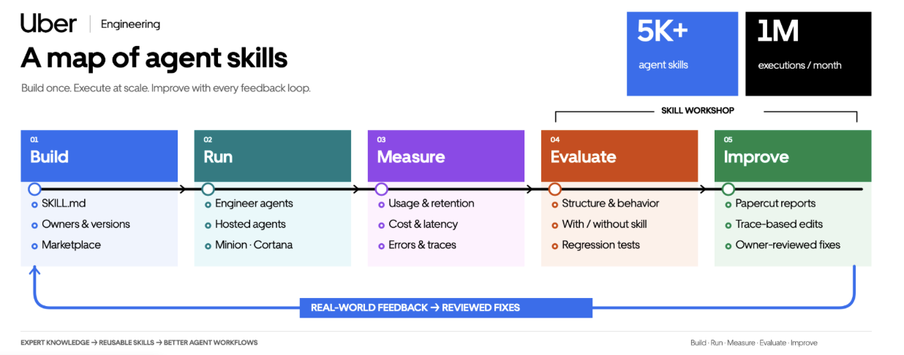

橫向五欄從 Build 到 Improve，下方長箭頭把經過審查的修正帶回起點。右上角的數字交代規模；要看懂作者的主張，請沿底下那條箭頭找「誰拿到回饋、如何改下一版」。

| 工作時刻 | Before：痛點 | After：設計與意圖 |
|---|---|---|
| 專家交接 | 關鍵知識散在對話、手冊和個人的環境設定 | 把一個工作流包成有主人、有版本的目錄，讓別人能執行同一套步驟 |
| 換工具或團隊 | 每種 agent 各裝一套；新人得先知道關鍵字才能找對工具 | 用共同目錄、分層設定與任務搜尋縮短第一次成功的路徑 |
| 改提示或換模型 | 文字讀起來更清楚，卻不知道會不會多走一步或漏查資料 | spec 保存意圖；在固定環境分別評過程、成果，再做有／無配對 |
| 降成本 | 只看到整場 session 用量，很難決定改哪個步驟 | 從高頻、高成本工作流取樣，看工具錯誤、長尾、上下文與品質，再挑具體改法 |
| 遇到摩擦 | 當下靠繞路交差，下位使用者重新付一次代價 | 留下可分組、可回放的失敗，等修正版在相同情境通過才關案 |

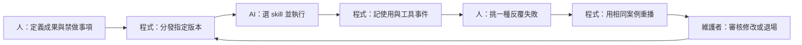

## 第二講｜如何分發、發現與維護 skill

### 分發與所有權

Uber 用漸進揭露（progressive disclosure）減少啟動時的上下文。探索先讀名稱和描述，啟用再讀正文，執行需要時才取 scripts／references。文章以約 100 tokens 的描述和少於 500 行的正文說明其配置。

**圖 1｜描述、步驟與參考資料分開載入**

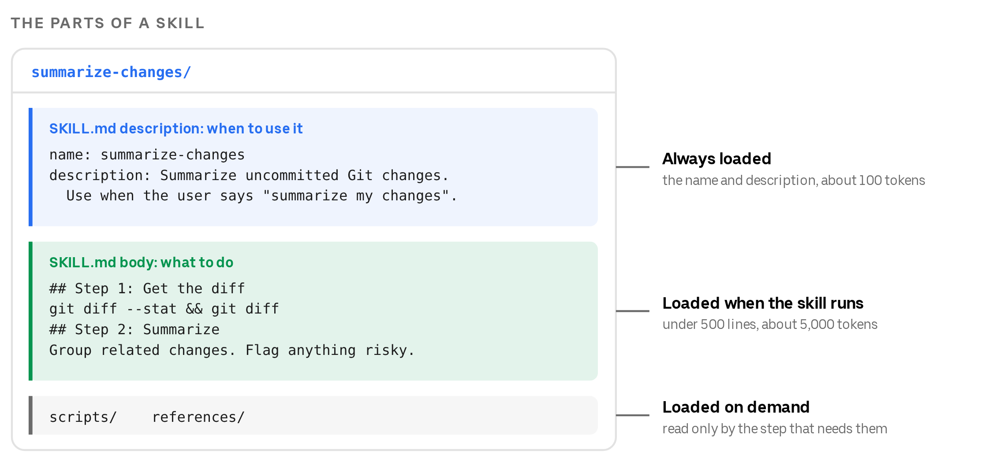

以整理 Git 差異為例，藍框只教模型辨認「何時用」，綠框才要求取得 diff，底下目錄供特定步驟查閱。若 skill 常選錯，先改藍框的觸發描述；已選對卻做錯，才去改綠框。

**圖 2｜每週市集存量**

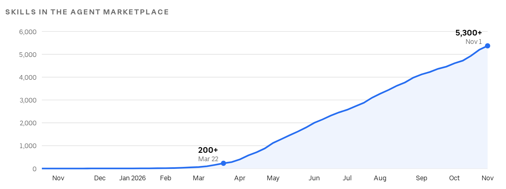

橫軸跨 13 個月，曲線由 Git 歷史重建，三月的 200 多項到十一月初已逾 5,300。這裡數的是可供選擇的項目；數量長大會提高發現與維護的負擔。

**圖 3｜每月實際叫用次數**

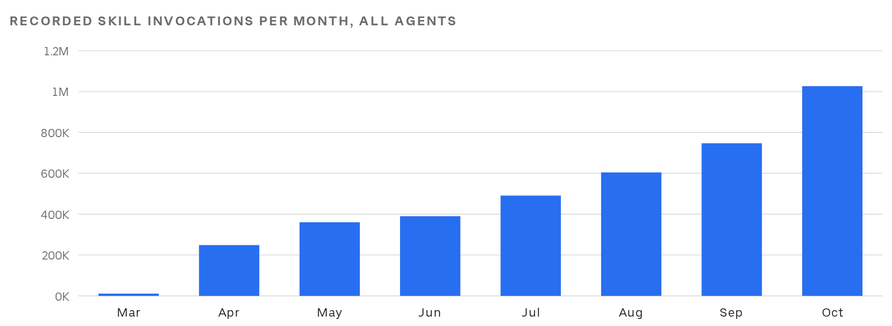

三月至十月的長條逐月增高，最後一根超過一百萬。與圖 2 並讀，才看得到供給和被記錄的需求。判斷效果還需圖 13 的配對實驗。

| 層級 | 管理方式 |
| --- | --- |
| Domain | 團隊自建領域與 reviewer，同行核准並通過 CI 後發布。 |
| Core | 高使用量或跨團隊的技能由指定團隊維護，每次變更由平台團隊審查。 |
| Always-on | 約 100 個廣泛使用的技能預設提供。升級前評估效益與品質。 |

**圖 4｜治理成本隨影響範圍增加**

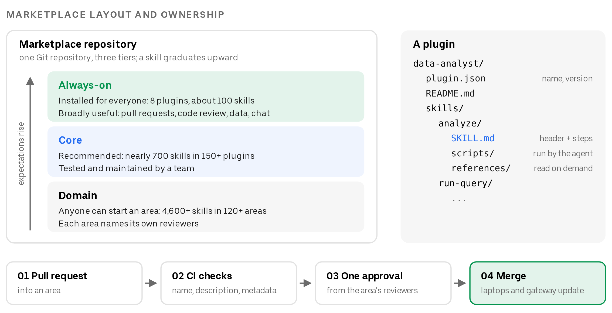

左側 Domain、Core、Always-on 的箭頭向上，右邊的 plugin 可包多個 skills。底列讓人看到領域作者有明確的 PR、CI、核准、合併路徑。把某項技能設成全員預設，才需要承擔全員上下文與維護成本。

`aifx` 保存安裝選擇，再翻譯成各宿主配置。Uber 的設定由公司、團隊／計畫、repo、工作目錄、使用者、local override 逐層合併。後面的層可增加 plugins。技能搜尋再綜合分類、eval 和使用量，讓大量技能可以按任務找到。若團隊的瓶頸在共用設定與跨 repo 工作入口，可以先參考 [[2026-11-12-THE-HOME-REPO-PATTERN-MULTI-REPO-AGENT-WORKFLOW|Home Repo 的做法]]。

**圖 5｜同一個入口管理不同宿主**

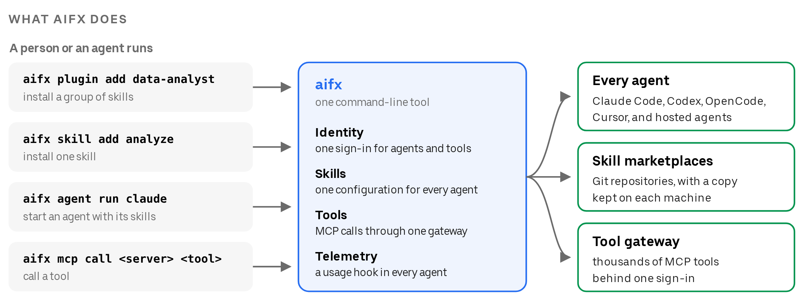

左側四種操作匯入 aifx，再連往各宿主、市集和工具閘道。安裝整組 data-analyst 或單一 analyze 是兩種粒度；使用者保有選擇宿主的自由，平台則有共同登入和觀測入口。

**圖 6｜執行時才翻譯設定**

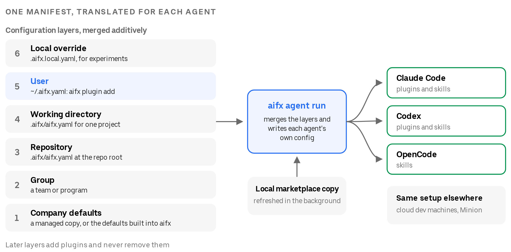

由下往上讀公司、群組、repo、工作目錄、使用者、本機六層。後層可以增加 plugins；中間的啟動程序再把合併結果寫成各宿主認得的格式。除錯時要看最終生效的清單。

**圖 7｜一份原始碼，三條分發路徑**

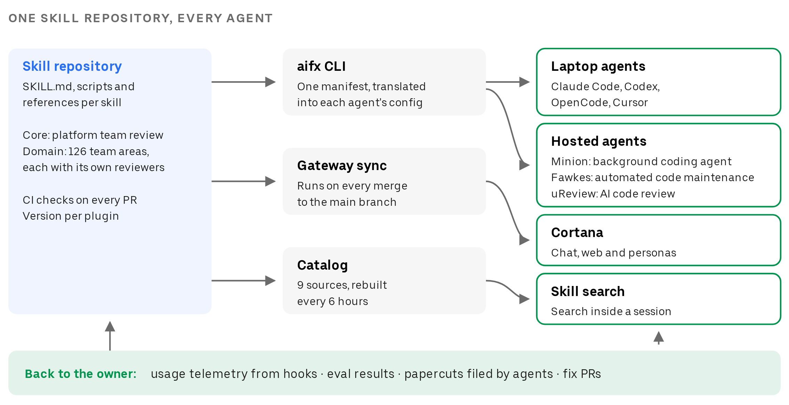

左邊是版控來源；中間 CLI 處理各宿主設定，gateway 隨 main 合併同步，catalog 週期性重建搜尋。底部的 telemetry、eval 與報修都回到 owner。查不到新技能和已載入舊版，可能發生在不同路徑。

**圖 8｜人在工作流中找到技能**

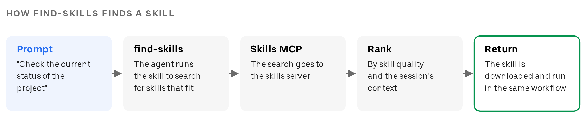

從「查專案狀態」出發，find-skills 經 Skills MCP 查詢，再依品質與當場上下文排序，下載後直接執行。作者要寫清楚使用情境；一個熟悉內部工具名稱的人才搜得到的技能，很難跨團隊採用。

## 第三講｜把「我覺得變好」改成可重跑的比較

**圖 11｜作者打開 Skill Workshop 後怎麼工作**

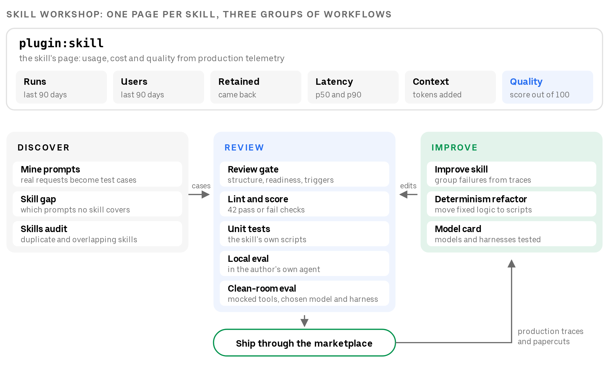

上排把近 90 天使用、使用者、留存、延遲、上下文和品質放在同一頁。下排由 Discover 找缺口，Review 做 lint、本機與 clean-room 評估，Improve 從線上失敗提出修改，再送回審查。案件來源、放行依據與改版理由各自有位置。

### 評估與盲測

| 要問的問題 | 可留下的證據 |
| --- | --- |
| 會不會在對的時候觸發？ | 正例、相近反例、實際啟用事件，以及其他 skill 共存時的結果。 |
| 任務過程是否正確？ | 執行軌跡（trajectory），包括工具、順序、錯誤與恢復步驟。 |
| 交付是否成功？ | 可機器檢查的檔案或結果。語意品質另用有人工標註錨點的 rubric。 |
| Skill 有增益嗎？ | 相同輸入及環境重跑有／無 skill，隱藏分組身分判斷結果。用相同對相同的重跑估計噪音。 |
| 換宿主或環境還能跑嗎？ | 乾淨環境（clean room）測試版本、fixture、依賴與配置。作者電腦上的成功結果只代表該環境。 |

Uber 的 eval 配比建議約 5% 固定輸入與預期結果的 golden cases、80% 真實提問的 trajectory 評估、15% 作者評分。文章也描述幾項 lint 規則，例如每步有單一目的、核對工具結果後再往下、錯誤處理要有具體行動。70–90% 有時比滿分套件更能區分行為，是對評測辨識力的觀察。必須遵守的動作仍應獨立用確定性判準檢查。

**圖 12｜案例組成與執行環境是兩個不同選擇**

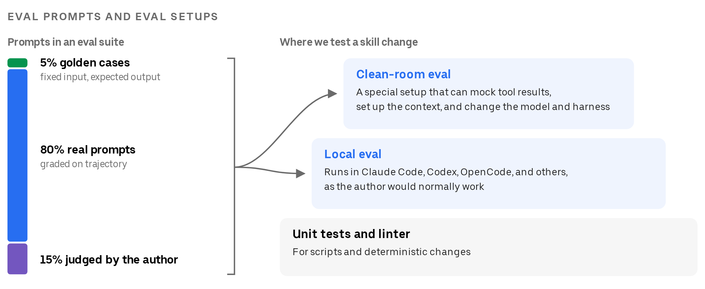

左側 5／80／15 描述案例來源和判分方式。右側 clean room 可換工具回應、模型、harness；local eval 保留真實宿主，單元測試負責腳本。要抓「只在作者機器上成功」，就要刻意拿掉他的快取、路徑與工具。

圖 13 有 11 個技能。文件下載在 91% 的比較中勝出，資料倉儲查詢技能為 87%。有 4 個技能在這次對照中看不出明確差異。圖中的橫線是 95% 區間，灰帶是相同條件重跑的噪音；資料分析的 67% 被圖標為臨界，會受噪音帶估法影響。這些數字描述 Uber 的樣本與環境。資料倉儲例中，無 skill 的組別多 13% 工具呼叫、約 6 倍工具錯誤、耗時多 31%。

**圖 13｜同一題拿掉 skill，結果還分得出來嗎？**

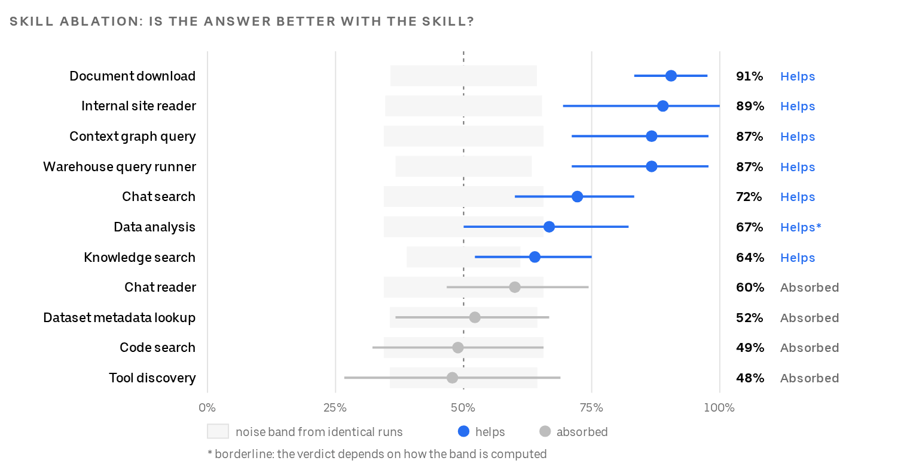

先找 50% 的中心線，再讀每列的點、區間和該列灰色噪音帶。文件下載的優勢明顯；工具探索靠近五五波。灰色項目值得進一步縮短或拿掉再測。難分勝負還可能來自案例不足、判分噪音或題目沒碰到真正用途。

**怎麼組一組公平的試驗？** 作者先寫人能判斷的例題與容許變化。例如兩份報告措辭不同但指標與結論相同，可判等價；格式相同而查錯表，仍須扣分。真實環境與乾淨環境並跑，才能把宿主差異和規格缺陷分開。Uber 提到 Minion、AES 和 devpods；小團隊可先用本機加一個乾淨 fixture。規格描述「每次都要查對哪張表」，之後即使模型或腳本替換，仍能重用相同判準。

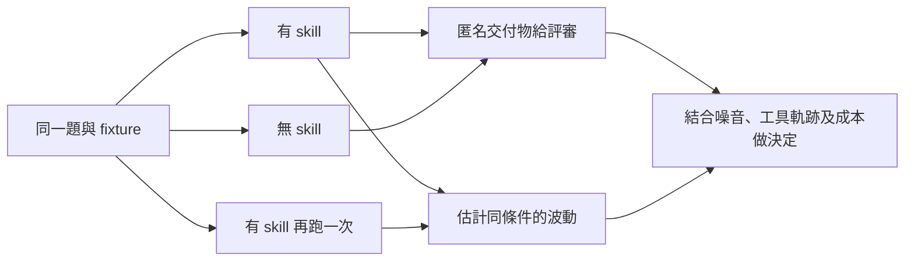

## 第四講｜量到什麼，就能改什麼？

Uber 記錄 skill 身分、版本及由人或模型觸發等事件，原文表示使用事件不含 prompt 或檔案內文。圖 10 列出的 12 類指標包括使用量、留存、觸及、共同使用、成本、上下文、延遲、錯誤、工具、版本、agent、安裝。可先挑和目前決策最相關的幾項。

**圖 9｜事件怎麼進到作者的決策畫面？**

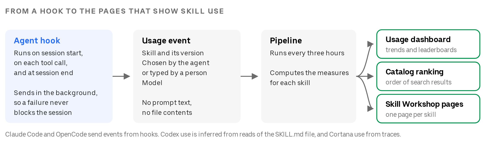

左方 hook 在背景送出；中央管線每三小時計算，右邊供儀表板、搜尋排序和作者頁使用。圖底小字很重要：Claude Code／OpenCode 用 hooks，Codex 從 SKILL.md 讀取推定，Cortana 靠 traces。跨宿主比較要帶上觀測方式。

**圖 10｜十二種量測各有一個決策對象**

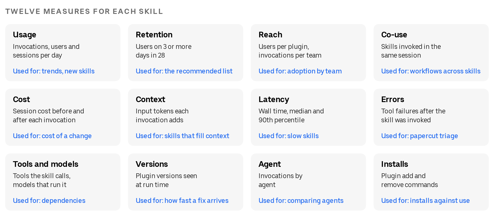

沿每格藍字讀「這個數字誰拿來做什麼」。使用量看趨勢，留存影響推薦；版本看修復送達速度，安裝則要和實際使用交叉看。下方實作講義把十二格展開成可搜尋的欄位與計算表。

原文用呼叫前後的累計 session 成本快照估算該次成本。視窗包含其他工具與後續回合，歸因有誤差。Code Mode 把固定工作移到腳本，模型只讀必要結果。圖 14 的 **約 140 萬 vs. 900 tokens** 是該 50 筆寬表查詢的估算。另一個 tracing skill 的 worker 改動前後成本差 **46%**，部署 skill 第一週沒有下降。要把收益套用到其他工作流，需重做相同輸入的品質、延遲與成本對照。

**圖 14｜相同查詢，模型實際讀了多少？**

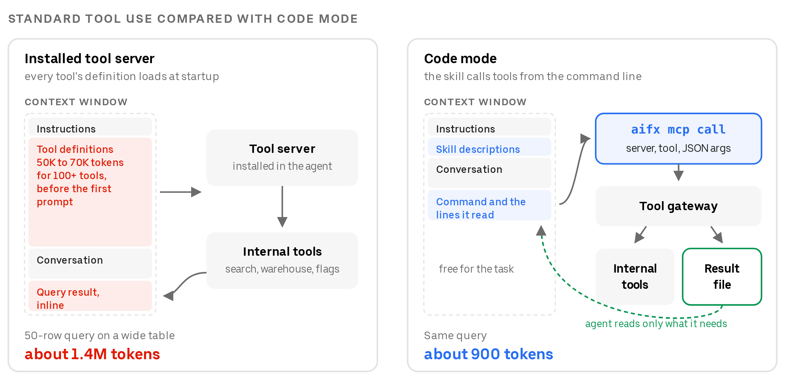

左側紅塊分別是起始就載入的工具描述，以及整份內嵌的查詢結果。右側結果落檔，虛線表示模型只讀需要的行。可先量「結果檔大小與實際需要的欄位」，再決定把哪段固定查詢搬去腳本。

**同樣想省錢，該改哪一段？** 查詢每次都做相同轉換時，可抽成能單獨測試的程式；跨工具關聯仍需模型判斷時，可讓便宜 worker 查找，只把有限長度的摘要送回主模型。結果小且次次都需要時，載入當下執行即可少一次往返。Uber 的搜尋案例從四輪變三輪，平均費用降 32%。相反地，若主因是等待，改短 prompt 幫助有限：作者在花費最高的 20 場 session 中看到通知回合約占三分之一，遂把 PR 輪詢移到較便宜的背景執行。這組比例只描述那 20 場。

## 第五講｜把一次繞路留給下一版使用者

`log-papercut` 回報意圖、執行內容、預期、實際結果與修正線索。圖 16 示範六步。收案後由人分流，建立測試與基線，提出變更並由維護者覆核，合併後重跑，通過才關閉。日後若匹配的問題再現可重開。原文另以維護 PR 被退回或反覆修改作為人工訊號，將受阻案例補入後續評估。

**圖 15｜為什麼指令成功仍值得報修？**

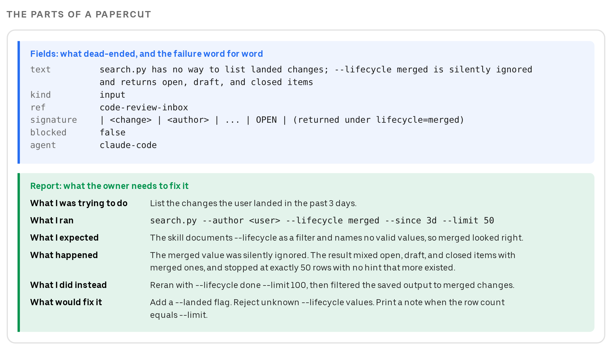

上半部用 kind、ref、signature、blocked 和 agent 讓類似報告能分組。下半部記錄使用者想找近三天已合併的變更，但搜尋忽略 merged 篩選、混入 open/draft，剛好回滿 50 筆也沒提示截斷。能繞路完成所以 blocked 為 false；若只統計工具退出碼，這個缺陷會消失。

**圖 16｜修正合併後才有足夠證據結案**

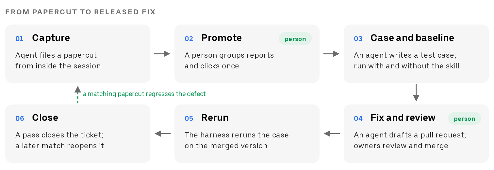

順著上排往右再沿下排往左看，兩個 person 標記落在案件提升與修正審查。程式在已合併版本重跑，虛線把日後相同指紋的回報連回舊案。如此才能區分「提過修補」與「這個案例確實恢復」。

Uber 舉的案例包括共用暫存檔互相覆寫、秒與毫秒誤用、查無設定卻默默回傳別的值，以及未設 CI 的 repo 反覆等待。這些問題適合寫成明確的測試條件，例如每次執行有自己的輸出目錄，缺值回明確錯誤，等待有截止條件。

> [!note] 圖片來源
> 封面及圖 1–16 均來自 Uber Engineering，圖 2、3、13、16 保留原始動畫。各圖下方的讀法與本機實作練習為講義補充。

## 實作講義｜從一份 session log 算出能採取行動的指標

**先挑問題，再挑欄位。** 如果問題是「升級後有沒有人用新版」，需要的是執行時的版本。如果問題是「查詢是不是更準」，至少要有一組已知正解或人工標註。把所有 JSONL 丟給模型打分，會把這兩件事混在同一個分數裡。以下是將 Uber 圖 9、10 延伸到個人環境的方案。

### 先認識兩種紀錄

2026-11-28 依修改時間各抽最近 24 份本機 JSONL，每檔最多檢查前 1,401 列，只彙整鍵名、事件種類與版本。Codex 樣本的 CLI 版本介於 0.160.0–0.170.0；Claude Code 樣本為 2.1.206、2.1.261。表中欄位依事件與版本選填。這是格式抽查；尚未對兩套宿主跑同一組任務校準量測差異。

| 想還原的事 | Codex rollout，通常在 `~/.codex/sessions/` | Claude Code transcript，通常在 `~/.claude/projects/` |
|---|---|---|
| 切分哪一場、哪一輪、哪個模型 | 外層 `timestamp / type`；`session_meta.payload.id`、`cli_version`、`model_provider`；`turn_context.payload.turn_id / model`。子執行緒可帶 `parent_thread_id` | 外層 `sessionId / timestamp / version / uuid / parentUuid`，模型在 `message.model`。留意 `agentId / isSidechain` 與分支 |
| 什麼證據表示 skill 被叫用？ | 在 `response_item` 裡查 `payload.name` 與 `arguments` 或 `input`；辨認讀取指定目錄的 `SKILL.md`，核對配對輸出。標記「推定讀取」。索引掃描、引用路徑、安裝或重讀要另外處理 | 在 `assistant.message.content[]` 找 `type=tool_use`、`name=Skill`，技能在 `input.skill`。屬工具呼叫直接證據；人輸入的命令可能走其他路徑。樣本部分列另有 `attributionSkill`，需校準涵義與覆蓋率 |
| 做過哪些工具動作、是否失敗？ | `payload.type=function_call / custom_tool_call` 取 `call_id / name`，接同 ID 的 `function_call_output / custom_tool_call_output`。回傳 `output` 的錯誤或退出狀態依工具解析；複合工具外層成功仍要看子結果 | `tool_use.id / name` 接 `user.message.content[].tool_use_id`，該區塊 `type=tool_result`，讀 `is_error` 與工具專屬狀態。API 錯誤另有 `isApiErrorMessage`，應獨立統計 |
| 花了多久？ | 外層時間戳配對工具請求／結果；`event_msg` 的 `payload.type=task_started / task_complete` 有 `turn_id`，部分 complete 有 `duration_ms` | 工具呼叫所在列及對應結果所在列的 `timestamp` 算經過時間；以 `uuid / parentUuid` 選定對話分支。兩端不全，記缺值 |
| token 花在哪？ | `event_msg` → `payload.type=token_count` → `info.total_token_usage`（累計）及 `last_token_usage`。看 `input_tokens / cached_input_tokens / output_tokens / reasoning_output_tokens` 等子欄；`info` 可為空 | `assistant.message.usage` 的 `input_tokens / cache_creation_input_tokens / cache_read_input_tokens / output_tokens`。依 `message.id`、可用時加 `requestId` 合併同一模型回應的多列，以完整用量計一次 |
| 哪裡要另行補資料？ | 另接 runner、安裝與驗收紀錄 | 兩者都應另存技能的 manifest 版本或內容雜湊、安裝事件、匿名使用者與團隊對照、任務 fixture 和最後驗收。CLI 的 `version`、repo 的 HEAD 都不能代替實際載入的 skill 版本 |

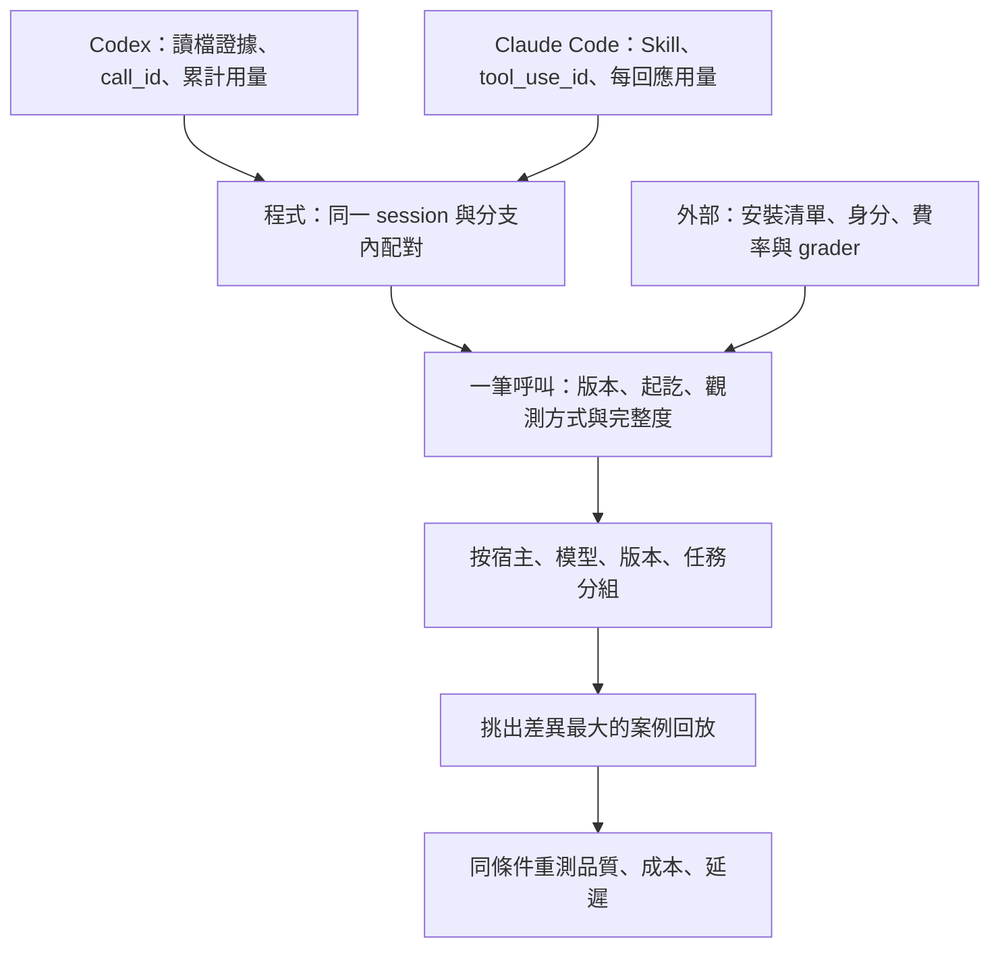

### 圖 10 的十二個指標：看什麼、怎麼算、該改哪裡

下表第一欄依原圖分類。後兩欄是用上表兩種 log 實作的口徑；自行選定的分母與歸因規則要連同報表一起保存。

| Uber 的觀察 | 本機實作與必要分母 | 哪一種決策用得到它？ |
|---|---|---|
| 1 使用量（usage） | 按日計數去重的 invocation、不同 session、不同匿名使用者。原生與推定呼叫各列一欄；無身分就只算前兩項 | 啟用增加但使用者持平，先查是否少數任務密集重試 |
| 2 留存（retention） | 28 天內至少 3 個不同日期使用的使用者數。若另報比例，以同窗曾使用者為分母；兩週使用同一場長 session 須按呼叫日期算 | 決定哪些技能值得推薦；低頻月結流程另設觀察窗 |
| 3 觸及（reach） | 從實際載入版本連到 plugin，數不同使用者；按團隊歸屬算呼叫。缺名冊則團隊覆蓋未知 | 分辨只在作者團隊流行，或值得跨團隊推廣 |
| 4 共用（co-use） | 每個 session 對 skill 集合去重，再統計每對技能共現場數。若算 A→B 接續率，另用時間順序及 A 的出現場數 | 找可串接的工作流，再取 trace 確認是否真的有前後依賴 |
| 5 成本（cost） | Uber 用呼叫前後相鄰累計費用快照相減。本機用 token 差量或每回應用量配模型與當期費率；區分快取讀、寫與輸出，保留估算標記 | 找出平均每次費用昂貴且量大的工作流，再對相同成果比較新版 |
| 6 上下文（context） | 觀察相鄰請求的輸入量變化，同時記工具回傳大小與是否壓縮。token 累計增量含重讀的歷史；精確新增多少內容需額外在工具邊界量測 | 大結果只用了幾欄時，改回傳檔案、索引或摘要 |
| 7 延遲（latency） | 對有完整 skill 起訖的呼叫算牆鐘時間，再取 p50、p90 並報樣本數；僅有讀檔時間時，可量單一工具延遲，整個 skill 耗時未知 | 中位數正常但 p90 長，回看慢樣本是否卡在排隊、輪詢或等待人 |
| 8 錯誤（errors） | 在已界定的呼叫範圍內算失敗工具數；另報失敗數／有結果的工具數及缺結果數。工具回成功仍可能查錯資料，須靠驗收揭露 | 集中在參數或單位就修指示；工具服務故障則交服務維護者 |
| 9 工具與模型（tools and models） | 按工具名稱及當輪模型分組，算每次任務工具數、已知失敗數；大量低價模型處理簡單任務時，先按任務分層 | 看哪些 skill 依賴即將改版的工具，以及便宜 worker 是否可替代 |
| 10 版本（versions） | 用**載入當時**的 plugin 版本或 skill 雜湊串事件，算新版呼叫／已知版本呼叫，另列 unknown | 修復已發布但錯誤持續，先查舊版是否仍在使用 |
| 11 宿主（agent） | 按紀錄來源分 Codex、Claude Code，附版本、原生／推定方式、已知可觀測場數 | 先排除偵測口徑不同，再判斷要修哪個宿主的配置 |
| 12 安裝（installs） | 從套件管理器或部署 manifest 另記 add/remove；與同人同版本的首次呼叫關聯。沒有安裝資料就保留未知 | 安裝後沒啟用時，檢查任務匹配、描述和搜尋排序 |

### 怎麼算才不會改善錯地方？

1. **先定一次工作從哪裡開始、在哪裡結束。** Claude 的 Skill 工具回傳有時只代表指令已展開，後續查詢才是工作的主體。Codex 讀完檔也只有起點。能控制 runner 時，在呼叫前後發 `skill_start / skill_end`，帶自訂 `invocation_id / parent_id / skill_rev / outcome`。這四個是建議新增的欄位。無明確終點的舊資料，報視窗估計和涵蓋率。
2. **把工具呼叫與結果配對，再判定軌跡。** 例如規格要求「查表 → 核對單位 → 輸出」，兩個工具同時出現在 log 不足以證明順序。把必要步驟、禁止操作和錯誤恢復各做一個斷言；重試成功仍計第一次失敗。沒有回傳與明確失敗分開。
3. **用量先去重，再談歸因。** 假設 Codex 前後累計輸入從 100,000 到 106,000，這段視窗消耗 6,000 input tokens；其中可能包含舊對話重讀與其他工具。Claude 同一 `message.id` 的兩列都帶 6,000，若屬同一回應就只取一筆完整值。不同提供者對 cache 的拆法不同，不能把已含在 input 裡的快取再加一次。無適用價目時只報 tokens。多 skill 重疊時另列共享成本，避免總帳重算。
4. **最後接外部成果。** 對每個案例保存 `case_id / variant / model / skill_rev / verdict`，連到產物檢查或盲評。分母包括失敗與逾時；同時列完成率、每次嘗試成本、總成本／成功件數。只比較成功場次的用量，可能會漏掉新版本更常半途放棄。
5. **把反例當驗收。** 用四個合成案例驗 parser：重複讀 skill 檔、同一 Claude 回應拆成多列、工具結果缺失、兩個 skills 在同一視窗重疊。預期分別是「推定且去重規則可見」、「用量只算一次」、「結果未知」、「共享用量不重複歸戶」。升版先重跑這四案。

> [!example] **自己可以做的配對練習**：固定同一張測試資料表、同一個問題和模型，要求交付帶單位的總額。A 組保留查詢 skill，B 組移除，另將 A 重跑觀察自身波動。grader 先驗數值、單位與資料來源，再比較工具數、錯誤率、p90 等待與每件成功成本。若兩組答案同樣正確而 B 多花三輪找表，優先保留表名與查詢入口；若 A 快卻用錯單位，先補規格與回歸案例。這是教學練習，數據需在自己的環境取得。

### 影片對照與證據

Jerry 的影片於 2026-11-25 發布，片長 10:43，說明欄標示動畫與 AI 配音。本次以 302 段英文自動字幕結合中文章節及 Uber 原文整理；字幕沒有人工逐句核對。影片負責解說，使用數字與技術設計回查原文及圖。

| 時間 | 重點 | 閱讀時的判斷 |
| --- | --- | --- |
| [02:06](https://www.youtube.com/watch?v=K_ixtIBNQbw&t=126s) | 市集三層與維護者 | 從一套 Git 審核流程就能起步。規模大時，常用與預設技能才需要較嚴格的維護。 |
| [04:27](https://www.youtube.com/watch?v=K_ixtIBNQbw&t=267s) | 規格、lint 和 eval | 先寫決定性的輸出和必做行為，再決定哪些要人工或模型判斷。 |
| [05:49](https://www.youtube.com/watch?v=K_ixtIBNQbw&t=349s) | 把 skill 拿掉重跑 | 影片把 4 組結果講成「模型吸收」。圖 13 表示該次試驗無法分辨差異。模型能力提升是可能解釋之一。 |
| [06:59](https://www.youtube.com/watch?v=K_ixtIBNQbw&t=419s) | Code Mode | 估算針對 Uber 的工具載入和查詢方式。對自己的流程先量測。 |
| [08:20](https://www.youtube.com/watch?v=K_ixtIBNQbw&t=500s) | Agent 報修 | 先做好可重現與分流，才能讓後續修正結果被覆核。 |

原文的線上 A/B、按模型編譯 skill、擴大 trace 索引與 task router 列於 What's Next。離線盲測與已描述的分發配置有不同成熟度。 [Uber Engineering 原文](https://www.uber.com/us/en/blog/optimizing-ubers-agent-skills/)

## 我的心得（My Takeaways）

> [!tip] 一週內能開始的最小導入
> 選一個已有用戶或曾退化的 skill。寫一頁 spec、一次真實但去識別的失敗、一個相近的觸發反例。固定 runner、模型、fixture、規則與版本，跑舊版、新版與無 skill 基線。以報告 ID 串起回報、修正、合併後重跑。先沿用現有 Git 與報告流程。

有了基線再選投資方向：返工多先修分流與回歸，跨 repo 重複配置多先檢查安裝與版本，輸出太大先把一個固定步驟改成可測的腳本。能反覆重跑的例子也適合拿來檢查模型升級。

## sys-assistant 導入檢查表

以 2026-11-27 讀取的 `main` 為基準。勾選項表示已核對程式入口或既有測試。未勾選項是要補齊的工作，或仍需用實際執行證明的能力。

### 已有，可直接沿用

- [x] **Skill 與 Expert 各有測試入口。** 單一 skill 可檢查是否觸發、其他 skill 共存時是否干擾觸發，以及有／無 skill 的成果差。Expert 測試另檢查檔案、工具、輸出和 KPI。
- [x] **有隔離工作區與評估資料格式。** Runner 可佈署 fixture，已有案例 schema、確定性斷言、模型評分和報告。單一 skill 的功能評估已有品質與 token 差值。
- [x] **有使用追蹤、明確觸發的回饋及分析入口。** 使用、測試與回饋各有報表。使用追蹤提供採用訊號，回饋可提供排查線索。
- [x] **已有分階段改善規劃。** 現有規劃已涵蓋觸發、分流、修正提案與合併後驗證，可以在前面加一個試點驗收。

### 獨立 session 的觀察

- 干擾測試目前針對觸發。有／無 skill 的功能評估則在隔離工作區執行。要驗證 skills 共存時的交付品質，應用 Expert 整合案例另做驗收。
- 使用追蹤主要記錄會話中觀測到的 skill 集合。宿主的事件範圍也不同，應把會話覆蓋、技能觸發與確切呼叫次數分別量測。

### 缺口，先補這三項

- [ ] **選一個試點，補一頁可驗收的 spec。** 建議從已有測試的回饋工作流開始。指定維護者，寫清楚預期輸出、必做步驟、禁止副作用與失敗時的處置，再連到案例 ID。**完成條件**是有正常、失敗、相近但不應觸發三種案例，必做與禁止行為都能檢查。
- [ ] **讓一筆回報可以回放。** 先用合成資料做一張精簡回報，以問題 ID 串起案例、執行 ID、實際載入的 skill 版本、宿主、模型、測試資料版本和結果。**完成條件**是同一失敗可在隔離環境重現，且能區分環境缺資料、工具故障和 skill 行為錯誤。
- [ ] **留存修正前、候選版與合併後的證據。** 用相同條件確認基準會失敗、候選版通過目標案例與必要回歸、合併版本再通過一次。**完成條件**是維護者能用同一問題 ID 找到三份結果，再決定關閉或重開。

### 已有基礎，接著加強

- [ ] **加強有／無 skill 對照。** 保留既有 runner。把「有／無」與「舊／新」設成兩類比較，固定 fixture、宿主、模型和判準，另留同版本重跑的波動。成本以達到相同成果門檻的配對比較。
- [ ] **補上關鍵步驟的軌跡斷言。** 工具出現或叫用次數只能證明部分行為。對必須依序執行的步驟，加可驗證的順序、錯誤處理及副作用檢查。
- [ ] **補強跨宿主的觀測口徑。** 分別驗證「安裝、觸發、結果、可觀測」。使用事件標明是直接觀測或從 session 推定，無資料標為未知。先核對一個宿主，再比較其他宿主。
- [ ] **區分精簡事件與詳細回饋。** 自動事件用允許欄位與去重鍵，詳細回饋沿用明確觸發的流程。用合成資料覆蓋清理失敗、超時與重複回報，確認只送出允許欄位並歸到同一問題。
- [ ] **把回饋分流建立在可比較的基線上。** 先用最少欄位、去重與人工分流。能判斷重複退化後，再把只讀匯整接入排程，保留環境故障、未觀測與樣本不足的狀態。完成這一步後才評估自動修正提案。

> [!note] 這次盤點的驗證範圍
> 本次重跑的 104 個既有測試全數通過，schema 檢查 0 個錯誤、14 個警告，runner 列出 3 個同時具備 basic 與 advance 的可執行 skill。模型實跑、跨宿主驗收與合併後回放仍待完成。

## 待補充（Open Questions）

- 重複執行同一 prompt 的變異要如何估計？搜尋 `agent skill ablation identical-run baseline`。
- 一次 session 多個 skills 同時執行時，成本如何公平歸因？搜尋 `skill invocation cost attribution spans`。
- 稀有但高影響的工作流只有少量樣本時，怎麼建立穩定的驗收？搜尋 `rare critical agent workflow evaluation`。
- 如何將早期回饋與被退回的 PR 轉成匿名 fixture，並保留重現線索？搜尋 `redacted agent trace replay fixtures`。
- 如何決定原本預設安裝的 skill 何時退場？搜尋 `skill retirement model upgrade evaluation`。

## 相關連結（Related）

- [[2026-03-07-CLAUDE-SKILL-EVAL-FRAMEWORK-3-SKILLS-ONE-AFTERNOON-REAL-DATA]]，從少量技能開始建立一輪評估與改版基線。
- [[2025-12-29-SKILLSBENCH-AGENT-SKILL-USE-BENCHMARK-CODE-ANALYSIS]]，研究有／無 skill 對照與獨立環境。
- [[2026-11-12-THE-HOME-REPO-PATTERN-MULTI-REPO-AGENT-WORKFLOW]]，共用入口、專案規則與宿主實際接入。
- [[2026-11-23-INTRODUCING-CLAUDE-SHIP]] — 用歷史 PR 評估政策誤放行與每次有效修正的成本。

## 知識層次分析（Bloom's Taxonomy Analysis）

| 層次 | 對本文的應用 |
| --- | --- |
| 記憶 | 逐步載入、三層市集、軌跡評估、消融試驗（ablation）、papercut。 |
| 理解 | 排序靠用量訊號，是否值得保留要看任務結果與成本。 |
| 分析 | 從文件讀取推定使用會有誤差。成本快照和盲測都需要各自的比較條件。 |
| 應用 | 建立一個本機可回放的失敗。對高用量工作流跑有／無配對，再加必要流程斷言。 |
| 評估 | 比較人工分流與自動分流的成本。低量流程先用簡單紀錄，高頻且有穩定樣本才值得建更完整的管線。 |

### 分析型追問（Socratic Follow-up）

- Skill 被偵測到、被讀取及實際完成任務時，事件應各記什麼？
- 基準也在退化時，怎麼把模型變動與 skill 改版分開？
- 所有用量都集中在一類職務時，哪些案例還需要刻意補？
- 如果成本下降來自提早終止，哪個成果斷言能抓到？
- 一年前已關閉的回報重新發生時，靠什麼欄位判定是同一問題？

### 方案批判三問

1. 最大風險是大量自動回報將原始資料帶出工作環境，或把錯誤歸因給 skill。回報先限定欄位及證據來源，維護者確認再改。
2. 模型、工具、fixture 或環境同時變更時，配對差異難以歸因。固定條件或重建基準後再判斷。
3. 少數技能可先手動保存回放案例與對照結果。需要多團隊發佈、依賴版控及支援多個宿主時，統一分發才有額外價值。

## 六頂思考帽回饋（Six Thinking Hats Feedback）

### 藍帽｜問題與範圍

能否知道一個 skill 值得保留，並在退化時留下可修證據？

### 白帽｜事實與未知資訊

文章有現行市集、部分常用技能的盲測及報修範例。缺完整逐案樣本、執行成本和稀有任務的成功率。

### 紅帽｜直覺與讀者反應

百萬次標題容易讓人先想到大平台。從一筆實際失敗開始更容易理解做法。

### 黃帽｜價值與可保留內容

版本化規格、有／無對照及合併後回放能直接重用。

### 黑帽｜風險與限制

缺少結果驗收、樣本不足或不同宿主的用量口徑混在一起都可能產生錯誤結論。

### 綠帽｜替代方案與新應用

用現有測試 runner 和最小回報 JSON 先跑一次。需要跨使用者匯整時，再加最少欄位。

### 藍帽｜修改項目與下一步

- 將必要操作和最後交付分別寫成斷言。
- 固定版本與 fixture，保留一次配對對照。
- 用同一個問題 ID 串起修正前、候選與合併後證據。

## References

- [Uber Engineering｜How Uber Evals 1 Million Agent Skill Invocations a Month](https://www.uber.com/us/en/blog/optimizing-ubers-agent-skills/)，2026-11-23。
- [Jerry｜Uber 怎麼管 5,300 多個 AI 技能？](https://www.youtube.com/watch?v=K_ixtIBNQbw)，2026-11-25。
- [Agent Skills 規格](https://agentskills.io/specification)。
