## TL;DR

- 開發者用 agent 寫完改動，常常還得回頭等 CI、回留言、再找人核准。Claude Ship 接手其中反覆發生的交接。
- 團隊版有三個角色。Code Review 提出問題，PR Steward 推修正，Claude Approvals 讀團隊政策決定還缺誰核准。最後能否合併，由 GitHub 的分支規則決定。
- 個人版從本機 Claude Code 啟動。`/ship` 處理送審和後續追蹤，已有自己的 PR 時，可用 `/steward` 只追蹤。兩者都用開發者自己的身分。
- 在 agents-control-platform（ARCP）上，第一步可只做一件事：給定一張 Jira 票與一個 PR，回答「**哪一版、哪項檢查、接下來輪到誰？**」等答案能重播、能核對，再開放自動修正。

## 摘要與設計原理

以前開發者同時是作者和協調者。上午送出 PR，下午才收到一則留言，重新理解上下文、修一行、再等一輪 CI。即使測試全過，也要確認授權的人看過。Agent 壓縮了寫程式的時間，卻讓更多 PR 同時進入這個等待區。Anthropic 的設計把「發現問題」、「改變程式」與「判定誰能放行」拆開。第一個角色提供證據，第二個產生新版本，第三個解讀團隊規則。程式每改一次，證據就可能過期，因此流程必須能回到審查，而非只往合併方向前進。[發布文章](https://claude.com/resources/articles/introducing-claude-ship)

### Before / After：同一個 API 重試修正

以下沿用官方截圖的例子：API 回覆限流，重試程式開始解析 `Retry-After`。若只測「等待秒數」而漏了 HTTP 日期或缺值，測試即使全綠，使用者仍可能遇到連續重試。

| 交接點 | Before：作者協調 | After：團隊啟用對應角色 |
|---|---|---|
| 哪裡有問題？ | 作者在 CI 與審查留言之間比對，回頭找程式碼 | Code Review 結合周圍程式碼查核疑點，把嚴重程度與理由貼回對應行 |
| 誰修、怎麼追？ | 作者切回舊分支、補例外處理與回歸測試，通知審查者 | Steward 讀 CI 與回饋，推修正 commit，留言交代改了什麼、如何撤回。新提交可再觸發審查 |
| 誰承擔決策？ | 作者逐一找對應維護者，或靠大家記得例外規則 | Approvals 依版本庫政策列出尚缺的核准。文件與敏感模組可以有不同條件 |
| 何時完成？ | 人到 GitHub 看檢查再合併 | 分支保護照常生效。若已開 auto-merge，最後一項條件轉綠就可能直接合併 |

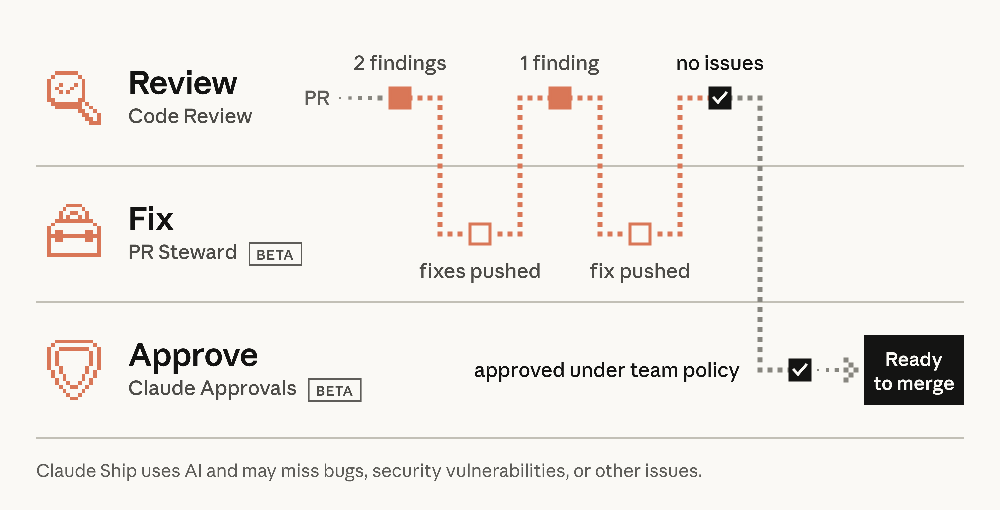

### 三個角色各自擁有什麼證據？

1. **Code Review** 比對差異與周邊程式碼，從多個面向找問題，再查核候選發現。維護者可以選 Quick、Standard 或 Deep。審查「沒有發現」仍有漏判的可能，測試和領域審查者各自提供不同證據。
2. **PR Steward** 接收失敗檢查、合併衝突和審查回饋。可用 PR 留言 `@claude` 引導或 `@claude stop` 停止。每次 push 留下改動和撤回說明，下一位人員才有足夠上下文接手。其設計職責到修正為止。
3. **Claude Approvals** 讀取版本庫內的 `.claude/approvals.yml`。規則可依路徑、審查結果或分類器指定所需人數、誰能核准，以及 Claude 何時可送出 approving review。observe 模式先顯示假設照政策執行會得到的結果。要真正阻擋不合規的合併，須在 GitHub 將對應 check 設為 required。[團隊設定與角色](https://code.claude.com/docs/en/claude-ship)

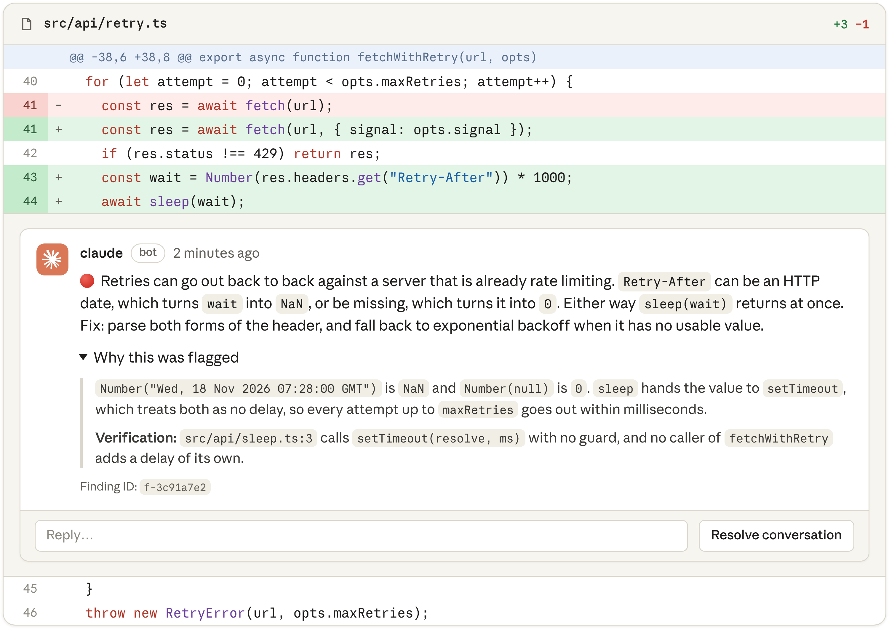

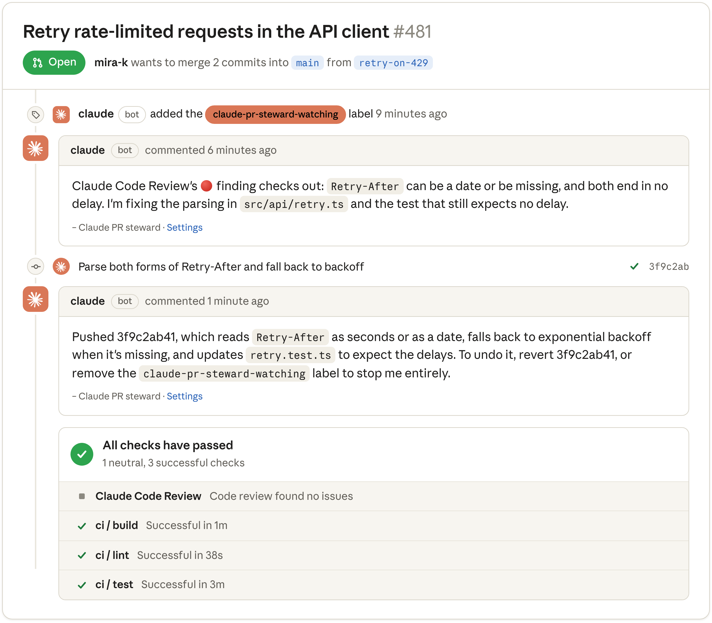

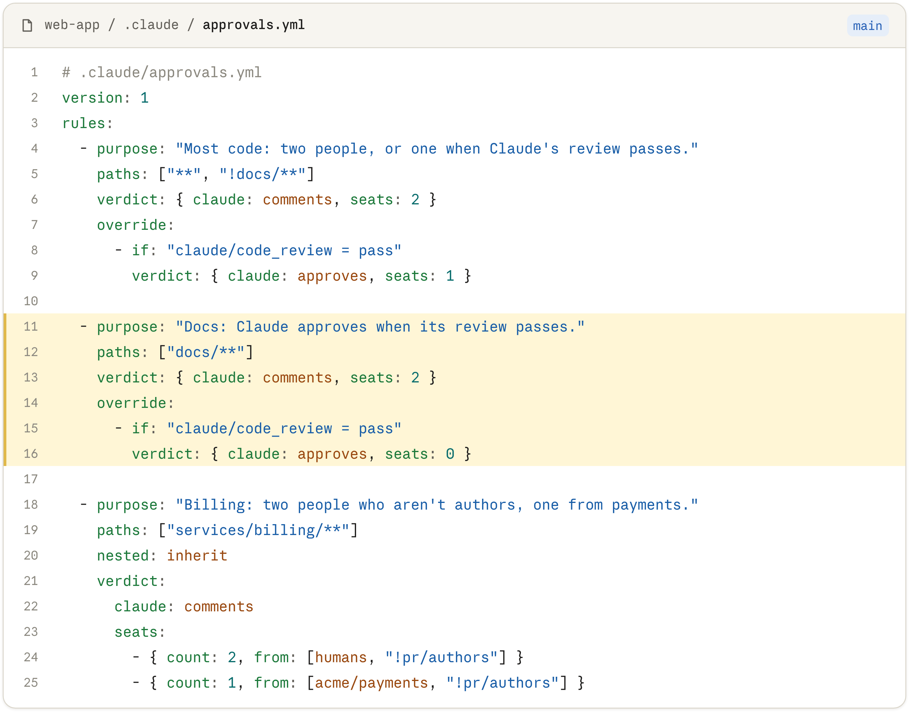

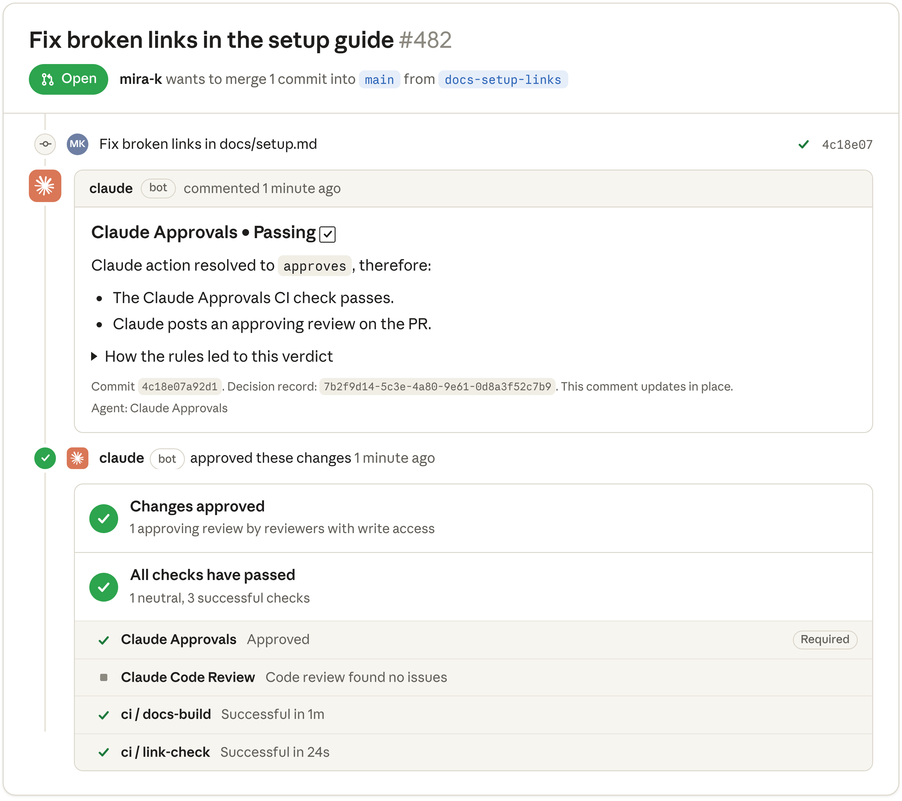

**怎麼讀成效數字？** Anthropic 回報自家 Claude Code 團隊六月至九月合併的 PR 超過原來兩倍，被 revert 的比例下降超過 40%。當時審查只是整套工程流程的一層。要估計自己的收益，應比較相近風險與規模的 PR，至少記錄等待時間、退回率、人工介入次數和用量。官方文章另有一個可追的實例：PM 發現 Analytics API 文件把金鑰適用範圍寫得容易誤解，開 PR 後仍經文件審查者簽核，當晚合併。[案例與團隊觀察](https://claude.com/resources/articles/introducing-claude-ship)

## 從十月的內部審查，到十一月的 Claude Ship

把兩篇文章放在一起，可以看出兩個瓶頸。十月的工程團隊要解決「誰有時間讀完這麼多改動，又能及早攔下錯誤？」十一月的產品要解決「即使有人找到問題，接下來誰盯著修正、重跑和核准？」前者解釋完整的交付流程，後者把其中可重複的 PR 工作交給三個角色。[工程團隊實務](https://claude.dev/blog/solving-code-review-at-anthropic/) · [產品發布](https://claude.com/resources/articles/introducing-claude-ship)

| 一項改動走到哪裡 | Claude Code 團隊怎麼取得證據 | 對照 Claude Ship，誰接下一棒？ |
|---|---|---|
| 開 PR 前 | 作者先交測試、建置輸出或畫面比對，再用獨立上下文檢查 diff | 團隊可沿用自己的驗證方式，將預期行為寫進 PR，供 reviewer 核對 |
| PR 有發現 | 多個 agent 找候選問題，另一組驗證後才留言。作者修正或留下理由結束討論 | Code Review 提出帶位置的發現，Steward 處理回饋與失敗 CI，將新 commit 交回檢查 |
| 需要核准 | 內部依風險及作者信任條件決定需要幾位人員。敏感路徑另有要求，新提交也可能使既有核准失效 | 使用 Ship 的團隊自行寫 Approvals 政策，再以 GitHub required checks 和分支保護執行 |
| 合併後 | 合併佇列檢驗與最新 main 的組合；功能開關、漸進發布、值班與回復接手線上風險 | Ship 的產品流程走到 PR 可合併。部署、觀測與決定何時回復，仍要由服務擁有者安排 |

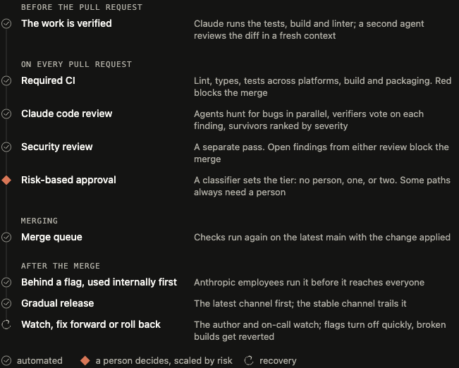

**讀圖時先找 merge queue。** 排在它上方的綠燈回答「這個改動目前通過哪些檢查」；佇列還要驗兩個原先各自通過的改動合在一起是否正常。再往下才是使用者是否受到影響。這也是閱讀產品頁的 *ready to merge* 時要保留的界線。[工程文章](https://claude.dev/blog/solving-code-review-at-anthropic/)

### 為什麼 reviewer 與 fixer 都能工作，PR 卻遲遲無法結束？

工程團隊遇過一個 CLI PR，一夜之間審查與修正超過五十輪。團隊回查反覆被指出的程式碼，約 59% 在第一輪審查時已經存在。若每次修完一行都重新檢視整個範圍，reviewer 就可能繼續找到既有問題；fixer 每回應一次，又產生下一輪。作者採取四個調整：三輪後提醒作者重新檢視做法、前幾輪後縮小複審差異、同類缺陷集中提出、已提過的問題去重。三輪是要求重新判斷的時點。文章沒有把它列成 Ship 的預設停止條件。[工程文章的收斂實驗](https://claude.dev/blog/solving-code-review-at-anthropic/)

| 內部 PR 收斂指標 | 調整前 | 調整後 |
|---|---:|---:|
| 一輪審查與修正後通過的比例 | 65% | 78% |
| 需要至少五輪的比例 | 8.9% | 1.5% |
| 通過前平均審查次數 | 2.08 | 1.32 |

這組數字描述審查流程調整前後。要知道是不是少抓了問題，團隊同時追蹤已知缺陷的召回率，並在已知乾淨的 PR 上檢查 reviewer 是否提出會造成傷害的修改。更上層才看每個 PR 的人工核准數（中位數與 p95）、人工留言、等待人的時間，以及 revert 和事故率。[指標與評測方法](https://claude.dev/blog/solving-code-review-at-anthropic/)

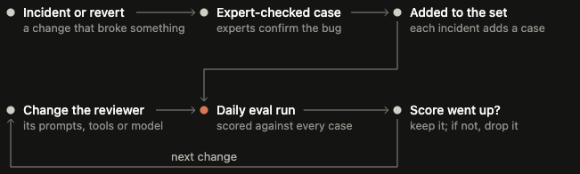

**這張圖有兩種會變動的東西。** 上排用事故擴充題庫，下排用同一套題庫評估新的 reviewer。把兩者拆開，才有機會回答「新版能否抓到上次漏掉的錯」，也能用乾淨案例檢查它是否只是更愛留言。完整分層防護與團隊知識交接圖解見 [[2026-10-15-HOW-THE-CLAUDE-CODE-TEAM-DOES-CODE-REVIEW]]。

## 使用方法：先選個人 PR 或整個版本庫

| 情境 | 入口 | 執行地點與責任 |
|---|---|---|
| 自己的改動已完成，希望送審並追到可合併 | 本機 Claude Code 的 `/ship` | 能以你的權限 commit、push、開 PR、執行本機審查，再追蹤 |
| 自己的 PR 已開，只需要處理後續回饋 | 在該分支輸入 `/steward` | 跳過開 PR 與起始審查；亦可用來重新啟動追蹤 |
| 只想知道程式碼有什麼問題 | `/code-review` | 只執行審查 |
| 整個團隊要持續處理多人的 PR | Organization settings → Claude Ship | 由 Owner 逐庫啟用，組織付費；規則和 GitHub 分支保護一起管理 |

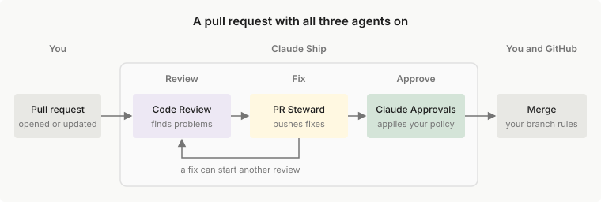

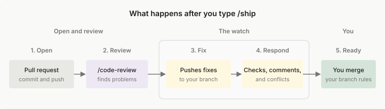

### 開發者操作手冊

1. 在本機終端的 clone 檢查 `git status`、`git branch --show-current`、`git remote -v`。官方列 Claude Code ≥ 2.1.330、GitHub CLI ≥ 2.63 並已登入、Git ≥ 2.38。2.1.331 調整多項啟動條件。確認通知、機器休眠與其他工作目錄的安排。
2. **公開 GitHub repo 如 ARCP**，先將預計送審的變更 commit 到非預設分支，再於 Claude Code 輸入 `/ship`。公開庫的啟動步驟會跳過未提交內容。私人非 fork 庫則可能把未追蹤的新檔也一起提交；事先檢查實際內容。啟動時只短暫提示可按 Esc，無需再次確認就會繼續。若要 draft、PR 範本、不同 base 或從 fork 送出，先自行開 PR。
3. 例如輸入 `/ship high 41` 審查自己的 PR #41；在同一分支輸入 `/steward 41` 則直接追蹤。預設會讀有寫入權的人員與支援的 Claude bot 留言；要額外採信特定機器人可用 `/steward +my-lint-bot`。組織 PR Steward 已接手時，本機不另開 watch。
4. 追蹤期間，Claude 可處理 CI、回覆討論、請對方再審或把 base 合回工作分支。要無人值守須選 auto；手動權限模式可能停在提示。查狀態用 `/tasks`，看操作界線用 `/ship terms`。共用指引可放在 `.claude/skills/steward/SKILL.md`。口頭要求「先讓我看過再推」僅是對模型的指示。
5. 讓 session 保持開啟、電腦清醒、原 checkout 留在同一分支。下一項工作另開 clone 或 worktree。切換分支、關閉 session、PR 關閉或合併、經過七天等都會終止追蹤。`/ship stop` 在目前這輪結束才生效；要中止眼前這輪按 Esc。恢復用 `/steward`。本機運作計入該 session 用量。[本機操作及版本差異](https://code.claude.com/docs/en/ship-command)

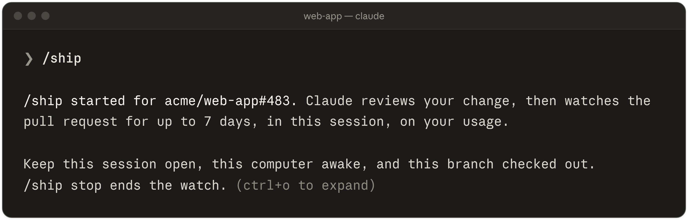

> [!warning] 追蹤程式會用你的 Git 與 GitHub 登入身分。測試、hooks 與剛合進來的程式都可能在本機執行。正式控制點是工作環境裡能用哪些憑證，以及遠端分支要求哪些檢查和人員核准。已啟用 auto-merge 時，單是修好 CI 就可能導致合併。[執行權限](https://code.claude.com/docs/en/ship-command#decide-where-to-run-a-watch)

**使用其他 Git 服務時**，先 commit 並推送有 upstream 的分支，再由人在服務上開 MR／PR。新版可追蹤分支，部分主機能讀取檢查與留言，回覆討論、重跑檢查和讀 CI log 的能力與 GitHub 有別。[其他主機的支援範圍](https://code.claude.com/docs/en/ship-command#watch-a-branch-on-another-host)

### 團隊導入手冊

選一個 repo，由 Owner 先開 Code Review，確認審查深度與觸發時機；再將 PR Steward 設為手動 `@claude steward`，明確設定預算；最後把核准政策放上預設分支，以 observe 模式比對實際的人審。政策上線後，原先的自動審查範圍可能改變，需保留的規則要明列 `claude/code_review`。觀察滿意才調整 required checks。Team、Enterprise 的組織代理按 token 使用額度另計，observe 也會計費。Code Review 已正式提供，另外兩個角色目前為 public beta。停止組織計費應依序停 Approvals、Steward、Review；本機指令另行管理。[組織設定、費用與限制](https://code.claude.com/docs/en/claude-ship)

## 把流程移植到 agents-control-platform

**版本基準**為公開庫 main 的 `dc2bb0b847b48c15ac2a3e9dd3000e3bba056df8`。下表是讀碼盤點；後面的設計是假設由 ARCP 自己讀 GitHub、派現有 worker、核對證據，全程不依賴 Claude Ship 或其指令。[固定版本原始碼](https://github.com/swchen44/agents-control-platform/tree/dc2bb0b847b48c15ac2a3e9dd3000e3bba056df8)

| 能力 | 現況與程式入口 | 接到 PR 時的改動 |
|---|---|---|
| 接事件與派工 | 已有。Jira → `poller.py:poll_once` → `dispatcher.py:handle`，依 profile 派 worker | 補 PR 來源，先以 Jira 指定 repo 與 PR 號碼輪詢；同一張票可以關聯多個 PR |
| 可隔離的工作目錄與代理 | 已有。`workspace.py:provision` 準備票的 workspace，runner 可選 Codex 或 Claude | 增加每個 PR 的獨立 checkout，明確綁定來源庫、base 與 head。測試程序拿不到推送憑證 |
| 審查與驗證 | 部分。`config/skills/kp2-creview/SKILL.md` 讀票內 C 程式，寫 `REVIEW.md`；`grader.py` 可驗檔案、JSON 形狀或指令結果 | 加入讀 PR diff 與周邊程式的 reviewer；發現記錄檔案、位置、理由及受測 SHA。另查遠端 required checks |
| 等人與紀錄 | 已有。`approval.py:ApprovalGate` 在派工前開表單，`hil.py:apply_submission` 收件，`store.py:journal` 記事件 | 新增針對 PR 版本的決策。Jira 表單放行只代表允許開工；GitHub 的核准要能驗出人員身分及適用版本 |
| 限額、重試與重啟 | 已有。`dispatcher.py:_budget_precheck` 於派工前查用量；Store 保留 ticket session | 補每 PR 迴圈上限、外部副作用的去重紀錄、重啟後與 GitHub 對帳。ticket 成功不能直接轉成 PR ready |
| 合併決策 | 本次查閱的 ARCP 主程式未見 PR check / review 整合 | 新增政策評估與 GitHub check 輸出。試行階段只產生建議，由維護者在 GitHub 合併 |

**建議讀碼順序**：先看 [Poller](https://github.com/swchen44/agents-control-platform/blob/dc2bb0b847b48c15ac2a3e9dd3000e3bba056df8/src/arcp/poller.py) 如何把來源變動轉成工作，再看 [Dispatcher](https://github.com/swchen44/agents-control-platform/blob/dc2bb0b847b48c15ac2a3e9dd3000e3bba056df8/src/arcp/dispatcher.py) 何時願意派工。最後對照 [Grader](https://github.com/swchen44/agents-control-platform/blob/dc2bb0b847b48c15ac2a3e9dd3000e3bba056df8/src/arcp/grader.py) 驗了什麼、[ApprovalGate](https://github.com/swchen44/agents-control-platform/blob/dc2bb0b847b48c15ac2a3e9dd3000e3bba056df8/src/arcp/approval.py) 放行了什麼。這兩個答案決定新流程可以沿用到哪裡。

### Before：ARCP 已有的任務生命週期（簡圖）

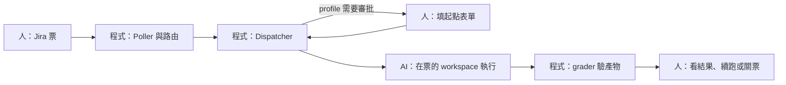

### After：同一張票可追到指定 PR 的最新版本（提案）

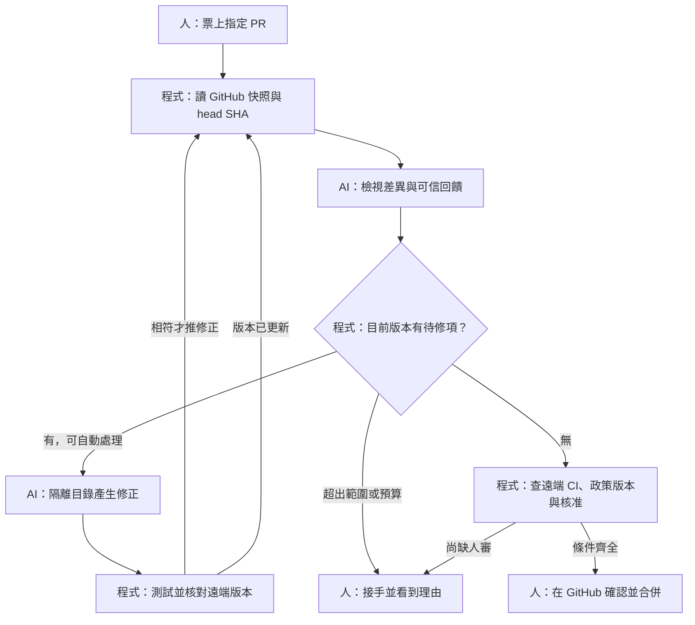

### 可排進 backlog 的實作清單

| 階段 | 交付物與責任邊界 | 可驗收的結果 |
|---|---|---|
| 0．準備樣本 | 選一個 repo、幾個已結案 PR，保存經去識別化的 diff、事件順序、required checks、人審與最終結果。維護者標註哪些改動可自動修 | 有文件改動、缺測試、改權限、重複事件、CI 未回覆五種案例；先量人工等待時間 |
| 1．唯讀追蹤 | 新增 GitHub 讀取介面、PR 狀態表；以 `repo_id + pr_number` 關聯 ticket。每輪保存 base/head SHA、政策 revision、待辦、證據連結與下一位負責人 | 重播相同事件不新增工作；head A 的綠燈在 B 出現後失效。重啟時依遠端狀態補漏。未知或失聯清楚顯示原因 |
| 2．產生修正建議 | 新增 reviewer 與 fixer 兩個 profile。前者輸出有位置的發現；後者在隔離 checkout 產生 patch 與測試紀錄。先讓人選擇是否套用 | 一個已知缺陷可重現，修正後回歸測試轉綠；測試失敗、證據不齊或超額時留下交接單 |
| 3．允許有限寫入 | 只讓單一受控 publisher 推指定 PR 分支。以預期 head 防併發覆寫，給每次動作唯一識別，推送前後寫 journal | 模擬「push 成功但本機當機」，恢復後能辨識已送出的 commit；重送不多推一次。遇到新的人工提交就重新取樣 |
| 4．觀察政策再強制 | 從可信的 base 版本讀政策。首版採明確路徑與必要檢查，預設交人；變更 `src/arcp/approval.py`、CI 或政策本身時指定維護者。先記影子決策，再考慮接為 required check | 維護者比對人工決策與建議，逐件解釋「本會錯放」的案例。重放未過前留在 observe；啟用或回退規則都保留紀錄 |

> [!example] **拿 PR #41 演練（假設案例）**：Jira 關聯 #41，head A 的測試失敗。fixer 補測試得到 B；就在推送前，人先推了 C。此時 ARCP 應記下「A 已過期」，保留 patch 並重新讀 C。畫面要能回答「仍缺 C 的回歸測試」，而不是顯示 A 已修好。如果 C 同時改到核准邏輯，即使 CI 綠燈也交給維護者。

**第一個 session 就能做的事**：在一張測試票上手填 PR URL，用唯讀權限擷取兩個相鄰 commit 的狀態，輸出 `ticket / PR / head / 缺哪項證據 / 下一位負責人`。把事件順序打亂重播一次。若輸出還會把舊 head 認作 ready，先修資料模型。後續以每 PR 的人工切回次數、首次送審到 ready 的時間、誤放行件數、每次有效修正用量評估收益。

**ARCP 試點練習（提案）**：在唯讀交接單放入三次審查事件。第一輪指出時間單位錯誤；第二輪換句話重提同一位置；第三輪驗出修補在另一條路徑也漏了單位轉換。驗收時，第二輪應連回同一發現，第三輪要保留新位置和測試證據。再用一個已知正確的 PR 當對照。若輪數減少，卻連第三輪的真缺陷也消失，就得重調去重條件。每筆紀錄帶 PR、head SHA、發現位置、處置理由與驗證結果，方便維護者重播。

**驗證紀錄**：在上述 clone 執行 `PYTHONPATH=src python3 tests/test_grader.py`（15/15）、`tests/test_approval.py`、`tests/test_idempotency.py`（後兩個同樣用 Python 與相同 PYTHONPATH，皆 PASS）。涵蓋現有 grader、派工前表單與 Jira 重放情境。Claude Ship 的產品行為來自官方文件；ARCP 的 PR 流程尚屬設計，沒有開測試 PR 或執行端對端合併。

## 我的心得

最值得移植的是「交接時必須說清楚還缺什麼」。如果一筆成功紀錄只有 ticket ID，過幾個小時回來，很難知道它驗的是修正前還是修正後的程式。加上 commit、證據來源和下一個責任人，團隊就能先改善人工協作，再逐步把耗時的那一段自動化。

## 待補充（Open Questions）

- 既有 Jira 票中，一票多 PR、跨 repo 的比例有多少？會影響資料模型與收件匣排序。追蹤詞：`ticket PR cardinality`。
- 自家專案哪些路徑和變更類型最容易被誤判為低風險？追蹤詞：`shadow approval false allow`。
- CI 不穩、修正真的有效要怎麼區別？重跑成功的比例應單獨觀察多久？追蹤詞：`flaky check rerun baseline`。
- 哪種工作負載節省的人力足以抵銷審查和重跑成本？追蹤詞：`cost per accepted fix`。

## 相關連結（Related）

- [[2026-10-15-HOW-THE-CLAUDE-CODE-TEAM-DOES-CODE-REVIEW]] — 追到產品發表前的工程流程，以及團隊為何保留多層檢查。
- [[2026-04-09-ANTHROPIC-SHIPPED-THREE-OF-FIVE-HARNESS-LAYERS]] — 對照執行、約束與驗證各自該由誰負責。
- [[2026-11-23-HOW-UBER-EVALS-1-MILLION-AGENT-SKILL-INVOCATIONS-A-MONTH]] — 把影子決策錯誤收進可重播的迴歸樣本。

## 知識層次分析（Bloom's Taxonomy Analysis）

| 層次 | 用這篇筆記做什麼 |
|---|---|
| 記憶 | 分清 finding、fix commit、approving review 與 merge 四種事件。 |
| 理解 | 解釋為何多一次 push 會讓上一次審查失去適用性。 |
| 分析 | 拿一筆綠色 check 查其 SHA、資料來源與適用政策，找出尚缺的核准。 |
| 應用 | 為兩個連續提交各產生交接單，再重播一次重複通知，比對兩次結果。 |
| 評估 | 比較人工維護清單與自動 watcher 節省的切換次數，扣掉誤報處理和模型成本。 |

### 分析型追問（Socratic Follow-up）

「可合併」在這個 repo 的精確條件是什麼？如果 base 在檢查後才前進，哪些證據要重算？如何分辨 PR 變多源自團隊擴編或流程改善？當值維護者最想保留哪個人審點？半年後若 agent 學會不斷重跑 flaky CI，哪個指標會最先暴露問題？

### 方案批判三問

1. **最大風險**：把舊版的測試或人工核准貼到新版，留下看似齊全的錯誤紀錄。
2. **失敗條件**：遠端版本已變、必要檢查缺席、規則來源可被同一個 PR 改寫，或 worker 可以自行核准修正。每一種都該產生具體的待人工處理原因。
3. **替代方案**：低流量庫可先用 GitHub required checks、CODEOWNERS 加上人工修正；有人反覆跨工具搬運回饋、且這段耗時可量到時，再導入 fixer。

## 六頂思考帽回饋（Six Thinking Hats Feedback）

| 帽子 | 本案例的回饋 |
|---|---|
| 藍・定題 | 聚焦從 PR 已開到 ready 的等待時間。 |
| 白・事實 | ARCP 有確定性 grader，已有測試可重跑；目前沒有自建 PR 迴圈的成效數字。 |
| 紅・感受 | 作者想離開去做下一張票，值班者卻需要知道哪個人還要看改動；同一張交接單應服務兩者。 |
| 黃・價值 | 只做唯讀版也能省去每天逐張票尋找 PR 的時間。 |
| 黑・風險 | 高吞吐可能掩蓋重跑次數增加、人工退回和過早放行。 |
| 綠・替代 | 用歷史 PR 做離線重播，先找出明顯不同意的判斷。 |
| 藍・收斂 | 選樣本、做逐版本交接單、核對錯放案例，再決定寫入權限。 |

## References

- [Anthropic 工程團隊的程式碼審查流程與收斂實驗](https://claude.dev/blog/solving-code-review-at-anthropic/)，2026-10-15。

- [Anthropic 發布文章與產品畫面](https://claude.com/resources/articles/introducing-claude-ship)
- [Claude Ship 團隊版文件](https://code.claude.com/docs/en/claude-ship)
- [本機 /ship 與 /steward 操作規格](https://code.claude.com/docs/en/ship-command)
- [ARCP 查閱版本](https://github.com/swchen44/agents-control-platform/tree/dc2bb0b847b48c15ac2a3e9dd3000e3bba056df8)
