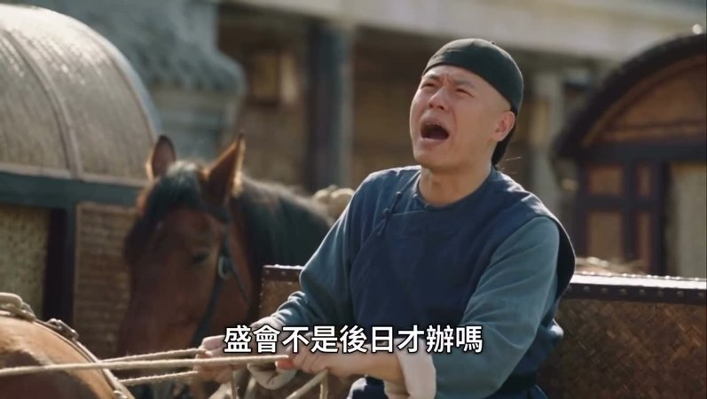

## TL;DR

- 影片用宮廷劇的選址、交通受阻和歸責情節改寫時事。創作者在影片開頭標示由 AI 製作及諷刺性質。本文分析敘事與字幕，劇情本身不能核實真實借用紀錄。
- Threads 版有華語音訊和燒進畫面的繁中字幕。創作者的 YouTube 版另有英文配音與英文自動字幕。對照兩版時，應依場景核對英文的時間與語意。
- 日後可複用兩種做法。用一個鏡頭交代決策、再用下一個場景呈現後果。交付雙語版本時，另做地名、角色與文化詞彙的對照表。

## 摘要（Summary）

風向株式會社於 2026-11-26 發布《仁愛路宮鬥戲》「順起來盛會」。Threads 分享文的時間為 2026-11-26 16:17 UTC，即台灣時間 11 月 27 日 00:17。檔名使用創作者 YouTube 上傳資料的日期。短劇先用宮廷人物談場地安排，再切換到遭遇交通阻礙的人、看公文的人以及追問消息來源的人。不同視角讓抽象爭論變成可以從畫面理解的情節。 [Threads 分享原文](https://www.threads.com/@politiciansong78/post/DgNg8oDozP5) · [創作者原片](https://www.youtube.com/watch?v=ZDdTdX9FHKQ)

## 關鍵洞察（Key Insights）

- **場景切換能讓後果具體可見。** 室內地圖呈現選址，街頭人物的日常行程讓觀眾理解提前封街在劇情中的影響。做其他題材時也能用「決策者視角 → 受影響者視角」交代因果。
- **公文道具支撐後半段的轉折。** 角色拿到文件後仍缺少關鍵資訊，片尾再用追問憑據回扣。道具承擔了敘事功能，也讓字幕中「文書寫了什麼」變得重要。
- **英文配音和字幕各有可能出錯。** 地名音譯、戲仿稱謂與反諷語氣尤其容易變形。翻譯後需逐段檢查是否保留人物的主張、懷疑或轉述身分。

## 詳細內容（Details）

### 中英場景對照

下表是依兩個版本整理的雙語摘要。中文與英文欄均為重述，時間是 Threads 版的約略起點。YouTube 連結可用來找相近場景，英文配音的換句點會有幾秒差異。

| 時間 | 華語場景摘要 | English scene summary |
| --- | --- | --- |
| [00:00](https://www.youtube.com/watch?v=ZDdTdX9FHKQ&t=0s) | 宮中報告某場地已有人借用，另一處已借到。主角質疑後者能否容納支持者。 | A court aide reports the venue options. The lead questions whether the available space is large enough. |
| [00:22](https://www.youtube.com/watch?v=ZDdTdX9FHKQ&t=22s) | 對外仍有人詢問原場地，主角先以另有安排回應。 | The lead hints at a different plan while others expect the original location. |
| [00:31](https://www.youtube.com/watch?v=ZDdTdX9FHKQ&t=31s) | 轉向仁愛大道。有人提醒提前搭台會影響通行。 | A broad avenue is selected. An aide anticipates disruption from early setup. |
| [00:46](https://www.youtube.com/watch?v=ZDdTdX9FHKQ&t=46s) | 街頭出現封路和受阻的人，直接呈現市民處境。 | The consequences are shown from the street, through residents trying to get home. |
| [00:59](https://www.youtube.com/watch?v=ZDdTdX9FHKQ&t=59s) | 官員收到交通回報，要求疏導並和主辦方商量。 | Officials hear that traffic is stuck and try to arrange relief. |
| [01:17](https://www.youtube.com/watch?v=ZDdTdX9FHKQ&t=77s) | 宮中下令撤台。不同角色對另一處場地借用者提出猜測，文書未能證實。 | The stage is ordered down. Characters suggest someone to blame, but the paperwork does not identify the borrower. |
| [01:44](https://www.youtube.com/watch?v=ZDdTdX9FHKQ&t=104s) | 主角宣布停辦。接下來的對話質疑把責任先歸給某人的做法。 | The event is canceled. A later exchange highlights the gap between suspicion and evidence. |
| [02:08](https://www.youtube.com/watch?v=ZDdTdX9FHKQ&t=128s) | 宮中肯定撤宴決定，提出改在宮裡見面。 | The court endorses the cancellation and proposes a meeting inside the palace. |
| [02:34](https://www.youtube.com/watch?v=ZDdTdX9FHKQ&t=154s) | 有人傳達替代場地可讓出，隨後遭回絕。 | An alternative venue is offered and then turned down. |
| [02:55](https://www.youtube.com/watch?v=ZDdTdX9FHKQ&t=175s) | 民間人物提出借用是否一致、是否能縮小搭台規模等疑問。 | Residents ask about the conflicting venue accounts and whether a smaller setup would have helped. |
| [03:29](https://www.youtube.com/watch?v=ZDdTdX9FHKQ&t=209s) | 群眾要求交代。一人追問證據，另一人表示自己只是聽說。 | The crowd demands answers. One person asks for proof, and another admits the claim is hearsay. |

### 字幕與語音來源

| 素材 | 取得方式 | 適用範圍 |
| --- | --- | --- |
| Threads 華語音訊 | 公開嵌入播放器取得 MP4，驗證 H.264／AAC 後抽取音訊，以本機 MLX Whisper 辨識 112 段。 | 用來找台詞發生時間。繁中畫面字幕可以校正同音錯字。 |
| Threads 繁中字幕 | 播放器未提供可下載字幕軌。每秒抽兩幀、用 Apple Vision OCR 擷取字幕區，整理成 106 段 VTT。 | 畫面擷取時間為約值。無字幕、交疊、模糊或小字可能漏讀，OCR 也可能讀到道具。 |
| YouTube 英文字幕 | 下載英文自動字幕 VTT，另存 115 段 API 資料。當時取得的 `en` 與 `en-orig` 內容相同。 | 自動字幕反映英文配音的辨識結果。平台上的繁中自動翻譯軌下載回傳 HTTP 429。 |
| YouTube 英文語音 | 下載獨立 `en-US` 音軌，以本機 MLX Whisper 產生 49 段。 | 英文是另一音軌，時間與措辭需對照。英文 ASR 和平台字幕相符的段落，仍有可能一起聽錯。 |

> [!note] 片尾的誤辨示例
> Threads 畫面在約 03:34 出現「可有憑據」，但英文機器文字輸出 *Peking Opera*。中文畫面和前後情節支持「追問證據」的解讀。英文音軌這一句實際如何配音，仍需人工重聽。前半段的「仁愛大道」也曾在華語辨識稿變成「人愛大道」，可用地圖鏡頭的字幕校正。

### 可直接用於下一支雙語影片

1. **在分鏡表加一欄「觀眾在本鏡頭知道什麼」。** 用畫面回答位置、人物、行動和後果，減少兩種配音都必須解說的句數。
2. **在配音前固定一份雙語詞表。** 至少記錄人名／稱謂、地名、重複出現的道具與關鍵語意。像「娘娘」可視語境譯為 *Your Ladyship*，名稱要在同一角色的所有字幕一致。
3. **以場景為單位對齊，再各自打字幕時間。** 保留同一場景 ID 及各語言起訖。同一場景在英文版仍使用英文音軌的時間，不假設起訖毫秒完全一樣。
4. **檢查最容易出問題的三種段落。** 抽查第一次出現的專名、同一房間的多人對話、片尾關鍵反轉。驗收看是否保留語意、說話人和字幕可讀性。

最小可重用記錄格式：

| 場景 ID | 原音範圍 | 英文音軌範圍 | 畫面證據 | 語意驗收 |
| --- | --- | --- | --- | --- |
| S01 | 各自填時間碼 | 各自填時間碼 | 角色、動作或可讀道具 | 兩版是否保留同一個行動、語氣與不確定性 |

## 我的心得（My Takeaways）

這個案例可以拿來練習「一個決策、一個可見後果」的剪輯。做雙語影片時，先試一段 30 秒，再檢查靜音看字幕和只聽音軌是否都能交代故事。測試用自己的內容與虛構角色，保留分鏡、音軌與字幕各自的修訂來源。

## 待補充（Open Questions）

- YouTube 英文配音由創作者製作、後製方提供，或由平台生成？搜尋 `YouTube multi audio track dub provenance`。
- 片尾的英文誤辨來自配音措辭、背景聲還是 ASR？搜尋 `verify dubbed audio against subtitles`。
- 固定字幕位置的 OCR 遇到雙行排版或跳動字幕時，抽樣率怎麼選？搜尋 `burned-in subtitle OCR temporal grouping`。
- 兩種配音長度差異過大時，要優先改譯文、延長鏡頭，還是改切點？搜尋 `AV translation dubbing isochrony`。

## 相關連結（Related）

- [[2026-04-04-AI-VIDEO-PROMPT-FORMULA-SIX-DIMENSIONS]]，把本片的場景轉折連到鏡頭、動作與節奏設計。
- [[2026-10-23-COLAB-MINIMAX-H3-VS-KIE-AI-SEEDANCE-2-5-PAID-AI-VIDEO-WORKFLOW]]，對照配音、參考音、分鏡與影片交付的驗收。
- [[2026-01-09-NEWTYPE-OS-MULTI-AGENT-CONTENT-PRODUCTION-ORCHESTRATION]]，延伸到腳本、素材、版本與發布的生產順序。

## 知識層次分析（Bloom's Taxonomy Analysis）

| 層次 | 對本片的應用 |
| --- | --- |
| 記憶 | 場景切換、燒錄字幕、語音辨識、英文配音及語意對齊。 |
| 理解 | 地圖交代決定，街頭鏡頭讓觀眾看見劇中影響，文書和片尾追問讓證據成為情節的一部分。 |
| 分析 | 畫面字和兩個英文辨識結果可以互相校對，但劇情仍無法驗證現實事件。 |
| 應用 | 建立一段 30 秒雙語樣片。製作雙語術語表，再檢查三處關鍵台詞。 |
| 評估 | 有官方字幕時可先保留原軌和來源。燒錄字幕適合 OCR 補取，遇到聽覺與畫面不一致則保留差異供覆核。 |

### 分析型追問（Socratic Follow-up）

- 片中「借到了」和「文書能證明借用者」分別表達什麼？
- 拿掉地圖鏡頭後，街頭段落還能讓觀眾看懂是哪個決策造成影響嗎？
- 哪三句英文配音最需要人重聽，依據是什麼？
- 只看英文的觀眾會如何理解人物的身分和語氣？
- 日後版本換了音軌，哪一份記錄能讓字幕編輯找到原來的查核依據？

### 方案批判三問

1. 若把字幕當實際音訊，會把誤辨或重述誤當引語。保留畫面、配音、作者字幕和 ASR 各自的來源。
2. 如果畫面字幕改位置或音軌重新剪輯，固定座標 OCR 和給定時間碼會失準。先檢查字幕區及兩個場景錨點。
3. 若只需讀懂故事，雙語場景摘要的查用成本低。若要做正式字幕，則需要逐句聽辨與分軌時間校對。

## 六頂思考帽回饋（Six Thinking Hats Feedback）

- **藍帽**：研究分鏡和雙語字幕的查用方式。
- **白帽**：兩個來源長度接近，提供不同音軌。字幕與配音尚未人工逐句核對。
- **紅帽**：宮廷和街頭的視角切換容易讓人記住後果。
- **黃帽**：反覆使用道具與稱謂，可讓多個短場景共用角色和情節資訊。
- **黑帽**：非等時英配、同音字或字幕漏讀會造成錯引。
- **綠帽**：用同一段素材製作兩版，一版保留稱謂、一版用情境譯法，再比可理解性。
- **藍帽**：保留原軌與時間碼。先用 30 秒做字幕驗收，再擴到整片。

## References

- [政客爽的 Threads 分享](https://www.threads.com/@politiciansong78/post/DgNg8oDozP5)。
- [風向株式會社原片《仁愛路宮鬥戲》](https://www.youtube.com/watch?v=ZDdTdX9FHKQ)，含英文音軌。
