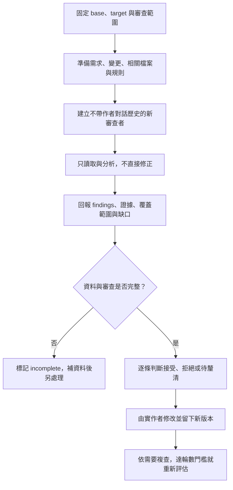

## TL;DR

- 你的「用 subagent 審查」有官方方法與公開實作可參考；**只說不要沿用上下文，不能證明對話歷史真的被排除**。要看新 session、一般 subagent、fork 或 resume 的啟動方式。
- 審查者需要需求、變更與專案規則。應排除作者先前的自我辯護，保留能判斷對錯的資料；空白上下文不是目標。
- 最通用的候選方法是：固定目標版本，另開審查者，交付中性的需求與變更，要求有證據的 findings，修正決策另做。
- `/review`、`/code-review`、自訂 prompt、headless 與跨模型審查是不同入口；headless 只代表非互動執行，不自動保證獨立上下文或唯讀。
- 本篇只整理文件、固定版本原始檔與他人經驗，未執行任何 review 方法。`gpt-6-astra`／`high` 文稿 review 已依使用者要求取消，保留未來待辦。

## 摘要（Summary）

[[2026-10-15-HOW-THE-CLAUDE-CODE-TEAM-DOES-CODE-REVIEW|前篇]]整理 Anthropic 的審查與發布制度；本篇回答實作問題：在 Codex 或 Claude Code 裡，要如何啟動審查、提供資料、限制範圍，以及閱讀結果？方法以跨專案可重用為目標，不依賴單一框架或特定業務案例。

閱讀順序：先看第 1 節的上下文辨識，再複製第 3 節的通用 prompt。偏好工具內建入口看第 4 節；需要腳本化看第 5 節；想比較別人的實際用法看第 6 節。

## 來源歸屬與驗證範圍

| 證據類型 | 本篇能說明什麼 | 本篇不能聲稱什麼 |
| --- | --- | --- |
| 官方文件 | 2026-10-26 查得的產品行為與命令介面 | 使用者安裝版本、帳號權限及實際執行必定相同 |
| 固定 commit 原始檔 | 該版本的參數、歷史載入路徑與公開流程設計 | 讀過原始檔等於在目標宿主驗證成功 |
| 具名公開使用回報 | 該發文者描述的做法、感受與困難 | 社群共識、客觀成效或模型能力排名 |
| Codex 整理與範本 | 把上述做法轉為通用操作格式 | 這是原作者的逐字 prompt，或已證明有效的最佳解 |

> [!important] 研究完成與方法驗證分開
> 本次沒有執行 `codex review`、`codex exec`、`claude -p`、`/code-review`、公開 helper 或 reviewer subagent，也沒有安裝本文提到的 skills。文件格式、連結與 Mermaid 檢查不算方法成效驗證。

## 關鍵洞察（Key Insights）

1. **上下文獨立是機制，審查中立還需要好的交接。** 即使啟動新 agent，主 agent 若把「這樣做一定正確」的結論寫進委派訊息，仍會影響審查。
2. **需求正確與實作正確要分開問。** 找 bug 的內建 review，不等於已檢查每條需求、範圍與專案規範。
3. **新 session、唯讀、版本固定是三個不同條件。** 新 session 仍可能讀到同一份正在改動的 working tree；唯讀 reviewer 也可能拿錯比較基線。
4. **零 findings 需要附範圍與缺口。** 讀取失敗、空 diff、缺規格或未跑完，都不能被整理成「沒問題」。

## 詳細內容（Details）

### 1. 「不要上下文」應拆成哪幾件事？

#### 1.1 你目前的方法有沒有根據？

**有來源支持這個方向，但尚未確認你的實際呼叫方式。** Anthropic 的 best practices 建議新上下文審查，也示範 Writer／Reviewer 兩個 session；Addy Osmani 的公開流程要求傳產物與契約，不傳作者一路推理的過程。這些支持「獨立看結果」的做法，沒有證明某句要求忘記前文的 prompt 能清除已載入的內容。[官方方法][claude-practices]、[Addy 原始檔][addy-doubt]

Codex 的整理是：把要求改成 **「建立新的審查者，只交付審查任務包」**。至於你的宿主實際建立了什麼、帶了哪些歷史，要等之後看呼叫與 session 紀錄，現在保持未驗證。

#### 1.2 幾種名稱相近，行為不同

| 入口或設定 | 查得的歷史行為 | 實務讀法 |
| --- | --- | --- |
| 同一對話說「忘記前面，重新審查」 | 這是對模型的指示，沒有因此刪除歷史的產品證據 | 可以要求換角度，不能當成上下文隔離證明 |
| Claude 一般新 subagent | 文件說不接收父對話歷史；接收委派訊息，並可能載入專案規則、skills 等 | 主 agent 應提供完整而中性的審查資料 |
| Claude conversation fork | 文件說繼承整段對話 | 適合接續工作；不能當成獨立於作者對話的審查 |
| Claude skill 的 `context: fork` | 文件特別澄清：**與 conversation fork 不同**，新 subagent 不看原對話歷史 | 不能只看到 `fork` 一字就判斷有無歷史 |
| Codex 一般 spawn | 查核版本的 `fork_context` 決定是否採完整歷史；省略時布林值預設為 false | 這是該工具協定的欄位，不是通用 CLI 旗標 |
| Codex CLI 專用 review | 官方說啟動專用 reviewer；查核原始檔傳入 `initial_history: None` | 支持該路徑沒有沿用父對話歷史；不外推至所有 Codex 宿主與版本 |
| resume 或繼續既有 reviewer | 原有歷史可繼續存在 | 有助增量複查，與全新獨立首輪不同 |

來源：[Claude 啟動內容與 fork][claude-agents]、[Claude skill 的特殊語意][claude-skills]、[Codex spawn 原始檔][codex-spawn]、[Codex review 原始檔][codex-review-source]。

新 subagent 仍有系統指令、工作目錄、工具權限及專案資料。**不接收父對話歷史，不等於完全沒有上下文，也不等於已消除模型偏誤。** Claude 的一般 subagent 與 fork、Codex 的權限／skills 繼承，也不能直接混成一套設定。

#### 1.3 四個邊界要分開記錄

| 邊界 | 要交代的事 | 不能由什麼代替 |
| --- | --- | --- |
| 對話 | 新 thread、一般 subagent，還是 fork／resume？ | 「請客觀一點」的措辭 |
| 輸入 | 需求、diff、相關檔案、規則是否齊全？ | 把所有內容都拿掉 |
| 版本 | 哪個 base、哪個 target？包含哪些未提交檔？ | 只有分支名稱、沒有本次範圍說明 |
| 權限 | 工具可否寫入、執行命令、對外發文？ | prompt 裡一句「不要修改」 |

### 2. 最通用的候選操作流程

以下為 **Codex 依來源整理的候選流程，尚未實測**。

1. **固定範圍**：一個 commit、已提交分支差異，或包含 staged／unstaged／untracked 的本機候選；寫清楚，不混用。
2. **組審查任務包**：目標版本、需求來源、變更內容、相關程式入口、適用規則與限制。
3. **另開審查者**：新 session 或不繼承歷史的新 subagent；不要把作者的自我背書當作需求交給它。
4. **先審查，後決定修正**：輸出 findings、證據、範圍及未檢查項目，先不讓 reviewer 自動修改。
5. **逐條處理**：接受、拒絕並說明、需要補資料。必要時針對新版本複查，設定停止或升級條件。



圖為流程設計，非實際執行 trace。對未提交變更，另一個 session 開著時，實作者若繼續寫檔，reviewer 看到的內容也可能改變；新對話並不會自動凍結 working tree。

> [!note] `git diff` 的範圍容易漏東西
> `git diff BASE...HEAD` 看的是已提交差異；`git diff HEAD` 不會自動包含 untracked 新檔。原生 reviewer 與自行準備 diff 的範圍也可能不同。公開 autoreview helper 明確區分 local、branch、commit；可以借用這種分法，而不必採用該工具。[範圍來源][autoreview]

### 3. 可貼給任何 coding agent 的審查 prompt

以下是 **Codex 改寫的通用範本**，不是任何作者的逐字 prompt，也沒有執行驗證。先替換方括號欄位。提供需求與變更，不貼整段實作聊天紀錄。

```text
目標：獨立審查指定變更是否符合需求，以及是否引入實質問題。

審查目標：[repository／目錄]
比較基線：[BASE SHA 或明確比較點]
目標版本：[TARGET SHA；若是未提交變更，列出其範圍]
變更資料：[diff 檔案、已固定的來源，或可使用的比較方式]
需求來源：[spec／issue／驗收條件；沒有就明列沒有]
適用規則：[專案規範與相關文件路徑]
允許執行驗證：否。本輪只讀取與分析。

請建立一個不繼承實作者對話歷史的新 reviewer。
若宿主無法確認是否排除歷史，請明說，不要宣稱已隔離。
只向 reviewer 交付上述資料與以下審查目標，不轉述作者的自我背書。

檢查需求遺漏、錯誤行為、回歸、介面契約、安全邊界，
以及改動對相關呼叫端與資料流的影響。
可閱讀必要的周邊程式與測試，不能只憑命名猜測。
把規格違反、實質 bug、可選設計建議分開。
不要強求固定數量的問題，不為湊 findings 提出風格偏好。

每項 finding 請列：
- 優先程度與問題摘要
- 檔案及行號
- 觸發條件、影響與支持證據
- 是靜態推導、已執行確認，還是待釐清的假設

最後列出實際審查範圍、缺少的資料與未執行的檢查。
找不到問題時明說；資料不足或沒審完時標記 incomplete。
本輪只回報，不修改檔案、不提交、不對外發文。
```

**新開的獨立 session 版本**：已經由你另開新 session 時，將「請建立 reviewer」那一段改成「你就是 reviewer，直接按本任務包審查」。這避免為了套範本又多派一層 agent。若沒有規格，仍可找 bug，但不要宣稱完成了需求符合性審查。

範本的設計參考官方 Writer／Reviewer、新上下文審查、Matt 的規範／需求分離，以及 Addy 的產物＋契約交接。它的效果仍待之後比較。[官方方法][claude-practices]、[Matt][matt-review]、[Addy][addy-doubt]

### 4. 使用內建 review：少寫流程，但仍要選對範圍

#### 4.1 Codex CLI 的 `/review`

官方列出四種入口：基準分支、未提交變更、特定 commit、自訂審查指示；專用 reviewer 回報依優先程度排列的發現，文件說不修改 working tree。未提交模式包含 staged、unstaged 與 untracked。[官方文件][codex-review-doc]

固定原始檔也有非互動命令；以下是**文件與靜態參數宣告對照出的示例，未在本機執行**，擇一使用並換成實際目標：

```bash
codex review --base origin/main
```

```bash
codex review --uncommitted
```

```bash
codex review --commit TARGET_SHA
```

查核版本把明確 Git target 與自訂 prompt 設為互斥；不要自行拼成 `codex review --base origin/main "額外規則"`。需要完整自訂任務包時，可參考下一節的 `codex exec` 路徑。這是版本相關限制，日後應重新讀對應版本的介面。[參數原始檔][codex-review-args]

#### 4.2 Claude Code 的本機 `/code-review`

2026-10-26 的本機審查文件說，指令在自己的 session 啟動背景 subagent，另有自己的上下文；目標可以是分支、範圍、PR 或路徑：

```text
/code-review
/code-review main...my-feature
/code-review HEAD~3..HEAD
```

這些是可選示例，未執行。該文件將 `/review` 列為別名，並說明舊版本不同；外掛或自訂同名 skill 也不能僅憑名稱認作內建行為。審查-only 用法先不加 `--fix` 或 `--comment`，把修正與對外發布留給後續決策。

**指令檔也有差別**：目前文件說本機 `/code-review` 遵循 `CLAUDE.md`，不讀服務專用的 `REVIEW.md`；GitHub 上的 managed Code Review 是另一個產品入口。不能把前篇的內部制度、服務與本機指令混為一談。[本機文件][claude-local]

### 5. Headless：把同一種任務交付自動化

Headless 是傳遞任務的方式。它不自動代表換模型、清空專案規則或限制寫入。新執行不加 resume／continue，可以避開接續既有聊天；仍需交代啟動時載入的設定。[Codex][codex-headless]、[Claude][claude-headless]

#### 5.1 自訂 Codex 審查任務包

先將第 3 節的已填寫 prompt、必要 diff 與來源路徑整理到 `/tmp/review-request.txt`。以下為 **Codex 依官方介面組合的候選命令，未執行**：

```bash
codex exec --sandbox read-only --ephemeral \
  --output-last-message /tmp/codex-review.md - \
  < /tmp/review-request.txt
```

`--sandbox read-only` 是權限設定；`--ephemeral` 控制 rollout 的磁碟保存，不能把它解釋為清除所有設定或規則。不要加 `resume` 來接續實作者的舊 session。CLI 支援從 stdin 讀完整 prompt，省去把程式碼塞進 shell 字串的問題。[官方非互動文件][codex-headless]

#### 5.2 Claude 的內建指令與自訂 prompt 兩條路

沿用本機內建審查的候選例子：

```bash
claude -p "/code-review main...my-feature" \
  --output-format json > /tmp/claude-native-review.json
```

若要自己定義審查契約，並事先把 diff 放入任務包，可用下列 **未執行範本**：

```bash
claude -p "Review the request supplied on stdin. Report findings only." \
  --tools "Read,Glob,Grep" \
  --disallowedTools "mcp__*" \
  --output-format json \
  < /tmp/review-request.txt > /tmp/claude-review.json
```

這個自訂版本沒有提供 Bash，所以 Git diff 要先納入任務包；它仍可讀相關來源。`--tools` 限制內建工具清單，`--allowedTools` 是預先允許某些工具，不是同一種限制；MCP 工具另受其設定控制。這組參數也不證明啟動 hooks 或所有宿主層行為都被隔離。[CLI 參考][claude-cli]

一般 `claude -p` 仍會載入專案／使用者設定。官方另提供 `--bare` 跳過多種自動載入，但也會略過有用的專案規則，而且有不同的驗證與登入條件；不把它當成通用審查的預設值。`--no-session-persistence` 只控制 session 保存，也不是忘記前文的魔法開關。[非互動文件][claude-headless]

### 6. 別人公開怎麼做？

以下是**具名來源與公開流程的小樣本**，不能稱為整個社群的共識。流程設計、使用自述與成效實驗分開看。

| 誰／來源類型 | 公開做法 | 可借用之處 | 限制與證據 |
| --- | --- | --- | --- |
| Anthropic 官方方法文件 | Writer 與 Reviewer 用不同 session，或在新 subagent 查 diff 與指定標準 | 把獨立審查做成明確步驟 | 官方建議，不是使用者環境的實測。[來源][claude-practices] |
| Matt Pocock／公開 skill 原始檔 | 固定比較點；Standards 與 Spec 各交一個並行 subagent，分別回報 | 需求遺漏不會被風格意見淹沒；沒有 spec 就明說跳過 | 方法要求有需求與規範來源，並非只有兩個 agent 就足夠。[來源][matt-review] |
| Addy Osmani／公開 skill 原始檔 | 用產物＋契約交付新上下文，拿掉作者的結論；逐條調和發現，最多三個 cycle 後升級處理 | 新 reviewer 也可能因缺資料而誤判；不能照單全收 | 這是作者設計的流程；本文未驗證成效，也未套用其安裝或互動政策。[來源][addy-doubt] |
| Peter 的 agent-scripts 所指向的 OpenClaw 共用 autoreview | 明確區分 local／branch／commit，提供必要未改動檔案，驗證報告完整性與狀態 | 固定資料、記錄覆蓋範圍；不完整不能當作 clean | 查的是 canonical helper，不採用二手轉述的無限重跑說法。未安裝或執行。[入口][peter-entry]、[來源][autoreview] |
| Reddit `u/Substantial_Wheel909`／本人使用自述 | Claude 實作，交 Codex 審查，再由 Claude 修正；認為有幫助，也說審查慢 | 可把作者與 reviewer 分到不同工具 | 貼文使用較早模型；沒有對照實驗。對自己交付了多少 repo context 也不確定，不能當隔離證明。[來源][reddit-hybrid] |
| Reddit `u/johnmaytokes`／本人使用自述 | 短版入口檔指向 repo 內規則，以書面任務交接；新 reviewer 對照計畫，避免反覆人工搬運訊息 | 用文件延續需求，減少將整段聊天交出去 | 這是 homelab 經驗；同討論的 `u/_vorex` 也回報來回管理、遺漏商業規則及回歸等困難。[來源][reddit-workflow] |

Peter 的入口在查核版本是指向共用來源的連結，因此不能把舊入口、某個轉載或目前 helper 的細節混為一版。現在的來源明列：`scoped-clean` 只涵蓋選定目標與優先範圍，`filtered` 不等於 clean；缺上下文或未完成要保留狀態，不能只看 exit code。這些設計可借鏡，不代表其他工具也使用相同狀態契約。

#### 跨模型審查值得試，但不先指定永遠的贏家

社群有正面自述，也有額外管理成本的回報。另有 Xiang 等人於 2026-07 的研究摘要，在 116 個程式解題任務、reviewer 不能執行測試的條件下，報告不同模型順序有不對稱結果。這與真實 repo／當前版本不同；本篇僅將其作為反例提醒，未重現實驗，也不據此選定長期最佳順序。[研究摘要][cross-model-paper]

### 7. 把流程包成自訂 agent，還是只用 prompt？

先用 prompt 能較清楚地看到本輪交付了什麼；要反覆使用相同角色，才考慮設定檔。以下是 **Claude 官方格式加上 Codex 自編內容的候選範本，沒有安裝**。可以存成 `.claude/agents/independent-reviewer.md`：

```markdown
---
name: independent-reviewer
description: Reviews a fixed change against supplied requirements and project rules.
tools: Read, Grep, Glob
model: inherit
---

Read the supplied review request, diff, and necessary source files.
Report actionable defects and requirement gaps with file/line evidence.
Separate confirmed static reasoning from hypotheses and unexecuted checks.
Do not force a finding count. State missing context and incomplete coverage.
Report only; do not edit files or publish comments.
```

這個角色沒有 Bash，因此呼叫時要提供已準備的 diff 或任務包。它有自己的系統指令與專案規則，仍不能稱為零上下文。Codex 的自訂 agent 使用不同格式與繼承規則；最通用的部分是任務契約，不是跨工具複製同一份 frontmatter。[Claude 格式][claude-agents]、[Codex agent 文件][codex-agents]

### 8. 先看結果，再決定是否修改

這是從前篇、Addy 與 autoreview 設計整理出的 **Codex 建議輸出契約**：

| 欄位 | 為什麼要有 |
| --- | --- |
| Scope | 知道實際看了哪個版本、檔案及範圍 |
| Findings | 具體位置、觸發條件、影響與證據 |
| Requirement gaps | 沒完成的需求，與一般 bug 分開 |
| Uncertainties | 缺資料、靜態推論與尚未確認的假設 |
| Checks performed | 只列真的執行過的檢查；本篇候選 prompt 預設不執行 |
| Completion state | 完成、找不到實質問題，或 incomplete |

若雙軸或多 agent 審查，也要先去除重複與明顯錯誤，再決定處理。Matt 的原設計刻意分開 Standards／Spec 報告，不把其中一軸的通過當作另一軸也通過。不要為了讓 reviewer 滿意，就持續增加需求之外的抽象或防禦分支。

## 我的心得（My Takeaways）

以下為 Codex 的整理建議，還不是驗證結論：對你的使用方式，最值得先固定的是**審查任務包與輸出格式**。同一份需求、同一個版本與同一種報告要求，才能比較 subagent、內建 review 或另一個 headless session 的差異。

目前無法回答「你先前那句不要上下文是否有效」，因為還沒檢視實際呼叫與輸入。能回答的是：一般 fresh subagent 有產品機制可依據，單句要求忘記歷史則不足以證明隔離；而完全不給需求也會讓 reviewer 更容易誤判。

與 [[2026-09-06-CODEX-CLI-VS-CLAUDE-CODE-AUTOMATION-CHEAT-SHEET|CLI 自動化速查表]]及 [[2026-10-03-CODEX-PRACTICAL-WORKFLOWS-CONTEXT-CACHING-SKILLS-AND-TOOLS|Codex 工作流程專篇]]一起使用時，保留三個分界：啟動方式、載入資訊、可用權限。它們各自影響行為。

## 後續驗證待辦：尚未執行

### A. 文稿的獨立模型 review

使用者先提出，後明確取消本次執行，改為之後再做。**本次沒有啟動 reviewer。**

| 項目 | 預定設定／狀態 |
| --- | --- |
| 模型 | `gpt-6-astra`；保留使用者指定，不自行換模型 |
| Reasoning effort | `high` |
| Session | 新建獨立 thread；不傳父對話、研究推理、作者自我評語或先前 findings |
| 輸入 | 只給這篇文章的路徑與審查目標；讓 reviewer 自行閱讀文章及其中來源 |
| 目標 | 檢查事實、通用性、來源歸屬、命令示意與未被支持的結論；不執行文中方法 |
| 狀態 | `cancelled-not-started`；模型帳號可用性與實際啟動設定尚未驗證 |

預備目標文字如下，**未送出**：

```text
審查這篇文章是否能準確、通用且可追溯地指導 Codex／Claude Code
使用者進行程式碼審查。自行閱讀指定文章與其中來源，找出事實錯誤、
未被支持的結論、混淆的產品機制及有問題的命令示意。
只回報附文章行號與來源證據的問題、未能確認的項目及審查範圍。
不修改檔案，不執行文章中的審查方法。
文章路徑：[本篇 Markdown 的絕對路徑]
```

### B. 方法成效的後續比較

以下是未執行的候選設計：固定同一份需求、同一個變更版本、已知缺陷與乾淨對照；比較新 session、新 subagent、原生 review，以及必要時的跨模型路徑。記錄實質缺陷、誤報、缺需求、時間、token 與回合數；不能只比較哪個模型留的留言多。

此處把「文稿品質 review」與「方法成效驗證」拆成兩個待辦。即使文稿日後通過獨立審查，也不代表文中的方法已實測有效。

## 待補充（Open Questions）

1. 使用者原本的 subagent 呼叫究竟有沒有繼承父歷史？宿主是否能顯示委派內容與歷史載入方式？建議搜尋：`Codex fork_context Claude subagent startup transcript`。
2. 相同任務下，fresh session、新 subagent 與內建 reviewer 的缺陷召回及誤報有何差異？建議搜尋：`fresh context code review controlled evaluation false positives`。
3. 同一個已知缺陷，在只給 diff 與加入必要未改動檔案時，偵測結果有何改變？建議搜尋：`code review diff context cross file dependency evaluation`。
4. 雙軸審查在真實需求上是否增加有效發現，或只增加風格與維護建議？建議搜尋：`spec compliance standards multi agent review evaluation`。
5. 什麼情況值得使用不同模型第二意見？品質改善能否抵銷成本與協調負擔？建議搜尋：`cross model code review order cost latency repository benchmark`。
6. 本機產品版本更新後，上下文、內建指令與 tool restriction 是否仍符合本文快照？建議搜尋：`Claude Code code-review context fork Codex review release notes`。

## 相關連結（Related）

- [[2026-10-15-HOW-THE-CLAUDE-CODE-TEAM-DOES-CODE-REVIEW]]：制度與理論主篇；本篇補可操作的方法候選與他人經驗。
- [[2026-09-06-CODEX-CLI-VS-CLAUDE-CODE-AUTOMATION-CHEAT-SHEET]]：對照非互動介面、權限與 session 管理；各版本仍需查核。
- [[2026-10-03-CODEX-PRACTICAL-WORKFLOWS-CONTEXT-CACHING-SKILLS-AND-TOOLS]]：連接上下文、交接、工具與可追溯的交付證據。

## 知識層次分析（Bloom's Taxonomy Analysis）

| 認知層次 | 核心目的 | 對本文的具體應用 |
| --- | --- | --- |
| 記憶 | 辨識操作與名詞 | 新 session、一般 subagent、conversation fork、skill `context: fork`、headless、固定比較點 |
| 理解 | 說清機制差異 | 分別解釋對話歷史、任務輸入、檔案版本與工具權限；headless 不決定其餘三者 |
| 分析 | 檢驗來源與主張 | 區分官方宣告、固定 source path、社群自述與建議；找出從「另一個 agent」跳到「更可靠」的證據缺口 |
| 應用 | 準備後續可做的工作 | 寫出一份具體審查任務包；把需求與規範分列；保存可比較的 findings 格式。這些是建議，並未代替方法驗證 |
| 評估 | 決定投入與取捨 | 簡單變更先考慮單一 reviewer；只有範圍可分及成本合理時再比較雙軸或跨模型，不先假定代理數越多越好 |

### 分析型追問（Socratic Follow-up）

- **澄清**：你說的無上下文，是沒有作者聊天，還是連需求、規則、舊介面也沒有？
- **假設**：如果需求只存在父對話，拿掉歷史後要用什麼讓 reviewer 判斷需求遺漏？
- **證據**：哪些記錄能證明此次啟動的是新 reviewer，而不是 resume 或完整歷史 fork？
- **觀點**：站在維護者立場，哪些 findings 真正需要修改，哪些只是 reviewer 的設計偏好？
- **後果**：若每個小改動都多跑幾個模型，長期增加的是有效防護，還是成本與協調工作？

### 方案批判三問（Critical Evaluation）

1. **最大的風險是什麼？** 把上下文不足或沒有完成審查的結果當成 clean，或因為第二個模型說要改，就改壞正確程式。
2. **什麼情況下會失敗？** 目標持續變動、比較點錯誤、漏掉 untracked 檔、缺需求、繼承作者結論，或授予了超出審查所需的能力。
3. **有沒有更好的替代方案？** 小變更可以先用單一獨立 session 配合既有機械檢查；高風險變更則應保留人工與可執行驗證。多 agent 或跨模型是可比較的候選，不是通用必要條件。

## 六頂思考帽回饋（Six Thinking Hats Feedback）

### 藍帽：問題與範圍

把「如何啟動一個通用 reviewer」寫清楚，先保存可追溯候選方法。本次不實測、不安裝、不啟動 reviewer。

### 白帽：事實與未知資訊

已有官方文件、三套具名公開流程、社群使用與困難回報、Codex 固定 source path。未知的是使用者實際啟動紀錄與各方法在同一任務上的效果。

### 紅帽：直覺與讀者反應

「再找一個 agent 看」容易帶來安心感；大量新意見也可能造成焦慮。這是可能的讀者感受，不能當成可靠度指標。

### 黃帽：價值與可保留內容

通用任務包可跨工具重用，能保留需求又減少傳遞作者的自我背書；固定輸出也有利於之後比較。

### 黑帽：風險與限制

官方介面會變動，原始檔不是 runtime 證據；社群樣本有限且常涉及舊模型。隔離歷史不代表消除相同模型的盲點。

### 綠帽：替代方案與新應用

可把同一份需求與固定 diff 交給不同入口，先只比較靜態 findings；再另開可執行驗證階段確認具體問題，避免把兩種能力混成一個分數。

### 藍帽：修改項目與下一步

1. 先保存本文候選 prompt 與來源，不立即導入全部工具。
2. 日後另行啟動使用者指定的 `gpt-6-astra`／`high` 文稿 review。
3. 文稿與方法成效分開驗證，保留成功、失敗與未完成狀態。

## References

- [Claude Code best practices][claude-practices]：Writer／Reviewer、fresh-context review 與範圍限制。
- [Claude subagents][claude-agents]：啟動內容、resume 與完整歷史 fork。
- [Claude skills][claude-skills]：`context: fork` 與 conversation fork 的區別。
- [Claude 本機 Code Review][claude-local]：本機入口、目標、修正／發文選項及指令檔差異。
- [Claude headless][claude-headless]、[CLI reference][claude-cli]：非互動、工具與 session 參數。
- [Codex Code Review][codex-review-doc]、[非互動模式][codex-headless]、[subagents][codex-agents]：官方介面與概念。
- [Codex spawn][codex-spawn]、[review task][codex-review-source]、[review CLI args][codex-review-args]：固定 `970111f6cb62cc02fe36a82ea7d71b37a2889c97`，僅靜態檢查。
- [Matt code-review][matt-review]：固定 `5beb35b040e3de97e54fa9e386d7e42d15c295c2`。
- [Addy doubt-driven-development][addy-doubt]：固定 `aeac41d4d005999432bb7312f7ff06383a91d59d`。
- [Peter 的入口][peter-entry]、[OpenClaw autoreview][autoreview]：分別固定 `1159adf26ad007df38b87debb107d3946008d38b`、`3b7f365f91c5e7f31ae9825a641775d393cbc654`。
- [Reddit 混合工具使用回報][reddit-hybrid]、[Reddit 工作流程與困難討論][reddit-workflow]：具名帳號自述，非受控測試；由搜尋工具讀取公開頁面，直接瀏覽器存取另遇網路封鎖。
- [Cross-Model LLM Code Review][cross-model-paper]：Xiang 等人，2026-07-22；本文只引用摘要層級的實驗範圍與順序限制，未重現研究。

[claude-practices]: https://code.claude.com/docs/en/best-practices#run-multiple-claude-sessions
[claude-agents]: https://code.claude.com/docs/en/sub-agents#what-loads-at-startup
[claude-skills]: https://code.claude.com/docs/en/skills#run-skills-in-a-subagent
[claude-local]: https://code.claude.com/docs/en/code-review-local
[claude-headless]: https://code.claude.com/docs/en/headless
[claude-cli]: https://code.claude.com/docs/en/cli-reference
[codex-review-doc]: https://learn.chatgpt.com/docs/code-review?surface=cli
[codex-headless]: https://learn.chatgpt.com/docs/non-interactive-mode
[codex-agents]: https://learn.chatgpt.com/docs/agent-configuration/subagents
[codex-spawn]: https://github.com/openai/codex/blob/970111f6cb62cc02fe36a82ea7d71b37a2889c97/codex-rs/core/src/tools/handlers/multi_agents/spawn.rs#L100-L112
[codex-review-source]: https://github.com/openai/codex/blob/970111f6cb62cc02fe36a82ea7d71b37a2889c97/codex-rs/core/src/tasks/review.rs#L132-L145
[codex-review-args]: https://github.com/openai/codex/blob/970111f6cb62cc02fe36a82ea7d71b37a2889c97/codex-rs/exec/src/cli.rs#L296-L330
[matt-review]: https://github.com/mattpocock/skills/blob/5beb35b040e3de97e54fa9e386d7e42d15c295c2/skills/engineering/code-review/SKILL.md
[addy-doubt]: https://github.com/addyosmani/agent-skills/blob/aeac41d4d005999432bb7312f7ff06383a91d59d/skills/doubt-driven-development/SKILL.md
[peter-entry]: https://github.com/steipete/agent-scripts/blob/1159adf26ad007df38b87debb107d3946008d38b/skills/autoreview
[autoreview]: https://github.com/openclaw/agent-skills/blob/3b7f365f91c5e7f31ae9825a641775d393cbc654/skills/autoreview/SKILL.md
[reddit-hybrid]: https://www.reddit.com/r/ClaudeCode/comments/1qfu7ga/claude_code_codex_is_really_good/
[reddit-workflow]: https://www.reddit.com/r/codex/comments/1wyzbib/claude_code_codex_users_what_does_your_actual/
[cross-model-paper]: https://arxiv.org/abs/2607.21656
