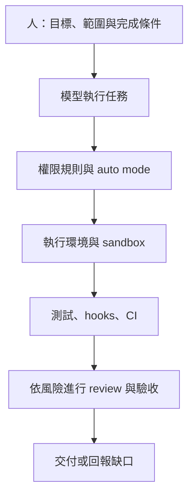

## TL;DR

- Anthropic 的 Lydia Hallie 認為模型能力變強後，開發者可以減少逐步引導，把注意力移到任務目標、執行邊界與可檢查的結果。
- 安全分層：auto mode 分類操作；deny 規則限制指定工具行為；sandbox 約束 shell 及子程序；雲端環境減少本機資料暴露。每層都有範圍與限制。
- 驗證分層：寫清完成條件，適時用 hooks 強制檢查，再用 CI 和依風險配置的 review 檢查交付。測試通過不自動代表需求正確。
- 兩片是同一場演講及中文整理；本文補充官方文件中的事件差異與環境限制。目前未在 Claude Code 實測操作、權限或成效。

## 摘要（Summary）

[AI Engineer 原講](https://www.youtube.com/watch?v=vlfCjWuv4es)由 Anthropic Claude Code 團隊 Lydia Hallie 主講；[AI懶人報中文版](https://www.youtube.com/watch?v=-m3yj9YLmxs)以四段說明設定、安全、驗證和多工。兩支影片共同回答：**當 agent 可以持續工作數小時，哪些原本由人做的控制工作，必須由模型、工具與環境接手？**

英文字幕 528 段、由 YouTube 自動生成；中文字幕 146 段，API 標記非自動生成。中文影片穿插原講，字幕並不涵蓋所有插入片段。兩份字幕未逐句人工核對；模型名稱等專有名詞依來源上下文處理。本文同時參考 Anthropic 官方文件，文件可能隨版本變化。

## 關鍵洞察（Key Insights）

1. **把意圖寫清楚，並保留模型無法自行發現的資訊。** 講者建議縮短 `CLAUDE.md`，例如保留程式碼沒有直接顯示的舊系統依賴。
2. **可建議的行為與必須執行的約束不同。** Prompt 有助引導；permissions、sandbox、hooks 與 CI 對不同範圍建立可檢查的邊界。
3. **多工使驗收與協調更重要。** 隔離工作目錄可降低互相覆寫，但需求、衝突、整合測試和外部副作用仍需要管理。
4. **先交代哪些說法是誰的。** 演講中的能力、效率及內部審查方式是講者分享；官方文件說明介面；本文範例是整理建議，沒有做執行驗證。

## 詳細內容（Details）

### 一、同一項工作，責任移到哪裡？

| 原本常見的人工作業 | 講者提出的方向 | 仍要關注什麼 |
| --- | --- | --- |
| 中途反覆提醒、調整方向 | 給模型清楚目標，縮減冗餘指引 | 需求、假設、優先順序與是否符合使用者意圖 |
| 每個動作按允許 | auto mode 作分類判斷 | 分類器會出錯；決定哪些行為需要硬性約束 |
| 防止危險動作 | deny 規則、sandbox、環境隔離 | 各工具涵蓋範圍、設定和未受約束的路徑 |
| 檢查每個變更 | 測試、hooks、CI 與 review | 驗收標準是否涵蓋真正需求，失敗訊號是否可見 |
| 自己開多個 session | 使用多 session 或 Projects 協調 | 任務分工、版本固定、結果整合及成本 |

這是本文整理的概念圖，實際順序與攔截位置依工具、設定、事件與版本而定。

### 二、指引：讓 agent 看見程式碼看不到的事

Lydia 提到過去因模型表現而加入大量強調詞或反覆提醒，較新的模型可能因此產生多餘操作。她建議 `CLAUDE.md` 優先放非顯而易見的專案事實，例如：程式碼未直接指向、仍須支援的舊版來源。她提到 `/doctor prompt-audit` 可協助檢視設定；實際可用性以目前安裝版本為準。

中文片將這點簡化成「只寫程式碼看不到的」。本文建議把它當精簡原則：專案真正需要的驗收、權責與特殊指令仍應保留，先確認效果再移除。這不是要刪掉所有 `AGENTS.md`、skills 或既有規範。

### 三、安全：分清四個控制層

| 層 | 作用 | 邊界與例子 |
| --- | --- | --- |
| Prompt／`CLAUDE.md` | 表達偏好、背景與任務意圖 | 模型可能未遵守；不能單靠文字證明安全 |
| permissions／deny | 在工具行為進入分類前，阻擋符合規則的動作 | 規則必須正確匹配實際工具與路徑；見[官方 auto mode 文件](https://code.claude.com/docs/en/auto-mode-config) |
| auto mode | 對操作提供自動判斷，減少逐項確認 | 不是完美判斷；是否可用、預設及判斷範圍依版本與環境而異 |
| sandbox／雲端 | 從程序、檔案系統、網路或整個執行環境建立限制 | 必須核對設定與實際執行方式；雲端對外寫入仍有真實副作用 |

原講引用一項 Anthropic 評估，說特定危險命令中人員抓到約 14%，auto mode 擋下約 89%。這是講者對特定研究的摘要，不能外推成所有任務的失誤率；本文未獨立重做研究。

#### 為什麼 `npm test` 仍可能有副作用？

工具權限檢查看到的可能只是啟動測試，但測試會執行專案與相依套件程式碼。單靠對工具呼叫的核准，不足以描述子程序能存取的檔案與網路。Lydia 用這個例子解釋為何需要執行環境的限制，而不是把每個測試都視為無害。

[官方 sandbox 文件](https://code.claude.com/docs/en/sandboxing)說明：sandbox 主要包住 shell 命令與其子程序；內建檔案／網頁工具、hooks、MCP servers 等在此 shell sandbox 之外，須依各自權限與部署環境處理。環境變數可能繼承；可排除命令或允許 sandbox 外重試的設定，也會改變實際邊界。不能只因開啟 `/sandbox` 就宣稱整個 session 都被隔離。

#### 雲端 session

講者描述雲端 session 使用獨立環境與 repo 複本，讓本機未提交的密鑰及資料不必自動出現在環境中。官方[雲端文件](https://code.claude.com/docs/en/claude-code-on-the-web)說明託管環境的 network secrets 等機制；實際憑證、網域與存取範圍取決於設定與環境。推送 commit 或透過 connector 執行外部動作後，影響不會因機器可丟棄而消失。

### 四、驗證：從需求到可觀察結果

講者以登入 API 遷移為例：相同任務可能只遷移新登入、遺留舊 API，或意外讓既有使用者登出。先寫清楚預期行為，才能選擇檢查點。

| 檢查點 | 可回答的問題 | 仍不能證明什麼 |
| --- | --- | --- |
| 測試與 build | 特定可執行案例是否通過 | 沒有涵蓋的需求、真實部署與使用體驗 |
| 截圖與視覺檢查 | 指定畫面是否能讀、布局是否正常 | 所有螢幕、互動與效能都正確 |
| Hook | 某個事件發生時能否啟動特定檢查或回饋 | 檢查內容本身足夠完整 |
| CI | 提交後是否執行團隊設定的共同檢查 | CI 外的產品決策與所有真實情境 |
| Review | 需求、風險與變更是否值得接受 | 必然找出全部缺陷 |

給 agent 的任務可以包含：目標、不可改變行為、受影響範圍、具體完成條件、要執行的驗證及要求回報實際輸出。這是本文的通用整理，可接回 [[2026-10-21-MATT-POCOCK-SKILLS-V-MODEL-WORKFLOW-MAPPING|需求與 V-model 驗證]]。

#### Hook 的 `exit code 2` 不只一種效果

原講提醒驗證腳本不能只把測試原本的失敗碼直接當成會阻止完成的訊號。[官方 hooks 文件](https://code.claude.com/docs/en/hooks)說明 `exit code 2` 的效果依事件而異：

- `PreToolUse` 可阻止尚未執行的工具呼叫。
- `PostToolUse` 發生在工具已執行之後；不能撤銷該動作，stderr 提供模型回饋。
- `Stop`、`TaskCompleted` 等事件可在適用條件下讓 agent 繼續工作；官方文件也記載部分錯誤會被視為非阻擋。
- `Stop` 不會因使用者中斷而執行；官方建議檢查 `stop_hook_active` 等訊號，避免無法解決的反覆阻擋。

所以「測試失敗就 `exit 2`」要連同**hook 事件、stderr、執行位置、錯誤處理與退出條件**一起設計，並在自己的版本驗證。本文沒有安裝或執行 hook。

### 五、多工與 review：加速前先準備什麼？

Lydia 描述多個雲端 session 可各自在不同環境工作；CI 對提交執行共同檢查，Auto-fix 可回應部分失敗。她提到團隊依風險決定人類 reviewer 數量，低風險文件可能不需要人審，較高風險變更需要更多審查。這是該團隊的工作描述，不是所有 repo 都能套用的政策。

她也介紹當時 beta 的 Claude Code Projects：主要 session 協調工作、分派 threads 並彙整結果。模型配置、context 管理及產品可用性須以[官方產品文件](https://code.claude.com/docs/en/claude-code-on-the-web)及實際版本為準。雲端隔離不會自動處理相同檔案衝突或整合相依。

與既有研究的連接：[[2026-10-26-GENERAL-CODE-REVIEW-WORKFLOWS-CODEX-CLAUDE-CODE|通用 review 方法]]討論 fresh session、fork 與審查輸入；[[2026-10-15-HOW-THE-CLAUDE-CODE-TEAM-DOES-CODE-REVIEW|Anthropic 審查制度]]則整理風險、核准與發布。新 session 不代表審查者自然具備需求或完整程式碼背景。

### 六、讀者可採取的漸進方式

以下是研究者建議，尚未實測：

1. 選一項範圍清楚、可回復的工作，寫出目標、不可改變行為和完成條件。
2. 檢查專案既有規則，區分背景資訊、可建議事項及必須由工具或環境限制的行為。
3. 明確設計相關測試、輸出與失敗處理；有無法驗證的部分就列出缺口。
4. 單一工作流程可觀察後，再考慮隔離並行任務；每份工作記錄基準、產物與驗收結果。
5. 依版本文件驗證 permissions、sandbox 與 hooks；不要把一個工具的選項名稱直接移植成另一個工具的設定。

## 我的心得（My Takeaways）

講者最有用的問題是：人不再逐步介入後，由什麼東西承接原本的判斷？答案必須具體到能觀察的需求、限制與證據。自動化可以減少重複工作，但管理多個工作成果需要保留整合與交付責任。

## 待補充（Open Questions）

- 影片引用的 auto mode 測試在不同任務與參與者上的結果如何？搜尋：`Anthropic auto mode 14 percent 89 study`。
- 目前版本各 hook 事件與失敗情況是否符合預期？搜尋：`Claude Code hook exit code 2 event`。
- 如何量測多 session 帶來的整合等待與 review 負荷？搜尋：`parallel coding agents integration throughput`。
- 哪些規範可安全從 `CLAUDE.md` 移除，哪些對本專案仍有用？搜尋：`instruction ablation agent evaluation`。
- 雲端 session 的網路、憑證與外部服務權限在實際團隊如何配置？搜尋：`Claude Code cloud environment network secrets`。

## 相關連結（Related）

- [[2026-10-26-GENERAL-CODE-REVIEW-WORKFLOWS-CODEX-CLAUDE-CODE]]：fresh session、審查輸入與非互動 review。
- [[2026-10-15-HOW-THE-CLAUDE-CODE-TEAM-DOES-CODE-REVIEW]]：Anthropic 團隊的風險核准與發布制度。
- [[2026-10-21-MATT-POCOCK-SKILLS-V-MODEL-WORKFLOW-MAPPING]]：沿用需求到修復階段與驗收對照。

## 知識層次分析（Bloom's Taxonomy Analysis）

| 層次 | 本文應用 |
| --- | --- |
| 記憶 | auto mode、deny、sandbox、hooks、CI、Projects |
| 理解 | 模型判斷、程序邊界與驗證訊號各自處理不同問題 |
| 分析 | 分清講者內部經驗、官方產品行為與未驗證建議 |
| 應用 | 為一個任務寫完成條件；盤點測試與失敗回報 |
| 評估 | 單 session 較易追蹤；並行可縮短獨立工作，但增加協調與整合成本 |

### 分析型追問（Socratic Follow-up）

- 哪項限制需要硬性執行，哪項只是偏好？
- 若 sandbox 無法啟動或允許例外，安全假設是否仍成立？
- 哪些驗證可證明登入遷移沒有登出原有使用者？
- 當測試漏掉需求時，僅審查測試輸出會發生什麼？
- 多 session 一年後會累積哪些協調及成本負擔？

### 方案批判三問

1. **最大風險**：控制範圍理解錯誤，或檢查不充分卻過早信任結果。
2. **失敗條件**：hook 事件配置錯誤、sandbox 外程序能存取敏感資料、CI 未涵蓋需求或並行工作互相衝突。
3. **替代方案**：風險高或需求不明確時，先用單 session、較窄權限與人工審查；可重複驗證後再擴大自動化。

## 六頂思考帽回饋（Six Thinking Hats Feedback）

### 藍帽：問題與範圍
整理兩片對責任轉移、安全、驗證與多工的說明。

### 白帽：事實與未知資訊
已讀字幕與官方文件；使用者的 Claude Code 版本、權限與效果未實測。

### 紅帽：直覺與讀者反應
少按確認令人期待，但多個控制層容易讓人誤以為已完全安全。

### 黃帽：價值與可保留內容
明確的完成條件、實際輸出及統一檢查有助交接與定位問題。

### 黑帽：風險與限制
模型與分類器可能失誤；shell sandbox 不包含所有工具；測試也可能漏需求。

### 綠帽：替代方案與新應用
先挑一項可回復工作試驗，用測試與人工抽查找出適合自動化的部分。

### 藍帽：修改項目與下一步
- 對照當前官方文件確認 hook 和 sandbox 的具體範圍。
- 將任務完成條件與實際驗證結果一起保存。
- 衡量單工到多工的整合成本，再決定是否擴大。

## References

- [Lydia Hallie 原講，2026-11-12](https://www.youtube.com/watch?v=vlfCjWuv4es)。
- [AI懶人報中文整理，2026-11-15](https://www.youtube.com/watch?v=-m3yj9YLmxs)。
- [Claude Code：auto mode](https://code.claude.com/docs/en/auto-mode-config)。
- [Claude Code：sandbox](https://code.claude.com/docs/en/sandboxing)。
- [Claude Code：hooks](https://code.claude.com/docs/en/hooks)。
- [Claude Code：cloud sessions](https://code.claude.com/docs/en/claude-code-on-the-web)。
- [Claude Code：best practices](https://code.claude.com/docs/en/best-practices)。
