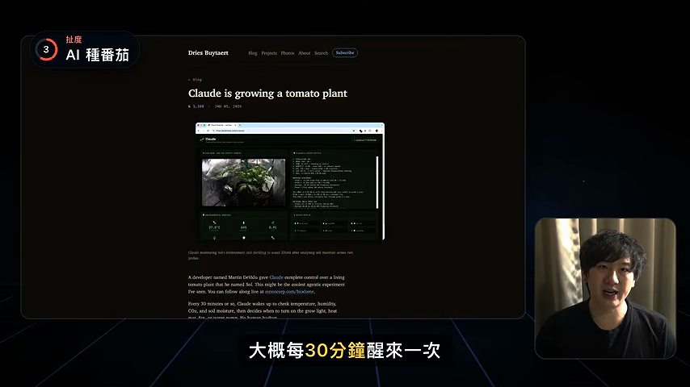
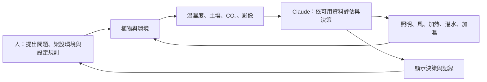
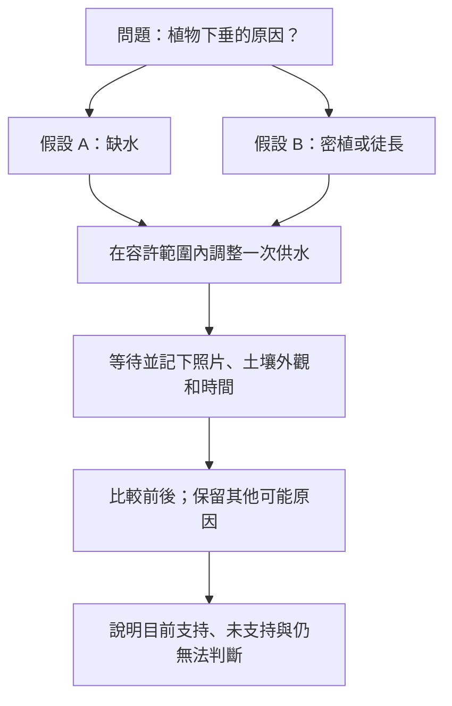
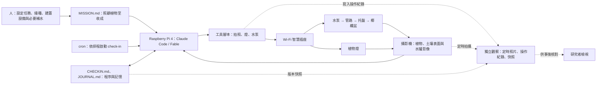
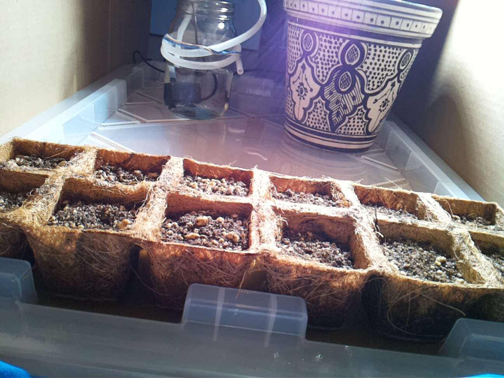
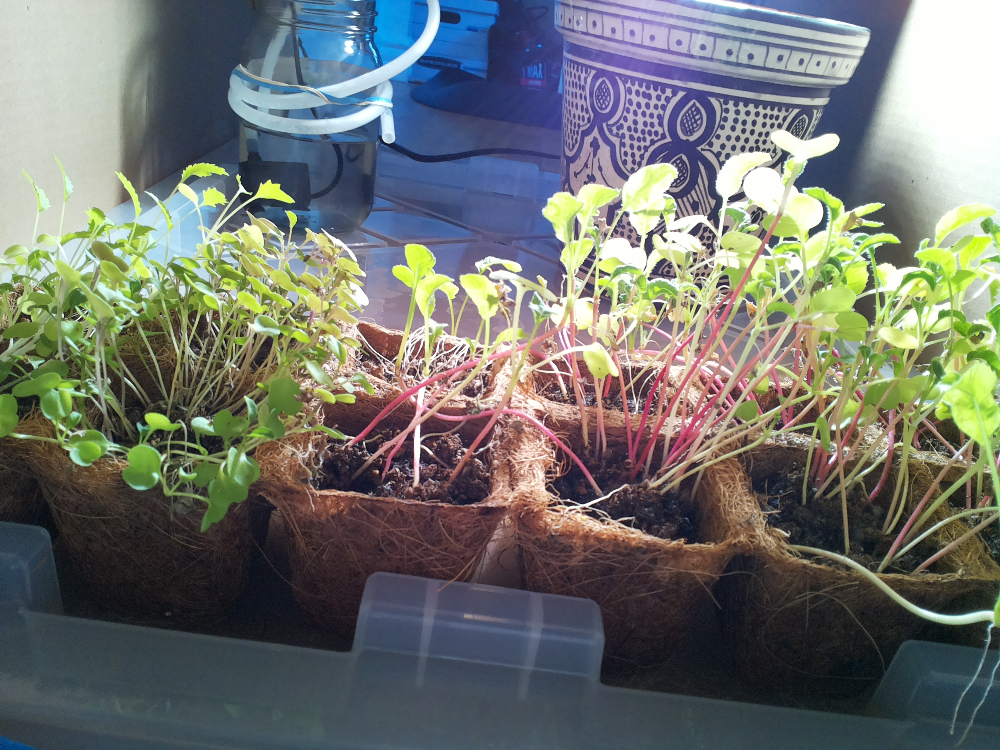
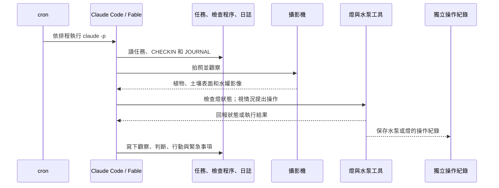
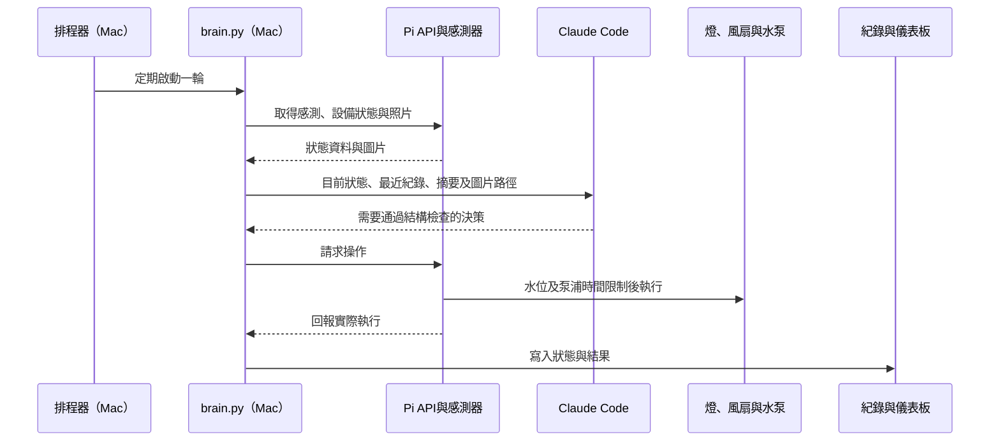
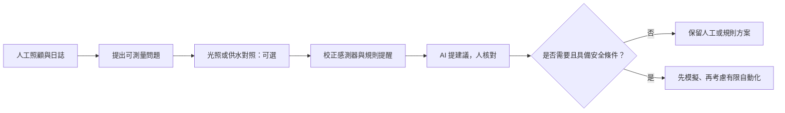

## TL;DR

- 影片的番茄是 Martin DeVido／AutonCorp 的 **Sol Biodome**：作者回報 Claude 每約 30 分鐘根據感測與影像決策，100 天後結出 6–8 顆成熟番茄。
- Sol 官方公開了[百日紀錄](https://autoncorp.com/sol.html)；本次**未找到可確認由 Sol 原作者公開的原始碼**。已下載的 [Wall-e](https://github.com/Vistawizard/wall-e) 是另一位作者受 Sol 啟發的實作，不能當成 Sol 的程式。
- Tal 的 Farmer Claude 公開任務、日誌、架構與獨立操作紀錄；與 Sol 比較要注意植物、感測器及人的參與不同，不能當控制實驗。
- 分階段 BOM 以 Wall-e 的法國歷史價格試算；system prompt 比較區分文字要求、程式限制與人工責任。
- Wall-e 使用 Raspberry Pi 讀感測器與執行設備，Mac 執行 Claude Code、記錄與發布；本篇是固定版本的靜態研究，未接設備或實測。
- 對照你的 [Plant-Based Living Lab 計畫](https://github.com/swchen44/plant-based-living-lab/blob/main/docs/MASTER_PLAN.md)：第 13–16 題可選擇性串連，先人工觀察，再比較光照、供水、規則提醒與 AI 建議；**16 題均為候選，尚未選題或完成實驗**。
- 學習歷程要留下自己的動機、資料、失敗、決策與反思；下列範本是待填的設計，不是學生已做的事。

## 摘要（Summary）

影片 [07:09–07:26](https://www.youtube.com/watch?v=Mm689dbEfCM&t=429s)介紹 Claude 觀察植物並控制設備。影片在 [07:13](https://www.youtube.com/watch?v=Mm689dbEfCM&t=433s)顯示 Dries Buytaert 的〈Claude is growing a tomato plant〉，該文指向 Martin DeVido 的 Sol；因此已從畫面確認是 Sol，不是 Tal Raviv 的另一個種植實驗。

本文以 Sol 官方故事呈現人與 agent 的問題、過程及限制；用受其啟發的 Wall-e 開源程式解釋一種具體技術架構；最後把兩者轉成可以由學生選擇、實作與記錄的研究路線。學生不需要照搬百日全自動系統：先確認場地、植物、時間、指導老師及可量測問題。



*圖：酷可實驗室影片畫面 [07:13](https://www.youtube.com/watch?v=Mm689dbEfCM&t=433s)，用於辨識案例來源；畫面並未證明本篇已重現系統。*

> [!important] 證據與執行狀態
> - Sol 的 100 天與 6–8 顆成果來自[原作者官方紀錄](https://autoncorp.com/sol.html)，不是本文實測或獨立試驗；沒有取得完整原始量測、對照組與統計設計。
> - Wall-e 是**受 Sol 啟發的獨立 GitHub 專案**，分析固定於 `4df6ceb66f09faf18df217a82c391ec6aacbd60d`；下載於 `source-materials/sol-biodome-research/wall-e/`。其資料檔 `docs/data/latest.json` 為 `pre-planting`、量測欄位為 null，不能據此宣稱 Wall-e 已種出番茄。
> - 原始影片字幕 312 段，標記非自動產生，未逐句核對音訊。本文沒有運行 Claude、接設備、做盆栽實驗或驗證公開儀表板的即時資料。

## 關鍵洞察（Key Insights）

1. 種植主題可同時練習植物觀察、實驗設計、資料整理、基本控制與溝通；不必先決定所有階段。
2. 讓 agent 「控制」需要感測、記憶、決策、執行與回饋；模型本身不會自然讀到土壤，也不會自動連上水泵。
3. 人先定義問題、提供設備、設定可操作範圍、選擇證據；AI 的判斷可被記錄與質疑，學生應能說明自己的選擇。
4. 收成與自動化是值得研究的結果，但「AI 一定比人工更好」是待比較的假設，不能從單株 Sol 推論。

## 詳細內容（Details）

### 一、先釐清：Sol 與 Wall-e 不是同一個 repo

| 項目 | Sol：影片中的案例 | Wall-e：受啟發的公開實作 |
| --- | --- | --- |
| 作者／來源 | Martin DeVido，[AutonCorp 官方紀錄](https://autoncorp.com/sol.html) | Vistawizard，[GitHub](https://github.com/Vistawizard/wall-e) 明說 inspired by Sol |
| 植物與狀態 | Trophy tomato；作者稱 100 天後有 6–8 顆成熟果，已封存 | README 計畫使用 Tiny Tim；本次取得的資料檔顯示尚未種植 |
| AI 連接方式 | 官方說明感測器、影像、控制與約 30 分鐘循環；未取得可核對的原始程式 | Mac 呼叫 `claude -p`，Pi 提供 HTTP、感測與執行；以下依固定版原始碼靜態分析 |
| 可否複製其程式？ | 尚未找到可確認的原作者 repo | 已下載公開程式、文件與材料清單；尚未安裝或接機器驗證 |
| 成效證據 | 官方案例敘述；未取得對照實驗資料 | 有軟體與規劃文件，不等於已完成植物全週期或驗收 |

之前 [[2026-11-20-CLAUDE-20-USE-CASES-PROJECTS-AND-EVIDENCE|影片案例索引]]曾把 Tal Raviv 的實驗列為「概念相符但未確認」；這次依影片畫面確認是 Sol，該索引也同步修正。

### 二、Sol 的故事：問題、經過、結果與限制

**人的問題與選擇。** Martin 設計的問題是：AI 能否長時間照顧一個活的生命？官方描述他建立封閉種植環境、感測與可控制設備，設定日常照護由 Claude 決策的實驗條件。這些設計、部署與目標仍是人的工作；「無人工介入日常澆水」不能推成沒有人工架設、沒有成本或不需人負責。

**agent 的循環。** 依[原作者紀錄](https://autoncorp.com/sol.html)及 [Dries 當時的觀察](https://dri.es/claude-is-growing-a-tomato-plant)，Claude 約每 30 分鐘讀溫度、濕度、CO₂、土壤水分及影像，再決定光、加熱、風或水等；官方頁也列出排氣與加濕設備。這是來源對行為的報告；原始模型 prompt、完整資料及所有操作結果尚未取得。



此圖是 Codex 根據公開描述畫出的**概念流程**，不代表已取得 Sol 的內部程式或完整安全設計。

| 階段 | 作者公布的觀察 | 可問的學習問題 |
| --- | --- | --- |
| 第 0–14 天 | 播種、等待、子葉出現 | 種子需要什麼？什麼叫「成功發芽」？ |
| 第 15–50 天 | 長出真葉並進入營養生長；官方稱澆水節奏逐漸穩定 | 如何知道土壤含水與植株生長的關係？ |
| 第 51–70 天 | 開花，接著出現第一個果實 | 花、授粉與結果之間需要哪些條件？ |
| 第 71–100 天 | 果實長大、成熟；官方回報 6–8 顆，百日後結束 | 單株成果可回答什麼？與其他方法比較還需要什麼？ |

官方也稱成熟期約 2,200 mL／日，是**該案例末期數值**，不是其他品種、容器或台灣陽台的澆水建議。[來源](https://autoncorp.com/sol.html)。

**挑戰與處理。** 有[第三方整理](https://mentat.fyi/finds/claude-grows-a-tomato-plant-sol/)引述一次多設備異常與 agent 重新啟動設備的故事，但未取得當次完整原始日誌、獨立儀器或重現資料；故只能說「據報曾發生及處理」，不宣稱已驗證修復次序、所需分鐘或植物會否因此死亡。這個案例提醒我們設計斷線、停電、感測異常時的安全狀態與人工介入；**不要照搬原案無人工備援的實驗條件**。

### 二之一、Sol 與 Farmer Claude：同樣照顧植物，研究問題不同

以下比較依 [AutonCorp 的 Sol 官方紀錄](https://autoncorp.com/sol.html)、[Tal Raviv 的實驗文章](https://www.talraviv.co/p/fable-grows-my-food)與其[公開封存](https://github.com/talsraviv/farmer-claude-archive/tree/179498ddd12e9dee869b68ad69018a2c0e6ac868)整理。兩案植物、設備、時間與研究設計都不同，**不是控制變因一致的 A/B 試驗，不能依收成推論哪種 AI 或硬體比較優秀**。

| 比較問題 | Martin DeVido：Sol | Tal Raviv：Farmer Claude | 對學生有什麼啟發？ |
| --- | --- | --- | --- |
| 想知道什麼 | 作者想知道 AI 能否長期照顧一株植物直到結果 | 作者想測試 agent 在資訊不足時，能否用有限工具摸索照護 | 先決定要研究「可靠照顧」、「資訊不足」還是「省工」；不要一次混成一題 |
| 植物與環境 | 封閉 biodome、Trophy 番茄；作者稱 Day 100 有 6–8 顆成熟果 | 室內混合播種；作者說最後沒有吃到蘿蔔 | 種類、生長期和數量影響成果；記錄品種與採收定義 |
| 觀察 | 官方儀表板列溫度、濕度、CO₂、土壤濕度、VPD、葉片溫差及畫面；早期報導提到兩個土壤探針 | 作者刻意只給一個攝影機觀察；5 MP 照片或 1080p 影片，無其他環境感測器 | 鏡頭也是感測器；照片好用但不能直接量到土壤內部或空氣濕度 |
| 執行 | 官方列燈、加熱墊、循環與排氣風扇、水泵、加濕器；早期材料也提及 CO₂ | Raspberry Pi 4、Wi-Fi 插座、水泵和植物燈；人先準備好工具 | 工具越多不必然越好：每個設備都增加成本、校正及可能故障點 |
| 時間安排 | 原作者稱約每 30 分鐘一輪 | agent 自訂 `cron`；作者記下初期每天三次檢查，並用固定排程開關燈 | 分清「排程器固定觸發」與「每輪判斷內容」；固定排程不等於沒有 AI |
| 記憶 | 第三方整理稱有短期推理與約兩小時的彙整層；尚未取得 Sol 原始碼核對機制 | 可查原始檔 `JOURNAL.md`、`CHECKIN.md` 和 session 記錄，供下次喚醒使用 | 比較記憶資料「寫了什麼、下輪讀到什麼、如何驗證」；不要只比較名稱 |
| 人的參與 | 作者報告日常澆水與燈光無人介入；人仍設定目標、設備和環境 | 作者先架設並播種、處理水管；之後也曾補水 | 自主程度要寫明起點與邊界；硬體、物資和設計不會憑空出現 |
| 公開證據 | 官方總結、儀表板及第三方採訪；本次未取得原案程式與逐輪原始資料 | 作者提供 Pi 檔案快照、日誌、照片、排程與泵浦操作紀錄 | 原始資料越完整越能核對；模型敘述仍要和獨立紀錄比對 |

> [!warning] 有待證據的細節
> 第三方網頁描述 Sol 的「兩層記憶、兩小時睡眠」與第 34 天 Arduino 故障，但目前沒有取得當時原始程式與完整日誌；[第三方說法](https://plantacrescutadeunai.mariuscomper.uk/index-en.html)可以作為待查線索，不宜寫成已證實的內部架構。該網頁的「13 分鐘」引自結案文字，**不能確定是故障發生到修復的實際總時間**。同樣，Tal 的作者沒有證明「沒有濕度感測器」是沒吃到蘿蔔的唯一原因：密植、供水、影像判讀和環境等都可能需要檢查。

#### Tal 的具體過程：想法、證據、修改

1. **先設計問題與約束**：Tal 不告訴 agent 種子種類、水泵流量或燈泡瓦數；人把工具、植物與環境準備好。這測的是特定不完整資訊條件，**不是日常種植的最佳做法**。
2. **第一次試水就遇到困難**：agent 用短脈衝測水、觀察照片，推測管路和虹吸有問題並要求協助；Tal 調整管路及補滿水。之後 agent 又以照片觀察和短脈衝核對；詳見[作者敘述](https://www.talraviv.co/p/fable-grows-my-food)。
3. **建立可延續的工作方式**：agent 撰寫 [`CHECKIN.md`](https://github.com/talsraviv/farmer-claude-archive/blob/179498ddd12e9dee869b68ad69018a2c0e6ac868/home/bubbles/farmer-claude/CHECKIN.md) 與 [`JOURNAL.md`](https://github.com/talsraviv/farmer-claude-archive/blob/179498ddd12e9dee869b68ad69018a2c0e6ac868/home/bubbles/farmer-claude/JOURNAL.md)，自行安排 `cron`。作者指出它修正了排程中缺少工作目錄的錯誤；這是該案例紀錄，不代表每次都能自主修復。
4. **比較兩個假設**：葉子下垂時，agent 曾考慮缺水或密植／徒長，增加一次灌水並在約六小時後回看；作者記錄其結論較偏向後者。這是 agent 在日誌中的判斷，沒有控制試驗，不能排除其他原因。
5. **發現復原與不足**：作者記錄 9 月 6 日斷電後，下次排程檢查發現燈沒亮、開燈，並新增 [`lamp-sync.sh`](https://github.com/talsraviv/farmer-claude-archive/blob/179498ddd12e9dee869b68ad69018a2c0e6ac868/home/bubbles/farmer-claude/tools/lamp-sync.sh) 處理日後重開機；作者也承認 agent 對水位影像判讀不可靠，反覆要求補水，最終沒有吃到蘿蔔。

另一個很適合學習的反例：該版本 `JOURNAL.md` 記錄 9 月 19–24 日曾因 OAuth 到期出現 18 次失敗、六天未澆水；[checkin.log](https://github.com/talsraviv/farmer-claude-archive/blob/179498ddd12e9dee869b68ad69018a2c0e6ac868/home/bubbles/farmer-claude/logs/checkin.log) 確有連續認證失敗訊息。**日期與六天的說法來自 agent 日誌；本次沒有重算所有 cron 與泵浦日誌**。這提醒我們：排程存在不代表每次成功執行，應保留獨立紀錄並設人工可見的失敗通知。



此圖是 **Codex 依 Tal 的案例畫出的研究思考示意**，不是建議對任何植物直接加水；實際操作需依植物、場地及老師指導設計。

#### 兩種記憶方案：怎麼選？

| 問題 | 累積原始檔與明確檢查程序 | 原始紀錄加定期摘要 |
| --- | --- | --- |
| 好處 | 像 Tal 的檔案可追溯原始時間與變更，較易審查 | 資料量大時可降低每輪需要閱讀的上下文 |
| 限制 | 日誌會變長；未必每次都讀完、排程也可能失敗 | 摘要可能漏掉故障或錯誤觀察；不能只保留摘要 |
| 學生先做 | 手寫／試算表加日期，保留照片及 AI 原文 | 資料多時每週寫摘要，並標註對應原始紀錄編號 |
| 驗證 | 比對原始日誌、感測或獨立照片 | 用抽樣方式核對摘要是否忠於原紀錄、缺失是否被保留 |

Wall-e 的近期紀錄＋定期摘要可以在其原始碼檢查；**不能反推 Sol 也用相同檔名或實作**。


### 二之二、Farmer Claude 的系統架構：一個攝影機、一台 Pi 與可追溯紀錄

[作者文章](https://www.talraviv.co/p/fable-grows-my-food)記錄的是實驗者的設計與感受；[固定版本封存 README](https://github.com/talsraviv/farmer-claude-archive/blob/179498ddd12e9dee869b68ad69018a2c0e6ac868/README.md)保留 Pi 檔案、排程、可讀 session、照片與設備操作紀錄。以下架構由 Codex 根據兩者繪製；**固定版本是結束時的快照，不能假設每個元件從第一天就相同**。



攝影機提供影像，不直接測量土壤含水量。人準備的工具腳本封裝攝影機與智慧插座；作者指出這些是 CLI 工具，和 MCP 有相似的工具使用概念，**不表示它們是 MCP server**。實驗者另外設置 agent 未被告知的觀察工作，用來保存每小時影像、操作紀錄和資料夾版本；這有助於事後對照，但單靠紀錄仍不能證明實際水量或植物健康狀態。




*圖：實驗者封存的定時影像，日期時間為加州時間。可比較裝置和植物外觀，但不能僅憑這兩張判定含水量、植物品種或失敗原因。來源：[8 月 25 日](https://github.com/talsraviv/farmer-claude-archive/blob/179498ddd12e9dee869b68ad69018a2c0e6ac868/home/bubbles/.farmer-ground-truth/timelapse/hourly-camera/auto_2026-08-25_1245.jpg)、[9 月 24 日](https://github.com/talsraviv/farmer-claude-archive/blob/179498ddd12e9dee869b68ad69018a2c0e6ac868/home/bubbles/.farmer-ground-truth/timelapse/hourly-camera/auto_2026-09-24_1245.jpg)。作者對其擁有的封存資料採 [CC0 1.0](https://github.com/talsraviv/farmer-claude-archive/blob/179498ddd12e9dee869b68ad69018a2c0e6ac868/LICENSE)。*

#### 一次 check-in 怎麼運作？



固定版 [crontab](https://github.com/talsraviv/farmer-claude-archive/blob/179498ddd12e9dee869b68ad69018a2c0e6ac868/var/spool/cron/crontabs/bubbles)可見三次每日檢查，並以獨立排程控制早晚燈光；斷電後另有 `@reboot` 同步燈狀態。這是該快照的配置，並非證明整段實驗的排程都不變。每次檢查若認證或程式失敗，agent 的判斷步驟可能根本沒有執行；燈的獨立排程與 AI 檢查也可能有不同結果。

| 檔案／來源 | 誰建立、用來做什麼 | 核對時要注意 |
| --- | --- | --- |
| [MISSION.md](https://github.com/talsraviv/farmer-claude-archive/blob/179498ddd12e9dee869b68ad69018a2c0e6ac868/home/bubbles/farmer-claude/MISSION.md) | 人寫目標，告知 agent 可自行排定喚醒 | 這是任務文件；公開 session 中的 Claude Code system prompt 副本已由作者移除 |
| [CHECKIN.md](https://github.com/talsraviv/farmer-claude-archive/blob/179498ddd12e9dee869b68ad69018a2c0e6ac868/home/bubbles/farmer-claude/CHECKIN.md)、[JOURNAL.md](https://github.com/talsraviv/farmer-claude-archive/blob/179498ddd12e9dee869b68ad69018a2c0e6ac868/home/bubbles/farmer-claude/JOURNAL.md) | agent 寫檢查步驟、長期規則及事件紀錄 | 是 agent 的觀察與判斷，可能誤讀；應對照照片和其他紀錄 |
| [水泵紀錄](https://github.com/talsraviv/farmer-claude-archive/blob/179498ddd12e9dee869b68ad69018a2c0e6ac868/home/bubbles/.farmer-ground-truth/water_log.jsonl)、[定時照片](https://github.com/talsraviv/farmer-claude-archive/tree/179498ddd12e9dee869b68ad69018a2c0e6ac868/home/bubbles/.farmer-ground-truth/timelapse/hourly-camera) | 實驗者安排的獨立觀察；水泵程式記錄操作結果 | 紀錄到的泵浦秒數不是經流量計驗證的實際出水量；定時照片不是 agent 每次都看過的照片 |
| [可讀 session](https://github.com/talsraviv/farmer-claude-archive/tree/179498ddd12e9dee869b68ad69018a2c0e6ac868/archive-extras/readable-transcripts) | 作者依原始 session 製作易讀版本，可看工具呼叫與回應 | 不等於完整心智推理；作者說部分 8 月 24 日至 9 月 1 日的 session 因自動清理而遺失 |

作者另標示：版本快照從 8 月 26 日開始；9 月 6 日以前的系統 log 因斷電重啟而缺失，初始 session 的結尾也不完整。README、易讀 session、照片分類是發布時整理過的形式，不代表所有檔案原樣存在於 agent 工作目錄。

#### 安全限制與實驗經驗

固定版 [`water.py`](https://github.com/talsraviv/farmer-claude-archive/blob/179498ddd12e9dee869b68ad69018a2c0e6ac868/home/bubbles/farmer-claude/tools/water.py) 顯示單次上限 **8 秒**、兩次至少間隔 **30 分鐘**、每日總上限 **60 秒**；程式嘗試關閉泵浦並核對關閉狀態，失敗時記錄緊急事件。這些是程式意圖和靜態檢查，不是實際硬體安全測試。[權限設定](https://github.com/talsraviv/farmer-claude-archive/blob/179498ddd12e9dee869b68ad69018a2c0e6ac868/home/bubbles/farmer-claude/.claude/settings.json)也允許直接呼叫 `kasa`，因此不能宣稱所有可能的控制路徑都強制經過 `water.py`。例如程序中斷、連線失敗或直接控制設備時，仍需另外驗證保護是否生效。

| 經驗與證據 | 學到什麼 | 對學習歷程／下一版的建議，尚未實測 |
| --- | --- | --- |
| 第一次供水後出現虹吸與管路位置問題；人調整後，agent 再拍照與短脈衝核對。 | 即使指令執行成功，水實際流到哪裡仍是另一個問題。 | 畫出水路、先量測流量並拍前後照；保留人工介入與修改原因。 |
| agent 為燈光安排固定排程，斷電後增加同步腳本。 | 適合規則化的工作可以交給排程；恢復後也要檢查狀態。 | 記下預期狀態、重啟後實際狀態與恢復耗時；不要只展示成功情境。 |
| 作者指出水位影像解讀有誤，也觀察到 agent 在缺水警告與節水判斷上不穩定。 | 影像只能提供有限線索；信心高不等於量測正確。 | 設可讀水位標記並以人工量測交叉核對，記錄判斷錯誤與修正。 |
| agent 日誌提到 OAuth 失效，`checkin.log` 可見認證失敗。 | 排程存在不等於任務確實完成，憑證生命週期也會影響植物。 | 建立獨立成功心跳、失敗通知與人工接手規則；以實際事件測試。 |
| agent 自己寫日誌並提出植物下垂的假設；作者沒有吃到蘿蔔。 | 可觀察的推理和可用成果是不同的評估面向；單案無法判定某個唯一成因。 | 事先寫成果指標、觀察指標與限制；保留失敗和不確定性。 |

作者文章說後續沒有再與 agent 對話，也承認曾補水；封存 README 另列出人工登入修復及健康檢查的 session。這些證據顯示人有不同形式的維運活動，不能將「無後續對話」擴張為整個系統無人碰觸。是否每項維運影響植物照護，須逐一查時間與內容。

#### 三案架構如何對應到學生選題？

| 設計問題 | Sol：作者報告的原案 | Farmer Claude：封存可查 | Wall-e：固定版設計 |
| --- | --- | --- | --- |
| 決策與硬體 | 官方描述 30 分鐘循環，多種 biodome 感測與控制；細節未完整公開 | Pi 4 上執行 agent；一個攝影機、Wi-Fi 燈和泵 | Mac 執行決策，Pi API 讀取感測並控制設備 |
| 記憶與證據 | 官方總結成長過程；本次未找到可核對逐輪記憶的原始碼 | 程序、日誌、session、泵浦紀錄、照片及版本快照 | 源碼描述近期紀錄、摘要及設備回報；本文未實測 |
| 故障與人 | 官方稱日常決策不靠人工澆水或開燈；完整故障紀錄待查 | 可查虹吸、斷電後同步、認證錯誤，以及人工補水等紀錄 | 程式包含 watchdog、泵浦與水位限制；未驗證實體故障 |
| 學生適合借用 | 定義跨週期觀察問題，將長期目標拆成階段 | 保留人的任務、AI 假設、可獨立核對的照片與操作紀錄 | 把資料、決策和設備控制分層；先在無設備模式檢查建議 |

推薦先選一個可在學期內回答的問題，例如「人工目視澆水判斷與盆重紀錄是否一致？」先由學生量測、留下不同判斷與證據，再決定是否加入 AI 整理或控制。這是本文的研究建議，不是三案已驗證的比較結果。


### 三、Wall-e 的人與 agent：從 GitHub 看一種實作

[Wall-e 固定版本 README](https://github.com/Vistawizard/wall-e/tree/4df6ceb66f09faf18df217a82c391ec6aacbd60d)說明，作者將系統拆為 Raspberry Pi 與 Mac Studio。下列是**程式所表達的設計**，不是本機 runtime 或實際植物成果。



| 誰／元件 | 設計上的工作 | 實際源碼證據 |
| --- | --- | --- |
| 人 | 決定問題、設備、種植條件、權限與系統部署；應理解並審查控制與結果 | [README](https://github.com/Vistawizard/wall-e/blob/4df6ceb66f09faf18df217a82c391ec6aacbd60d/README.md)、[SETUP.md](https://github.com/Vistawizard/wall-e/blob/4df6ceb66f09faf18df217a82c391ec6aacbd60d/SETUP.md) |
| Mac 週期主程式 | 取得資料、請求決策、送出動作、記錄與發布 | [`src/brain.py`](https://github.com/Vistawizard/wall-e/blob/4df6ceb66f09faf18df217a82c391ec6aacbd60d/src/brain.py) |
| Claude Code | 利用提供的狀態與照片輸出結構化決策；非直接連接植物 | [`src/claude_runner.py`](https://github.com/Vistawizard/wall-e/blob/4df6ceb66f09faf18df217a82c391ec6aacbd60d/src/claude_runner.py)、[`src/claude_loop.py`](https://github.com/Vistawizard/wall-e/blob/4df6ceb66f09faf18df217a82c391ec6aacbd60d/src/claude_loop.py) |
| Pi 與設備 | 讀感測、接收命令、控制水泵／風扇／燈 | [`src/pi_server.py`](https://github.com/Vistawizard/wall-e/blob/4df6ceb66f09faf18df217a82c391ec6aacbd60d/src/pi_server.py)、[`src/devices.py`](https://github.com/Vistawizard/wall-e/blob/4df6ceb66f09faf18df217a82c391ec6aacbd60d/src/devices.py) |
| 守護程式與記憶 | 依設計檢查 Pi 健康及主循環逾時，保存歷史與摘要 | [`src/watchdog.py`](https://github.com/Vistawizard/wall-e/blob/4df6ceb66f09faf18df217a82c391ec6aacbd60d/src/watchdog.py)、[`src/memory.py`](https://github.com/Vistawizard/wall-e/blob/4df6ceb66f09faf18df217a82c391ec6aacbd60d/src/memory.py) |

**一輪具體怎麼走？** 根據源碼：`launchd` 的 `StartInterval` 是 1,800 秒；`brain.py` 取 Pi 狀態與照片，`claude_loop.py` 組合感測、設備狀態、最近三輪及摘要；`claude_runner.py` 用 `claude -p` 載入照片路徑並期待 JSON；`Decision` 用 schema 限制欄位，再向 Pi 發出請求；最後把決策及 Pi 回報記錄下來。

**靜態可見的限制與尚待驗證：** `pi_server.py` 的 `/state` 與 `/actuate` 檢查 `X-Pi-Token`，`/health` 未使用該依賴；`Actuation` 和設備層限制單次泵浦最多 30 秒，水位非明確正常時跳過泵浦。這些是程式碼檢查，不代表防溢水、繼電器卡住、網路加密、供電故障或所有異常都有實測保障。範例 `PI_URL` 是 HTTP，本次未驗證部署是否另有傳輸保護。模型回應格式、讀圖權限、訂閱與部署相容性亦未執行。

> [!note] 「Claude 的觀點」如何理解？
> 本文指模型收到什麼資訊、被要求做什麼、提出什麼格式的決策，以及哪些判斷需查核；這是人對系統的分析。不能把 agent 的生成文字當作它有人的感受，也不能替未取得的 Sol 原始對話編造心得。

### 四、挑戰 → 做法 → 如何留下證據

| 挑戰 | 已知做法／限制 | 學生可以留下什麼 |
| --- | --- | --- |
| 不知道何時澆水 | Sol 依來源使用土壤與影像；Wall-e 有土壤讀值及安全上限 | 自己的澆水量、盆重、植株照片、判斷依據與例外 |
| 感測值可能偏差 | Wall-e 有 [`scripts/calibrate_soil.py`](https://github.com/Vistawizard/wall-e/blob/4df6ceb66f09faf18df217a82c391ec6aacbd60d/scripts/calibrate_soil.py)；校正效果未實測 | 同一條件重複讀值、校正前後表、偏差與不確定性 |
| 系統斷線、動作失敗 | Wall-e 有 watchdog、逾時、泵浦與水位限制；不能推成涵蓋全部失敗 | 故障時間、預期／實際行為、處理者、修正前後與停機條件 |
| 只看最後收成 | Sol 有成長階段敘述；單株與單次試驗不能證明優於其他方法 | 逐週照片、同批條件、量測表、缺值、成本、可反駁假設 |
| AI 產出好看卻無法解釋 | Wall-e 保存狀態、decision 與 executed；能否完整反映物理世界仍需測試 | 學生原始筆記、AI 建議、採納或拒絕理由、老師／自己核對結果 |

### 四之一、預估材料清單：從人工開始，逐步增加能力

以下是 **Codex 依 [Wall-e 固定版本 BOM](https://github.com/Vistawizard/wall-e/blob/4df6ceb66f09faf18df217a82c391ec6aacbd60d/BOM.md) 重組的教學情境，不是三案的實際採購帳單**。單價沿用作者 2026 年 4–5 月法國清單，作為比較基準，並非目前台灣報價；所有數量均為一組／一件，除非特別註明。先假設已有手機、供水容器與可使用的電腦；階段可以各自停下，不必升到全自動。

| 階段與研究能力 | 新增材料與單價（歐元） | 階段新增 | 累計參考 |
| --- | --- | ---: | ---: |
| A 人工照顧與紀錄 | 種子包 €3、5L 椰纖 €6、15cm 盆 €3；假設自然光、手機與水容器已具備 | €12.00 | €12.00 |
| B 加入感測與記錄 | Pi Zero 2 WH €24.90、電源 €8.50、microSD €18.50、DHT22 €8.55、BH1750 €5.90、ADS1115 €19.90、土壤感測器 €7.20、GPIO／麵包板套件 €10.90、兩組跳線各 €3.95 | €112.25 | €124.25 |
| C 加入受限自動控制與影像 | 攝影機 €8.90、轉接排線套件 €10.70、水泵 €3.10、繼電器 €14.90、浮球 €7.50、風扇 €4.50、智慧插座 €8.72、植物燈 €25、燈座電線 €5 | €88.32 | €212.57 |
| C 可選：自行焊接工具 | 烙鐵工具組 €18.99；若已借到或有預焊模組可另行評估 | €18.99 | €231.56 |

B 的感測資料還需要自己撰寫或採用合適的紀錄／提醒程式，並校正感測器；C 還需要程式、權限、接線和實際測試。此清單未包含 Mac Studio 或其他 AI 主機、模型訂閱／API、網路、用電、水、運費、稅、外殼、防水、校正工具、損壞替換與工時，**不可當完整預算或落地報價**。法國 Type E 智慧插座不應假設能用於台灣；電壓、插頭、功率、相容性及水電隔離須由有資格的人確認。高中專題可先用低壓與人工操作，選用合適的現成設備及老師指導。

Wall-e 作者 BOM 標題約 €226，但其供應商小計列 Gotronic €161.85、Amazon €25.81–27.71、燈具約 €30、種植材料約 €12；依列出的數字重算約 **€229.66–231.56**，差異源於總表與明細不一致。這是來源內部不一致，不代表我們已核對實際成交金額。

| 比較維度 | Sol 原案 | Tal 的 Farmer Claude | Wall-e 參考及本文分階段設計 |
| --- | --- | --- | --- |
| 控制器與 AI | 原作者說明有 agent 和 biodome；完整採購明細未取得 | Pi 4 跑 Claude Code，攝影機與網路插座 | Pi Zero 2 WH 採感與控制；另外用既有 Mac 執行 agent |
| 感測與執行 | 多種環境感測、攝影機及多種致動器；精確成本未知 | 攝影機、泵浦、燈與兩個 Wi-Fi 插座；完整單價未知 | 從 A 人工，逐漸加入 B 感測、C 有限控制；不等同前兩案實際配置 |
| 預算可比較性 | 未取得完整公開 BOM，不能推算總價 | 未取得完整公開 BOM，不能推算總價 | 上表可重算，依舊缺主機、服務與維運等成本 |

用電可記成 `額定功率(W) ÷ 1000 × 每日運轉小時 × 天數 × 每度電價` 的預估，再用實測功耗修正；不要把設備額定值當成實測用電。學生可以記錄每筆採購的日期、來源、替代品、使用時間與故障，將預算預測和實際支出一起作為學習歷程證據。

### 四之二、比較公開任務與 system prompt：責任怎麼交給 AI？

這三案的文件公開程度不同：[Wall-e 的 system prompt](https://github.com/Vistawizard/wall-e/blob/4df6ceb66f09faf18df217a82c391ec6aacbd60d/prompts/system.md) 是明確的系統提示；Tal 的 [MISSION.md](https://github.com/talsraviv/farmer-claude-archive/blob/179498ddd12e9dee869b68ad69018a2c0e6ac868/home/bubbles/farmer-claude/MISSION.md) 與 [CHECKIN.md](https://github.com/talsraviv/farmer-claude-archive/blob/179498ddd12e9dee869b68ad69018a2c0e6ac868/home/bubbles/farmer-claude/CHECKIN.md) 是任務及操作文件，**不應假稱已找到它們的 system prompt**；Sol 本次未取得原案提示詞。以下是靜態閱讀，不代表這些指令每次都成功或植物照護建議普遍適用。

| 問題 | Sol 原案 | Tal 的 Farmer Claude | Wall-e |
| --- | --- | --- | --- |
| 目標由誰設定 | 官方說明人設定照顧番茄至結果；逐字提示未公開於本次取得資料 | 人設定任務與工具，agent 自己形成部分作業程序 | 提示詞設定照顧一株 Tiny Tim、每約 30 分鐘判斷 |
| AI 看什麼 | 儀表板與感測器；每輪精確上下文未取得 | 攝影機、工具與持久檔案；檢查程序列出應讀內容 | 提示詞要求看感測數據、照片、前次紀錄與生長階段 |
| AI 能做什麼 | 官方說可控制多種設備；權限實作未取得 | 透過工具與排程控制燈和水泵，也能修改檔案 | 提示指定燈、風扇與泵浦，回傳 JSON 決策和記憶／評估文字 |
| 人仍做什麼 | 設計、建置並設定實驗；官方稱日常照護循環無人介入 | 先搭建、播種、調整管路與後續補水 | 同一份提示詞一方面寫無人介入，另一方面明列**使用者補水、採果** |
| 如何限制 | 原作者提供規則與環境描述，未取得完整實作 | 檢查公開腳本與紀錄，不能只看任務文字 | 提示要求限水；[決策 schema](https://github.com/Vistawizard/wall-e/blob/4df6ceb66f09faf18df217a82c391ec6aacbd60d/src/claude_loop.py) 與 [Pi 端程式](https://github.com/Vistawizard/wall-e/blob/4df6ceb66f09faf18df217a82c391ec6aacbd60d/src/pi_server.py)另設單次 0–30 秒及缺水停泵判斷 |

**設計啟發：**把「自然語言要求」、「程式會檢查的限制」與「人實際負責的事」分成三欄。單次最多 30 秒不等於每日總量受限；提示詞說自主，也不等於不需要人。程式靜態可見保護條件，並不證明真實感測器、繼電器、故障復原或防水已通過測試。Wall-e 生長階段和澆水數字是作者針對其設施的設定，不能直接套用到其他植物或環境。

#### 可供學生修改的觀察提示詞

以下為 **Codex 建議的未實測範本**，不是任一作者的原文；它只協助整理觀察，沒有設備操作權限：

```text
你是我的植物觀察紀錄助理。請根據我提供的日期、植物品種、照片描述、實測數據與人工操作記錄，整理：
1. 哪些是我實際提供的觀察，哪些是你的推測？
2. 提出最多兩個可能原因，說明各自依據與不確定性。
3. 缺少哪些資料？下一次應記錄什麼，才能區分可能原因？
4. 以表格列出日期、觀察、假設、待查問題與原始紀錄編號。
不要捏造數據、假裝看過未提供的照片，或自行控制任何設備；涉及調整時，先列出待與老師確認的問題。
```

保留輸入、AI 回答、自己是否採納及原因，並定期對照原始照片或實測紀錄；這些才有助於呈現學生的判斷與成長。


### 五、對照你的候選題：從人工到 AI，不必一次做完

你的 [MASTER_PLAN.md](https://github.com/swchen44/plant-based-living-lab/blob/main/docs/MASTER_PLAN.md) 是 **2026-11-12 的規劃稿**，寫明 16 個題目都是候選，不是已選的六題或已完成實驗。第 13–16 題可以互相銜接，也可以獨立選擇。下表是參考原計畫提出的**候選路線**，學生、家長與老師決定是否採用。

| 階段 | 對應候選題 | 人要做什麼 | 可觀察產物與進階條件 |
| --- | --- | --- | --- |
| 0. 問題與人工基準 | 13、16 | 選作物與場地；人工澆水、拍照、記工時 | 環境圖、株高／葉數、用水及異常記錄；先確認有可研究的問題 |
| 1. 光照 | 14，可選 | 同批材料、可比光照與重複盆數；記錄電力及限制 | 生長曲線與耗能比較；自然光與 LED 差異可能混雜溫度與光量 |
| 2. 供水 | 15，可選 | 比較人工與毛細供水；觀察水量、漏水和維護 | 累計水量、時間、成長與裝置異常；比較的是整套系統 |
| 3. 感測及規則提醒 | 16 | 校正感測器，先採離線記錄及規則通知，人決定是否澆水 | 校正表、提醒紀錄、誤報／漏報、總成本與時間 |
| 4. AI 建議 | 16，條件允許時 | 給匿名化或必要資料，要求 AI 附依據；由人決定 | 原始讀值、建議、實際決策、差異、錯誤與模型成本 |
| 5. 有界自動化 | 延伸提案，未列為必做 | 若老師與家人同意，先在模擬／無水狀態測試，設停機、人工接管與安全界線 | 空載與故障測試證據，再決定是否適合真實運作；不預設一定上線 |



這是**研究設計建議**，不是已批准的選題、已採購設備或已發生的學生經歷。AI 未必比簡單規則更省時間或準確；校正與維護本身也有成本。

### 六、學習歷程：把「我做過」變成可說清楚的故事

參照 [[2026-06-19-HIGH-SCHOOL-LEARNING-PORTFOLIO|先前高中生學習歷程筆記]]，先保留真實素材，再整理故事。以下回應使用者整理的三個常見錯誤：

| 常見錯誤 | 可以怎麼改善 | 可留的證據 |
| --- | --- | --- |
| 只上傳報告或截圖 | 說明為何選題、個人角色、最關鍵發現 | 問題來源、日期、原始照片與數據 |
| 各份成果破碎、沒有主軸 | 以一個自己真正關心的問題串起人工、觀測與改良；每階段可獨立成篇 | 同一問題的版本、決策與階段時間線 |
| 只寫空泛反思 | 描述一次具體困難、原先想法、採取行動與改變 | 當時紀錄、失敗照片、比較數據、下一步 |

**每週十分鐘紀錄範本**（方括號待學生填寫；不可虛構）：

```text
日期與地點：[實際日期、場域]
我的問題／本週目標：[為什麼想觀察這件事]
我自己做了什麼：[觀察、操作、查資料或設計]
AI 做了什麼：[沒有使用就寫無；有使用則保留提示、版本與回答]
證據：[照片編號、數據、單位、資料表或失敗紀錄]
遇到的困難：[具體情況與原因是否確定]
我的選擇：[採用或拒絕什麼、為什麼]
結果與限制：[實測結果、缺值、不能判斷之處]
我的改變／下一步：[真正的想法、下一個可驗證問題]
```

**一條可展示的系列敘事**：我原本想知道 `[自己的問題]` → 做了 `[人工觀察]` → 遇到 `[真實困難]` → 嘗試 `[規則或 AI 建議]` → 用 `[可核對證據]` 比較 → 我改變了 `[自己的判斷]` → 下一步是 `[未完成問題]`。例如「第一次把感測器插入乾土與濕土，讀值差異和預期不同，因此重新查接線並記下校正」只是**示意情境**，不是學生已完成的經歷。

### 七、從人與 agent 的角度學到什麼？

| 視角 | 可學到的問題 | 如何證明是自己的學習 |
| --- | --- | --- |
| 人：植物研究者 | 先界定變因、測量、重複與環境差異，判斷資料能否支持結論 | 說得出選種、澆水、量測與改變設計的原因 |
| 人：系統設計者 | 將危險動作、供電、水與錯誤處理放入設計，而不是只看 AI 文句 | 保留流程草圖、檢查結果、故障修正與未完成項目 |
| agent：資訊處理流程 | 從讀值、照片、歷史摘要提出結構化決策，但輸出不保證正確 | 保存可分享的提示與輸出，對照感測紀錄與人類判斷 |
| agent：回饋與限制 | 驗證執行結果與決策是否不同；記憶摘要可能遺漏資訊 | 記下請求／實際動作、異常、人工接手與下一次修正 |

## 我的心得（My Takeaways）

Sol 讓「感知→決策→行動→觀察」變得容易理解；Wall-e 提供可以閱讀的另一種程式設計。對高中生更有價值的，不是宣稱自己造出無人農場，而是能指出親自提出的問題、做錯什麼、怎麼修正與資料能支持到哪裡。AI 可以協助查詢與整理，但學習經歷和反思必須來自真實參與。

## 待補充（Open Questions）

1. Sol 原作者是否公開實驗原始程式、提示與逐輪感測資料？搜尋：`AutonCorp Sol biodome source code Martin DeVido`。
2. Sol 設備異常的完整時間線與獨立紀錄是否可取得？搜尋：`Sol biodome outage source log Claude`。
3. Wall-e 是否完成真實種植、實際用水與故障測試？搜尋：`Vistawizard wall-e tomato harvest validation`。
4. 學生實際場地的日照、季節、供水與可用器材為何？需現場測量與老師確認。
5. 在相似條件下人工、規則提醒及 AI 建議對工時、失誤、耗電和植株生長的差異為何？需先設計對照。
6. 分階段器材在實際場地、台灣供應商與電壓條件下的報價及維運成本為何？需逐項詢價並驗證相容性。
7. 哪些學校的自主學習紀錄、教師認證與上傳時程適用？以就讀學校公告為準。

## 相關連結（Related）

- [[2026-06-19-HIGH-SCHOOL-LEARNING-PORTFOLIO]]：講座對真實素材、數據、故事及 AI 輔助整理的建議。
- [[2026-11-20-CLAUDE-20-USE-CASES-PROJECTS-AND-EVIDENCE]]：本影片其他案例與來源追查。
- [[2026-09-10-PHYSICAL-AI-THE-HIDDEN-VALUE-POOLS-LEADERS-ARE-MISSING]]：實體 AI 部署與驗證限制。
- [Plant-Based Living Lab：MASTER_PLAN.md](https://github.com/swchen44/plant-based-living-lab/blob/main/docs/MASTER_PLAN.md)：16 個候選題及第 13–16 題的研究方法。

## 知識層次分析（Bloom's Taxonomy Analysis）

| 層次 | 具體應用 |
| --- | --- |
| 記憶 | 感測器、執行器、閉環、人工基準、變因與對照 |
| 理解 | 解釋植物狀態如何經量測、決策與行動再次影響植物 |
| 分析 | 區分原案與重製、作者自述與實測、AI 決策與實際設備結果 |
| 應用 | 建立人工日誌；設計一項單變因比較與感測校正表 |
| 評估 | 比較人工、規則與 AI 的時間、可靠性、成本與可解釋性 |

### 分析型追問（Socratic Follow-up）

- 澄清：澆水過多要怎麼量測，而不是只用感覺判斷？
- 假設：感測器錯誤或斷線時，哪一個結論會失效？
- 證據：Sol 單株存活能否證明 AI 優於人工？還要哪些對照？
- 觀點：學生、老師及設備維護者會如何看同一個系統？
- 後果：若長期省略人工觀察，可能漏掉哪些設備與植物問題？

### 方案批判三問

1. 最大風險：感測錯誤或失控導致植物受損、漏水或電氣事故；學習紀錄也可能誤寫 AI 產出為個人經驗。
2. 失敗條件：缺少可比基準、器材校正、場地及教師支持，或沒有停機／人工處理方式。
3. 替代方案：人工日誌或定時／規則提醒較易理解、維護與比較；需求確立、具足夠驗證後再考慮 AI。

## 六頂思考帽回饋（Six Thinking Hats Feedback）

### 藍帽：問題與範圍
從 Sol、Wall-e 與候選題目中規劃可選的學習路線。

### 白帽：事實與未知資訊
官方有 Sol 百日自述；Wall-e 有固定版本原始碼及播種前資料，本次未做實機驗證。

### 紅帽：直覺與讀者反應
植物和可見的變化可能引發好奇；長期照護及設備也可能讓初學者感到負擔。

### 黃帽：價值與可保留內容
人工記錄、分析和設計可逐步累積，失敗也能成為具體的學習證據。

### 黑帽：風險與限制
單株成果不是比較實驗；設備、資料、供電與學生時間有限，不能預先承諾成效。

### 綠帽：替代方案與新應用
以短週期葉菜、手寫日誌或試算表開始，不必先採購完整 AI 農場。

### 藍帽：修改項目與下一步

1. 由學生與老師確認興趣、場地、時間與候選題。
2. 做人工基準並保留真實過程，再判斷是否加入感測。
3. 若需要 AI，先比較有無 AI 的結果並保留人工接手。

## References

- [酷可實驗室影片](https://www.youtube.com/watch?v=Mm689dbEfCM&t=429s)；[Dries Buytaert：Claude is growing a tomato plant](https://dri.es/claude-is-growing-a-tomato-plant)。
- [AutonCorp：Sol 百日紀錄](https://autoncorp.com/sol.html)、[Sol 儀表板](https://autoncorp.com/biodome/)；可見介面不等於當前仍在持續實驗。
- [Wall-e 固定版本](https://github.com/Vistawizard/wall-e/tree/4df6ceb66f09faf18df217a82c391ec6aacbd60d)，受 Sol 啟發的不同專案。
- [Plant-Based Living Lab 原始計畫](https://github.com/swchen44/plant-based-living-lab/blob/main/docs/MASTER_PLAN.md)，2026-11-12 規劃稿。
- [高中生的學習歷程檔案](https://github.com/swchen44/personal-knowledge-base-from-ai/blob/main/Education/2026-06-19-HIGH-SCHOOL-LEARNING-PORTFOLIO.md)。

- [Tal Raviv：I had Fable grow my food](https://www.talraviv.co/p/fable-grows-my-food)；[Farmer Claude 固定版本封存](https://github.com/talsraviv/farmer-claude-archive/tree/179498ddd12e9dee869b68ad69018a2c0e6ac868)。
- [Wall-e 固定版本 system prompt](https://github.com/Vistawizard/wall-e/blob/4df6ceb66f09faf18df217a82c391ec6aacbd60d/prompts/system.md)；[材料清單](https://github.com/Vistawizard/wall-e/blob/4df6ceb66f09faf18df217a82c391ec6aacbd60d/BOM.md)。
