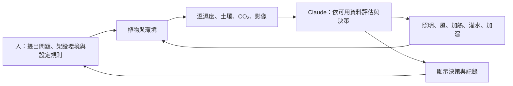
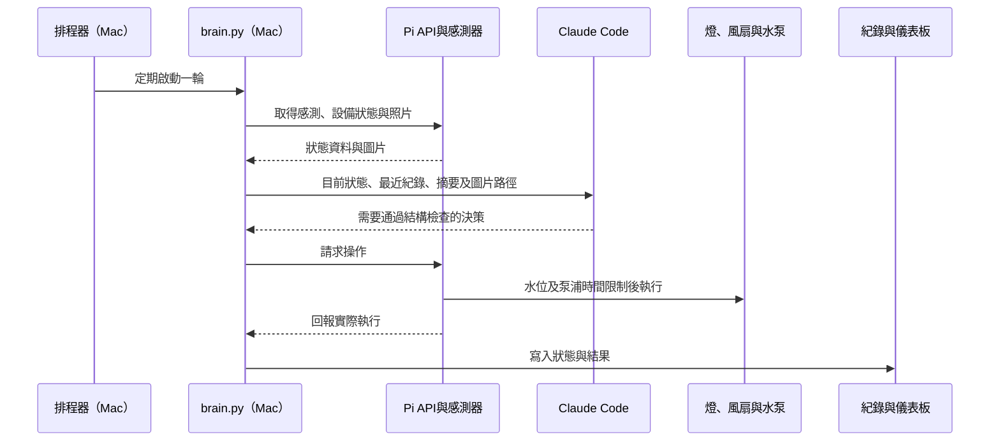
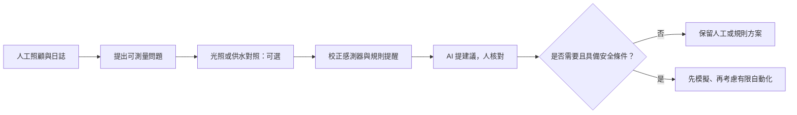

## TL;DR

- 影片的番茄是 Martin DeVido／AutonCorp 的 **Sol Biodome**：作者回報 Claude 每約 30 分鐘根據感測與影像決策，100 天後結出 6–8 顆成熟番茄。
- Sol 官方公開了[百日紀錄](https://autoncorp.com/sol.html)；本次**未找到可確認由 Sol 原作者公開的原始碼**。已下載的 [Wall-e](https://github.com/Vistawizard/wall-e) 是另一位作者受 Sol 啟發的實作，不能當成 Sol 的程式。
- Wall-e 使用 Raspberry Pi 讀感測器與執行設備，Mac 執行 Claude Code、記錄與發布；本篇是固定版本的靜態研究，未接設備或實測。
- 對照你的 [Plant-Based Living Lab 計畫](https://github.com/swchen44/plant-based-living-lab/blob/main/docs/MASTER_PLAN.md)：第 13–16 題可選擇性串連，先人工觀察，再比較光照、供水、規則提醒與 AI 建議；**16 題均為候選，尚未選題或完成實驗**。
- 學習歷程要留下自己的動機、資料、失敗、決策與反思；下列範本是待填的設計，不是學生已做的事。

## 摘要（Summary）

影片 [07:09–07:26](https://www.youtube.com/watch?v=Mm689dbEfCM&t=429s)介紹 Claude 觀察植物並控制設備。影片在 [07:13](https://www.youtube.com/watch?v=Mm689dbEfCM&t=433s)顯示 Dries Buytaert 的〈Claude is growing a tomato plant〉，該文指向 Martin DeVido 的 Sol；因此已從畫面確認是 Sol，不是 Tal Raviv 的另一個種植實驗。

本文以 Sol 官方故事呈現人與 agent 的問題、過程及限制；用受其啟發的 Wall-e 開源程式解釋一種具體技術架構；最後把兩者轉成可以由學生選擇、實作與記錄的研究路線。學生不需要照搬百日全自動系統：先確認場地、植物、時間、指導老師及可量測問題。


*圖：酷可實驗室影片畫面 [07:13](https://www.youtube.com/watch?v=Mm689dbEfCM&t=433s)，用於辨識案例來源；畫面並未證明本篇已重現系統。*

> [!important] 證據與執行狀態
> - Sol 的 100 天與 6–8 顆成果來自[原作者官方紀錄](https://autoncorp.com/sol.html)，不是本文實測或獨立試驗；沒有取得完整原始量測、對照組與統計設計。
> - Wall-e 是**受 Sol 啟發的獨立 GitHub 專案**，分析固定於 `4df6ceb66f09faf18df217a82c391ec6aacbd60d`；下載於 `source-materials/sol-biodome-research/wall-e/`。其資料檔 `docs/data/latest.json` 為 `pre-planting`、量測欄位為 null，不能據此宣稱 Wall-e 已種出番茄。
> - 原始影片字幕 312 段，標記非自動產生，未逐句核對音訊。本文沒有運行 Claude、接設備、做盆栽實驗或驗證公開儀表板的即時資料。

## 關鍵洞察（Key Insights）

1. 種植主題可同時練習植物觀察、實驗設計、資料整理、基本控制與溝通；不必先決定所有階段。
2. 讓 agent 「控制」需要感測、記憶、決策、執行與回饋；模型本身不會自然讀到土壤，也不會自動連上水泵。
3. 人先定義問題、提供設備、設定可操作範圍、選擇證據；AI 的判斷可被記錄與質疑，學生應能說明自己的選擇。
4. 收成與自動化是值得研究的結果，但「AI 一定比人工更好」是待比較的假設，不能從單株 Sol 推論。

## 詳細內容（Details）

### 一、先釐清：Sol 與 Wall-e 不是同一個 repo

| 項目 | Sol：影片中的案例 | Wall-e：受啟發的公開實作 |
| --- | --- | --- |
| 作者／來源 | Martin DeVido，[AutonCorp 官方紀錄](https://autoncorp.com/sol.html) | Vistawizard，[GitHub](https://github.com/Vistawizard/wall-e) 明說 inspired by Sol |
| 植物與狀態 | Trophy tomato；作者稱 100 天後有 6–8 顆成熟果，已封存 | README 計畫使用 Tiny Tim；本次取得的資料檔顯示尚未種植 |
| AI 連接方式 | 官方說明感測器、影像、控制與約 30 分鐘循環；未取得可核對的原始程式 | Mac 呼叫 `claude -p`，Pi 提供 HTTP、感測與執行；以下依固定版原始碼靜態分析 |
| 可否複製其程式？ | 尚未找到可確認的原作者 repo | 已下載公開程式、文件與材料清單；尚未安裝或接機器驗證 |
| 成效證據 | 官方案例敘述；未取得對照實驗資料 | 有軟體與規劃文件，不等於已完成植物全週期或驗收 |

之前 [[2026-11-20-CLAUDE-20-USE-CASES-PROJECTS-AND-EVIDENCE|影片案例索引]]曾把 Tal Raviv 的實驗列為「概念相符但未確認」；這次依影片畫面確認是 Sol，該索引也同步修正。

### 二、Sol 的故事：問題、經過、結果與限制

**人的問題與選擇。** Martin 設計的問題是：AI 能否長時間照顧一個活的生命？官方描述他建立封閉種植環境、感測與可控制設備，設定日常照護由 Claude 決策的實驗條件。這些設計、部署與目標仍是人的工作；「無人工介入日常澆水」不能推成沒有人工架設、沒有成本或不需人負責。

**agent 的循環。** 依[原作者紀錄](https://autoncorp.com/sol.html)及 [Dries 當時的觀察](https://dri.es/claude-is-growing-a-tomato-plant)，Claude 約每 30 分鐘讀溫度、濕度、CO₂、土壤水分及影像，再決定光、加熱、風或水等；官方頁也列出排氣與加濕設備。這是來源對行為的報告；原始模型 prompt、完整資料及所有操作結果尚未取得。



此圖是 Codex 根據公開描述畫出的**概念流程**，不代表已取得 Sol 的內部程式或完整安全設計。

| 階段 | 作者公布的觀察 | 可問的學習問題 |
| --- | --- | --- |
| 第 0–14 天 | 播種、等待、子葉出現 | 種子需要什麼？什麼叫「成功發芽」？ |
| 第 15–50 天 | 長出真葉並進入營養生長；官方稱澆水節奏逐漸穩定 | 如何知道土壤含水與植株生長的關係？ |
| 第 51–70 天 | 開花，接著出現第一個果實 | 花、授粉與結果之間需要哪些條件？ |
| 第 71–100 天 | 果實長大、成熟；官方回報 6–8 顆，百日後結束 | 單株成果可回答什麼？與其他方法比較還需要什麼？ |

官方也稱成熟期約 2,200 mL／日，是**該案例末期數值**，不是其他品種、容器或台灣陽台的澆水建議。[來源](https://autoncorp.com/sol.html)。

**挑戰與處理。** 有[第三方整理](https://mentat.fyi/finds/claude-grows-a-tomato-plant-sol/)引述一次多設備異常與 agent 重新啟動設備的故事，但未取得當次完整原始日誌、獨立儀器或重現資料；故只能說「據報曾發生及處理」，不宣稱已驗證修復次序、所需分鐘或植物會否因此死亡。這個案例提醒我們設計斷線、停電、感測異常時的安全狀態與人工介入；**不要照搬原案無人工備援的實驗條件**。

### 三、Wall-e 的人與 agent：從 GitHub 看一種實作

[Wall-e 固定版本 README](https://github.com/Vistawizard/wall-e/tree/4df6ceb66f09faf18df217a82c391ec6aacbd60d)說明，作者將系統拆為 Raspberry Pi 與 Mac Studio。下列是**程式所表達的設計**，不是本機 runtime 或實際植物成果。



| 誰／元件 | 設計上的工作 | 實際源碼證據 |
| --- | --- | --- |
| 人 | 決定問題、設備、種植條件、權限與系統部署；應理解並審查控制與結果 | [README](https://github.com/Vistawizard/wall-e/blob/4df6ceb66f09faf18df217a82c391ec6aacbd60d/README.md)、[SETUP.md](https://github.com/Vistawizard/wall-e/blob/4df6ceb66f09faf18df217a82c391ec6aacbd60d/SETUP.md) |
| Mac 週期主程式 | 取得資料、請求決策、送出動作、記錄與發布 | [`src/brain.py`](https://github.com/Vistawizard/wall-e/blob/4df6ceb66f09faf18df217a82c391ec6aacbd60d/src/brain.py) |
| Claude Code | 利用提供的狀態與照片輸出結構化決策；非直接連接植物 | [`src/claude_runner.py`](https://github.com/Vistawizard/wall-e/blob/4df6ceb66f09faf18df217a82c391ec6aacbd60d/src/claude_runner.py)、[`src/claude_loop.py`](https://github.com/Vistawizard/wall-e/blob/4df6ceb66f09faf18df217a82c391ec6aacbd60d/src/claude_loop.py) |
| Pi 與設備 | 讀感測、接收命令、控制水泵／風扇／燈 | [`src/pi_server.py`](https://github.com/Vistawizard/wall-e/blob/4df6ceb66f09faf18df217a82c391ec6aacbd60d/src/pi_server.py)、[`src/devices.py`](https://github.com/Vistawizard/wall-e/blob/4df6ceb66f09faf18df217a82c391ec6aacbd60d/src/devices.py) |
| 守護程式與記憶 | 依設計檢查 Pi 健康及主循環逾時，保存歷史與摘要 | [`src/watchdog.py`](https://github.com/Vistawizard/wall-e/blob/4df6ceb66f09faf18df217a82c391ec6aacbd60d/src/watchdog.py)、[`src/memory.py`](https://github.com/Vistawizard/wall-e/blob/4df6ceb66f09faf18df217a82c391ec6aacbd60d/src/memory.py) |

**一輪具體怎麼走？** 根據源碼：`launchd` 的 `StartInterval` 是 1,800 秒；`brain.py` 取 Pi 狀態與照片，`claude_loop.py` 組合感測、設備狀態、最近三輪及摘要；`claude_runner.py` 用 `claude -p` 載入照片路徑並期待 JSON；`Decision` 用 schema 限制欄位，再向 Pi 發出請求；最後把決策及 Pi 回報記錄下來。

**靜態可見的限制與尚待驗證：** `pi_server.py` 的 `/state` 與 `/actuate` 檢查 `X-Pi-Token`，`/health` 未使用該依賴；`Actuation` 和設備層限制單次泵浦最多 30 秒，水位非明確正常時跳過泵浦。這些是程式碼檢查，不代表防溢水、繼電器卡住、網路加密、供電故障或所有異常都有實測保障。範例 `PI_URL` 是 HTTP，本次未驗證部署是否另有傳輸保護。模型回應格式、讀圖權限、訂閱與部署相容性亦未執行。

> [!note] 「Claude 的觀點」如何理解？
> 本文指模型收到什麼資訊、被要求做什麼、提出什麼格式的決策，以及哪些判斷需查核；這是人對系統的分析。不能把 agent 的生成文字當作它有人的感受，也不能替未取得的 Sol 原始對話編造心得。

### 四、挑戰 → 做法 → 如何留下證據

| 挑戰 | 已知做法／限制 | 學生可以留下什麼 |
| --- | --- | --- |
| 不知道何時澆水 | Sol 依來源使用土壤與影像；Wall-e 有土壤讀值及安全上限 | 自己的澆水量、盆重、植株照片、判斷依據與例外 |
| 感測值可能偏差 | Wall-e 有 [`scripts/calibrate_soil.py`](https://github.com/Vistawizard/wall-e/blob/4df6ceb66f09faf18df217a82c391ec6aacbd60d/scripts/calibrate_soil.py)；校正效果未實測 | 同一條件重複讀值、校正前後表、偏差與不確定性 |
| 系統斷線、動作失敗 | Wall-e 有 watchdog、逾時、泵浦與水位限制；不能推成涵蓋全部失敗 | 故障時間、預期／實際行為、處理者、修正前後與停機條件 |
| 只看最後收成 | Sol 有成長階段敘述；單株與單次試驗不能證明優於其他方法 | 逐週照片、同批條件、量測表、缺值、成本、可反駁假設 |
| AI 產出好看卻無法解釋 | Wall-e 保存狀態、decision 與 executed；能否完整反映物理世界仍需測試 | 學生原始筆記、AI 建議、採納或拒絕理由、老師／自己核對結果 |

### 五、對照你的候選題：從人工到 AI，不必一次做完

你的 [MASTER_PLAN.md](https://github.com/swchen44/plant-based-living-lab/blob/main/docs/MASTER_PLAN.md) 是 **2026-11-12 的規劃稿**，寫明 16 個題目都是候選，不是已選的六題或已完成實驗。第 13–16 題可以互相銜接，也可以獨立選擇。下表是參考原計畫提出的**候選路線**，學生、家長與老師決定是否採用。

| 階段 | 對應候選題 | 人要做什麼 | 可觀察產物與進階條件 |
| --- | --- | --- | --- |
| 0. 問題與人工基準 | 13、16 | 選作物與場地；人工澆水、拍照、記工時 | 環境圖、株高／葉數、用水及異常記錄；先確認有可研究的問題 |
| 1. 光照 | 14，可選 | 同批材料、可比光照與重複盆數；記錄電力及限制 | 生長曲線與耗能比較；自然光與 LED 差異可能混雜溫度與光量 |
| 2. 供水 | 15，可選 | 比較人工與毛細供水；觀察水量、漏水和維護 | 累計水量、時間、成長與裝置異常；比較的是整套系統 |
| 3. 感測及規則提醒 | 16 | 校正感測器，先採離線記錄及規則通知，人決定是否澆水 | 校正表、提醒紀錄、誤報／漏報、總成本與時間 |
| 4. AI 建議 | 16，條件允許時 | 給匿名化或必要資料，要求 AI 附依據；由人決定 | 原始讀值、建議、實際決策、差異、錯誤與模型成本 |
| 5. 有界自動化 | 延伸提案，未列為必做 | 若老師與家人同意，先在模擬／無水狀態測試，設停機、人工接管與安全界線 | 空載與故障測試證據，再決定是否適合真實運作；不預設一定上線 |



這是**研究設計建議**，不是已批准的選題、已採購設備或已發生的學生經歷。AI 未必比簡單規則更省時間或準確；校正與維護本身也有成本。

### 六、學習歷程：把「我做過」變成可說清楚的故事

參照 [[2026-06-19-HIGH-SCHOOL-LEARNING-PORTFOLIO|先前高中生學習歷程筆記]]，先保留真實素材，再整理故事。以下回應使用者整理的三個常見錯誤：

| 常見錯誤 | 可以怎麼改善 | 可留的證據 |
| --- | --- | --- |
| 只上傳報告或截圖 | 說明為何選題、個人角色、最關鍵發現 | 問題來源、日期、原始照片與數據 |
| 各份成果破碎、沒有主軸 | 以一個自己真正關心的問題串起人工、觀測與改良；每階段可獨立成篇 | 同一問題的版本、決策與階段時間線 |
| 只寫空泛反思 | 描述一次具體困難、原先想法、採取行動與改變 | 當時紀錄、失敗照片、比較數據、下一步 |

**每週十分鐘紀錄範本**（方括號待學生填寫；不可虛構）：

```text
日期與地點：[實際日期、場域]
我的問題／本週目標：[為什麼想觀察這件事]
我自己做了什麼：[觀察、操作、查資料或設計]
AI 做了什麼：[沒有使用就寫無；有使用則保留提示、版本與回答]
證據：[照片編號、數據、單位、資料表或失敗紀錄]
遇到的困難：[具體情況與原因是否確定]
我的選擇：[採用或拒絕什麼、為什麼]
結果與限制：[實測結果、缺值、不能判斷之處]
我的改變／下一步：[真正的想法、下一個可驗證問題]
```

**一條可展示的系列敘事**：我原本想知道 `[自己的問題]` → 做了 `[人工觀察]` → 遇到 `[真實困難]` → 嘗試 `[規則或 AI 建議]` → 用 `[可核對證據]` 比較 → 我改變了 `[自己的判斷]` → 下一步是 `[未完成問題]`。例如「第一次把感測器插入乾土與濕土，讀值差異和預期不同，因此重新查接線並記下校正」只是**示意情境**，不是學生已完成的經歷。

### 七、從人與 agent 的角度學到什麼？

| 視角 | 可學到的問題 | 如何證明是自己的學習 |
| --- | --- | --- |
| 人：植物研究者 | 先界定變因、測量、重複與環境差異，判斷資料能否支持結論 | 說得出選種、澆水、量測與改變設計的原因 |
| 人：系統設計者 | 將危險動作、供電、水與錯誤處理放入設計，而不是只看 AI 文句 | 保留流程草圖、檢查結果、故障修正與未完成項目 |
| agent：資訊處理流程 | 從讀值、照片、歷史摘要提出結構化決策，但輸出不保證正確 | 保存可分享的提示與輸出，對照感測紀錄與人類判斷 |
| agent：回饋與限制 | 驗證執行結果與決策是否不同；記憶摘要可能遺漏資訊 | 記下請求／實際動作、異常、人工接手與下一次修正 |

## 我的心得（My Takeaways）

Sol 讓「感知→決策→行動→觀察」變得容易理解；Wall-e 提供可以閱讀的另一種程式設計。對高中生更有價值的，不是宣稱自己造出無人農場，而是能指出親自提出的問題、做錯什麼、怎麼修正與資料能支持到哪裡。AI 可以協助查詢與整理，但學習經歷和反思必須來自真實參與。

## 待補充（Open Questions）

1. Sol 原作者是否公開實驗原始程式、提示與逐輪感測資料？搜尋：`AutonCorp Sol biodome source code Martin DeVido`。
2. Sol 設備異常的完整時間線與獨立紀錄是否可取得？搜尋：`Sol biodome outage source log Claude`。
3. Wall-e 是否完成真實種植、實際用水與故障測試？搜尋：`Vistawizard wall-e tomato harvest validation`。
4. 學生實際場地的日照、季節、供水與可用器材為何？需現場測量與老師確認。
5. 在相似條件下人工、規則提醒及 AI 建議對工時、失誤、耗電和植株生長的差異為何？需先設計對照。
6. 哪些學校的自主學習紀錄、教師認證與上傳時程適用？以就讀學校公告為準。

## 相關連結（Related）

- [[2026-06-19-HIGH-SCHOOL-LEARNING-PORTFOLIO]]：講座對真實素材、數據、故事及 AI 輔助整理的建議。
- [[2026-11-20-CLAUDE-20-USE-CASES-PROJECTS-AND-EVIDENCE]]：本影片其他案例與來源追查。
- [[2026-09-10-PHYSICAL-AI-THE-HIDDEN-VALUE-POOLS-LEADERS-ARE-MISSING]]：實體 AI 部署與驗證限制。
- [Plant-Based Living Lab：MASTER_PLAN.md](https://github.com/swchen44/plant-based-living-lab/blob/main/docs/MASTER_PLAN.md)：16 個候選題及第 13–16 題的研究方法。

## 知識層次分析（Bloom's Taxonomy Analysis）

| 層次 | 具體應用 |
| --- | --- |
| 記憶 | 感測器、執行器、閉環、人工基準、變因與對照 |
| 理解 | 解釋植物狀態如何經量測、決策與行動再次影響植物 |
| 分析 | 區分原案與重製、作者自述與實測、AI 決策與實際設備結果 |
| 應用 | 建立人工日誌；設計一項單變因比較與感測校正表 |
| 評估 | 比較人工、規則與 AI 的時間、可靠性、成本與可解釋性 |

### 分析型追問（Socratic Follow-up）

- 澄清：澆水過多要怎麼量測，而不是只用感覺判斷？
- 假設：感測器錯誤或斷線時，哪一個結論會失效？
- 證據：Sol 單株存活能否證明 AI 優於人工？還要哪些對照？
- 觀點：學生、老師及設備維護者會如何看同一個系統？
- 後果：若長期省略人工觀察，可能漏掉哪些設備與植物問題？

### 方案批判三問

1. 最大風險：感測錯誤或失控導致植物受損、漏水或電氣事故；學習紀錄也可能誤寫 AI 產出為個人經驗。
2. 失敗條件：缺少可比基準、器材校正、場地及教師支持，或沒有停機／人工處理方式。
3. 替代方案：人工日誌或定時／規則提醒較易理解、維護與比較；需求確立、具足夠驗證後再考慮 AI。

## 六頂思考帽回饋（Six Thinking Hats Feedback）

### 藍帽：問題與範圍
從 Sol、Wall-e 與候選題目中規劃可選的學習路線。

### 白帽：事實與未知資訊
官方有 Sol 百日自述；Wall-e 有固定版本原始碼及播種前資料，本次未做實機驗證。

### 紅帽：直覺與讀者反應
植物和可見的變化可能引發好奇；長期照護及設備也可能讓初學者感到負擔。

### 黃帽：價值與可保留內容
人工記錄、分析和設計可逐步累積，失敗也能成為具體的學習證據。

### 黑帽：風險與限制
單株成果不是比較實驗；設備、資料、供電與學生時間有限，不能預先承諾成效。

### 綠帽：替代方案與新應用
以短週期葉菜、手寫日誌或試算表開始，不必先採購完整 AI 農場。

### 藍帽：修改項目與下一步

1. 由學生與老師確認興趣、場地、時間與候選題。
2. 做人工基準並保留真實過程，再判斷是否加入感測。
3. 若需要 AI，先比較有無 AI 的結果並保留人工接手。

## References

- [酷可實驗室影片](https://www.youtube.com/watch?v=Mm689dbEfCM&t=429s)；[Dries Buytaert：Claude is growing a tomato plant](https://dri.es/claude-is-growing-a-tomato-plant)。
- [AutonCorp：Sol 百日紀錄](https://autoncorp.com/sol.html)、[Sol 儀表板](https://autoncorp.com/biodome/)；可見介面不等於當前仍在持續實驗。
- [Wall-e 固定版本](https://github.com/Vistawizard/wall-e/tree/4df6ceb66f09faf18df217a82c391ec6aacbd60d)，受 Sol 啟發的不同專案。
- [Plant-Based Living Lab 原始計畫](https://github.com/swchen44/plant-based-living-lab/blob/main/docs/MASTER_PLAN.md)，2026-11-12 規劃稿。
- [高中生的學習歷程檔案](https://github.com/swchen44/personal-knowledge-base-from-ai/blob/main/Education/2026-06-19-HIGH-SCHOOL-LEARNING-PORTFOLIO.md)。
