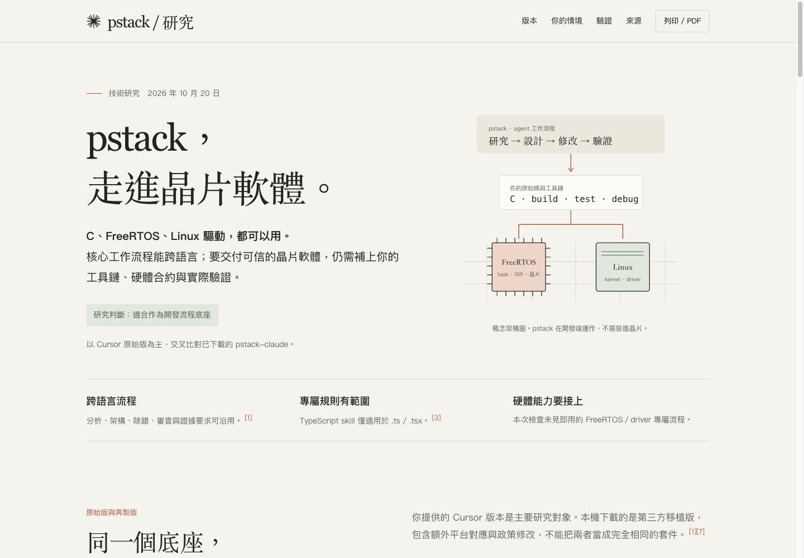

## TL;DR

- pstack 的核心是 AI agent 的分析、設計、除錯、審查與驗證工作流程（workflow），可用於 C；跨語言流程仍須搭配實際工具鏈與領域規範，無法保證所有語言及硬體環境都能完整驗證。
- 本次以 Cursor 原始版為主，再比較已下載的 `pstack-claude`。原始版就有行為驗證與形式驗證（formal verification）生成 skill，並非移植版才新增。
- `typescript-best-practices` 明確限定 `.ts`／`.tsx`。C 可借用狀態與邊界設計目的，具體語法、指標生命期及同步要求仍按 C、SDK 與 kernel 規範處理。
- FreeRTOS 的 task／ISR、Linux 驅動的 MMIO／DMA 與生命週期，需要專案自己的操作與觀察介面。編譯、host 測試、模型、目標系統及板端證據要分開回報。
- 建議先挑一個既有 bug，接上現有 build／test／板端重現，再評估 pstack 的效果。本次沒有在實際 firmware 或 driver 上量測成功率或效能。

## 摘要（Summary）

這份筆記保存 2026-10-20 session 的研究。使用者以 C 開發晶片軟體，使用 FreeRTOS，也會開發 Linux 驅動，因此要判斷 pstack 是否受程式語言限制。研究先辨識本機下載的第三方移植版，再依使用者補充的 Cursor 原始 repo 核對，最後產出 Anthropic 風格、圖文並茂且可離線閱讀的 HTML。

**日期口徑：**`date` 是實際研究及報告產出日期；`ingested` 是轉入知識庫日期。此筆記保留當時固定 commit，沒有把 10 月 20 日的版本寫成 10 月 22 日的最新版本。



- [原始 HTML 報告，可下載後離線開啟](assets/2026-10-20-PSTACK-EMBEDDED/pstack-embedded-report.html)
- [完整研究正文，已將 workspace 連結轉成固定版本 GitHub 來源](assets/2026-10-20-PSTACK-EMBEDDED/pstack-language-applicability-research.md)
- [原始版 skill 清單](assets/2026-10-20-PSTACK-EMBEDDED/research-evidence/upstream-index.json)
- [2026-10-20 報告驗證紀錄](assets/2026-10-20-PSTACK-EMBEDDED/research-evidence/report-receipt.json)
- [本次轉入清單與來源雜湊值](assets/2026-10-20-PSTACK-EMBEDDED/ingest-manifest.json)

> [!important] 證據邊界
> 本次是原始檔層級適用性研究（source-level applicability research）。沒有安裝、啟用或更新 pstack，沒有修改全域設定，也沒有替使用者的 firmware、FreeRTOS 板子或 Linux driver 執行 build、形式驗證或實機驗收。HTML 的瀏覽器驗證只證明報告本身可用。

## Why：為什麼要研究？

pstack 作者的工作背景與範例包含前端及應用程式，但這不足以判定整套方法只支援 TypeScript。另一方面，skill 宣稱「任何語言」也不足以推論它已內附所有編譯器、驗證器與晶片操作方法。

研究要回答三個問題：工作流程能否轉用 C、哪些規則有特定語言限制，以及 FreeRTOS／Linux driver 的完成證據要從哪裡取得。這與 [[2026-03-31-AI-WORKFLOW-AGENTS-SKILLS-STANDARDS]] 的流程、能力及本地規範分層相通。

## What：研究了哪些版本？

| 對象 | 固定版本 | 這份研究如何使用 |
| --- | --- | --- |
| `cursor/plugins` 的 `pstack/` | `ddf824aff1e55ba14bd666b30bce3fc69962abe6` | 原始版；官方 archive 中檢查 172 個檔案及 56 個 `skills/*/SKILL.md` |
| 已下載 `michael-denyer/pstack-claude` | `49b68501b075ec1eb2755dd0d22fbf2492d67e97`，v0.9.94 | 移植版；核對平台對應、政策分支與共同 skill |
| 移植版記錄的 pstack 同步基準 | `7b353f78f6ec193bdbe48ed8059444eb09b6878e` | 由 `tools/upstream.json` 讀取；與本次原始版研究快照分開記錄 |
| FreeRTOS、Linux kernel、CBMC 官方文件 | 2026-10-20 session 查核內容 | 核對候選驗證工具及平台規則；未在使用者專案執行 |

56 是該快照的 skill 定義數，包含原則參考，沒有表示支援語言數或品質分數。兩版未做所有 scripts 的逐行等價性驗證。[原始版入口](https://github.com/cursor/plugins/tree/ddf824aff1e55ba14bd666b30bce3fc69962abe6/pstack)、[下載版 README](https://github.com/michael-denyer/pstack-claude/blob/49b68501b075ec1eb2755dd0d22fbf2492d67e97/README.md)、[同步基準](https://github.com/michael-denyer/pstack-claude/blob/49b68501b075ec1eb2755dd0d22fbf2492d67e97/tools/upstream.json)、[政策差異](https://github.com/michael-denyer/pstack-claude/blob/49b68501b075ec1eb2755dd0d22fbf2492d67e97/tools/forks.json)。

## How：流程如何接上晶片軟體？

### 概念架構（System Architecture）

```text
┌──────────────────────────────────────────────────┐
│ pstack：研究 → 設計 → 修改 → 審查 → 驗證           │
│ 在開發端引導 AI agent，不必裝進晶片               │
└──────────────────────┬───────────────────────────┘
                       ▼
┌──────────────────────────────────────────────────┐
│ 專案合約：C code、SDK、compiler、build/test 命令    │
│ 補上：ISR、ownership、MMIO、同步、errata 與證據規則 │
└─────────────┬─────────────────────┬───────────────┘
              ▼                     ▼
┌─────────────────────┐  ┌─────────────────────────┐
│ FreeRTOS firmware   │  │ Linux kernel driver     │
│ task／ISR／周邊硬體 │  │ probe/remove／IRQ／DMA  │
└─────────────┬───────┘  └────────────┬────────────┘
              └──────────┬───────────┘
                         ▼
              可重跑的結果、log 與未驗證項目
```

此圖是研究提出的適配方式，不是 pstack 已內附這些硬體整合。

### 建議的 bug 工作循環（Execution Flowchart）

```text
[讀 repo：確認目標與既有命令]
                 │
                 ▼
[在原問題的環境重現] ── 無法操作 ──► [記錄缺少的介面及未驗證項目]
                 │ 可重現
                 ▼
[依 runtime 證據縮小根因]
                 │
                 ▼
[最小修正，保留平台合約]
                 │
                 ▼
[重跑同一個重現路徑] ── 未通過 ──► [回到根因調查]
                 │ 通過
                 ▼
[交付失敗／通過證據與仍未涵蓋的條件]
```

原版 [bug-fix playbook](https://github.com/cursor/plugins/blob/ddf824aff1e55ba14bd666b30bce3fc69962abe6/pstack/skills/poteto-mode/playbooks/bug-fix.md) 要求同一操作介面（surface）重現與驗證；[TDD skill](https://github.com/cursor/plugins/blob/ddf824aff1e55ba14bd666b30bce3fc69962abe6/pstack/skills/tdd/SKILL.md) 針對成本合理的測試採失敗優先回歸，不強迫為昂貴、整合過重或不明確的測試路徑新建架構。

## 關鍵洞察（Key Insights）

### 1. 跨語言的是工作方法，驗證要靠環境

[型別紀律原則](https://github.com/cursor/plugins/blob/ddf824aff1e55ba14bd666b30bce3fc69962abe6/pstack/skills/principle-type-system-discipline/SKILL.md) 適用靜態型別語言；[TS skill](https://github.com/cursor/plugins/blob/ddf824aff1e55ba14bd666b30bce3fc69962abe6/pstack/skills/typescript-best-practices/SKILL.md) 則明確匹配 `.ts`／`.tsx`。C 可用 `struct`、`enum`、opaque handle 表達部分狀態與 API 合約，但無法直接取得 TS branded type、`never` 或 schema inference 的語言能力。

移植版使用 TypeScript、Bun、Node.js 的支援腳本，屬於開發工具本身的實作，沒有要求被修改的專案也使用它們。這可與 [[2026-07-31-DOTNET-SKILLS-POLYGLOT-UNIT-TEST-AGENT-CODE-ANALYSIS]] 比較：通用流程、語言規則與測試發現機制，必須各自驗證，不能只看 polyglot 名稱。

### 2. 原始版已有兩種驗證生成 skill

| Skill | 實際工作 | 限制 |
| --- | --- | --- |
| `create-verification-skill` | 從 repo 找 launch、drive、observe、isolate 方法，建立並實跑專案驗證 skill | 例子偏 browser／PTY／HTTP；未執行的輸出只能叫草稿；替代環境的差異須列出 |
| `create-formal-verification-skill` | 找高風險性質，依問題選模型檢查器或直接作用於 code 的 verifier，建立可重跑檢查 | 通過只涵蓋模型、探索界限（bounds）與假設（assumptions）；不內附所有語言驗證器 |

原始版 [行為驗證生成](https://github.com/cursor/plugins/blob/ddf824aff1e55ba14bd666b30bce3fc69962abe6/pstack/skills/create-verification-skill/SKILL.md) 與 [形式驗證生成](https://github.com/cursor/plugins/blob/ddf824aff1e55ba14bd666b30bce3fc69962abe6/pstack/skills/create-formal-verification-skill/SKILL.md) 都存在。後者要求模型對應 code，記錄 sync commit，並在真實 code 的破壞變體上確認檢查能失敗，避免只有綠燈的無效驗證。

TLA+ 可作為事件順序的小型設計模型；CBMC 可作為 C 記憶體安全、部分 undefined behavior 與 assertions 的候選檢查工具。兩者的性質與覆蓋範圍不同。FreeRTOS 官方 repo 的 `FreeRTOS/Test/CBMC/proofs` 提供使用先例，沒有證明使用者的 application 或 vendor port 也已驗證。[CBMC 官方](https://www.cprover.org/cbmc/)、[FreeRTOS CBMC](https://github.com/FreeRTOS/FreeRTOS#cbmc)。

### 3. 本次未見即用的領域專屬流程

原始版 `skills/`、`agents/` 以 `FreeRTOS|Zephyr|bare.metal|JTAG|OpenOCD|KUnit|kselftest|MMIO|CBMC|Frama.C` 搜尋，沒有命中對應的專屬操作說明。下載版另外檢查 skills、docs、README，搜尋 firmware、ISR、interrupt、DMA 等詞，也未找到領域專屬工作流。

這是限定快照與搜尋範圍的負向觀察。它沒有證明作者從未用 pstack 開發嵌入式軟體，也沒有證明通用 agent 無法協助相關工作。

## 三種情境的適用方式

| 情境 | 可沿用的工作 | 必須補上的專案條件 | 代表性驗證 |
| --- | --- | --- | --- |
| 可隔離 C 模組 | parser、ring buffer、狀態機、錯誤路徑分析 | compiler、資料範圍、指標與資源生命期、既有測試命令 | host 測試、靜態檢查；適合時評估 CBMC |
| FreeRTOS | queue／semaphore／notification、timeout、task／ISR 合約分析 | target port、FreeRTOSConfig、SDK、優先序、buffer ownership、build／flash／reset／log 介面 | 目標 RTOS 重現、trace／log、實機周邊與時序量測 |
| Linux 驅動 | probe/remove、資源清理、IRQ、workqueue、共享資料分析 | kernel commit、`.config`、architecture、compiler、裝置與操作介面 | KUnit、kselftest；依支援條件選 Sparse、Smatch、KASAN、KCSAN、lockdep |

FreeRTOS ISR API 與優先序規則依 port 判讀，Cortex-M 的 interrupt 數值排序不可直接套所有晶片。Linux 的 KUnit 測 kernel 內 C 元件，kselftest 多由 userspace 測可見介面；這些測試不能自動證明實體晶片的 IRQ／DMA 時序。[FreeRTOS ISR](https://github.com/FreeRTOS/FreeRTOS-Kernel-Book/blob/main/ch07.md)、[Cortex-M port](https://www.freertos.org/Documentation/02-Kernel/03-Supported-devices/04-Demos/ARM-Cortex/RTOS-Cortex-M3-M4)、[Kernel Testing Guide](https://docs.kernel.org/dev-tools/testing-overview.html)、[KUnit](https://docs.kernel.org/dev-tools/kunit/index.html)、[kselftest](https://docs.kernel.org/dev-tools/kselftest.html)。

## 驗證分層：每層回答不同問題

| 證據範圍 | 能回答什麼 | 無法單獨推論什麼 |
| --- | --- | --- |
| 交叉編譯／靜態檢查 | build、型別與工具可辨識的 defect | 執行行為、硬體可用性 |
| Host 邏輯測試 | 隔離 code 的輸入／輸出 | 真實 scheduler、ISR、DMA 與 cache 行為 |
| 模型／有界驗證 | 指定性質在模型、界限與假設內是否成立 | 模型未描述的實作或硬體條件 |
| 目標 RTOS／kernel 執行 | 已執行路徑的 context、生命週期與觀察結果 | 未跑過的錯誤路徑、實體周邊差異 |
| 實體晶片／板子 | 特定硬體、負載與測試條件的實際行為 | 所有硬體版本或未測條件的普遍保證 |

這些證據互補，不是上層通過就能取代其餘層。實際觀測介面可與 [[2026-10-03-FREERTOS-RISCV-OBSERVABILITY-RESEARCH]] 對照，但不把該舊筆記的任何 POC 結果算成本次 pstack 的實測。

## 嵌入式適配：保留平台合約

| 原則偏好 | 對 C／kernel 的採用判斷 |
| --- | --- |
| `boundary-discipline` 信任內部型別、避免重複驗證 | 型別未必保證 lifetime、範圍或異步 ownership。依故障模型保留必要檢查、assertions 與同步 |
| `minimize-reader-load` 合併單一 caller wrapper、薄 adapter | HAL、MMIO accessor、barrier 或測試替身介面可能有架構與驗證用途；不能只靠 caller 數或 LOC 決定刪除 |
| `no-comments` 積極刪註解 | 原版明列 vendor／platform／protocol、public API contract 等例外。errata、ordering、ISR 與 timing 理由應附來源保留 |
| 偏好簡短直接的 code | 不可因此移除必要同步或 ownership transfer。Linux 的 `volatile` 無法替代並行保護；firmware 的 MMIO 寫法仍按架構與 SDK 規範 |

這些是對來源原則的工程適配建議，沒有聲稱 pstack 曾對使用者程式做出上述錯誤修改。[Boundary discipline](https://github.com/cursor/plugins/blob/ddf824aff1e55ba14bd666b30bce3fc69962abe6/pstack/skills/principle-boundary-discipline/SKILL.md)、[Minimize reader load](https://github.com/cursor/plugins/blob/ddf824aff1e55ba14bd666b30bce3fc69962abe6/pstack/skills/principle-minimize-reader-load/SKILL.md)、[Comment Sicko 例外](https://github.com/cursor/plugins/blob/ddf824aff1e55ba14bd666b30bce3fc69962abe6/pstack/agents/comment-sicko.md)、[Linux Device I/O](https://docs.kernel.org/driver-api/device-io.html)、[Kernel volatile 說明](https://docs.kernel.org/process/volatile-considered-harmful.html)。

## 快速採用建議（Quick Start）

1. 在 repo 記錄 target、SDK、compiler、RTOS／kernel 版本、build 命令、記憶體限制、ISR 與同步合約。
2. 沿用現有測試及板端操作，建立可重跑入口。生成的驗證 skill 要實跑成功才列為可用。
3. 挑一個真實 bug 試跑，保留修改前失敗、修改後通過及仍未驗證項目，再決定擴大採用。

以下是本次報告的完整建議提示詞，不是已執行的專案變更，也不是安裝指令。

```text
使用 poteto-mode 分析這個 C / FreeRTOS 專案的問題。
先從 repo 確認 target architecture、toolchain、SDK、FreeRTOSConfig 與既有 build/test 命令。
區分 task 與 ISR context，檢查適用的 API、優先序、blocking 與 buffer ownership。
保留有依據的硬體 errata、MMIO、barrier、critical section 與 HAL 合約。
先重現，再提出最小修正；依現有 host、模擬器與板端 harness 驗證。
逐一回報在哪個環境執行、觀察到的結果，以及仍未驗證的硬體行為。
```

原始版依 Cursor 的操作及 `.cursor/skills/verify-<app>/` 路徑，移植版依各 runtime mapping 與生成 skill 命名操作。不要把兩版指令、路徑及自治政策混用。可與 [[2026-10-17-MATT-POCOCK-SKILLS-V13-GRILLING-COMPOSITION-AND-DELIVERY-WORKFLOW]] 比較入口、共用方法、宿主與交付驗收的分層。

## 這個 session 實際交付了什麼？

- 完整研究 Markdown，含原版／移植版、TS 專屬規則、形式驗證與硬體邊界。
- 40,282 bytes 的單檔 HTML，暖白底、襯線標題與陶土色重點；內含架構圖、情境切換、驗證分層、來源及提示詞。
- 172 個原始版檔案／56 個 skill 定義的快照清單，並固定兩個 repo commit。
- HTML 瀏覽器檢查涵蓋 320、390、768、1440 px，沒有整頁水平溢出；三個情境 tab、鍵盤方向鍵及提示詞複製可用，console／page errors 為 0。這些結果來自 10 月 20 日保存的 receipt，轉入時沒有冒稱重新跑過瀏覽器。
- HTML 原始 SHA-256 為 `6165738654f09424822226eb8c2ad735a25c9f83794605327cb03e9afab90173`。轉入時重新核對檔案雜湊值，保留原樣；完整頁面截圖主要重複正文及表格，因此只收錄首頁示意圖，其餘資訊保留為原生 Markdown。

本次沒有 pstack 對 firmware 的 A/B benchmark、成本比較或 target acceptance。沒有用 HTML 檢查結果代替嵌入式驗證。

## 我的心得（My Takeaways）

這次最實用的判斷方式是把「可移植的工作方法」「特定語言規則」「可操作的驗證環境」拆開。C 開發者不必因作者背景或工具腳本語言排除 pstack，也不應把通用驗證生成 skill 當作即用的板端工具。

優先投資能讓 agent 重跑的 build、log 與重現路徑，再把硬體不可省略的限制寫成明確合約。沒有這些條件，多模型審查一致或 skill 已載入，都不能代替實際交付證據。

## 待補充（Open Questions）

- 在使用者實際 CPU／vendor port、compiler 與 SDK 上，哪些模組能先以 host harness 隔離？搜尋關鍵字：`FreeRTOS vendor port host test hardware abstraction`。
- 現有板子能否由 agent 重跑 build、flash、reset、UART 及失敗判定？尚缺哪些權限或操作介面？搜尋關鍵字：`hardware in the loop automated firmware regression UART JTAG`。
- 哪個 C invariant 最適合先做 CBMC？其輸入、loop unwinding、外部函式與假設如何設定？搜尋關鍵字：`CBMC verification harness unwinding assertions embedded C`。
- 指定 kernel／architecture／.config 對 KUnit、KASAN、KCSAN、lockdep 的支援及執行成本如何？搜尋關鍵字：`kernel version architecture KUnit KCSAN KASAN lockdep support`。
- 原始版與移植版的政策差異，會如何影響團隊既有審查與完成門檻？搜尋關鍵字：`pstack forks.json policy runtime mapping verification gate`。
- 相較既有 agent 工作法，pstack 能否改善真實 embedded 任務的缺陷率、耗時與成本？目前缺少受控對照。搜尋關鍵字：`embedded coding agent workflow evaluation baseline cost defect rate`。

## 相關連結（Related）

- [[2026-10-03-FREERTOS-RISCV-OBSERVABILITY-RESEARCH]]：補上 task／ISR、trace 與目標量測的實際觀察介面；兩篇的驗收結果各自獨立。
- [[2026-10-17-MATT-POCOCK-SKILLS-V13-GRILLING-COMPOSITION-AND-DELIVERY-WORKFLOW]]：對照共用方法、宿主入口、授權及交付驗證如何組合。
- [[2026-03-31-AI-WORKFLOW-AGENTS-SKILLS-STANDARDS]]：對照可攜流程與專案本地規範的責任分工。
- [[2026-07-31-DOTNET-SKILLS-POLYGLOT-UNIT-TEST-AGENT-CODE-ANALYSIS]]：比較跨語言測試 agent 的語言擴充與 harness discovery，避免把名稱當成支援保證。

## 知識層次分析（Bloom's Taxonomy Analysis）

| 認知層次 | 核心目的 | 對本文的具體應用 |
| --- | --- | --- |
| 記憶 | 掌握核心名詞 | 記住原版與移植版、poteto-mode、TS 專屬 skill、行為驗證、形式驗證及 target evidence |
| 理解 | 串起責任邊界 | pstack 決定工作方法；repo 提供語言／平台合約；工具與目標環境提供具體證據 |
| 分析 | 檢查論證前提 | 「any language」是流程設計範圍；缺少 target harness、模型假設不正確或同名 skill 有政策分支時，端到端結論不成立 |
| 應用 | 落到現有工作 | 列出現有 build／flash／log 命令；選一個 queue 或 cleanup bug 建立失敗與通過證據；記錄不能刪的硬體合約 |
| 評估 | 比較採用選項 | pstack 適合需要可追溯、多階段方法的任務；既有簡單腳本在確定性回歸上較直接。先以同一 bug 比較，沒有實測前不宣稱品質或成本優勢 |

### 分析型追問（Socratic Follow-up）

- **澄清：**團隊說「支援 C」時，是指能讀寫、能 build，還是能完成實機回歸？驗收欄位如何拆開？
- **假設：**如果板端不可由 agent 操作，應如何保留完成門檻，並清楚區分本機已完成與硬體未驗證？
- **證據：**要證明 pstack 比現有方法有效，哪些相同任務、故障類型及成本數字需要先固定？
- **觀點：**若硬體工程師認為通用的刪註解與簡化規則有風險，哪些具體案例能改寫成可執行的本地規範？
- **後果：**若長期維護原版與移植版兩份設定，政策或驗證 skill 漂移會造成什麼錯誤完成宣告？

### 方案批判三問

1. **最大的風險是什麼？**把 host、模型或審查結果當作硬體驗收，可能讓 ISR／DMA／時序問題進入產品；積極簡化若刪掉必要合約，也可能引入難以重現的故障。
2. **什麼情況下會失敗？**沒有可執行的 repo 命令、無法控制 target、依 port 誤用優先序規則、模型與實作失同步，或跨 runtime 只搬 skill 名稱而沒有對應工具。
3. **有沒有更好的替代方案？**對確定、反覆執行的測試，先建一般 CI／hardware-in-the-loop 腳本，再讓 agent 調用，常比整套自治流程更容易維護。複雜調查與設計工作再評估 pstack 的價值。

## 六頂思考帽回饋（Six Thinking Hats Feedback）

### 藍帽：問題與範圍

決策是要不要把 pstack 當作 C／FreeRTOS／Linux 驅動的流程底座。本篇只回答來源可證的適用性，並列出採用前需要接上的能力。

### 白帽：事實與未知資訊

已知是固定 commit 的 skills、TS 限定條件、兩版皆有驗證生成，以及報告產物的歷史檢查。未知是實際 target、compiler、板端介面、kernel config 與採用成效。

### 紅帽：直覺與讀者反應

「任何語言」容易讓讀者期待開箱即可完整驗證。這是閱讀感受，不能據此推論作者或工具的實際能力；以流程／語法／環境分層比較能降低混淆。

### 黃帽：價值與可保留內容

固定版本、同一操作介面重現、最小修正與模型失敗對照，都是能讓團隊重跑及審查的方法。原版與移植版的區分也方便日後追蹤政策漂移。

### 黑帽：風險與限制

本次沒有 target acceptance 或受控效益實驗。不能把未命中的關鍵字推成「完全不支援 embedded」，也不能把一般應用層簡化原則直接套到 MMIO／DMA。

### 綠帽：替代方案與新應用

可先做小型的專案驗證入口，讓既有 CI／板端測試負責確定性結果，再由 pstack 分析失敗與提出修正。高風險 C 模組另以 CBMC，並行設計另以模型探索，避免強迫單一方法覆蓋全部。

### 藍帽：修改項目與下一步

- 已把日期、固定 SHA 與歷史 HTML 檢查口徑放在前面，避免版本或驗證範圍混淆。
- 已把原版能力、移植版政策與本文工程建議分開呈現，並保留來源附件。
- 下一步需在使用者選定的實際專案試跑一個 bug；條件與效益問題保留在 Open Questions。

## References

- [原始 Cursor pstack 固定快照](https://github.com/cursor/plugins/tree/ddf824aff1e55ba14bd666b30bce3fc69962abe6/pstack)
- [pstack-claude 固定快照](https://github.com/michael-denyer/pstack-claude/tree/49b68501b075ec1eb2755dd0d22fbf2492d67e97)
- [CBMC](https://www.cprover.org/cbmc/)
- [FreeRTOS CBMC](https://github.com/FreeRTOS/FreeRTOS#cbmc)
- [Linux Kernel Testing Guide](https://docs.kernel.org/dev-tools/testing-overview.html)
- [本 session 完整研究及各 claim 的來源連結](assets/2026-10-20-PSTACK-EMBEDDED/pstack-language-applicability-research.md)
